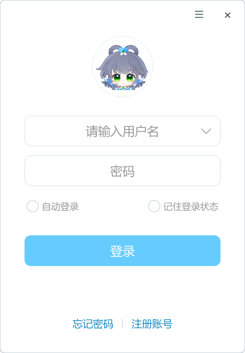
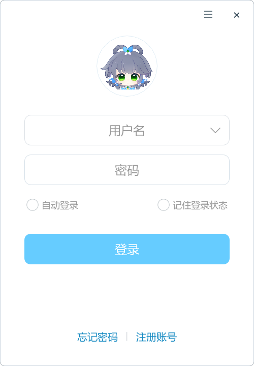

# R01：从 C 图书管理作业出发，读懂并小改 Godot 客户端

这是一份可以边读边操作的第一课。只要求你认识变量、`if`、循环、数组和普通函数；其他知识出现时再补。准备 VS Code，最后三个练习才需要运行 Godot。

核对日期：2026-10-02；源码基准：`2ea9870`。后续代码变化时，以函数名定位，不死记行号。前后关系见[总阅读路线](场景与控件说明.md#route-01)，本课结束后进入 [R02](R02-账号登录详解.md)、[R03](R03-登录后生命周期详解.md)。

**这次只推演一种确定情形：** 正常图形模式、依赖齐全、全新的学习用户目录，没有窗口配置和账号记录，没有 `--preview`、没有 `--capture`。一直走到登录表单等待输入，不进行真实登录。

目标有三项：知道程序如何走到登录页；遇到一个调用能找到实现并回到调用处；能够修改一处文案、一个默认尺寸和一小段判断，再检查及恢复。

## 怎样使用这份长讲义

不要求一次读完。每一课按“位置 → 新知识 → 逐句推演 → 进入/返回 → 快照 → 预测题”推进。答题后再展开答案；不会时回看指定位置。

- **源码摘录**来自项目；折叠的完整函数用于复习。
- **教学拆开版、C 类比**帮助理解，不能原样贴回项目。
- **真正执行**的项目函数继续展开；**只是连接**的未来按钮回调不在此时执行。
- 到 `FileAccess`、`ConfigFile`、`Window` 等 Godot 内置接口时解释参数、结果和效果，不追到引擎 C++ 内部。
- 首次遇到的调用深入一次；再次遇到就回到原课复习。字段初始值也会执行，但没有自定义构造函数的简单对象不凭空增加一个函数调用。

### 路线与休息点

| 顺序 | 小课 | 学完时你的位置 |
|---|---|---|
| 1 | [0—3：从 main 到场景、对象和 GDScript](#lesson-00) | 能读懂最小场景与脚本声明 |
| 2 | [4—6：自动调用、信号、静态子节点准备](#lesson-04) | 即将进入 Application._ready |
| 3 | [7—9：标题、窗口位置与初始尺寸](#lesson-07) | 第一次恢复登录窗口完成 |
| 4 | [10—12：配置、风格、日志](#lesson-10) | 首条启动日志已保存 |
| 5 | [13—14：日志窗口与协调器](#lesson-13) | 已具备反馈/退出入口，尚未创建账号服务 |
| 6 | [15—17：装配账号与聊天协作对象](#lesson-15) | 对象已创建，账号尚未启动 |
| 7 | [18—20：给表单会话、等一帧、尝试恢复](#lesson-18) | 空白登录表单等待你输入 |
| 8 | [21：回放整个过程](#lesson-21) | 能自己口述调用链 |
| 9 | [22—25：隔离环境和三个修改练习](#lesson-22) | 能观察效果并只撤销自己的修改 |

<a id="lesson-00"></a>
## 第 0 课：C 的 main 去哪里了

**当前位置。** 暂时不打开复杂脚本。先回想自己的图书管理程序：

```c
/* 教学示意，不是本项目代码 */
int main(void) {
    load_books();
    show_menu();
    while (1) {
        int choice = read_choice();
        if (choice == 1) add_book();
        if (choice == 0) break;
    }
    save_books();
    return 0;
}
```

**先补知识。** 上面菜单循环在你自己写的 main 中。图形程序同样需要持续接收输入、刷新画面，但 Godot 已经提供了这样的运行框架，我们称它为“引擎”。项目脚本把自己的一些函数交给引擎，在特定时刻由引擎调用。

**逐句推演。** 不必在本项目中寻找自己写的 `int main()`。先找“引擎启动哪个项目、载入哪个场景”；随后找引擎自动调用的 `_ready()`。函数名开头的下划线本身没有魔法，只有引擎规定的名称才是特殊入口。

**进入与返回。** 这里的 main 只是类比。真正的下一步是读 `project.godot`，不是执行上面的 C 代码。

**快照。** 此刻我们还没有创建任何客户端业务对象，只建立了一个认识：引擎拥有外层循环，项目提供配置和回调。

**先预测：** Godot 调完 `_ready()` 后，程序就像 main 执行 return 一样退出吗？

<details><summary>答案与回看位置</summary>

不会。`_ready()` 是初始化回调，结束后引擎仍处理画面、输入与事件。若不理解，回看本课 C 菜单循环的作用；Godot 的循环不是写在你的 `_ready()` 里。

</details>

<a id="lesson-01"></a>
## 第 1 课：先用两个配置项找到真实起点

**当前位置。** VS Code 按 `Ctrl+P`，打开 [client-godot/project.godot](../client-godot/project.godot)，搜索 `run/main_scene`。

```ini
run/main_scene="res://scenes/main.tscn"
config/custom_user_dir_name="AgentLuo-Godot"
```

**先补知识。** 这是配置，不是 C 或 GDScript。左边是选项名，右边是值。`res://` 表示 `project.godot` 所在目录，即 `client-godot`；`user://` 表示程序运行时自己的可写数据目录。

**逐句推演。** 第一项告诉引擎默认加载 `scenes/main.tscn`。第二项参与确定运行数据目录名称；它不把用户名或密码写在源码里。当前窗口初始值也写在配置里，但后面脚本会重新应用尺寸，所以“配置中有值”不代表它最后不会改变。

扩展名先只记住这四种：`.gd` 是脚本；`.tscn` 描述场景节点；`.tres` 描述资源；`.json` 是用键和值组织的数据。项目版本 0.1.5 与引擎版本 4.7.1 是两套编号。

**进入与返回。** 从 `run/main_scene` 进入 [main.tscn](../client-godot/scenes/main.tscn)。读完下一课回来，你应能反向指出这个场景是被哪项配置选中的。

**快照。** `res://scenes/main.tscn` 对应磁盘上的 `client-godot/scenes/main.tscn`；账号资料尚未读取。

**先预测：** 把 `.gd` 当作场景树文件寻找按钮节点，会找到 `[node ...]` 声明吗？

<details><summary>答案与回看位置</summary>

通常不会；节点声明在 `.tscn`，行为在 `.gd`。回看本课四种扩展名。一个文件可以引用另一个文件，这正是接下来要练的跳转。

</details>

<a id="lesson-02"></a>
## 第 2 课：一本书、一种书的结构、一个运行中的对象

**当前位置。** 先看下面的小例子，再回到 main 的根节点。

```c
/* 教学示意：结构体把一条记录的多个字段放在一起 */
struct Book {
    int id;
    int borrowed;
};
struct Book first = {1, 0};
struct Book second = {2, 0};
```

**先补知识。** `struct Book` 描述数据长什么样，first/second 是按它建立的两条具体记录。对象也有“类型”和“具体实例”的区别，并且类型通常还提供操作这些数据的方法。这里用结构体搭桥，不意味着 Godot 对象只是一块 C 结构体内存。

**逐句推演。** main 的 `AgentLuo` 是一个实际节点实例，类型为 `Control`。节点是能加入 Godot 树结构的对象；Control 是用来建立 UI 区域的一类节点。根 Control 所在的系统窗口由 `get_window()` 取得，根 Control 本身不是操作系统窗口。

节点的“父子关系”可以先理解为目录关系：父节点下挂若干子节点。两个节点同名不等于它们是同一个对象；同一个对象被两个变量引用，也不会自动变成两个对象。

**引用再补一步。** 在 C 中，`struct Book copy = first` 通常复制结构体值。Godot 中把一个 Node 变量赋给另一个变量，通常是让两个变量指向同一个对象。画成 `变量A → 一个节点 ← 变量B`；不是在界面上复制两份。以后若学 C 指针，可以用“保存指向对象的位置”帮助理解，但 GDScript 不允许你把这个引用随便做地址运算。

**进入与返回。** 搜索 main 的 `name="AgentLuo"`，找到 script 属性；暂时不进入脚本，先沿子节点阅读：

```text
AgentLuo
├─ Background
├─ Workspace
│  ├─ Navigation/Items/导航按钮
│  └─ Split
├─ Center/AccountForm
├─ LogProblem
├─ ExitDialog
├─ SecurityError
├─ AccountStorageWarning
└─ Chrome
```

`parent="."` 是根的直接子节点，`parent="Workspace"` 是 Workspace 的子节点。Center 与 Workspace 是兄弟，不是 Split 的孩子。Chrome 是隐藏适配节点，不是浏览器。空的 Split 以后才放角色和聊天视图。

**快照。** AccountForm 已由子场景描述；AvatarPanel/ChatView 还没有运行实例。详细控件用途可查[场景说明](场景与控件说明.md)，此处先掌握位置关系。

**先预测：** `_split = %Split` 会不会再创建一个 Split？

<details><summary>答案与回看位置</summary>

不会，是取得已有节点的引用；创建需要另一类操作。若把引用当成复制，回看本课的两箭头示意。

</details>

<a id="lesson-03"></a>
## 第 3 课：把第一段 GDScript 拆到能读为止

**当前位置。** 打开 [application.gd](../client-godot/src/application.gd)，只读声明区与 `setup()`。

```gdscript
extends Control
const Services = preload("res://src/composition/application_services.gd")
@onready var _split: HSplitContainer = %Split
```

**先补知识。**

| 写法 | 从 C 基础怎样理解 |
|---|---|
| `var count: int = 0` | 声明变量并给初值；类型写在变量名后 |
| `var count := 0` | 根据初值推断类型，不是 C 的复合运算符 |
| `const` | 这个名字的绑定不再重新赋值；不等于被引用对象的所有内容都只读 |
| `func f(x: int) -> void:` | 定义函数；x 是参数，void 表示没有普通返回值 |
| 缩进 | 表示代码块，承担 C 中大括号的一部分作用 |
| `null` | 没有对象引用；使用前可能需要判断 |
| `if 条件:` / `for item in items:` | 用冒号与缩进写判断/遍历；遍历数组时item依次取得元素，遍历字典时取得键 |
| `bool`、`true/false`、`Error`、`OK` | 布尔类型与真假值；Error是返回错误码的类型，OK表示这个调用成功 |
| `extends Control` | 这个脚本扩展已有 Control 类型，能使用其属性和方法 |
| `self` | 当前脚本所属的这个对象 |
| `@onready` | 把该变量的初始化推迟到节点准备阶段 |
| `%Split` | 按场景唯一名找节点，不是取余运算 |
| 名字前 `_` | 常见的内部实现命名约定；不是所有这种函数都自动执行 |

**逐句推演。** `preload` 先取得脚本资源。`Services` 此刻可以用来创建对象，但它自己不是已经装配好的服务实例。

遇到较长一行时这样拆：

```gdscript
# 教学拆开版，不要替换原项目
var settings_script = preload("res://src/storage/godot_settings_store.gd")
var settings_object = settings_script.new(layout_path)
settings = settings_object
```

第一行找到类型描述；第二行创建对象并把 layout_path 传给其构造函数 `_init()`；第三行保存引用。`.` 访问对象/资源提供的成员；`()` 表示现在调用。只写 `chat.clear_cache` 则是取得方法，尚未调用。

`.tscn` 经 preload 得到 PackedScene——一份节点树模板；`instantiate()` 根据模板造出节点树，`add_child()` 再挂到父节点。不要把 new、instantiate、add_child 混成“加载”一个词。

**进入与返回。** Application 的 `setup()` 只保存外部传入的 session、布局路径和外链服务。直接按项目入口启动没有外部人先调用它，使用字段默认值；测试可以先 instantiate，再 setup，再 add_child。setup 不是引擎规定的回调。

**快照。** `_session=null`、`_avatar=null`、`_chat_view=null`，`_expanded=false`，`_layout_ready=false`，`_ratio=1.0/3.0`。

**先预测：** `Services.new(...)` 与 `Services.mount(...)` 是同一类操作吗？

<details><summary>答案与回看位置</summary>

不是。前者创建一个 Services 对象并执行 `_init`；mount 是这个对象上的普通方法，要在对象准备后调用。回看教学拆开版；本项目实际写 `_services.mount(...)`。

</details>


<details>
<summary>本课完整函数复习：先完成推演，再对照源码</summary>

[src/application.gd](../client-godot/src/application.gd) · `setup()`

<!-- r01-source src/application.gd#setup -->
```gdscript
func setup(account_session: Node = null, layout_path: String = "user://window_layout.cfg", external_links: RefCounted = null) -> void:
	_session = account_session
	_layout_path = layout_path
	_external_links = external_links
```

</details>

<a id="lesson-04"></a>
## 第 4 课：资源怎样选中具体实现，函数何时自动执行

**当前位置。** main 顶部的 `ext_resource` 与 Application 的 `@export` 字段；接着看 [window_chrome.gd](../client-godot/src/ui/window_chrome.gd)。

**先补知识。** Resource 是可配置、可引用的数据/能力对象，通常不作为节点进入场景树；RefCounted 是按引用管理生存期的普通对象基类：常规强引用会保持对象存活，没有引用后可自动释放；Node的树内生存期另由场景树和释放操作管理，不能照搬C的malloc/free写法。Node 能在树中接收引擎回调。这三者不是三种可见控件。

**逐句推演。** `.tscn` 中 `ExtResource("某ID")` 是到文件顶部查相同 ID，找到外部文件；`SubResource` 则引用本文件中定义的资源。`@export` 使脚本字段可由场景赋值，最终使用场景提供的具体资源。

走一次路径：`main.runtime → resources/platform/runtime.tres → godot_runtime_environment.gd`。该脚本的 `arguments()` 返回 Godot 内置 `OS.get_cmdline_user_args()`；`is_headless()` 比较显示驱动名称。它只是薄薄的适配层，不是另一个引擎。

| 主场景字段 | 实现选择 | 启动时首先用来做什么 |
|---|---|---|
| runtime | [runtime.tres](../client-godot/resources/platform/runtime.tres) | 读启动参数、日志环境、是否有图形显示 |
| window_system | [windows.tres](../client-godot/resources/platform/windows.tres) | 以后查询窗口状态 |
| password_encryption | [encryption.tres](../client-godot/resources/platform/encryption.tres) | 检查 WindowsSecurity 是否可用 |
| secret_protection | [secrets.tres](../client-godot/resources/platform/secrets.tres) | 传给凭据存储；此刻没有令牌待保护 |
| decoder_factory | [decoder.tres](../client-godot/resources/platform/decoder.tres) | 传给媒体；此刻没有音频待解码 |

**进入与返回。** 节点创建时执行字段初值和自定义 `_init`，场景的属性赋值在准备进树之前完成。进入树会调用 `_enter_tree`；子节点准备完成后父节点才收到 `_ready`。只依赖“子先 ready、父后 ready”这一关系，不用背无关兄弟节点的先后。

Chrome 的 `_enter_tree → host.attach → _apply_presentation` 是实调用：记住窗口引用与 login_mode；登录模式设置无边框、不可调整大小、透明背景；开启嵌入子窗口，登记关闭时保存几何，再记下当前位置和尺寸。默认字段值建立的是状态，`attach` 才把宿主接到真实窗口。

**快照。** Chrome 已绑定窗口；其 `_store` 尚未在 Application 中 configure，所以还不能写指定布局。主 Application._ready 尚未开始。预载场景还可能连带加载其中引用的.tres，触发如GodotSettingsStore._init这样的资源构造；它只保存资源路径，不等于AvatarPanel已经instantiate。

**先预测：** `@export var runtime = 默认实现` 写在脚本顶部，是否保证永远用默认实现？

<details><summary>答案与回看位置</summary>

不是；场景可以覆盖导出字段。回看本课 ExtResource 路径，判断实际对象必须把脚本与场景放在一起读。

</details>


<details>
<summary>本课完整函数复习：先完成推演，再对照源码</summary>

[src/ui/window_chrome.gd](../client-godot/src/ui/window_chrome.gd) · `_enter_tree()`

<!-- r01-source src/ui/window_chrome.gd#_enter_tree -->
```gdscript
func _enter_tree() -> void:
	host.attach(get_window(),login_mode)
```

[src/platform/desktop_window_host.gd](../client-godot/src/platform/desktop_window_host.gd) · `attach()`

<!-- r01-source src/platform/desktop_window_host.gd#attach -->
```gdscript
func attach(window: Window, login: bool) -> void:
	_window = window
	login_mode = login
	_apply_presentation()
	_window.gui_embed_subwindows = true
	_window.close_requested.connect(save)
	_normal = Rect2i(_window.position,_window.size)
```

</details>

<a id="lesson-05"></a>
## 第 5 课：信号、回调和闭包——登记不等于执行

**当前位置。** [AccountView._ready](../client-godot/src/ui/account_view.gd) 中的 `pressed.connect(...)`。

**先补知识。** 你以前可能在菜单循环里写 `if choice == 1: add_book()`。图形程序里，按钮按下会发出一个“信号”；connect 登记收到这个信号时调用哪个函数。这个将来被调用的函数就是回调。

```gdscript
%MenuButton.pressed.connect(_open_menu)
%CloseLogin.pressed.connect(func(): exit_requested.emit())
```

**逐句推演。** 第一行传入已有方法 `_open_menu`，没有括号，不在这里打开菜单。第二行 `func(): ...` 定义没有名字的小函数；用户点击时才执行函数体，转发 exit_requested。`emit()` 表示发出信号。

小函数可以使用外层已经存在的变量，这叫捕获外部环境；带有这种环境的可调用对象常称闭包。初次只记住“保存将来需要执行的动作及其可访问对象”，不把它想成另开一个线程。

`Callable` 是可调用对象的类型；`Callable()` 可以表示空动作，`is_valid()` 检查是否可用，`.call()` 才执行。传递 `func(): controller.start(...)` 不会立即联网。

**进入与返回。** AccountView 创建两个 [PopupTrigger](../client-godot/src/ui/popup_trigger.gd)。其 `_init` 保存弹层，连接 popup_hide 和 button_down。这里只连接，`should_open/_on_hidden` 的实际点击处理留到使用菜单时。返回 AccountView._ready，继续登记日志、反馈、拖动等回调。

**快照。** 按钮存在，事件连接存在，但没有人点击，网络请求数仍为零。

**先预测：** 把 `connect(_open_menu)` 改为 `connect(_open_menu())`，还是同一含义吗？

<details><summary>答案与回看位置</summary>

不是。加括号会尝试现在调用方法，再把返回值交给 connect；这里需要的是将来执行的方法引用。回看本课第一行，不实际修改这段代码。

</details>


<details>
<summary>本课完整函数复习：先完成推演，再对照源码</summary>

[src/ui/popup_trigger.gd](../client-godot/src/ui/popup_trigger.gd) · `_init()`

<!-- r01-source src/ui/popup_trigger.gd#_init -->
```gdscript
func _init(trigger: BaseButton, popup: Popup) -> void:
	_popup = popup
	_popup.popup_hide.connect(_on_hidden)
	trigger.button_down.connect(func(): _dismissed_on_press = _popup.visible or _just_dismissed)
```

</details>

<a id="lesson-06"></a>
## 第 6 课：父节点还没 ready，子节点已经做了什么

**当前位置。** [account_view.gd](../client-godot/src/ui/account_view.gd) 的 `_ready` 和 [decision_dialog.gd](../client-godot/src/ui/decision_dialog.gd) 的 `_ready/_display`。

**先补知识。** 隐藏节点仍然可以存在于树里并初始化；visible=false 不等于“不执行代码”。`return` 结束当前函数，不会自动退出整个应用。

**逐句推演。**

1. AccountView._ready 建立上课的事件连接，把 Submit、Remember、AutoLogin、注册/重置、服务器、历史入口先禁用。
2. 它检查 `_session != null`；此时没有注入会话，所以不执行 `_initialize()`。
3. 主 ExitDialog 和 AccountForm 内的 RemoveAccountDialog 都会执行 DecisionDialog._ready：连接确认/取消/关闭/可选保存按钮，连接 visibility_changed，然后主动 `_display()`。
4. `_display()` 把导出的标题、正文、按钮文字写入控件；默认隐藏时不弹窗。只有 visible 时才安排取消按钮取得焦点。
5. 两个实例复用同一个脚本，却各自持有不同标题与正文。方法复用不是状态共享。

**进入与返回。** 读完 `_display`，回到调用它的 `_ready`；子树准备结束后才进入根 Application._ready。不要跳去执行已连接的 `_cancel` 或 `_send`。

**快照。** 表单可见但关键按钮暂时禁用；会话为空；确认框已经初始化但隐藏；Chrome 已 attach。

**先预测：** 此时没有会话，用户为何还不能提交用户名？

<details><summary>答案与回看位置</summary>

AccountView 主动禁用了提交入口，等 Application 创建并 setup 会话后才启用。回看本课前两步；这不是网络正在忙，而是组件尚未接好依赖。

</details>


<details>
<summary>本课完整函数复习：先完成推演，再对照源码</summary>

[src/ui/account_view.gd](../client-godot/src/ui/account_view.gd) · `_ready()`

<!-- r01-source src/ui/account_view.gd#_ready -->
```gdscript
func _ready() -> void:
	_menu_trigger = preload("res://src/ui/popup_trigger.gd").new(%MenuButton,%MenuPopup)
	_history_trigger = preload("res://src/ui/popup_trigger.gd").new(%HistoryButton,%HistoryPopup)
	%CloseLogin.pressed.connect(func(): exit_requested.emit())
	%DragArea.gui_input.connect(_drag_window)
	%MenuButton.pressed.connect(_open_menu)
	%MenuPopup.visibility_changed.connect(func(): %MenuButton.set_pressed_no_signal(%MenuPopup.visible))
	%Logs.pressed.connect(func(): %MenuPopup.hide(); log_requested.emit())
	%Feedback.pressed.connect(func(): %MenuPopup.hide(); feedback_requested.emit())
	for button in [%Submit,%Remember,%AutoLogin,%RegisterLink,%ResetLink,%SetServer,%HistoryButton]: button.disabled = true
	if _session != null: _initialize()
```

[src/ui/decision_dialog.gd](../client-godot/src/ui/decision_dialog.gd) · `_ready()`

<!-- r01-source src/ui/decision_dialog.gd#_ready -->
```gdscript
func _ready() -> void:
	%Confirm.pressed.connect(func(): hide(); confirmed.emit())
	%Cancel.pressed.connect(_cancel)
	%CloseDecision.pressed.connect(_cancel)
	%SaveAndClose.pressed.connect(func(): hide(); custom_action.emit("save"))
	close_requested.connect(_cancel)
	visibility_changed.connect(_display)
	_display()
```

[src/ui/decision_dialog.gd](../client-godot/src/ui/decision_dialog.gd) · `_display()`

<!-- r01-source src/ui/decision_dialog.gd#_display -->
```gdscript
func _display() -> void:
	%Message.text = dialog_text
	%DecisionTitle.text = title
	%Confirm.text = ok_button_text
	%Cancel.text = cancel_button_text
	%SaveAndClose.visible = show_save
	if visible: %Cancel.grab_focus.call_deferred()
```

</details>

<a id="lesson-07"></a>
## 第 7 课：终于进入 Application._ready——先设置标题

**当前位置。** [application.gd](../client-godot/src/application.gd)，搜索 `func _ready()`，只读第一条赋值。

```gdscript
get_window().title = preload("res://src/storage/release_info.gd").title()
```

**先补知识。** 赋值时先算右边，再写到左边指定对象的属性。静态函数 `static func` 可以直接通过脚本资源调用，不要求先 `.new()`。

**逐句推演。** 右边取得 ReleaseInfo 脚本并调用 title；左边 get_window 返回所在窗口，将结果写入其 title。它不是修改某个 Label。

**进入与返回。** 路径为 `Application._ready → ReleaseInfo.title → get_info → FileAccess/JSON → title → _ready 下一句`。

打开 [release_info.gd](../client-godot/src/storage/release_info.gd)：get_info 用内置 FileAccess 读 `res://release.json` 全文，再用 JSON.parse_string 转成数据。Dictionary 可以理解为“用名字而非数组下标找值”的容器：`info.product` 取 product 对应值。

`"%s %s" % [info.product, info.version]` 用两个值填入字符串模板；类似 C 的格式化输出思想，但这里返回字符串，而不是直接向终端输出。正常资源得到 `agentluo 0.1.5`。这段没有为损坏 JSON 编写兜底，教材假设资源齐全，不能编造“坏文件会自动用默认标题”。

**快照。** 窗口标题已设置；账号、聊天服务仍未创建。

**先预测：** 标题变了，是不是证明已经登录？

<details><summary>答案与回看位置</summary>

不是，这是账号装配前的显示元数据。回看本课调用链，没有认证调用。

</details>


<details>
<summary>本课完整函数复习：先完成推演，再对照源码</summary>

[src/storage/release_info.gd](../client-godot/src/storage/release_info.gd) · `get_info()`

<!-- r01-source src/storage/release_info.gd#get_info -->
```gdscript
static func get_info() -> Dictionary:
	return JSON.parse_string(FileAccess.get_file_as_string("res://release.json"))
```

[src/storage/release_info.gd](../client-godot/src/storage/release_info.gd) · `title()`

<!-- r01-source src/storage/release_info.gd#title -->
```gdscript
static func title() -> String:
	var info := get_info()
	return "%s %s" % [info.product, info.version]
```

</details>

<a id="lesson-08"></a>
## 第 8 课：深入窗口位置恢复，再返回主函数

**当前位置。** Application 紧接着的 `_geometry = Services.create_geometry(_layout_path)` 与 `_chrome.configure(_geometry,"login")`。

**先补知识。** Vector2i 是两个整数，如宽/高；Rect2i 是位置加尺寸，表示一个矩形。`Variant` 表示取到的值可能有不同类型，磁盘数据需要检查。`.get_value(section,key,fallback)` 的第三项是在找不到配置时使用的值。`Array[Rect2i]` 表示元素是矩形的数组；`for screen in screens` 按顺序取得数组中的每个元素，类似C的下标循环但省去手动维护下标。

**逐句推演与进入调用。**

1. `create_geometry` 对 `user://window_layout.cfg` 取目录并拼接 `window-geometry.cfg`，调用 [WindowGeometry._init](../client-godot/src/storage/window_geometry.gd) 保存路径。两个文件名不同：一个存一般设置，一个存窗口几何。
2. Chrome.configure 转发到 [DesktopWindowHost.configure](../client-godot/src/platform/desktop_window_host.gd)，保存 `_store` 和 `_key="login"`，再 `_restore`。
3. `_restore` 通过 Godot 的 DisplayServer 收集屏幕可用矩形；用当前窗口位置与默认尺寸构造 fallback。`(当前尺寸-目标尺寸)/2` 用于尽量保持窗口中心。
4. 进入 WindowGeometry.read_layout。ConfigFile.new 创建配置读取器，load 尝试读文件；这里没有因文件不存在而退出。get_value 找不到 `login/rect` 就使用 fallback。
5. 验证 Rect2i 和正尺寸，先限制不小于 minimum。遍历屏幕，选择与窗口交集较大的屏幕，再把尺寸与位置限制在可用区域。`clampi(x,a,b)` 将整数 x 限制在 a—b 之间。
6. 读取 maximized，缺失或类型不对用 false，返回 `{"rect":...,"maximized":false}`。
7. 回到 `_restore`：登录模式还会强制使用不超过屏幕可用范围的 default_size，并把 minimum 也设成这个 extent，所以本路径登录窗口固定尺寸。
8. 写入实际 Window 的 mode/min_size/size/position，更新 `_normal/_maximized/_last`，登记延后运行的 `_clamp_visible_frame`。

**返回位置。** `read_layout → _restore → configure → Chrome.configure → Application._ready 的 preview 判断`。这里只是读到了布局，文件的首次写入在下一课。

**快照。** `_geometry.path="user://window-geometry.cfg"`；host 有 store/key；使用 fallback 得到可见位置；尚没有账号数据。

**先预测：** 配置文件不存在，read_layout 会把“空字符串”赋给窗口尺寸吗？

<details><summary>答案与回看位置</summary>

不会，get_value 的 fallback 和类型检查提供 Rect2i。回看本课第4—6步。这里忽略 load 错误的写法只适用于这个实现，不是说所有文件读取都应该忽略错误。

</details>


<details>
<summary>本课完整函数复习：先完成推演，再对照源码</summary>

[src/storage/window_geometry.gd](../client-godot/src/storage/window_geometry.gd) · `read_layout()`

<!-- r01-source src/storage/window_geometry.gd#read_layout -->
```gdscript
func read_layout(key: String, fallback: Rect2i, minimum: Vector2i, screens: Array[Rect2i]) -> Dictionary:
	var config := ConfigFile.new()
	config.load(path)
	var saved: Variant = config.get_value(key,"rect",fallback)
	var rect: Rect2i = saved if saved is Rect2i and saved.size.x > 0 and saved.size.y > 0 else fallback
	rect.size = rect.size.max(minimum)
	if not screens.is_empty():
		var usable := screens[0]
		var overlap := 0
		for screen in screens:
			var area := rect.intersection(screen).get_area()
			if area > overlap:
				overlap = area
				usable = screen
		rect.size = rect.size.min(usable.size)
		rect.position.x = clampi(rect.position.x,usable.position.x,usable.end.x-rect.size.x)
		rect.position.y = clampi(rect.position.y,usable.position.y,usable.end.y-rect.size.y)
	var maximized: Variant = config.get_value(key,"maximized",false)
	return {"rect":rect,"maximized":maximized if maximized is bool else false}
```

[src/platform/desktop_window_host.gd](../client-godot/src/platform/desktop_window_host.gd) · `_restore()`

<!-- r01-source src/platform/desktop_window_host.gd#_restore -->
```gdscript
func _restore(default_size: Vector2i, minimum: Vector2i) -> void:
	var screens: Array[Rect2i] = []
	if DisplayServer.get_name() != "headless":
		for index in DisplayServer.get_screen_count():
			screens.append(DisplayServer.screen_get_usable_rect(index))
	var fallback := Rect2i(_window.position + (_window.size-default_size)/2,default_size)
	var state: Dictionary = _store.read_layout(_key,fallback,minimum,screens) if _store != null else {"rect":fallback,"maximized":false}
	if login_mode:
		var extent := default_size
		if not screens.is_empty():
			var screen := screens[clampi(_window.current_screen,0,screens.size()-1)]
			extent = Vector2i(mini(extent.x,screen.size.x),mini(extent.y,screen.size.y))
		state.rect.size = extent
		state.maximized = false
		minimum = extent
	_window.mode = Window.MODE_WINDOWED
	_window.min_size = minimum
	_window.size = state.rect.size
	_window.position = state.rect.position
	_normal = state.rect
	_maximized = state.maximized
	if _maximized: _window.mode = Window.MODE_MAXIMIZED
	_last = {"rect":_normal,"maximized":_maximized}
	_clamp_visible_frame.call_deferred()
```

</details>

<a id="lesson-09"></a>
## 第 9 课：应用登录尺寸，为什么这里还可能写文件

**当前位置。** Application 的 preview 分支之后：

```gdscript
_resize_window(Vector2i(480, 690), Vector2i(360, 480))
```

**先补知识。** `or` 是逻辑或，`not` 是取反；`"expanded" if 条件 else "login"` 类似 C 的 `条件 ? "expanded" : "login"`，但顺序不同。`.call_deferred()` 是把方法安排到引擎稍后的安全时机，不是在这一行递归执行。

**逐句推演与进入调用。**

1. `runtime.arguments()` → GodotRuntimeEnvironment.arguments → OS 用户参数。无 preview，跳过整段 instantiate(ChatPreview) 和 return。
2. `_resize_window` 中 `_expanded=false` 且无preview，所以 expanded=false；Chrome.set_login_mode(true)，Background 隐藏。
3. host.set_login_mode 发现仍是登录模式，不走“模式改变前保存”分支，但仍执行 `_apply_presentation`，保持登录窗口属性。
4. Chrome.select_layout → host.select_layout。`_saved_before_presentation=false`，先调用 save，随后再恢复指定布局。
5. save 用 `_expanded_mode()` 判断是否最大化等，窗口可见且普通模式时更新 `_normal`；调用 WindowGeometry.write_layout。
6. write_layout 检查 key 和尺寸，创建 ConfigFile，设置 rect/maximized，创建父目录并保存。首次的几何文件由此出现。
7. 回到 select_layout，把 `_key` 设为 login，再 `_restore(480×690,360×480)`；内部路径已经在上一课展开。登录模式最终以目标尺寸为准，并受屏幕可用大小限制。
8. 延后运行的 `_clamp_visible_frame` 会忽略 headless、无效/隐藏/嵌入窗口等不适用情形；对真实普通窗口，读取带装饰的外框，计算屏幕内位置差，修正位置并记录 `_normal`。

**返回位置。** `write_layout → save → select_layout → Chrome.select_layout → _resize_window → Application 创建 ImagePresenter 那一行`。

**快照。** 正常足够大的屏幕上，登录窗口为480×690；窗口几何文件已可能创建；`window_layout.cfg` 和 `account.cfg` 仍不存在。

**先预测：** 把项目配置文件里的窗口宽度改为500，能保证启动最后宽度为500吗？

<details><summary>答案与回看位置</summary>

不能，这里又明确调用480×690。回看本课第一行和第7步。练习会修改实际最后生效的启动调用，并检查是否有其他分支再次覆盖它。

</details>


<details>
<summary>本课完整函数复习：先完成推演，再对照源码</summary>

[src/application.gd](../client-godot/src/application.gd) · `_resize_window()`

<!-- r01-source src/application.gd#_resize_window -->
```gdscript
func _resize_window(target: Vector2i, minimum: Vector2i) -> void:
	var expanded: bool = _expanded or "--preview" in runtime.arguments()
	_chrome.set_login_mode(not expanded)
	%Background.visible = expanded
	_chrome.select_layout("expanded" if expanded else "login",target,minimum)
```

[src/platform/desktop_window_host.gd](../client-godot/src/platform/desktop_window_host.gd) · `select_layout()`

<!-- r01-source src/platform/desktop_window_host.gd#select_layout -->
```gdscript
func select_layout(key: String, default_size: Vector2i, minimum: Vector2i) -> void:
	if not _saved_before_presentation: save()
	_saved_before_presentation = false
	_key = key
	_restore(default_size,minimum)
```

[src/storage/window_geometry.gd](../client-godot/src/storage/window_geometry.gd) · `write_layout()`

<!-- r01-source src/storage/window_geometry.gd#write_layout -->
```gdscript
func write_layout(key: String, rect: Rect2i, maximized: bool) -> Error:
	if key.is_empty() or rect.size.x <= 0 or rect.size.y <= 0:
		return ERR_INVALID_PARAMETER
	var config := ConfigFile.new()
	config.load(path)
	config.set_value(key,"rect",rect)
	config.set_value(key,"maximized",maximized)
	var error := DirAccess.make_dir_recursive_absolute(path.get_base_dir())
	return config.save(path) if error == OK else error
```

</details>

<a id="function-r01-01"></a>
<a id="lesson-10"></a>
## 第 10 课：创建图片协调对象、配置对象和风格对象

**当前位置。** Application 的 `_images_presenter = ...new(...)` 到 `_services = Services.new(...)`；对照 [application_services.gd](../client-godot/src/composition/application_services.gd) 的 `_init`。

**先补知识。** “协调对象/服务”不是新语法，只是开发者给某类职责起的名字。ImagePresenter 负责安排图片展示；Services 负责创建并连接对象。看它做什么，比先背这些英文名字有用。

**逐句推演与进入调用。**

1. [ImagePresenter._init](../client-godot/src/ui/image_presenter.gd) 保存 geometry 和 window_system；传入的 window_system 非null，条件表达式不会再造一个备用对象。返回后 add_child；它没有自定义 `_ready`，也还没有 ImageWindow。这里的 `_window_system` 是能力引用，窗口本身要等将来open_image才实例化。
2. Services._init 创建两个 [GodotSettingsStore](../client-godot/src/storage/godot_settings_store.gd)。其字段 `_config=ConfigFile.new()` 先建立内存配置器，`_init(path)` 只保存路径；分别为 window_layout.cfg 和 dynamics-window.cfg。
3. 创建 [UiStyle](../client-godot/src/application/ui_style.gd)：字段先取 flat/svg、空图标列表及共享 Theme 资源，再调用 configure(settings)。
4. configure 保存 store，调用 load_settings。GodotSettingsStore.load_settings 新建候选 ConfigFile，尝试 load；只有OK才把 `_config` 换成候选。文件不存在时保留空配置并返回错误。
5. UiStyle 没有因该错误提前返回，而是继续用 get_value 读 `ui/style`、`ui/icons`，不存在则用 flat/svg；即使磁盘里有其他字符串也回退到允许值。GodotSettingsStore.get_value没有额外算法，只把section/key/fallback转交内部_config.get_value并返回；str(...)将取到的值转成字符串，再用in检查是否属于允许列表。
6. configure 调 `_apply_theme`，下一课进入。Services 构造器还有最后的 ClientLog.new，完成风格后回来读。

**返回位置。** `GodotSettingsStore.load_settings → UiStyle.configure → _apply_theme（下一课）→ Services._init 的 ClientLog.new`。先别跳回 Application，Services 构造器还没结束。

**快照。** 两个设置对象已有路径；默认文件仍不存在；UiStyle 已决定 flat/svg，但没有调用 save_settings。

**先预测：** `GodotSettingsStore.new(path)` 会立即把一个空配置写到磁盘吗？

<details><summary>答案与回看位置</summary>

不会，构造器只保存路径。回看本课第2步与下一步的显式load调用。new、读取和写入是三个不同动作。

</details>


<details>
<summary>本课完整函数复习：先完成推演，再对照源码</summary>

[src/composition/application_services.gd](../client-godot/src/composition/application_services.gd) · `_init()`

<!-- r01-source src/composition/application_services.gd#_init -->
```gdscript
func _init(layout_path: String, runtime: Resource) -> void:
	settings = preload("res://src/storage/godot_settings_store.gd").new(layout_path)
	dynamics_settings = preload("res://src/storage/godot_settings_store.gd").new(layout_path.get_base_dir().path_join("dynamics-window.cfg"))
	ui_style = preload("res://src/application/ui_style.gd").new()
	ui_style.configure(settings)
	log = preload("res://src/storage/client_log.gd").new("user://logs" if layout_path == "user://window_layout.cfg" else layout_path.get_base_dir().path_join("logs"),2097152,runtime)
```

[src/storage/godot_settings_store.gd](../client-godot/src/storage/godot_settings_store.gd) · `load_settings()`

<!-- r01-source src/storage/godot_settings_store.gd#load_settings -->
```gdscript
func load_settings() -> Error:
	var candidate := ConfigFile.new()
	var error := candidate.load(file_path)
	if error == OK: _config = candidate
	return error
```

</details>

<a id="lesson-11"></a>
## 第 11 课：风格初始化——从循环读到最终颜色

**当前位置。** UiStyle 的 `_apply_theme`、`_apply_panel_themes`、`apply_surface_style`、`apply_post_style`、`_apply_shadow`。

**先补知识。** Theme 保存控件共用的外观；StyleBoxFlat 是一份平面边框/背景参数。Color 的四个数字是红、绿、蓝、透明度，通常0—1。`as StyleBoxFlat` 尝试按这个类型看待对象；可能得null，所以有些位置继续检查。`&"名字"` 是 Godot 用于标识名称的 StringName，不是 C 取地址。

**逐句推演。**

| 实际进入的方法 | 内部按什么顺序执行 | 首次flat的结果 |
|---|---|---|
| `_apply_theme` | 暂时阻止Theme自身信号；遍历normal/hover/pressed，取导航StyleBox并改边距、圆角和颜色；设置字体大小/间距；调用面板分支；恢复信号并emit_changed | 三种按钮状态都有默认外观；没有style_changed业务信号被发出 |
| `is_crystal` | 比较 `ui_style == "crystal"` | false；各条件表达式取flat分支 |
| `_apply_panel_themes` | 遍历已有panel主题类型；取到StyleBox才调用surface；再遍历动态卡片normal/selected调用post | 只改实际存在的样式，不凭空创建所有控件 |
| `apply_surface_style` | 设圆角、四条边宽和边色；取原背景颜色并改透明度；调用shadow | flat圆角8、背景不透明 |
| `apply_post_style` | 设卡片圆角和边框；selected决定左边框宽；更新透明度，再shadow | normal左边1、selected左边3 |
| `_apply_shadow` | 按风格写阴影颜色、尺寸与偏移 | flat阴影尺寸0，偏移归零 |

阻止Theme信号再一次通知，是把一批外观修改集中完成。它不阻止以后所有按钮事件，也不保存 `.tres` 文件。图片/输入/气泡的其他样式方法没有在这个初始化分支被调用，就不要提前当成已经执行。

**进入与返回。** 上表的每个helper结束后回到调用它的循环下一项；循环结束回configure，再回Services._init。下一句就是创建ClientLog，顺着进入第12课；Application还要等待整个Services构造结束。

**快照。** Theme已在内存更新为flat，Services构造器尚未结束，导航的运行期图标注册还没发生；ImagePresenter仍没有图片窗口。

**先预测：** configure调用_apply_theme后，是否已经把flat写入磁盘的window_layout.cfg？

<details><summary>答案与回看位置</summary>

没有；这条路径只读取配置并修改Theme内存。回看第10课的load/get_value和本课方法表，没有save_settings。

</details>


<details>
<summary>本课完整函数复习：先完成推演，再对照源码</summary>

[src/application/ui_style.gd](../client-godot/src/application/ui_style.gd) · `configure()`

<!-- r01-source src/application/ui_style.gd#configure -->
```gdscript
func configure(store: Resource) -> void:
	_store = store
	if _store != null:
		_store.load_settings()
		var style: String = str(_store.get_value(SECTION, "style", "flat"))
		var icons: String = str(_store.get_value(SECTION, "icons", "svg"))
		ui_style = style if style in ["flat", "crystal"] else "flat"
		icon_style = icons if icons in ["svg", "emoji"] else "svg"
	_apply_theme()
```

</details>

<a id="lesson-12"></a>
## 第 12 课：首条日志怎样从内存写进文件

**当前位置。** Services._init 的最后一行 ClientLog.new；稍后回到 Application 的 `_log.record("client_started")`。源文件：[client_log.gd](../client-godot/src/storage/client_log.gd)。

**先补知识。** 文件读写可类比C的打开→读写→关闭。FileAccess.open返回可操作的文件对象，失败可得null；flush把缓冲内容交给底层，close结束本次打开。JSON是带键名的数据文本，JSONL是一行一条JSON记录。正则表达式是描述“允许什么文本形状”的规则；本课只解释使用目的，不要求你记住整条模式。

**逐句推演：先构造。** `_init` 保存runtime、目录和限制（默认最多10000条、2097152字节），编译事件名、run ID、临时文件名的匹配规则。run ID由时间、进程号、随机字节组成，用来区分每次启动，不是账号ID。

它调用 `runtime.process_id/os_name`，实际转到 [GodotRuntimeEnvironment](../client-godot/src/platform/godot_runtime_environment.gd) 的OS接口；再次调用已学过的ReleaseInfo.get_info。组成 `_meta`，记录版本、引擎、平台、未关闭且完整等初始状态。这时不创建日志目录。

**返回到主线：先接图标，再写日志。** Services._init结束，回Application中Services.new之后的下一句。

Services.new 返回后，Application `ui_style.apply_view(self, 图标字典)` 真正执行：

1. `apply_view` 遍历字典，`view.get_node("%"+name)` 找导航按钮，然后 `register_icon(button,name)`。
2. `register_icon` 遍历旧登记，保留仍有效且不是当前按钮的项，加入当前按钮弱引用。弱引用不会仅为登记图标而让已经释放的按钮继续存活，`get_ref()` 失效时得null。
3. `_apply_icon → uses_emoji()` 得false，拼出 `res://assets/ui/icons/名字.svg`，load图片，设置icon、缩放限制和禁用颜色。
4. `_apply_workspace_style → is_crystal()` 同样走flat分支，改导航面板和Background渐变数据。连接style_changed之后主动调用一次，所以此处不需要等用户点设置。
5. ImagePresenter.set_ui_style保存同一个服务；其 `_window` 还没有，因此不进入 `_style_window`。

`_log = _services.log` 是同一对象引用；连接write_failed之后才record，所以这一条写盘失败也有位置显示提示。

**进入record的完整首次路径。**

1. 检查日志是否关闭及事件名是否符合规则。创建时间/耗时/event/level/module/message组成的entry。
2. `_module("client_started")` 遍历模块前缀，没有特殊匹配就返回app。`_apply_fields → _apply_metrics` 检查允许的附加数字字段；本次fields为空，循环不复制任何字段，phase/code过滤也不进入 `_safe_code`。
3. JSON.stringify把entry转文本，to_utf8_buffer转字节，供容量统计与文件写入。
4. `_ensure_directory`：若未初始化，检查目标路径祖先没有被普通文件占用；创建日志目录，清理符合规则的遗留元数据临时文件。本次新目录没有遗留项。
5. `_save_metadata → _path` 拼本次 `.json.tmp` 路径；open写元数据、flush、检查错误、close，再rename为 `.json`。若失败会清理本次临时文件并返回错误。
6. `_ensure_directory`成功后置initialized并 `_prune`。它调用list_runs：读刚写的元数据，`_valid_run_metadata`验类型/ID/进程号，runtime.process_running检查运行状态，`_read_archive`尝试对应jsonl。此刻jsonl尚不存在，返回“不完整的读取结果”；这是第一次日志写入过程中的中间时点，不等于当前构造元数据被永久判坏。
7. `_prune`计算是否超过50次归档；首次没有超额，也不会删除正在运行的本次记录。`_read_archive`已因无文件返回，不执行逐条行内容的后续校验helper。
8. 回record，`_write_entry → _path/_jsonl_size`：首次jsonl无文件所以已有字节数0；检查条数/字节限制后进入 `_append_entry_file`。
9. `_append_entry_file`根据文件是否存在选择读写或新写，seek_end，写序列化字节，写换行字节10，flush、close、更新字节计数。
10. 成功时加入内存_entries；发entry_added的深拷贝并返回OK。本时刻LogWindow还未创建，所以不能假定它已经把首条日志画在屏幕上。

**失败分支。** 普通磁盘错误尽量保留内存entry，标记complete=false并发write_failed；容量限制拒绝继续增长。`_save_metadata`、目录和文件操作各自返回Error，调用者检查它；不要把“函数结束”都当成成功。

**返回位置。** `文件helper → record → Application 下一句创建engine_log_sink`。`EngineLogSink._init`只保存日志引用；runtime.register_logger转OS.add_logger。以后引擎错误到来才执行sink._log_error→延后_save，本主线不人为制造错误。

**快照。** 通常出现 `user://logs/<run>.json` 与 `.jsonl`，内存也有client_started。账号profile仍不存在。

**先预测：** ClientLog.new已经设置_directory，是否意味着第一次record之前目录一定存在？

<details><summary>答案与回看位置</summary>

不意味着。目录在record调用的_ensure_directory中才创建。回看本课构造段与第4步，区分“保存一个路径字符串”和“实际写磁盘”。

</details>


<details>
<summary>本课完整函数复习：先完成推演，再对照源码</summary>

[src/storage/client_log.gd](../client-godot/src/storage/client_log.gd) · `record()`

<!-- r01-source src/storage/client_log.gd#record -->
```gdscript
func record(event: String, fields: Dictionary = {}) -> Error:
	if _closed or _token.search(event) == null:
		return ERR_INVALID_PARAMETER
	var entry := {"time":Time.get_datetime_string_from_system(true) + "Z", "elapsed_ms":Time.get_ticks_msec() - _started, "event":event,
		"level":"ERROR" if event.contains("error") else "INFO", "module":_module(event), "message":EXPLANATIONS.get(event, "客户端活动")}
	_apply_fields(entry, fields)
	var serialized := JSON.stringify(entry).to_utf8_buffer()
	var error := ERR_OUT_OF_MEMORY if _entries.size() >= _max_entries else OK
	var limit_rejected := error == ERR_OUT_OF_MEMORY
	if not limit_rejected:
		error = _ensure_directory()
	if error == OK:
		var written := _write_entry(serialized)
		error = written.error
		limit_rejected = written.limit_rejected
	if error == OK:
		_entries.append(entry)
	if error != OK:
		# Preserve the in-memory view on ordinary disk failures. Limit failures
		# are deliberately rejected so the current run remains bounded.
		if not limit_rejected:
			_entries.append(entry)
		_meta.complete = false
		_save_metadata()
		write_failed.emit(error)
	entry_added.emit(entry.duplicate(true))
	return error
```

[src/storage/client_log.gd](../client-godot/src/storage/client_log.gd) · `_ensure_directory()`

<!-- r01-source src/storage/client_log.gd#_ensure_directory -->
```gdscript
func _ensure_directory() -> Error:
	if _initialized:
		return OK
	var ancestor := _directory
	while not ancestor.is_empty():
		if FileAccess.file_exists(ancestor):
			return ERR_CANT_CREATE
		var parent := ancestor.get_base_dir()
		if parent == ancestor:
			break
		ancestor = parent
	var error := DirAccess.make_dir_recursive_absolute(_directory)
	if error != OK:
		return error
	for name in DirAccess.get_files_at(_directory):
		if _metadata_tmp_pattern.search(name) == null:
			continue
		error = DirAccess.remove_absolute(_directory.path_join(name))
		if error != OK:
			return error
	error = _save_metadata()
	if error == OK:
		_initialized = true
		_prune()
	return error
```

[src/application/ui_style.gd](../client-godot/src/application/ui_style.gd) · `register_icon()`

<!-- r01-source src/application/ui_style.gd#register_icon -->
```gdscript
func register_icon(button: Button, name: String) -> void:
	var alive: Array[Dictionary] = []
	for entry in _icon_registry:
		var target = entry.button.get_ref()
		if target != null and target != button: alive.append(entry)
	alive.append({"button":weakref(button), "name":name})
	_icon_registry = alive
	_apply_icon(button, name)
```

</details>

<a id="lesson-13"></a>
## 第 13 课：日志窗口入树时，三个下拉框也会初始化

**当前位置。** Application 的 `_log_window = ...instantiate()` 到其Chrome.configure。对照 [log_window.gd](../client-godot/src/ui/log_window.gd)。

**先补知识。** `.duplicate(true)` 深拷贝容器，让内部数组/字典不与原数据无意共享；对象引用本身的所有权仍需另外理解。`is_node_ready()` 查询节点是否已完成准备。

**逐句推演。** instantiate创建窗口和子树；setup(_log)保存日志引用。窗口此时未ready，setup不初始化。apply_view先为Copy/Export按钮注册图标。add_child后子树进树：它自己的Chrome走第4课的attach（日志不是登录窗口），三个下拉框先ready，随后LogWindow.ready。

**深入下拉框，不跳过自定义方法。** 文件：[unified_dropdown.gd](../client-godot/src/ui/unified_dropdown.gd)、[dropdown_item.gd](../client-godot/src/ui/dropdown_item.gd)。

| 方法/路径 | 首次实际执行 |
|---|---|
| Dropdown._ready | 允许嵌入子窗口，登记键盘与pressed回调，new PopupTrigger并调用_build |
| `_build → close_menu` | 先hide弹层；清理已有行和_buttons。本次初始_items为空，不创建行 |
| `PopupTrigger._init` | 和第5课相同，只连接popup_hide/button_down |
| LogWindow._ready→ReleaseInfo.title→`_initialize` | 设置日志标题；已有logger，所以进入一次初始化 |
| `_level.set_items`→`_valid_items` | 遍历四个Dictionary，要求字符串ID、label及无重复ID；这批静态数据通过 |
| `_available(_selected)` | 用Array.any检查旧选择是否有效；any依次调用其小回调，这里不是“等用户事件”。空选择不匹配 |
| set_items 后半 | 深拷贝数据，选择第一个未禁用非分隔项all；`_caption`遍历查label并写按钮文本 |
| `_build`第二次 | 节点已ready，按四项instantiate DropdownItem；setup写text、id元数据、disabled；连接未来pressed再add_child |
| 模块下拉框set_items | 同样路径，all加日志模块列表；运行记录下拉尚未open，因此尚未装入历史run选项 |

特别注意“回调”不一定都未来触发：`.connect(func...)` 是登记事件；`Array.any(func...)` 是现在遍历数组并调用判断函数。以调用方行为为准。

LogWindow._initialize接着连接搜索、筛选、跟随、复制、导出和日志信号。`files.bind(_picker)` 是现在执行：进入 [GodotFileInteraction.bind](../client-godot/src/platform/godot_file_interaction.gd)，先cancel清_pending，旧_dialog为null不隐藏任何窗口，再保存FileDialog并连接file_selected/canceled。它不会打开文件选择器。

**返回位置。** LogWindow初始化结束，add_child返回Application；接着Chrome.configure(_geometry,"logs")复用第8课读取布局，logs段无记录时用fallback。日志窗口仍隐藏，没有调用open、list_runs填充运行下拉或显示日志正文。

**快照。** 日志窗口在树里、默认隐藏，级别/模块下拉可用；所有按钮行为已经连接但还没点击。

**先预测：** 为什么AccountForm先ready却没初始化，而LogWindow.ready时能初始化？

<details><summary>答案与回看位置</summary>

AccountForm是静态子场景，ready时还没session；LogWindow是运行期先setup(logger)再add_child，ready时已有依赖。回看第6课和本课第一段。setup能否晚调用由组件实现决定。

</details>


<details>
<summary>本课完整函数复习：先完成推演，再对照源码</summary>

[src/ui/log_window.gd](../client-godot/src/ui/log_window.gd) · `_initialize()`

<!-- r01-source src/ui/log_window.gd#_initialize -->
```gdscript
func _initialize() -> void:
	if _initialized:
		return
	_initialized = true
	_runs.activated.connect(func(index):
		_selected = index
		_refresh())
	_level.set_items([{"id":"all","label":"全部级别"},{"id":"INFO","label":"INFO"},{"id":"WARN","label":"WARN"},{"id":"ERROR","label":"ERROR"}])
	var modules: Array = [{"id":"all","label":"全部模块"}]
	for module in _logger.MODULES:
		modules.append({"id":module,"label":module})
	_module.set_items(modules)
	_level.activated.connect(func(_index): _refresh())
	_module.activated.connect(func(_index): _refresh())
	_search.text_changed.connect(func(_value): _refresh())
	_follow.toggled.connect(func(value):
		_text.scroll_following = value
		if value:
			_text.scroll_to_line(maxi(0,_text.get_line_count()-1)))
	_text.scroll_following = true
	_copy.pressed.connect(func():
		if input_service.copy_text(_text.get_parsed_text()) != OK: _status.text = "复制失败：剪贴板不可用。")
	files.bind(_picker)
	_export.pressed.connect(func():
		_export_id = _selected
		files.select_export("agentluo-diagnostics-" + _selected + ".zip"))
	files.export_selected.connect(func(target):
		var error: Error = target.export_log(_logger,_export_id)
		_status.text = "所选启动的完整诊断已导出（未上传）。" if error == OK else "导出失败（%s），请选择尚不存在且可写的文件。" % error)
	close_requested.connect(hide)
	_logger.entry_added.connect(func(entry):
		if visible and _selected == _logger.get_run_id() and _matches(entry):
			_append(entry))
	_logger.write_failed.connect(func(_error): _status.text = "日志写盘失败，当前窗口仍可查看内存记录；归档可能不完整。")
```

[src/ui/unified_dropdown.gd](../client-godot/src/ui/unified_dropdown.gd) · `set_items()`

<!-- r01-source src/ui/unified_dropdown.gd#set_items -->
```gdscript
func set_items(items: Array) -> Error:
	if not _valid_items(items): return ERR_INVALID_PARAMETER
	_items = items.duplicate(true)
	if not _available(_selected):
		_selected = ""
		for item in _items:
			if not item.get("separator",false) and not item.get("disabled",false):
				_selected = item.id
				break
	_caption()
	if is_node_ready(): _build()
	return OK
```

[src/ui/unified_dropdown.gd](../client-godot/src/ui/unified_dropdown.gd) · `_build()`

<!-- r01-source src/ui/unified_dropdown.gd#_build -->
```gdscript
func _build() -> void:
	close_menu()
	for child in _rows.get_children():
		_rows.remove_child(child)
		child.queue_free()
	_buttons.clear()
	for item in _items:
		if item.get("separator",false):
			_rows.add_child(SeparatorScene.instantiate())
			continue
		var row = Item.instantiate()
		row.setup(item)
		row.gui_input.connect(_key_input)
		row.pressed.connect(func(): _activate(item.id))
		_rows.add_child(row)
		_buttons.append(row)
```

</details>

<a id="lesson-14"></a>
## 第 14 课：建立退出与反馈通道，再检查认证能力

**当前位置。** Application 的 `auto_accept_quit = false` 到 `_services.mount(...)` 前一行。

**先补知识。** 短路判断：`A and B` 在A为false时不求B，类似C的`&&`。这可以避免在对象不存在时继续访问它。

**逐句推演与进入调用。**

1. `get_tree().auto_accept_quit=false`：引擎不再自动接受普通关闭请求，项目要先检查草稿。连接根窗口close_requested，函数体将来才执行。
2. [WindowCoordinator._init](../client-godot/src/application/window_coordinator.gd) 保存主节点、确认框、图片协调器、几何对象、两个窗口工厂和聊天脏状态Callable，再连接确认/取消。此刻没有_settings窗口，也不执行factory。
3. `func(): return is_instance_valid(_chat_view) and _chat_view.is_dirty()` 是将来检查草稿的函数。_chat_view目前null，但函数尚未调用；即使调用，短路也阻止访问无效对象。
4. 连接exit_requested/logout_requested：以后分别取消账号请求并quit、或session.logout。连接时_session尚null不报错，因为没有求函数体中的调用。
5. AccountForm日志入口连接已创建LogWindow.open；反馈入口必要时调用 Services.external_links，new [GodotExternalLinkOpener](../client-godot/src/platform/godot_external_link_opener.gd)。它没有额外构造流程。open_project以后才会调用OS.shell_open。
6. `password_encryption.is_available()`现在执行，场景注入的 [WindowsPasswordEncryption](../client-godot/src/platform/windows_password_encryption.gd) 调内置ClassDB.class_exists("WindowsSecurity")。
7. 依赖齐全返回true，继续mount；如果false则显示SecurityError并return，账号业务不再装配，但前面日志/反馈仍可使用。

**返回位置。** is_available返回Application的if判断；主线不进入错误分支，进入下一课mount。

**快照。** 协调器可处理未来退出；认证扩展存在。这里只验证类存在，不等于已经向服务器完成认证，也没有检查一个真实密码。

**先预测：** connect里的闭包提到了尚未赋值的_session，为什么没有立刻调用null.logout？

<details><summary>答案与回看位置</summary>

connect是登记，不是执行函数体。回看第5课，再区分将来logout回调与本课现在调用的is_available。

</details>


<details>
<summary>本课完整函数复习：先完成推演，再对照源码</summary>

[src/application/window_coordinator.gd](../client-godot/src/application/window_coordinator.gd) · `_init()`

<!-- r01-source src/application/window_coordinator.gd#_init -->
```gdscript
func _init(host: Control, dialog: Window, images: Node, geometry: Resource, settings_factory: Callable, dynamics_factory: Callable, chat_dirty: Callable) -> void:
	_host = host
	_dialog = dialog
	_images = images
	_geometry = geometry
	_settings_factory = settings_factory
	_dynamics_factory = dynamics_factory
	_chat_dirty = chat_dirty
	_dialog.confirmed.connect(_confirmed)
	_dialog.canceled.connect(_cancel)
```

</details>

<a id="function-r01-02"></a>
<a id="lesson-15"></a>
## 第 15 课：mount第一部分——账号对象与空资料

**当前位置。** [ApplicationServices.mount](../client-godot/src/composition/application_services.gd)，从data_root读到host.add_child(account)。

**先补知识。** 为普通函数传入“它需要用的对象”就是这里说的依赖注入；不需要先学一种框架。C中你也可能把books数组传给查询函数，而不是让它到处找全局数组。

**逐句推演。** data_root来自_layout_path的目录，正常为user://。new [CredentialStore](../client-godot/src/storage/credential_store.gd) 的_init只保存secrets/root，不保存令牌。new [GodotStorageService](../client-godot/src/storage/godot_storage_service.gd)保存profile路径/凭据；ClassDB有StorageVolume时创建该原生对象，但不查询磁盘容量。

长一行先拆开理解（教学写法，不替换源码）：

```gdscript
var api_script = preload("res://src/network/account_api.gd")
var api_object = api_script.new(encryption)
var session_script = preload("res://src/session/account_session.gd")
account = session_script.new(api_object, storage)
```

原始语句把中间变量省略了。先创建内层参数对象，再交给外层new；并不是从最外层文字开始执行每一个动作。

**进入调用。**

1. 主线injected_account为null，所以创建AccountApi；其_init保存安全能力和不小于0.05秒的超时值，不发HTTP。
2. [AccountSession._init](../client-godot/src/session/account_session.gd)保存api/storage，把API作为子节点，再立即 `_load_profile()`。
3. `_load_profile → storage.read_login_profile`。先FileAccess.file_exists("user://account.cfg")；首次false，直接返回 `{"ok":true,"code":"OK","data":{}}`。空Dictionary `{}`不是null，表示没有记录。
4. 返回_load_profile，loaded.ok=true，因此不设置错误；data为空就return。后面的服务器归一化、旧格式迁移、账号行校验都不在主线执行。
5. AccountSession构造完成才返回mount，再host.add_child(account)。API与Session没有自定义_ready，不在这一刻联网。

**有文件的旁支。** read_login_profile会open读全文、JSON.parse并检查顶层Dictionary；坏文件返回错误，Session设置_storage_ready=false。合法非空资料再检查server/username、迁移旧格式或校验accounts；这条路径的详细账号状态在R02，不假装它属于本次无文件调用。

**快照。** `_profile.username=""`、`accounts=[]`、`_session={}`、`_storage_ready=true`、`_storage_error=false`。缺少首次文件是允许的，不会弹“账号资料损坏”。

**返回位置。** `read_login_profile → _load_profile → AccountSession._init → mount 的host.add_child(account) → 创建models`。

**先预测：** new AccountSession时会在add_child到主应用之前读取profile吗？

<details><summary>答案与回看位置</summary>

会，自定义_init主动调用了_load_profile。不是所有工作都必须等_ready；这里的文件读取不要求会话已经在树中。回看第2—5步。

</details>


<details>
<summary>本课完整函数复习：先完成推演，再对照源码</summary>

[src/composition/application_services.gd](../client-godot/src/composition/application_services.gd) · `mount()`

<!-- r01-source src/composition/application_services.gd#mount -->
```gdscript
func mount(host: Node, injected_account: Node, layout_path: String, encryption: Resource, secrets: Resource, decoder_factory: Resource) -> void:
	var data_root := layout_path.get_base_dir()
	var credentials = preload("res://src/storage/credential_store.gd").new(secrets,data_root.path_join("accounts"))
	storage = preload("res://src/storage/godot_storage_service.gd").new(data_root.path_join("account.cfg"),credentials)
	account = injected_account
	if account == null:
		account = preload("res://src/session/account_session.gd").new(preload("res://src/network/account_api.gd").new(encryption),storage)
	host.add_child(account)
	models = preload("res://src/session/model_settings.gd").new(preload("res://src/network/json_request.gd").new(),preload("res://src/storage/model_store.gd").new(secrets,data_root.path_join("models")),log)
	host.add_child(models)
	dynamics = preload("res://src/session/dynamics_controller.gd").new(log)
	host.add_child(dynamics)
	cache = preload("res://src/storage/audio_cache.gd").new(data_root.path_join("audio"),log)
	var history = preload("res://src/session/history_sync.gd").new(preload("res://src/network/history_api.gd").new(),log)
	var reading = preload("res://src/storage/reading_position.gd").new(data_root.path_join("reading"))
	var images = preload("res://src/storage/history_images.gd").new(data_root.path_join("images"),log)
	executor = preload("res://src/session/model_executor.gd").new(models,log)
	var audio = preload("res://src/media/reply_audio.gd").new(log,Callable(),cache,decoder_factory)
	chat = preload("res://src/session/chat_session.gd").new(preload("res://src/network/websocket_transport.gd").new(),log,audio,history,reading,images,executor)
	host.add_child(chat)
```

[src/session/account_session.gd](../client-godot/src/session/account_session.gd) · `_init()`

<!-- r01-source src/session/account_session.gd#_init -->
```gdscript
func _init(api: Node, storage: StorageService) -> void:
	_api = api
	_storage = storage
	add_child(api)
	_load_profile()
```

[src/session/account_session.gd](../client-godot/src/session/account_session.gd) · `_load_profile()`

<!-- r01-source src/session/account_session.gd#_load_profile -->
```gdscript
func _load_profile() -> void:
	var loaded := _storage.read_login_profile()
	if not loaded.ok:
		_storage_error = true
		_storage_ready = false
		return
	var data: Dictionary = loaded.data
	if data.is_empty(): return
	if not data.get("server") is String or not data.get("username") is String:
		_storage_error = true
		_storage_ready = false
		return
	var server := ServerAddress.normalize(data.server)
	if not data.has("version") and data.get("remember") is bool:
		_migrate_profile(data, server)
		return
	if not _valid_profile_shape(data, server):
		_storage_error = true
		_storage_ready = false
		return
	var accounts := _profile_accounts(data.accounts)
	if not _storage_ready:
		_storage_error = true
		return
	_profile = {"version":2,"server":server,"username":data.username,"accounts":accounts}
```

</details>

<a id="lesson-16"></a>
## 第 16 课：mount第二部分——把每个构造继续读完

**当前位置。** mount 的models到audio几行。先按表一行一行进入，再返回原行下一句；不要因为名字多就把它们统称为“加载服务”。

**先补知识。** Timer是计时节点，创建它和start它不同。正则编译是准备校验规则，执行匹配才检查输入。方法名start是项目自己定的，不是只要出现这个名字就必然联网。

| 顺序与文件 | 进入的实际自有方法、内部动作 | 回到mount时的状态 |
|---|---|---|
| [ModelStore](../client-godot/src/storage/model_store.gd)、[ModelSettings](../client-godot/src/session/model_settings.gd) | ModelStore._init保存secrets/root；JsonRequest._init保存默认15秒超时与8MiB响应上限，不发送请求；ModelSettings._init保存http/store/logger并add_child(http) | 尚未读取模型用途；host.add_child(models)没有自定义_ready发请求 |
| [DynamicsController](../client-godot/src/session/dynamics_controller.gd) | _init保存logger/timeout；host.add_child触发_ready，new Timer、设wait_time、add_child、连接timeout→refresh_unread | Timer还未start，未刷新动态 |
| [AudioCache](../client-godot/src/storage/audio_cache.gd) | _init保存目录/logger，编译ID/分片路径规则 | 没有账号scope，没有写音频文件 |
| [HistorySync](../client-godot/src/session/history_sync.gd) | HistoryApi._init保存默认15秒超时；再交给HistorySync._init保存api/logger、add_child(api)，调用_empty返回idle/count=0/start_index=-1等初始字典 | 没有fetch_page，暂待加入ChatSession树 |
| [ReadingPosition](../client-godot/src/storage/reading_position.gd) | _init保存root并立即start("","")；清消息和路径、建立pending状态；调用ServerAddress.normalize("") | normalize先strip_edges得到空串，立即返回空；start随即return，不读阅读文件 |
| [HistoryImages](../client-godot/src/storage/history_images.gd) | _init保存root/logger | 没有图片请求 |
| [ModelExecutor](../client-godot/src/session/model_executor.gd) | _init保存ModelSettings/logger | 没有模型请求 |
| [ReplyAudio](../client-godot/src/media/reply_audio.gd)及[CacheReplay](../client-godot/src/media/cache_replay.gd) | ReplyAudio字段先new播放器与CacheReplay；CacheReplay._init设处理模式并add_child内部播放器。ReplyAudio._init保存工厂/cache、add_child(replay/player)、连接重放/口型信号、选择时钟、编译base64规则 | 播放器已存在但未play；没有解码器实例 |

`ServerAddress.normalize` 的其他host/port helper在这里不会执行，因为空字符串已提前返回；第一次真实认证才有地址校验的完整路径。

ReplyAudio `_clock = clock if clock.is_valid() else Time.get_ticks_msec` 中，传入空Callable，所以记录内置时钟方法引用，不是现在把时间固定住。以后每次_clock.call才取新时间。

**快照。** 多个协作对象已经存在，只有动态计时节点完成_ready，但计时器未启动；媒体构造没有产生声音。这些构造的副作用和账号start应分开画。

**先预测：** ReadingPosition确实调用了start，是否推翻了“mount没有启动账号业务”？

<details><summary>答案与回看位置</summary>

不推翻。它使用空账号建立空状态并提前返回，不是用已认证session启动网络。回看该行实际参数，不要只看函数名字。

</details>


<details>
<summary>本课完整函数复习：先完成推演，再对照源码</summary>

[src/storage/reading_position.gd](../client-godot/src/storage/reading_position.gd) · `start()`

<!-- r01-source src/storage/reading_position.gd#start -->
```gdscript
func start(server: String, username: String) -> void:
	_messages = []
	_path = ""
	_state = {"saved_id":"","target_id":"","pending":true,"manual":false,"located":false,"reason":""}
	var base := ServerAddress.normalize(server)
	if base.is_empty() or username.is_empty():
		return
	_path = _root.path_join(AccountScope.key(server, username)+".json")
	if FileAccess.file_exists(_path):
		var data: Variant = JSON.parse_string(FileAccess.get_file_as_string(_path))
		if data is Dictionary and data.get("uuid") is String:
			_state.saved_id = data.uuid
```

[src/media/reply_audio.gd](../client-godot/src/media/reply_audio.gd) · `_init()`

<!-- r01-source src/media/reply_audio.gd#_init -->
```gdscript
func _init(logger: RefCounted = null, clock: Callable = Callable(), cache: RefCounted = null, decoder_factory: Resource = null) -> void:
	_decoder_factory = decoder_factory if decoder_factory != null else preload("res://src/media/decoder_factory.gd").new()
	_cache = cache
	add_child(_replay)
	_replay.changed.connect(func(): _notify_audio(_replay.id))
	_replay.mouth_changed.connect(func(value): mouth_changed.emit(value))
	_replay.finished.connect(func(id,code):
		if not code.is_empty():
			_cache_errors[id] = code
			_metadata[id] = {}
			_notify_audio(id)
		_log("replay_finished",id,{"code":code})
		replay_finished.emit(id,code))
	_logger = logger
	_clock = clock if clock.is_valid() else Time.get_ticks_msec
	process_mode = Node.PROCESS_MODE_ALWAYS
	_invalid_base64.compile("^[A-Za-z0-9+/]*={0,2}$")
	add_child(_player)
```

</details>

<a id="lesson-17"></a>
## 第 17 课：mount最后一步——ChatSession把子对象接起来

**当前位置。** mount最后两行；打开 [websocket_transport.gd](../client-godot/src/network/websocket_transport.gd) 的_init和 [chat_session.gd](../client-godot/src/session/chat_session.gd) 的_init。

**先补知识。** 一个对象可以接收另一个对象的信号，再转发给自己的使用者。它像一个明确的交接点，并不因为转发了事件就重新执行一遍网络请求。

**逐句推演与进入调用。** Transport字段建立空发件箱等状态；_init记录时钟方法，把outbox.delivery_changed接成转发transport.delivery_changed的回调。发件箱尚空，回调体不执行。

ChatSession._init逐句分组：

1. 保存transport/logger/models。这里参数models是ModelExecutor，和Services.models的ModelSettings不同，必须看传入顺序。
2. models非null，add_child(executor)，连接completed→以后发送llm_response。
3. 本次media已传入，条件表达式不走备用Audio.new；add_child(media)，连接播放完成、消息音频、嘴型、播放状态。只登记，不播放。
4. add_child(transport)，连接连接状态、投递状态、事件和错误。
5. history非null，add_child(history)，连接页接收、边界就绪和状态；其API子节点随它一起进入树。
6. 保存reading；连接自身changed→_update_reading。
7. 本次images已传入，不创建备用HistoryImageSource；add_child(images)，连接图片状态转发。
8. 返回mount，host.add_child(chat)。这批Node没有新增自定义_ready发起账号start，之后每帧处理空状态见第20课。

**返回位置。** ChatSession._init → mount → Application的 `_session = _services.account` 等四条引用赋值。mount返回void，不返回服务字典；结果保存在Services成员中。

接着 `AccountLifecycle.new(...)` 的_init只保存chat/models/dynamics/三个可选能力的引用，未调用start。可选能力默认Resource字段已创建，未执行外观/世界/设备请求。

**快照。**

```text
Application
├─ AccountForm（早已存在，仍等待setup）
├─ ImagePresenter
├─ LogWindow（隐藏）
├─ AccountSession → AccountApi
├─ ModelSettings → JsonRequest
├─ DynamicsController → Timer（未启动）
└─ ChatSession
   ├─ ModelExecutor
   ├─ ReplyAudio → CacheReplay及播放器
   ├─ WebSocketTransport
   ├─ HistorySync → HistoryApi
   └─ HistoryImages
```

不是Node的缓存、配置、reading等通过引用持有，不全在这个节点树里。该图是结构示意，运行时未显式设置名称的节点可能显示自动生成的名字。

**先预测：** 此时能否说“对象图已建好，所以WebSocket认证成功”？

<details><summary>答案与回看位置</summary>

不能。Transport.start尚未执行。回看本课实际调用只有_init、add_child和connect；认证由后续登录生命周期触发。

</details>


<details>
<summary>本课完整函数复习：先完成推演，再对照源码</summary>

[src/session/chat_session.gd](../client-godot/src/session/chat_session.gd) · `_init()`

<!-- r01-source src/session/chat_session.gd#_init -->
```gdscript
func _init(transport: Node, logger: RefCounted = null, media: Node = null, history: Node = null, reading: RefCounted = null, images: Node = null, models: Node = null) -> void:
	_transport = transport
	_logger = logger
	_models = models
	if models != null:
		add_child(models)
		models.completed.connect(func(response): _transport.send_event("llm_response",response,false))
	_media = media if media != null else Audio.new(logger)
	add_child(_media)
	_media.playback_finished.connect(_audio_finished)
	_media.message_audio_changed.connect(func(id,state):
		if _by_id.has(id):
			message_audio_changed.emit(id,state))
	_media.mouth_changed.connect(func(value): mouth_changed.emit(value))
	_media.state_changed.connect(func(state):
		if state.playing:
			_touch_areas.clear()
			_touch_count = 0
		_state.speaking = state.playing
		state_changed.emit(get_state()))
	add_child(transport)
	transport.state_changed.connect(_connection_changed)
	transport.delivery_changed.connect(_delivery_changed)
	transport.event_received.connect(_receive)
	transport.system_error.connect(_system_error)
	_history = history
	if history != null:
		add_child(history)
		history.page_received.connect(_history_page)
		history.boundary_ready.connect(_release_history_sends)
		history.state_changed.connect(func(_value):
			_update_reading()
			state_changed.emit(get_state()))
	_reading = reading
	changed.connect(_update_reading)
	_images = images if images != null else preload("res://src/storage/history_image_source.gd").new()
	add_child(_images)
	_images.changed.connect(func(id,state): message_image_changed.emit(id,state))
```

</details>

<a id="lesson-18"></a>
## 第 18 课：把账号会话交给已经 ready 的表单

**当前位置。** Application从创建Lifecycle后继续读，直到 `_account_form.setup(_session)` 与session.changed连接。对应 [account_view.gd](../client-godot/src/ui/account_view.gd)。

**先补知识。** `.get("key",fallback)` 允许键不存在；`dictionary.key`通常表示取得已知键。`set_pressed_no_signal`明确只改勾选状态，不发toggled，避免程序回填控件时被误当成用户操作。

**逐句推演：先登记未来动作。** Application连接未读数→圆点/tooltip、未读内容→角色卡片、导航、表情、嘴型；这些不会因connect立即执行。然后 `_split.show()` 显示空分栏，再setup表单；显示容器不等于已经创建ChatView。

**进入setup的完整链。**

1. AccountView.setup保存session。`is_node_ready()`为true，因为第6课它已ready，于是进入_initialize。
2. `_initialized`初始false，设true防止重复接线；建立_fields字典，将server/username/password/confirm/invite名字指向实际控件。
3. 连接提交、输入变化、模式切换、服务器、历史账号、checkbox等事件。表单发送函数和认证细节还没被调用，不在本课展开。
4. 连接resized→_layout_form，同时主动执行_layout_form。它按宽度是否小于440选 `LoginCompactMargin` 或 `LoginFormMargin`；`theme_type_variation`是让控件采用主题里对应的一组样式。
5. 连接session.changed→_update_state；重新启用第6课禁用的按钮。
6. 调 `_sync_selected`：先设_syncing=true，再取get_login_defaults。进入Session的 `_entry → _index`，空accounts循环不进入，返回-1；_entry返回{}，因此defaults是空username、默认server、remember/auto_login=false。
7. 回_sync_selected，把username/server写入控件，用no_signal设置checkbox；调用_clear_secrets，重置密码草稿/光标字典，对password/confirm/invite执行clear。设置_manual_password=false、_syncing=false，再_apply_mode。
8. 如果某次程序赋值触发输入变化回调，_username_changed首先检查_syncing/_busy；回填时会提前返回。首次控件本来为空，本次运行未进入密码/用户名更改处理。不要从“这次没触发”推断程序赋值永远没有信号。
9. `_apply_mode` 调Session.get_session取得深拷贝，空则signed_in=false；`_remembered → get_history`读空历史，循环没有条目，返回{}，所以saved=false。
10. 逐条设visible/placeholder/text：显示头像、密码、历史入口、选项与页脚；隐藏确认密码、邀请码、已保存登录区；Submit为“登录”。`%Username.placeholder_text = "新用户名" if _mode == "reset" else "用户名"` 在此覆盖场景默认提示。
11. 返回_initialize，最后再看defaults.storage_error。false，不显示存储错误；返回setup，再返回Application连接其自己的session.changed→_account_changed。

**快照。** 这是第一次获得可交互登录表单：Submit启用，用户名空，记住/自动登录均未勾选，未发送网络请求。

**返回位置。** `get_defaults内部方法 → _sync_selected → _apply_mode内部getter → _initialize → setup → Application恢复设置`。不要因初始化调用过_apply_mode，就跳去用户点击时的_send。

**先预测：** 在场景把Username提示改成“学号”，为什么运行后又显示“用户名”？

<details><summary>答案与回看位置</summary>

本课第10步的脚本赋值后发生，覆盖了场景初值。回看原语句，练习1会修改这里普通模式的分支。

</details>


<details>
<summary>本课完整函数复习：先完成推演，再对照源码</summary>

[src/ui/account_view.gd](../client-godot/src/ui/account_view.gd) · `_initialize()`

<!-- r01-source src/ui/account_view.gd#_initialize -->
```gdscript
func _initialize() -> void:
	if _initialized: return
	_initialized = true
	_fields = {"server":%Server,"username":%Username,"password":%Password,"confirm":%Confirm,"invite":%Invite}
	for name in ["username","password","confirm","invite"]:
		_fields[name].text_submitted.connect(func(_text): _send())
	for name in ["password","confirm"]:
		_fields[name].text_changed.connect(func(value): _password_changed(name,value))
	_fields.username.text_changed.connect(_username_changed)
	_submit.pressed.connect(_send)
	%Cancel.pressed.connect(_session.cancel)
	%SetServer.pressed.connect(_open_server)
	%RegisterLink.pressed.connect(func(): select_mode("register"))
	%ResetLink.pressed.connect(func(): select_mode("reset"))
	%BackToLogin.pressed.connect(func(): select_mode("login"))
	%UsePassword.pressed.connect(func(): _manual_password = true; _apply_mode(); %Password.grab_focus())
	%HistoryButton.pressed.connect(_open_history)
	_remember.toggled.connect(func(_pressed): _options_changed(false))
	_automatic.toggled.connect(func(_pressed): _options_changed(true))
	%ServerSave.pressed.connect(_save_server)
	%Server.text_submitted.connect(func(_text): _save_server())
	%ServerDefault.pressed.connect(func(): %Server.text = Session.DEFAULT_SERVER)
	%ServerCancel.pressed.connect(_cancel_server)
	%ServerClose.pressed.connect(_cancel_server)
	%ServerDialog.close_requested.connect(_cancel_server)
	%RemoveAccountDialog.confirmed.connect(_remove_record)
	resized.connect(_layout_form)
	_layout_form()
	_session.changed.connect(_update_state)
	for button in [%Submit,%Remember,%AutoLogin,%RegisterLink,%ResetLink,%SetServer,%HistoryButton]: button.disabled = false
	_sync_selected()
	if _session.get_login_defaults().storage_error: _status.text = _error_text("STORAGE_ERROR")
```

[src/ui/account_view.gd](../client-godot/src/ui/account_view.gd) · `_sync_selected()`

<!-- r01-source src/ui/account_view.gd#_sync_selected -->
```gdscript
func _sync_selected() -> void:
	_syncing = true
	var defaults: Dictionary = _session.get_login_defaults()
	_fields.username.text = defaults.username
	_fields.server.text = defaults.server
	_remember.set_pressed_no_signal(defaults.remember)
	_automatic.set_pressed_no_signal(defaults.auto_login)
	_clear_secrets()
	_manual_password = false
	_syncing = false
	_apply_mode()
```

[src/ui/account_view.gd](../client-godot/src/ui/account_view.gd) · `_apply_mode()`

<!-- r01-source src/ui/account_view.gd#_apply_mode -->
```gdscript
func _apply_mode() -> void:
	var login := _mode == "login"
	var signed_in: bool = not _session.get_session().is_empty()
	var saved: bool = login and not _manual_password and _remembered().get("remember", false)
	%AvatarBlock.visible = login
	%AvatarGap.visible = login
	%BackToLogin.visible = not login
	%ModeTitle.visible = not login
	%ModeTitle.text = "注册账号" if _mode == "register" else "忘记密码"
	%ModeHelp.visible = _mode == "reset"
	%Username.placeholder_text = "新用户名" if _mode == "reset" else "用户名"
	%Password.placeholder_text = "新密码" if _mode == "reset" else "密码"
	%Confirm.placeholder_text = "确认新密码" if _mode == "reset" else "确认密码"
	%Confirm.visible = not login
	%Invite.visible = not login
	%Invite.placeholder_text = "已使用的邀请码" if _mode == "reset" else "邀请码"
	%Password.visible = not saved
	%SavedLogin.visible = saved
	%HistoryButton.visible = login
	%Options.visible = login
	%Footer.visible = login and not signed_in
	%Footer.get_parent().visible = login and not signed_in
	_form.visible = not signed_in
	_submit.text = {"login":"登录","register":"注册","reset":"重置账号"}[_mode]
```

</details>

<a id="function-r01-04"></a>
<a id="lesson-19"></a>
## 第 19 课：恢复设置，再认识 await

**当前位置。** Application的 `_restore_settings(settings)`、后续connect，以及 `await get_tree().process_frame`。

**先补知识。** `await 某信号` 暂停当前函数的后续步骤，把执行机会还给引擎，信号到来后从下一句继续。可以类比“登记好等通知再往下办”，不等于新建线程，也不等于while死循环等待。

**逐句推演与进入调用。**

1. settings来自Services成员；`_restore_settings → GodotSettingsStore.load_settings`，就是第10课的读取器。
2. 文件仍不存在，返回不是OK，所以_restore_settings整个if体不执行，ratio保持1/3，默认音量不被改动。并没有调用_chat.set_volume，更没有写文件。
3. 返回Application，连接chat.state_changed中的音量保存逻辑和split.dragged的分栏保存逻辑；这些函数体等事件才执行。
4. 连接split.resized→_resize_split。布局过程可能发resized，所以这类自动信号不同于只等待用户点击的按钮；_resize_split检查_layout_ready且_expanded，初始不满足，不改偏移。
5. 执行await process_frame，暂停_ready。下一帧恢复，_layout_ready=true，再主动_resize_split；此时_expanded仍false，仍不改偏移。

**有配置的旁支。** load成功才读ratio和volume。ratio必须是有限int/float，再clamp到0.3—0.6；volume还必须已在0—1内，才set_volume。ratio越界被裁剪，volume越界被忽略，字符串数字不会自动通过类型判断。

**返回位置。** 下一句是 `await _capture_or_resume()`。源码在一帧前后的两段都属于同一次_ready，不需要从函数第一行重新执行。

**快照。** `_layout_ready=true`、`_expanded=false`、`_ratio=1/3`。此处也是练习3插入一次性教学提示的明确位置。

**先预测：** 在await期间，窗口是不是就不能重绘了？

<details><summary>答案与回看位置</summary>

不是，正是把控制权交回引擎，其他事件和绘制能继续。回看本课新知识，与阻塞式死循环区别开。

</details>


<details>
<summary>本课完整函数复习：先完成推演，再对照源码</summary>

[src/application.gd](../client-godot/src/application.gd) · `_restore_settings()`

<!-- r01-source src/application.gd#_restore_settings -->
```gdscript
func _restore_settings(settings: Resource) -> void:
	if settings.load_settings() == OK:
		var ratio: Variant = settings.get_value("layout", "ratio", 1.0 / 3.0)
		if (ratio is float or ratio is int) and is_finite(float(ratio)):
			_ratio = clampf(float(ratio), 0.3, 0.6)
		var volume: Variant = settings.get_value("audio", "volume", 1.0)
		if (volume is float or volume is int) and is_finite(float(volume)) and volume >= 0 and volume <= 1:
			_chat.set_volume(float(volume))
```

</details>

<a id="function-r01-05"></a>
<a id="lesson-20"></a>
## 第 20 课：没有保存账号，为什么会安静地停在登录页

**当前位置。** Application._capture_or_resume → [AccountSession.resume](../client-godot/src/session/account_session.gd)。

**先补知识。** 一次函数调用可以返回结果但调用者不保存它；没有显示错误，不等于函数从未执行。也要区分“方法调用返回”和“一个异步请求已经完成”。

**逐句推演与进入调用。**

1. _capture_or_resume遍历runtime.arguments；主线没有capture，capture字符串保持空。
2. runtime.is_headless → GodotRuntimeEnvironment.is_headless返回false，因此执行_session.resume()。这里没有await或局部变量接收返回值。
3. resume调用get_login_defaults，重复第18课的_entry/_index/空账号路径。
4. auto_login=false、remember=false、username空，进入“不满足恢复条件”的if。storage_error=false，不_emit任何changed。
5. 调 `_result(false,"NO_SAVED_LOGIN",false)`，构造结果Dictionary并return。
6. 返回_capture_or_resume，它忽略该结果并结束；返回等待它的Application._ready，启动主线完成。

**重要分支。** 有效保存账号时resume会走login_saved并进入认证，见R02；有capture路径时先等1秒和绘制完成、截图并quit，不走resume；preview在更前面已分流，也不会来到这份正式装配。无图形headless分支不自动恢复，不能用它代替本课GUI行为。

**一帧里其他方法也会被引擎调用，逐个看空状态返回。**

| 项目回调链 | 未登录时执行到哪里 |
|---|---|
| WindowChrome._process→DesktopWindowHost.tick | 读取窗口状态；隐藏窗口直接返回；真实窗口更新_normal，变化后记0.4秒安静期，到期save。save路径已在第9课展开 |
| UnifiedDropdown._process→is_menu_open | 弹层未开返回false，直接return，不执行后面的窗口位置查询 |
| ReplyAudio._process | 取时钟，_streams为空，不进超时循环；找不到_active流就return，无解码/播放 |
| CacheReplay._process | status不是playing，第一行return |
| WebSocketTransport._process→_send_pending | 未连接，不走连接/认证/心跳分支；仍会检查待发队列 |
| ReliableOutbox.take_ready→_expire_pending | 遍历空_pending没有条目，返回；connected=false，take_ready返回空数组，_send_pending不发包 |

这里的“每帧”不是让启动函数反复执行。不同回调各自处理自己的状态；关窗口后的_exit_tree清理是R03的范围，本课追到等待输入为止。

**快照。** 会话仍空，没有_emit(signed_in)，所以不会触发Application._account_changed创建角色/聊天视图。NO_SAVED_LOGIN没有被显示为错误。

**先预测：** `_capture_or_resume`内部调用resume前没有await，那么外层await它，是否一定等待自动登录HTTP完成？

<details><summary>答案与回看位置</summary>

不一定。必须逐层看谁等待了谁。主线resume立即返回无账号结果；已有账号分支中的网络完成另由会话信号报告。回看本课第2步，再到R02看真正的await链。

</details>


<details>
<summary>本课完整函数复习：先完成推演，再对照源码</summary>

[src/application.gd](../client-godot/src/application.gd) · `_capture_or_resume()`

<!-- r01-source src/application.gd#_capture_or_resume -->
```gdscript
func _capture_or_resume() -> void:
	var capture := ""
	for argument in runtime.arguments():
		if argument.begins_with("--capture="):
			capture = argument.trim_prefix("--capture=")

	if not capture.is_empty():
		await get_tree().create_timer(1.0).timeout
		await RenderingServer.frame_post_draw
		var saved: Error = runtime.capture(get_viewport(),capture)
		get_tree().quit(0 if saved == OK else 1)
	elif not runtime.is_headless():
		_session.resume()
```

[src/session/account_session.gd](../client-godot/src/session/account_session.gd) · `resume()`

<!-- r01-source src/session/account_session.gd#resume -->
```gdscript
func resume() -> Dictionary:
	var defaults := get_login_defaults()
	if not defaults.auto_login or not defaults.remember or defaults.username.is_empty():
		if _storage_error: _emit("STORAGE_ERROR", true)
		return _result(false, "NO_SAVED_LOGIN", _storage_error)
	return await login_saved(defaults.username)
```

</details>

<a id="function-r01-03"></a>
<a id="lesson-21"></a>
## 第 21 课：合上源码，回放整个启动

**当前位置。** 回到Application._ready。不要再开启新文件，按这张图逐段指出当前语句：

```text
项目配置选择main
→ 创建静态子树/资源，子节点准备
→ Application._ready
  → 标题：读release.json
  → 几何：configure/read_layout；选择登录布局前保存几何
  → 图片协调器：只创建管理对象
  → Services构造：两个配置器、风格、日志对象
  → 应用风格与导航图标
  → 记录client_started：创建日志目录/元数据/事件文件
  → 注册引擎Logger；日志窗口进树/下拉初始化
  → 创建退出协调器，连接日志/反馈，检查认证扩展
  → mount：创建账号、模型、动态、历史、媒体、聊天协作对象
  → 创建Lifecycle但不start
  → 连接业务信号，AccountForm.setup，回填空账号并启用登录
  → 缺一般配置，保留默认比例/音量
  → 等一帧，标记布局就绪
  → resume返回NO_SAVED_LOGIN
→ 引擎继续处理帧与输入，等待用户动作
```

**最终数据快照。**

| 看什么 | 首次无账号路径的结果 |
|---|---|
| Application._session | 已有AccountSession对象引用，不等于已登录 |
| AccountSession内部_session | 空Dictionary |
| AvatarPanel/ChatView实例 | 尚未创建 |
| AccountForm/Submit | 表单可见，按钮可用 |
| 一般设置window_layout.cfg | 读取缺失被容错，没有因读取自动新建 |
| 几何window-geometry.cfg | 布局选择/保存可能已经创建 |
| logs目录 | 首条启动事件已经写入 |
| account.cfg与保存登录令牌 | 尚未因登录操作创建 |
| 网络/播放 | 尚未开始账号网络工作或播放音频 |

**先预测再核对。** 分别说出“创建对象”“挂进树”“连接信号”“启动账号工作”各发生在哪些行。

<details><summary>答案与回看位置</summary>

new/instantiate创建；add_child挂树；connect登记事件；AccountLifecycle.start(session)属于登录后的R03，本课主线没有执行。答不清前三者回看第3—6课；把会话对象当已登录回看第15—20课。

</details>

### 不需要在R01提前展开的函数

create_settings/create_dynamics是已传入的工厂，但按钮未点就不执行；打开日志的open、提交登录的_send、清缓存/改风格/发布动态、退出清理都等待后续动作。并非省略了已发生的调用，而是明确区分“现在的执行”与“未来的能力”。原R01深读锚点仍可用：配置构造对应第10—12课，mount对应第15—17课，窗口工厂执行转入R03。


<details>
<summary>本课完整函数复习：先完成推演，再对照源码</summary>

[src/application.gd](../client-godot/src/application.gd) · `_ready()`

<!-- r01-source src/application.gd#_ready -->
```gdscript
func _ready() -> void:

	get_window().title = preload("res://src/storage/release_info.gd").title()
	_geometry = Services.create_geometry(_layout_path)
	_chrome.configure(_geometry,"login")

	if "--preview" in runtime.arguments():
		_log_problem.queue_free()
		_exit_dialog.queue_free()
		_resize_window(Vector2i(1200, 800), Vector2i(960, 640))
		var preview = load("res://scenes/preview/chat_preview.tscn").instantiate()
		add_child(preview)
		preview.offset_top = 0
		move_child(_chrome,get_child_count()-1)
		return

	_resize_window(Vector2i(480, 690), Vector2i(360, 480))

	_images_presenter = preload("res://src/ui/image_presenter.gd").new(_geometry,window_system)
	add_child(_images_presenter)

	_services = Services.new(_layout_path,runtime)
	_services.ui_style.apply_view(self, {"NavChat":"nav_chat", "NavDynamics":"nav_at", "NavSettings":"nav_settings", "NavLogs":"nav_scroll"})
	_services.ui_style.style_changed.connect(_apply_workspace_style)
	_apply_workspace_style()
	_images_presenter.set_ui_style(_services.ui_style)
	_log = _services.log
	_log.write_failed.connect(func(_error): _log_problem.text = "日志保存失败，打开日志可查看本次内存记录；磁盘归档可能不完整。")
	_log.record("client_started")

	_engine_log = preload("res://src/storage/engine_log_sink.gd").new(_log)
	runtime.register_logger(_engine_log)

	_log_window = preload("res://scenes/ui/log_window.tscn").instantiate() as Window
	_log_window.setup(_log)
	_services.ui_style.apply_view(_log_window, {"CopyButton":"action_copy", "ExportButton":"action_export"})
	add_child(_log_window)
	_log_window.get_node("%Chrome").configure(_geometry,"logs")

	get_tree().auto_accept_quit = false
	get_window().close_requested.connect(func(): _request_close("exit"))

	_coordinator = preload("res://src/application/window_coordinator.gd").new(self,_exit_dialog,_images_presenter,_geometry,_services.create_settings,_services.create_dynamics,func(): return is_instance_valid(_chat_view) and _chat_view.is_dirty())
	_coordinator.exit_requested.connect(func():
		if is_instance_valid(_session): _session.cancel()
		get_tree().quit())
	_coordinator.logout_requested.connect(func(): _session.logout())

	_account_form.log_requested.connect(_log_window.open)
	_account_form.exit_requested.connect(func(): _request_close("exit"))

	if _external_links == null: _external_links = Services.external_links()
	_account_form.feedback_requested.connect(func(): _account_form.report_feedback_result(_external_links.open_project()))

	if not password_encryption.is_available():
		%SecurityError.show()
		%SecurityError.text = "认证加密组件不可用，暂时无法登录；日志和问题反馈仍可使用。"
		return

	_services.mount(self,_session,_layout_path,password_encryption,secret_protection,decoder_factory)
	_session = _services.account
	_models = _services.models
	_dynamics = _services.dynamics
	_chat = _services.chat

	_lifecycle = preload("res://src/application/account_lifecycle.gd").new(_chat,_models,_dynamics,appearance,world,devices)

	_dynamics.unread_changed.connect(func(count):
		if is_instance_valid(_nav_dynamics) and is_instance_valid(_dynamics_unread):
			_dynamics_unread.visible = count > 0
			_nav_dynamics.tooltip_text = "动态" if count <= 0 else "动态 · %s 条未读" % count)
	_dynamics.latest_unread_changed.connect(func(post):
		if is_instance_valid(_avatar): _avatar.set_unread_dynamic(post))

	%NavChat.pressed.connect(func(): %NavChat.button_pressed = true; _chrome.open_window())
	%NavDynamics.pressed.connect(func(): _open_settings("dynamics"))
	%NavSettings.pressed.connect(func(): _open_settings("settings"))
	%NavLogs.pressed.connect(_log_window.open)

	_chat.expression_requested.connect(func(command):
		if _avatar != null:
			_avatar.avatar.apply_expression(command))
	_chat.mouth_changed.connect(func(value):
		if _avatar != null:
			_avatar.avatar.set_mouth_openness(value))

	_split.show()
	_account_form.setup(_session)
	_session.changed.connect(_account_changed)

	var settings: Resource = _services.settings
	_restore_settings(settings)
	_chat.state_changed.connect(func(_state):
		var volume: float = _chat.get_audio_state().volume
		if settings.get_value("audio", "volume", 1.0) != volume:
			settings.set_value("audio", "volume", volume)
			if settings.save_settings() != OK:
				push_warning("Audio volume save failed"))

	_split.dragged.connect(func(_offset):
		if not _expanded:
			return
		_ratio = _avatar.size.x / maxf(_split.size.x, 1)
		settings.set_value("layout", "ratio", _ratio)
		if settings.save_settings() != OK:
			push_warning("Window layout save failed"))

	_split.resized.connect(_resize_split)

	await get_tree().process_frame
	_layout_ready = true
	_resize_split()

	await _capture_or_resume()
```

</details>

<a id="lesson-22"></a>
## 第 22 课：先准备不会碰真实账号的练习环境

**当前位置。** VS Code打开一个新的PowerShell终端。下面是一组工具命令，不要求先系统学习PowerShell；阅读前先记住三件事：`$名字`是终端变量，`$env:名字`是该终端的环境变量，`& 路径`是运行一个程序。

**先补知识。** 本课要修改的是临时副本，不是原仓库。APPDATA/LOCALAPPDATA只在这个终端及其新启动的子进程中改成学习目录；不会改Windows全局设置，不会影响已经运行的Godot。关闭此终端就结束这组环境设置。独立用户目录加上不登录，才能稳定复现第一次启动。

**先检查引擎。** 当前本机可执行文件在 `D:\godot\godot4.7.1\godot.exe`。若你的路径不同，请修改下面变量，必须选真正的exe而不是同名文件夹。旧VS Code设置可能仍指向搬家前位置，练习命令使用这里显式给出的路径。

```powershell
$lessonGodot = 'D:\godot\godot4.7.1\godot.exe'
if (-not (Test-Path -LiteralPath $lessonGodot -PathType Leaf)) {
    throw '请把 lessonGodot 改成实际 Godot 4.7.1 可执行文件路径'
}
& $lessonGodot --version | Out-Host
```

预期版本为 `4.7.1.stable.official.a13da4feb`；后面的项目脚本还会检查哈希。接着建立完整的运行所需副本：

```powershell
$lessonSource = 'D:\01restart\langchain\lty\Agent-LuoTianyi\client-godot'
$lessonRoot = Join-Path $env:TEMP ('agentluo-r01-study-' + [guid]::NewGuid().ToString('N'))
$lessonProject = Join-Path $lessonRoot 'project'
New-Item -ItemType Directory -Path $lessonProject | Out-Null
foreach ($lessonFile in @('project.godot', 'release.json', 'dependencies.lock.json')) {
    Copy-Item -LiteralPath (Join-Path $lessonSource $lessonFile) -Destination $lessonProject
}
foreach ($lessonFolder in @('src', 'scenes', 'resources', 'theme', 'addons', 'assets', 'scripts')) {
    Copy-Item -LiteralPath (Join-Path $lessonSource $lessonFolder) -Destination $lessonProject -Recurse
}
$env:APPDATA = Join-Path $lessonRoot 'appdata'
$env:LOCALAPPDATA = Join-Path $lessonRoot 'localappdata'
New-Item -ItemType Directory -Path $env:APPDATA, $env:LOCALAPPDATA | Out-Null
Write-Host "练习项目：$lessonProject"
Write-Host "练习数据：$env:APPDATA"
```

这几行分别是：指明原项目→创建唯一临时目录→复制运行需要的文件和目录→把子进程的数据位置隔离。没有复制旧`.godot`缓存、发布包、真实用户配置或Git目录；没有删除任何原文件。

**进入工具调用。** 在同一终端执行导入检查：

```powershell
$lessonCheck = Join-Path $lessonProject 'scripts/check.ps1'
& powershell -NoProfile -ExecutionPolicy Bypass -File $lessonCheck -Godot $lessonGodot -ImportOnly
if ($LASTEXITCODE -ne 0) { throw '导入检查未通过，先读输出中的错误再继续' }
```

这里运行的是副本中的检查脚本，ImportOnly只做冷导入检查。项目已处理已知的首次主题纹理导入竞争，会对指定错误重试一次；持续错误不能当作成功。看到“Cold import passed”再运行：

```powershell
& $lessonGodot --path $lessonProject | Out-Host
```

**快照。** 你应看到480×690的空白登录页。不要填写真实账号或点击登录；本课只看启动和本地变化。关闭窗口后命令返回，日志继续在该终端显示。

**准备修改。** 在VS Code另外打开输出的练习项目路径，确认编辑器面包屑包含`agentluo-r01-study-.../project`，不是原仓库。保留终端中的变量；每次保存文件后从同一终端重新运行上面的命令。不要从另一个普通终端或已经开启的原项目编辑器启动，否则可能没有学习环境变量。

先为会修改的两个文件做备份：

```powershell
$lessonBackup = Join-Path $lessonRoot 'before'
New-Item -ItemType Directory -Path $lessonBackup | Out-Null
Copy-Item -LiteralPath (Join-Path $lessonProject 'src/application.gd') -Destination (Join-Path $lessonBackup 'application.gd')
Copy-Item -LiteralPath (Join-Path $lessonProject 'src/ui/account_view.gd') -Destination (Join-Path $lessonBackup 'account_view.gd')
```

**先预测：** 仅复制源码到临时文件夹，但仍使用原APPDATA，是否足以保证没有自动登录？

<details><summary>答案与回看位置</summary>

不够，项目的自定义用户目录名相同，仍可能读到原账号数据。回看本课环境变量设置。测试代码副本与隔离用户数据要同时做；不要为了制造首次启动去删除真实账号目录。

</details>

<a id="lesson-23"></a>
## 第 23 课：练习1——修改用户名提示

**当前位置。** 副本 `src/ui/account_view.gd`，搜索 `func _apply_mode()`，再定位这一句。一次只改这一处。

原代码：

```gdscript
%Username.placeholder_text = "新用户名" if _mode == "reset" else "用户名"
```

练习改法：

```gdscript
%Username.placeholder_text = "新用户名" if _mode == "reset" else "请输入用户名"
```

**先补知识与逐句推演。** placeholder是输入为空时的提示，不是实际username。登录时_mode不是reset，所以取else；重置模式仍取“新用户名”。字符串引号要成对；没有改变字段类型、账号数据或提交逻辑。

**进入与返回。** 主线仍是 `AccountForm.setup → _initialize → _sync_selected → _apply_mode`。改变这里是因为它在场景初值之后执行；不用更改整个登录会话。

**验证。** 保存→关闭旧运行窗口→从学习终端重启→不输入文字，观察用户名框。预期为“请输入用户名”；输入一个临时字符后提示被输入内容替代，删掉字符后提示再次出现。不要点登录。

本次隔离副本实测画面：



**常见失败。** 仍显示旧文案：先确认改的是副本、保存了、重启了；若只改tscn的placeholder，会被_apply_mode覆盖。出现Parse Error：检查引号、原行缩进是否保留；不要为修文案改动整个函数。

**恢复。** 只把本行else的文字改回“用户名”，保存重启确认。若文件还有你自己的其他练习内容，不要整文件覆盖；备份用于对照，不是要求盲目恢复整个项目。

**先预测：** 改这句会改变发给服务器的用户名吗？

<details><summary>答案与回看位置</summary>

不会，placeholder不是text。回看本课第一段；真正提交从输入框text读取，属于R02。

</details>

<a id="lesson-24"></a>
## 第 24 课：练习2——修改首次登录窗口尺寸

**当前位置。** 副本 `src/application.gd` 的 `_ready()`，搜索下列调用。这个文本在文件其他函数也可能出现，所以先确认自己在_ready内。

原代码：

```gdscript
_resize_window(Vector2i(480, 690), Vector2i(360, 480))
```

练习改法：

```gdscript
_resize_window(Vector2i(500, 720), Vector2i(360, 480))
```

**逐句推演。** 第一对数字是目标宽高，第二对是传入的最小值。我们只改首次启动调用；`_show_signed_out()`里恢复登录布局的调用没有改，所以不能说已经统一改完所有登录窗口情形。

**进入与返回。** 沿第9课 `_resize_window → Chrome.select_layout → DesktopWindowHost.select_layout → _restore`，窗口宿主在登录模式下按default_size强制设置extent，并以屏幕可用范围限制大小。这也解释为什么只是改project.godot不一定有用。

**验证。** 先恢复练习1，再保存此改动并重启。预期比原窗口宽20、高30；本次实测客户端Window.size为500×720，截图也是该尺寸。屏幕可用高度不足720时会受限，不能把系统缩放下肉眼测量的物理像素直接当作Godot逻辑尺寸。



如果想用调试器确认，在host._restore写完 `_window.size = state.rect.size` 后停下，观察size；不会调试也可先按截图与窗口变化核对。首次显示时的布局会重新计算，输入框等仍由容器安排。

**常见失败。** 改到_show_signed_out而不是_ready，首次启动不会经过那里；旧进程未关仍看旧值；窗口超出屏幕可用范围被裁剪。已有几何记录中位置可能恢复，但登录模式的目标尺寸会在_restore内重新设置，应沿实际代码判断，不要先删除配置。

**恢复。** 将_ready内这一处500/720改回480/690，保存重启；其他同名调用不动。

**先预测：** 第二对最小值360×480意味着用户现在可以随便拖到这个大小吗？

<details><summary>答案与回看位置</summary>

不是，登录宿主设unresizable，并把minimum重新设为目标extent。回看第4课的窗口属性与第8—9课的_restore。参数名称的表面含义还会受到调用内部规则影响。

</details>

<a id="lesson-25"></a>
## 第 25 课：练习3——用一个布尔开关控制启动提示

**当前位置。** 先恢复练习2。副本Application._ready中找到：

```gdscript
await get_tree().process_frame
_layout_ready = true
_resize_split()
```

原代码在函数内有缩进，上面只展示关键三行。就在 `_layout_ready = true` 后增加：

```gdscript
# 练习改法：保留与原函数一致的缩进
var lesson_show_startup_hint := true
if lesson_show_startup_hint:
    print("R01：启动完成，等待输入")
```

**先补知识与逐句推演。** true/false是布尔值；`:= true`使变量推断为bool。变量写在_ready里面，是局部变量，不会成为所有窗口共用的设置。if下面的print比if多缩进一级；print把文字送到调试/终端输出，不会创建UI标签。

C类比仅用于理解：

```c
/* 教学示意：非零条件成立 */
int show_hint = 1;
if (show_hint) {
    printf("startup ready\n");
}
```

**进入与返回。** 插入点在等待一帧之后、布局就绪赋值之后；执行完提示继续原_resize_split，再_capture_or_resume。没改session、网络、真实日志存储或配置文件。这里用普通print做教学输出，不是调用结构化ClientLog.record加入新业务事件。

**验证两次。**

1. 值为true：保存重启，学习终端应出现一次 `R01：启动完成，等待输入`。
2. 值改false：关闭并重新运行，新进程的输出中不再出现这条提示。终端里旧进程的历史文字不会被自动擦掉，要比较这次启动之后的部分。
3. 两次都应正常显示空白登录页，没有新增网络请求。

**常见失败。** 每帧打印很多次：放进_process了，回到_ready。解析错误：if体缩进不对，或混乱地改变了外围函数缩进。一直有旧提示：可能正在看上次输出或跑错项目。变量标为false却仍打印时，检查print是否真在if内部。

**恢复。** 删除新加的变量、if及其print三行，保留原来的await、_layout_ready赋值和_resize_split。与备份比较，只确认自己的三行已移除，不执行git reset或整仓恢复。

**先预测：** 把局部变量改false并保存后，已经启动的旧进程会自动回到_ready重跑一遍吗？

<details><summary>答案与回看位置</summary>

不会按这个练习自动重跑。停止并重新启动才是本课稳定的验证方式；不要依赖编辑器热重载改变初始化流程。回看第0课和本课验证步骤。

</details>

## 课程完成自测

合上源码，依次回答；答不出来就按括号返回，不需要重新从头读。

1. 为什么没有自己写的main，却能一直等待输入？（第0课）
2. 一个Node引用赋给另一个变量，会创建第二个控件吗？（第2—3课）
3. 静态AccountForm何时ready，何时真正得到session？（第6、18课）
4. 为什么第一次运行会写几何和日志，却没有登录资料文件？（第9、12、15课）
5. 哪些函数在构造期间就执行？哪些只是connect登记？（第5、15—17课）
6. 为什么看到NO_SAVED_LOGIN也没有错误对话框？（第20课）
7. 一处默认值没生效，你会沿什么顺序查覆盖来源？（第23—24课）
8. 怎样确认改动发生在副本，并且只撤销自己改的几行？（第22—25课）

<details><summary>简短答案</summary>

引擎拥有外层循环；引用不复制节点；AccountForm先ready禁用按钮，后setup初始化；不同文件由不同调用写入；_init与显式调用现在执行，connect函数体以后执行；无账号结果被启动函数忽略且不emit错误；查实际加载文件、场景初值、脚本最后赋值、保存配置/窗口限制；检查副本路径，用备份逐行对照，只恢复自己的编辑。

</details>

下一步读 [R02](R02-账号登录详解.md)。那里才从点击Submit深入认证；[R03](R03-登录后生命周期详解.md)再讲已登录账号start、窗口工厂真正执行和退出清理。

## 启动调用核对索引（复习用）

下面是本次隔离GUI运行中，从场景实例化到空登录页稳定期间观察到的 134 个不同项目方法。按文件归组，不代表组内表格顺序就是全部时序；实际教学顺序见小课。已排除验证程序停止窗口后的退出清理。引擎内置API和匿名函数体不作为独立文件方法计数。

| 源码文件 | 本路径进入的方法 | 对照小课 |
|---|---|---|
| [src/storage/godot_settings_store.gd](../client-godot/src/storage/godot_settings_store.gd) | `_init`、`load_settings`、`get_value` | 4、10、19 |
| [src/ui/window_chrome.gd](../client-godot/src/ui/window_chrome.gd) | `_enter_tree`、`configure`、`set_login_mode`、`select_layout`、`_process` | 4、8、9、20 |
| [src/platform/desktop_window_host.gd](../client-godot/src/platform/desktop_window_host.gd) | `attach`、`_apply_presentation`、`configure`、`_restore`、`set_login_mode`、`select_layout`、`save`、`_expanded_mode`、`_clamp_visible_frame`、`tick` | 4、8、9、20 |
| [src/ui/decision_dialog.gd](../client-godot/src/ui/decision_dialog.gd) | `_ready`、`_display` | 6 |
| [src/ui/account_view.gd](../client-godot/src/ui/account_view.gd) | `_ready`、`setup`、`_initialize`、`_layout_form`、`_sync_selected`、`_clear_secrets`、`_apply_mode`、`_remembered` | 5、6、18 |
| [src/ui/popup_trigger.gd](../client-godot/src/ui/popup_trigger.gd) | `_init` | 5、13 |
| [src/application.gd](../client-godot/src/application.gd) | `_ready`、`_resize_window`、`_apply_workspace_style`、`_restore_settings`、`_resize_split`、`_capture_or_resume` | 7—20 |
| [src/storage/release_info.gd](../client-godot/src/storage/release_info.gd) | `title`、`get_info` | 7、12、13 |
| [src/composition/application_services.gd](../client-godot/src/composition/application_services.gd) | `create_geometry`、`_init`、`external_links`、`mount` | 8、10、14—17 |
| [src/storage/window_geometry.gd](../client-godot/src/storage/window_geometry.gd) | `_init`、`read_layout`、`write_layout` | 8、9 |
| [src/platform/godot_runtime_environment.gd](../client-godot/src/platform/godot_runtime_environment.gd) | `arguments`、`process_id`、`os_name`、`process_running`、`register_logger`、`is_headless` | 4、7、9、12、20 |
| [src/ui/image_presenter.gd](../client-godot/src/ui/image_presenter.gd) | `_init`、`set_ui_style` | 10、11 |
| [src/application/ui_style.gd](../client-godot/src/application/ui_style.gd) | `configure`、`_apply_theme`、`is_crystal`、`_apply_panel_themes`、`apply_surface_style`、`_apply_shadow`、`apply_post_style`、`apply_view`、`register_icon`、`_apply_icon`、`uses_emoji` | 10、11 |
| [src/storage/client_log.gd](../client-godot/src/storage/client_log.gd) | `_init`、`record`、`_module`、`_apply_fields`、`_apply_metrics`、`_ensure_directory`、`_save_metadata`、`_path`、`_prune`、`list_runs`、`_valid_run_metadata`、`_read_archive`、`_write_entry`、`_jsonl_size`、`_append_entry_file` | 12 |
| [src/storage/engine_log_sink.gd](../client-godot/src/storage/engine_log_sink.gd) | `_init` | 12 |
| [src/ui/log_window.gd](../client-godot/src/ui/log_window.gd) | `setup`、`_ready`、`_initialize` | 13 |
| [src/ui/unified_dropdown.gd](../client-godot/src/ui/unified_dropdown.gd) | `_ready`、`_build`、`close_menu`、`set_items`、`_valid_items`、`_available`、`_caption`、`_process`、`is_menu_open` | 13、20 |
| [src/ui/dropdown_item.gd](../client-godot/src/ui/dropdown_item.gd) | `setup` | 13 |
| [src/platform/godot_file_interaction.gd](../client-godot/src/platform/godot_file_interaction.gd) | `bind`、`cancel` | 13 |
| [src/application/window_coordinator.gd](../client-godot/src/application/window_coordinator.gd) | `_init` | 14 |
| [src/platform/windows_password_encryption.gd](../client-godot/src/platform/windows_password_encryption.gd) | `is_available` | 14 |
| [src/storage/credential_store.gd](../client-godot/src/storage/credential_store.gd) | `_init` | 15 |
| [src/storage/godot_storage_service.gd](../client-godot/src/storage/godot_storage_service.gd) | `_init`、`read_login_profile` | 15 |
| [src/network/account_api.gd](../client-godot/src/network/account_api.gd) | `_init` | 15 |
| [src/session/account_session.gd](../client-godot/src/session/account_session.gd) | `_init`、`_load_profile`、`get_login_defaults`、`_entry`、`_index`、`get_session`、`get_history`、`resume`、`_result` | 15、18、20 |
| [src/network/json_request.gd](../client-godot/src/network/json_request.gd) | `_init` | 16 |
| [src/storage/model_store.gd](../client-godot/src/storage/model_store.gd) | `_init` | 16 |
| [src/session/model_settings.gd](../client-godot/src/session/model_settings.gd) | `_init` | 16 |
| [src/session/dynamics_controller.gd](../client-godot/src/session/dynamics_controller.gd) | `_init`、`_ready` | 16 |
| [src/storage/audio_cache.gd](../client-godot/src/storage/audio_cache.gd) | `_init` | 16 |
| [src/network/history_api.gd](../client-godot/src/network/history_api.gd) | `_init` | 16 |
| [src/session/history_sync.gd](../client-godot/src/session/history_sync.gd) | `_init`、`_empty` | 16 |
| [src/storage/reading_position.gd](../client-godot/src/storage/reading_position.gd) | `_init`、`start` | 16 |
| [src/domain/server_address.gd](../client-godot/src/domain/server_address.gd) | `normalize` | 16 |
| [src/storage/history_images.gd](../client-godot/src/storage/history_images.gd) | `_init` | 16 |
| [src/session/model_executor.gd](../client-godot/src/session/model_executor.gd) | `_init` | 16 |
| [src/media/cache_replay.gd](../client-godot/src/media/cache_replay.gd) | `_init`、`_process` | 16、20 |
| [src/media/reply_audio.gd](../client-godot/src/media/reply_audio.gd) | `_init`、`_process` | 16、20 |
| [src/network/websocket_transport.gd](../client-godot/src/network/websocket_transport.gd) | `_init`、`_process`、`_send_pending` | 17、20 |
| [src/session/chat_session.gd](../client-godot/src/session/chat_session.gd) | `_init` | 17 |
| [src/application/account_lifecycle.gd](../client-godot/src/application/account_lifecycle.gd) | `_init` | 17 |
| [src/network/reliable_outbox.gd](../client-godot/src/network/reliable_outbox.gd) | `take_ready`、`_expire_pending` | 20 |

## 本次练习验证的范围

已在复制项目、独立APPDATA/LOCALAPPDATA、Godot 4.7.1图形模式下运行五组：原始状态、仅文案修改、仅尺寸修改、提示开启、提示关闭。每组检查实际控件文字、窗口尺寸、按钮可用、会话仍为空以及用户目录隔离，并捕获画面。临时修改已在副本恢复，原项目脚本未改变。

这是本课练习与首次启动路径的验证，不包括真实登录、服务器联调、完整客户端回归或所有显示缩放环境。记录与截图见 [r01-evidence/README.md](r01-evidence/README.md)。
