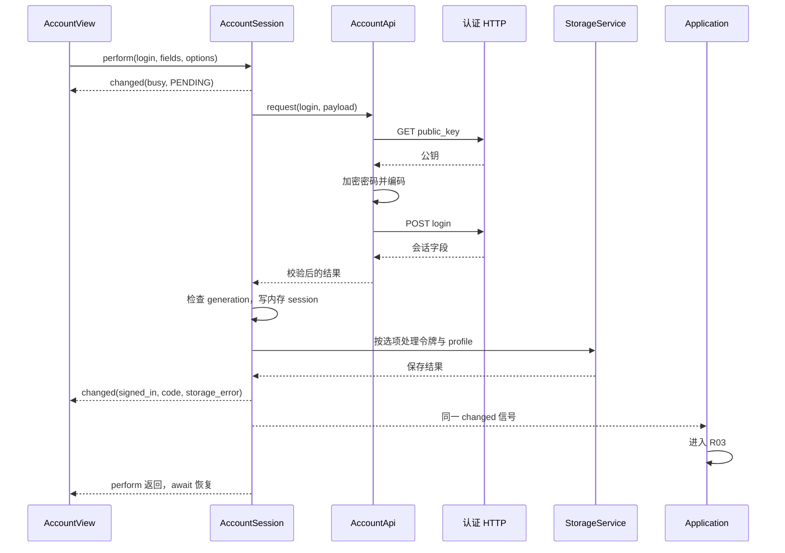

# R02 手把手阅读：一次登录怎样完成

上一讲：[R01：入口与应用装配](R01-入口与应用装配详解.md)。对应 [总路线 R02](场景与控件说明.md#route-02)，依据 `f1cb9e2`，核对日期 2026-10-01。下一讲：[R03：登录后生命周期](R03-登录后生命周期详解.md)。

这一讲沿着一次具体操作走：**填写用户名、密码，点“登录”，直到主界面接收到登录成功。**先走成功主线，再走取消、失败、自动登录与本地保存分支。

不需要真实账号也能完成源码阅读。示例中的用户名只是用来推演，不包含实际密码或令牌。

如果刚完成新版 R01，你已走到无账号登录表单，并认识了对象、信号和 await；本讲从用户第一次点击 Submit 接着往下走。第一次接触这些概念时，先回 [R01 第3—6课](R01-入口与应用装配详解.md#lesson-03) 和 [第18—20课](R01-入口与应用装配详解.md#lesson-18) 复习。


## 本讲新增：5 个主要函数精读

2026-10-02 按 `2ea9870` 核对。正文用于先走通流程，下面的精读保留当前函数完整代码，再解释参数、状态变化、失败分支和调用者怎样接收结果。代码是阅读快照，不要求复制到项目。

1. [AccountView._send：将一种表单转换成三种请求](#function-r02-01)
2. [AccountSession.perform：一次认证操作的完整状态边界](#function-r02-02)
3. [AccountApi._exchange：从信号回调转换为可 await 的结果](#function-r02-03)
4. [AccountSession._accept_login：先建立会话，再处理记住状态](#function-r02-04)
5. [AccountSession._emit：从内部字段推导页面状态](#function-r02-05)

## 准备：把四层职责写在旁边

依次打开：

| 层 | 文件 | 本讲中的职责 |
|---|---|---|
| 页面 | [account_view.tscn](../client-godot/scenes/ui/account_view.tscn)、[account_view.gd](../client-godot/src/ui/account_view.gd) | 读输入、响应点击、显示状态 |
| 会话 | [account_session.gd](../client-godot/src/session/account_session.gd) | 管理正在登录/已登录、账号资料、令牌保存与取消 |
| 网络 | [account_api.gd](../client-godot/src/network/account_api.gd) | 校验请求、获取公钥、加密密码、HTTP 及响应校验 |
| 存储 | [godot_storage_service.gd](../client-godot/src/storage/godot_storage_service.gd)、[credential_store.gd](../client-godot/src/storage/credential_store.gd) | 保存账号索引与受保护令牌 |

先不用通读每个文件。每走到一个调用，再打开它的实现；读完响应方向后回到调用者。

## 第一步：从你能看见的按钮出发

打开账号场景，按以下顺序找节点：

```text
AccountForm
└─ Column
   └─ BodyScroll/FormMargin/Body
      ├─ Form
      │  ├─ UsernameFrame/UsernameRow/Username
      │  ├─ Password
      │  ├─ Confirm
      │  ├─ Invite
      │  ├─ SavedLogin
      │  ├─ Options/AutoLogin、Remember
      │  └─ SubmitMargin/Submit
      └─ StatusArea/Status、Cancel
```

这个表单同时服务 login、register、reset 三种模式。Confirm、Invite 是否可见由脚本控制，不是三个完全独立的登录窗口。

切到 `account_view.gd`，搜索 `setup`、`_initialize`、`_fields`：

1. `setup(session)` 接收 R01 创建的同一个 AccountSession。
2. 初始化方法把节点引用保存进 `_fields`，后面 `_fields.username.text` 就是在取 Username 输入框的文字。
3. 找到 `_submit.pressed.connect(_send)`，这是按钮与业务的第一根线。
4. 再找到会话的 `changed` 连接到 `_update_state`，这是业务返回界面的另一根线。

**停一下：** `_send()` 是 Godot 自动识别的特殊方法吗？

<details>
<summary>对照答案</summary>

不是。它只是普通方法，因为这里被连接到 Button.pressed 才会在点击时执行。`_ready()` 才是 Godot 生命周期方法之一。

</details>

## 第二步：先限定一条最简单的主线

我们先假设：

- 当前模式是 `login`。
- 没有正在进行的请求。
- 使用手动密码输入，SavedLogin 区域没有接管提交。
- 这次暂不勾自动登录。
- 服务器认证与本地处理都正常。

这样你可以先读懂一条连续路径，再逐个放开条件。

搜索 `func _send()`，逐句读：

1. `if _busy: return`：页面层避免重复提交。
2. `operation := _mode`：把这次点击对应的模式保存为局部变量。
3. `_validate_passwords(operation)`：执行输入规则；注册/重置还要检查两次密码是否一致。
4. 若 `operation == "login" and %SavedLogin.visible`，走 `login_saved()`；我们的假设下不走这里。
5. 构造 `fields`，调用 `_session.perform(...)`。

手动登录的关键参数是：

| 参数 | 从哪里来 |
|---|---|
| operation | 当前模式，这里是 `login` |
| server | `_session.get_login_defaults().server`，不是任意未确认的文本 |
| fields.username | 用户名输入框 |
| fields.password | 密码输入框 |
| remember | Remember 的勾选状态 |
| auto_login | AutoLogin 的勾选状态 |

注意这里用了 `await`。页面会等 perform 的最终结果，再执行 `_present_response()` 和 `_apply_mode()`；但等待期间仍能通过 changed 信号更新页面，也能响应取消。

## 第三步：进入 perform，看“忙碌”是怎样产生的

在 `account_session.gd` 搜索 `func perform`。

先看开头：

```gdscript
if _busy: return _result(false, "BUSY")
if not _session.is_empty(): logout()
remember = remember or auto_login
var payload := fields.duplicate(true)
if operation == "login": payload.request_token = remember
_busy = true
var generation := _generation
_emit("PENDING")
```

逐句翻译：

- Session 也有自己的 busy 检查。它不能只依赖 UI 正确禁用按钮，因为其他调用者也可能调用 perform。
- 如果已经持有旧会话，先退出旧会话。
- 自动登录必须记住登录状态，所以 session 再次保证这条约束。
- 深拷贝字段，让后续加密等处理针对本次请求副本。
- `request_token` 告诉登录接口本次是否请求记住登录所需的令牌行为。
- 保存请求开始时的 generation，稍后用来判断结果是否已经过期。
- 在真正等待 HTTP 之前，就发出 PENDING。

现在跳到 `_emit()`：

```gdscript
changed.emit({"phase":"busy" if _busy else ("signed_in" if not _session.is_empty() else "signed_out"),"code":code,"storage_error":_storage_error})
```

这行值得拆成三列：

| 字段 | 回答的问题 | 常见取值 |
|---|---|---|
| phase | 当前处于哪个登录阶段？ | `busy`、`signed_in`、`signed_out` |
| code | 这次操作产生了什么结果/提示？ | `PENDING`、`OK`、`AUTH_REJECTED`、`CANCELLED` 等 |
| storage_error | 本地资料或令牌存储有没有问题？ | true / false |

`PENDING` 不是第四个 phase。当前 `_busy=true`，所以发出的阶段是 busy。

## 第四步：暂时回到页面，看请求还没结束时发生了什么

回到 AccountView 的 `_update_state(state)`：

- `_busy = state.phase == "busy"`。
- 输入框变为不可编辑，提交、账号切换等按钮被禁用。
- Cancel 显示出来，除非正在服务器设置对话框处理自己的状态。
- Status 根据 code 显示文案。

这一段解释了为什么点击后不用等服务器回来，按钮就已经不能连续点击。

同一 changed 信号也连接到了 Application 的 `_account_changed()`。它负责整体界面，而 AccountView 负责表单内部。一个信号有多个接收者，不意味着创建了两个账号会话。

现在回到 perform 的 `await _api.request(...)`，继续向网络层走。

## 第五步：HTTP 之前先发生哪些检查

打开 AccountApi，按 `request()` → `_perform()` → `_encrypt_payload()` 阅读。

`request()` 首先检查 operation、服务器地址和请求字段。非法请求可能在本地就返回失败，不一定已经发出 HTTP。

服务器地址处理再追到 [server_address.gd](../client-godot/src/domain/server_address.gd) 的 `normalize()`。第一遍只记住：同一个服务器需要归一化，不能让尾斜杠、默认端口等写法差异到处传播。

密码登录主线接下来执行：

```text
GET /auth/public_key
  → 检查公钥响应
  → password_encryption.encrypt_password(...)
  → 密文字节编码为 base64
  → 替换本次 payload 的 password
POST /auth/login
  → HTTP/JSON 校验
  → 登录返回字段校验
```

要区分两件事：密码由加密适配器处理；base64 只是把密文字节变成能放进 JSON 的字符串，本身不是加密算法。

R01 的 `encryption.tres` 最终指向 [windows_password_encryption.gd](../client-godot/src/platform/windows_password_encryption.gd)。本讲读到它怎样调用 `WindowsSecurity.encrypt_password` 即可；原生算法实现放在 R15。

再看 `_exchange()`：它创建 HTTPRequest、等待结果并释放请求节点。网络回调负责把超时、连接错误、HTTP 状态和非法 JSON 转成项目统一的结果。

最后看 `_validated_response()`。登录/自动登录要求 `user_id`、`login_token`、`message_token` 都是非空字符串。HTTP 200 并不自动等于有效登录结果，返回体还必须满足契约。

## 第六步：回到 Session，观察成功结果落到哪里

HTTP 完成后，perform 从 `await` 后继续执行：

```gdscript
_busy = false
response.storage_error = false
if generation != _generation: response = _result(false, "CANCELLED")
if response.ok:
    _accept_account(operation, server, fields, remember, auto_login, response)
```

先检查 generation，再接纳成功结果。顺序不能反过来：如果先写入会话再判断取消，旧请求就可能恢复一个已经不要的登录。

进入 `_accept_account()`，再进入 `_accept_login()`：

1. 复制服务器响应到内存 `_session`。
2. 补上归一化 server 和 username。
3. 按 remember 决定保存还是删除本地登录令牌。
4. 更新账号历史条目，将本次账号排到前面。
5. 持久化 profile。
6. 汇总本地存储错误，再回到 perform 发出最终 changed。

**这里一定要分清三份东西：**

| 内容 | 作用 | 保存方式 |
|---|---|---|
| 输入框 password / confirm | 本次认证输入 | 临时输入字段；成功/登录状态回填时清理 |
| 内存 `_session` | 当前已经认证的会话，含 message_token 等 | 运行时对象；退出登录清空 |
| profile | 记住服务器、用户名、账号列表、remember/auto_login/last_used | 默认 `user://account.cfg`；这里实际写 JSON，不能仅凭 cfg 扩展名认定是 ConfigFile |
| login_token | 下次无需密码恢复登录 | CredentialStore 单独保护后存入账号作用域 `.bin` 文件 |

`login_token` 和 `message_token` 不是同一用途。前者供自动登录恢复认证，后者进入聊天连接；profile 不混入明文密码或 token。

## 第七步：追一次存储，把“记住账号”看明白

打开 GodotStorageService，看 `read/write_login_profile` 与 `save/read/forget_login_token`。前一组处理账号资料，后一组委托 CredentialStore。

再打开 CredentialStore：

```text
server + username
  → AccountScope.key
  → 账号作用域文件名
login_token
  → secret_protection.protect_secret
  → 临时写入，再移动到目标 .bin
```

作用域函数在 [account_scope.gd](../client-godot/src/domain/account_scope.gd)。服务器与用户名共同参与键计算，所以同名账号在不同服务器下不是同一份凭据。

`secret_protection` 与前面的 `password_encryption` 也不同：

- PasswordEncryption：为发给认证接口的密码做加密。
- SecretProtection：保护留在本机的登录令牌。

本机实现可顺着 [secret_protection.gd](../client-godot/src/platform/secret_protection.gd) → [windows_secret_protection.gd](../client-godot/src/platform/windows_secret_protection.gd) 阅读。

## 第八步：成功信号怎样让登录框消失

回到 perform 末尾 `_emit(response.code, response.storage_error)`。

成功主线中，此时 `_busy=false`、`_session` 非空，于是 phase 为 signed_in。

两个主要接收者各做自己的事：

| 接收者 | 响应 |
|---|---|
| AccountView._update_state | 清理密码类输入，更新按钮、状态和模式 |
| Application._account_changed | 隐藏登录容器、创建角色与聊天视图、启动账号生命周期 |

随后页面 `_send()` 的 await 恢复，继续 `_present_response()`。不要误读成“必须等 `_send()` 全部结束才会发 signed_in”：最终 changed 是在 perform 返回之前发出的。

本讲到 Application 的 signed_in 分支就停。R03 会继续追它怎样启动聊天、模型、动态及窗口。

## 第九步：用同一条链路推演五个分支

### A. 用户取消请求

从 Cancel 的 pressed 追到 `AccountSession.cancel()`：它递增自己的 generation，调用 API.cancel。

API 也有自己的 generation；取消当前 HTTPRequest，并唤醒等待中的调用返回 CANCELLED。会话等待恢复后清 busy，再检查自己保存的 generation。

可以这样推演：请求开始时记录代次 7 → 用户取消使当前代次变 8 → 旧结果回来时 7≠8 → 不接纳旧成功结果。

两个 generation 属于不同对象，不是一个全局计数器；也不要和 R03 的生命周期 generation 混为一谈。

### B. 密码不正确或返回体不合法

沿 API 的响应校验读。401 会转为 AUTH_REJECTED；结构不满足契约会返回 INVALID_RESPONSE。Session 不进入 `_accept_login()`，最终保持 signed_out，页面显示相应提示。

错误响应与 storage_error 分属不同维度。网络认证失败并不等于本地文件坏了。

### C. 服务器认证成功，但本地保存失败

`_accept_login()` 已先建立内存 `_session`，之后才尝试保存 token/profile。因此存在这个合法状态组合：

```text
phase = signed_in
code = OK
storage_error = true
```

这表示当前认证可用，但下次自动恢复可能不可用。代码会尝试清理令牌并关闭内存中的记住/自动登录选项；Application 显示 AccountStorageWarning。

不要把本地保存失败直接说成“登录失败”，也不要把 `code=OK` 直接说成“所有步骤都成功”。

### D. 记住登录与自动登录

先读 AccountView 选项回调，再读 Session 的 `resume()` 和 `login_saved()`：

| 选项 | 行为 |
|---|---|
| 不记住 | 当前可登录，不保留用于下次恢复的登录令牌 |
| 记住但不自动 | 本地有可恢复的记录，用户可以主动选择已保存登录 |
| 自动登录 | 同时要求 remember；正常启动时 resume 尝试恢复 |

`resume()` 检查默认账号是否同时满足 auto_login、remember、username 非空，再调用 `login_saved()`。后者读取受保护 login_token，调用 `perform("auto_login", ...)`。

自动登录请求走 `/auth/auto_login`，不会重新要求用户输入密码，也跳过密码公钥加密步骤。令牌不可读时清除记住/自动选项并报告 CREDENTIAL_UNAVAILABLE；令牌被服务端拒绝也会清理相应记住状态。

### E. 注册、重置、选历史账号、修改服务器

主线读通后再补这几个入口：

| 节点/操作 | 顺着哪里读 | 与登录的区别 |
|---|---|---|
| RegisterLink / ResetLink | `select_mode()` → `_apply_mode()` → `_send()` | 改变字段组合；注册/重置成功不直接建立登录 session |
| HistoryButton | `_open_history()` → [login_account_row.tscn](../client-godot/scenes/ui/login_account_row.tscn) 的 Choose/Remove | 行没有自己的业务脚本，由父表单连接选择/移除回调 |
| SetServer / ServerSave | `_open_server()`、`_save_server()` → session.set_server → api.probe_server | 地址验证成功后才接纳新的服务器；账号历史按服务器隔离 |
| UsePassword | 表单的保存登录切换逻辑 | 从已保存登录入口改回手动密码输入 |

注册请求用 `/auth/register`；重置用 `/auth/reset_account`，字段是 new_username/new_password/invite_code。成功响应所需字段由 API 按 operation 区分，不能套用登录返回体。

## 用一张时序图收拢成功主线



这张图展示成功主线的职责顺序，不要求不同接收者的副作用由你假定为固定调度保证；准确行为仍以信号连接和函数体为准。

## 检查理解与可选断点

先自己回答：

1. 请求尚未完成时，谁让 Submit 禁用？
2. 为什么账号 API 返回 HTTP 200 后还要检查字段？
3. 取消请求后，为什么不能只隐藏加载状态就结束？
4. 为什么同一个用户名在两个服务器下有两份凭据？
5. signed_in 和 storage_error=true 能否同时成立？
6. 注册成功为什么不会自动显示聊天界面？

<details>
<summary>对照答案</summary>

1. Session 先发 busy/PENDING，AccountView 的 changed 回调禁用按钮。
2. HTTP 成功不保证 JSON 含有效 user_id/login_token/message_token。
3. 还要取消网络并使旧代次结果失效，避免迟到成功覆盖当前状态。
4. scope 由规范化 server 和 username 共同生成。
5. 能；网络会话可已建立，而本地记住状态保存失败。
6. 注册成功分支更新资料但不执行登录会话接纳；只有 login/auto_login 建立 `_session`。

</details>

可选断点按 `AccountView._send` → `AccountSession.perform` → `AccountApi._perform` → `_accept_login` → `_emit` 设置。跨 await 时优先观察 phase、code、generation 和字典字段是否存在；不需要打印真实密码或 token。

需要看可重复的行为例子时，先读 [test_account_session.gd](../client-godot/tests/test_account_session.gd)、[test_account_api.gd](../client-godot/tests/test_account_api.gd)、[test_login_profiles.gd](../client-godot/tests/session/test_login_profiles.gd)。测试是用来对照预期分支的，这份讲义本身不表示本次执行过测试。

最后把阅读位置停在 `Application._account_changed()` 的 signed_in 分支，继续 [R03](R03-登录后生命周期详解.md)。

## 主要函数逐段精读

<a id="function-r02-01"></a>

### 函数 1：AccountView._send：将一种表单转换成三种请求

源码：[src/ui/account_view.gd](../client-godot/src/ui/account_view.gd)；定位 `_send()`，本次快照起始行 152。

上游是 Submit.pressed。没有参数，直接读取当前控件状态；返回 void，异步等待结果后更新提示与显示模式。

```gdscript
func _send() -> void:
	if _busy: return
	var operation := _mode
	if not _validate_passwords(operation):
		return
	%FeedbackAddress.hide()
	var response: Dictionary
	if operation == "login" and %SavedLogin.visible:
		response = await _session.login_saved(_fields.username.text)
	else:
		var fields := {"username":_fields.username.text,"password":_fields.password.text}
		if operation == "register": fields.invite_code = _fields.invite.text
		elif operation == "reset": fields = {"new_username":_fields.username.text,"new_password":_fields.password.text,"invite_code":_fields.invite.text}
		response = await _session.perform(operation, _session.get_login_defaults().server, fields, _remember.button_pressed if operation == "login" else false, _automatic.button_pressed if operation == "login" else false)
	_present_response(operation, response)
	_apply_mode()
```

**按执行顺序拆解：**

1. 页面 busy 时直接返回，再把 `_mode` 保存为 operation。本次请求使用这个局部模式值。
2. `_validate_passwords()` 不通过就停止，所以后面的 API 调用不是所有点击都会发生。
3. 登录且 SavedLogin 可见时走 `login_saved(username)`；否则才从密码输入框组装普通 fields。
4. 注册在基础 fields 上增加 invite_code；重置则换成 new_username/new_password/invite_code。字段名字属于接口契约，不是显示文案。
5. 调用 perform 的服务器来自 session 默认服务器；remember/automatic 只在 login 模式传递控件值，其他模式传 false。
6. 两条请求分支都 await 最终结果，再 `_present_response()` 和 `_apply_mode()`。等待中页面状态仍由 changed → `_update_state()` 驱动。

**动手推演：** 用户输入了密码，但 SavedLogin 仍可见，点击登录会用哪个入口？代码选择 login_saved。想走密码入口需由 UsePassword 等交互先切换界面状态，而不是假定文本非空就自动改变分支。

**边界：** 页面收集意图；凭据持久化、HTTP 和 generation 不在这个函数里实现。

<a id="function-r02-02"></a>

### 函数 2：AccountSession.perform：一次认证操作的完整状态边界

源码：[src/session/account_session.gd](../client-godot/src/session/account_session.gd)；定位 `perform()`，本次快照起始行 113。

上游是 AccountView 或 login_saved 等调用者。输入 operation/server/fields/两个登录选项；异步返回结果 Dictionary，并在请求前后发 changed。

```gdscript
func perform(operation: String, server: String, fields: Dictionary, remember: bool = false, auto_login: bool = false) -> Dictionary:
	if _busy: return _result(false, "BUSY")
	if not _session.is_empty(): logout()
	remember = remember or auto_login
	var payload := fields.duplicate(true)
	if operation == "login": payload.request_token = remember
	_busy = true
	var generation := _generation
	_emit("PENDING")
	var response: Dictionary = await _api.request(operation, server, payload)
	_busy = false
	response.storage_error = false
	if generation != _generation: response = _result(false, "CANCELLED")
	if response.ok:
		_accept_account(operation, server, fields, remember, auto_login, response)
	elif operation == "auto_login" and response.code == "AUTH_REJECTED":
		response.storage_error = _forget_options(ServerAddress.normalize(server), str(fields.get("username", ""))) != OK
	_emit(response.code, response.storage_error)
	return response
```

**按执行顺序拆解：**

1. session 自己先拒绝重复请求；若旧会话非空则先 logout，避免把旧登录状态直接沿用到新操作。
2. auto_login 推导出 remember；深拷贝 fields 为 payload，登录时加 request_token。
3. 先置 busy、记录 generation，再 `_emit("PENDING")`。UI 此时就可以禁用输入，不需要等到 HTTP 返回。
4. await API 期间，用户可以取消；恢复后清 busy，将网络层结果补上 session 的 storage_error 字段。
5. 比较保存的 generation 和当前 generation。不同就把原响应整体换成 CANCELLED，然后才判断 response.ok，旧成功结果不会被接纳。
6. 成功进入 `_accept_account()`；仅自动登录被 AUTH_REJECTED 拒绝时，执行 `_forget_options()` 清除对应记住状态。普通网络错误不走这条特定清理分支。
7. 最后发状态信号，再返回 response。上游 await 后续代码运行之前，changed 的接收者已经有机会处理本次状态。

**动手推演：** 开始 generation=4，等待中 cancel 将其改为5，服务器随后返回 ok=true。第5步会用 CANCELLED 替换结果，不执行成功接纳。结果不是“显示取消但其实登录了”。

**易错点：** API 的结果包含 HTTP 信息；Session 又增加 storage_error。不要把不同层的结果结构都理解成完全相同的固定字段集合。

<a id="function-r02-03"></a>

### 函数 3：AccountApi._exchange：从信号回调转换为可 await 的结果

源码：[src/network/account_api.gd](../client-godot/src/network/account_api.gd)；定位 `_exchange()`，本次快照起始行 65。

上游是公钥探测、密码准备或认证 POST。参数为 URL、HTTP 方法及可选 payload；返回统一网络结果，临时持有一个 HTTPRequest。

```gdscript
func _exchange(url: String, method: int, payload: Dictionary = {}) -> Dictionary:
	var http := HTTPRequest.new()
	_http = http
	http.timeout = _timeout
	http.max_redirects = 0
	http.body_size_limit = 65536
	add_child(http)
	http.request_completed.connect(func(result, status, _headers, body):
		if _http != http:
			return
		if result == HTTPRequest.RESULT_TIMEOUT:
			_http_finished.emit(_failure("TIMEOUT"))
		elif result != HTTPRequest.RESULT_SUCCESS:
			_http_finished.emit(_failure("NETWORK_ERROR", status))
		elif status != 200:
			_http_finished.emit(_failure("AUTH_REJECTED" if status == 401 else "HTTP_ERROR", status))
		else:
			var parser := JSON.new()
			var valid := parser.parse(body.get_string_from_utf8()) == OK and parser.data is Dictionary
			_http_finished.emit({"ok":true, "code":"OK", "status":status, "data":parser.data} if valid else _failure("INVALID_RESPONSE", status)))
	var error := http.request(url, PackedStringArray(["Content-Type: application/json"]), method,
		JSON.stringify(payload) if method == HTTPClient.METHOD_POST else "")
	var response: Dictionary
	if error != OK:
		response = _failure("NETWORK_ERROR")
	else:
		response = await _http_finished
	_http = null
	http.queue_free()
	return response
```

**按执行顺序拆解：**

1. 新建 HTTPRequest，记录为 `_http`，设置超时、禁止重定向和 65536 字节响应体上限，然后加入树。
2. request_completed 回调先检查 `_http != http`。闭包捕获的是本次局部 http；如果当前引用已不再是它，直接忽略旧回调。
3. 判断顺序是传输超时 → 其他传输失败 → HTTP非200 → JSON解析。401 映射 AUTH_REJECTED，其他非200映射 HTTP_ERROR；只有 JSON 顶层为 Dictionary 才算本层成功。
4. `http.request()` 的返回值表示能否发起请求，不是服务器最终认证结果。发起失败直接构造 NETWORK_ERROR，否则 await 自定义 `_http_finished` 信号。
5. 回调把 Godot 的参数整理成 Dictionary 后 emit；await 从该信号取得 Dictionary，随后清 `_http`、queue_free 临时请求节点并返回。
6. cancel 会取消 HTTPRequest 并发 CANCELLED 的 `_http_finished`，使等待恢复。它不是只调用 cancel_request 后任由当前 await 一直悬着。

**动手推演：** HTTP 200 返回 JSON 数组会怎样？本层返回 INVALID_RESPONSE，因为只接受 Dictionary。HTTP 200 返回空字典则可通过本层，但仍需上层 `_validated_response()` 检查登录所需字段。

**层次区分：** 这个函数不决定是否写入 `_session`；它只统一网络和 JSON 结果。接口字段契约由上一层继续检查。

<a id="function-r02-04"></a>

### 函数 4：AccountSession._accept_login：先建立会话，再处理记住状态

源码：[src/session/account_session.gd](../client-godot/src/session/account_session.gd)；定位 `_accept_login()`，本次快照起始行 256。

上游是成功响应后的 `_accept_account()`。输入 profile 草稿、归一化地址、用户名、选项、response；返回 void，通过成员和传入 Dictionary 的修改交付结果。

```gdscript
func _accept_login(profile: Dictionary, address: String, username: String, remember: bool, auto_login: bool, response: Dictionary) -> void:
	_session = response.data.duplicate(true)
	_session.server = address
	_session.username = username
	var stored := ERR_UNAVAILABLE
	if _storage_ready:
		stored = _storage.save_login_token(address, username, _session.login_token) if remember else _storage.forget_login_token(address, username)
	response.storage_error = stored != OK
	var index := _index(profile.accounts, address, username)
	if index >= 0: profile.accounts.remove_at(index)
	profile.accounts.push_front({"server":address,"username":username,"remember":remember and stored == OK,"auto_login":auto_login and stored == OK,"last_used":Time.get_unix_time_from_system()})
```

**按执行顺序拆解：**

1. `response.data.duplicate(true)` 建立独立的内存 session，然后附加 server/username。此时会话已存在，后面的本地存储仍可能失败。
2. stored 初始为 ERR_UNAVAILABLE；仅 `_storage_ready` 为真时才尝试保存或删除令牌。
3. remember=true 时保存 login_token；remember=false 时主动删除该账号已有令牌，而不是简单跳过写入。不要将 message_token 当作这里保存的令牌。
4. 存储操作结果写入 response.storage_error。Dictionary 参数是引用语义，这个字段变化会被 `_accept_account()` 和 perform 看到。
5. 按 server+username 查找旧历史条目，存在则先移除，再 push_front 新条目，使最近账号位于前面。
6. 新条目的 remember/auto_login 都要求 `stored == OK`；last_used 记录当前系统时间。这里只修改传入的 profile 草稿，真正 `_persist(profile)` 在上层 `_accept_account()`。

**动手推演：** 网络认证成功、remember=true，但保存令牌失败。内存 session 仍已建立；response.storage_error=true，新条目的记住/自动选项为false。上层还会处理 profile 保存及错误后的令牌清理，不能只看本函数就说后续都已完成。

**再追一层：** `_accept_account()` 的 `_persist()` 也可能失败；因此本函数令牌保存成功并不代表账号资料已经全部保存成功。

<a id="function-r02-05"></a>

### 函数 5：AccountSession._emit：从内部字段推导页面状态

源码：[src/session/account_session.gd](../client-godot/src/session/account_session.gd)；定位 `_emit()`，本次快照起始行 202。

上游是 perform、logout、账号选择/服务器修改等路径。输入操作结果码和可选存储错误；返回 void，更新错误标志并广播 changed。

```gdscript
func _emit(code: String, storage_error: bool = false) -> void:
	_storage_error = storage_error or not _storage_ready
	changed.emit({"phase":"busy" if _busy else ("signed_in" if not _session.is_empty() else "signed_out"),"code":code,"storage_error":_storage_error})
```

**按执行顺序拆解：**

1. `_storage_error = storage_error or not _storage_ready`：调用者即使传 false，只要存储尚不可用，发出的存储错误仍为true。
2. phase 的优先级是 busy 最高，其次看 `_session` 是否非空。不是收到 code=OK 就无条件写 signed_in。
3. changed 的载荷只提供页面需要的状态摘要，没有把密码或会话 token 塞进去。
4. code 原样传递用于操作文案；phase 控制页面阶段；storage_error 表达本地保存能力。这三者要分别阅读。

**动手推演：** `_busy=false`、`_session` 非空、`_storage_ready=false`，调用 `_emit("OK")` 会发什么？答案是 signed_in / OK / storage_error=true。改成 `_busy=true`，同一 session 下 phase 会优先变 busy。

**返回方向：** AccountView._update_state 更新输入和提示；Application._account_changed 更新整个界面。多个监听者收到的是同一会话发出的状态，不是多个登录过程。
