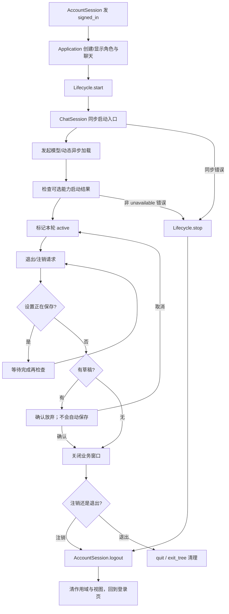

# R03 手把手阅读：登录后怎样启动，退出时怎样收尾

上一讲：[R02：账号登录](R02-账号登录详解.md)。对应 [总路线 R03](场景与控件说明.md#route-03)，依据 `f1cb9e2`，核对日期 2026-10-01。

R01 已经创建了一组对象，R02 得到了已认证账号。本讲连接这两件事：**让这些对象为当前账号工作，并在窗口关闭、注销或退出时正确停止。**

重点不是记住所有清理函数，而是始终问：现在停止的是一个窗口、一个账号作用域，还是整个应用？

新版 R01 已逐步解释了“对象建好但没有账号启动”的状态；可以对照 [R01 第17课的对象树](R01-入口与应用装配详解.md#lesson-17)。本讲才实际进入此前只登记的窗口工厂、登录后 start 和退出回调，勿把这些行为放回首次无账号的启动主线。


## 本讲新增：5 个主要函数精读

2026-10-02 按 `2ea9870` 核对。正文用于先走通流程，下面的精读保留当前函数完整代码，再解释参数、状态变化、失败分支和调用者怎样接收结果。代码是阅读快照，不要求复制到项目。

1. [AccountLifecycle.start：判断是否需要建立新账号作用域](#function-r03-01)
2. [WindowCoordinator.open：复用窗口或调用工厂](#function-r03-02)
3. [WindowCoordinator.request_close：先等保存，再汇总草稿](#function-r03-03)
4. [WindowCoordinator._confirmed：确认时仍需复核条件](#function-r03-04)
5. [SettingsWindow.save_changes：串行保存、汇总结果、决定是否关闭](#function-r03-05)

## 准备：打开四个核心文件

1. [application.gd](../client-godot/src/application.gd)
2. [account_lifecycle.gd](../client-godot/src/application/account_lifecycle.gd)
3. [window_coordinator.gd](../client-godot/src/application/window_coordinator.gd)
4. [application_services.gd](../client-godot/src/composition/application_services.gd)

窗口自身的设置/动态脚本，等走到关闭分支时再打开。本讲推荐分两遍：先读“登录与启动”，再读“窗口与退出”。

## 第一步：先把 created、ready、started 分开

请回忆 R01 的 mount：它已经创建并挂载 AccountSession、ChatSession、ModelSettings 和 DynamicsController。

但这些词表示不同阶段：

| 阶段 | 代表什么 | 不代表什么 |
|---|---|---|
| `.new()` / `.instantiate()` | 对象已经创建，字段和依赖可以配置 | 已在运行时树里，或已经联网 |
| `add_child()` / `_ready()` | Node 已经进入树并完成相应初始化，可以接收处理与信号 | 已经得到某个账号的会话 |
| `start(session)` | 项目主动要求服务开始为该账号工作 | 所有异步网络加载和认证都已成功 |

也就是说，登录前可以已经存在 ChatSession 对象，却还没有一个被激活的聊天账号。区分这个事实，后面的生命周期就容易读了。

## 第二步：从 signed_in 进入 Application

搜索 Application 的 `_account_changed(state)`，只读 `state.phase == "signed_in"` 这一支。

按执行顺序把视图变化圈出来：

1. 隐藏 `_center`，显示 Navigation。
2. 若 `_avatar == null`，实例化 AvatarPanel，注入 UiStyle、连接触摸信号、加入 Split。
3. 给角色面板设置当前最新未读动态。
4. 若 `_chat_view == null`，实例化 ChatView，注入 UiStyle，调用 `setup(_chat)`，加入 Split。
5. 将聊天图片/附件信号接到 ImagePresenter。
6. 若还没展开窗口，切换到展开布局。
7. 最后调用 `_lifecycle.start(_session.get_session())`。

关键摘录：

```gdscript
_chat_view = ChatView.instantiate() as Control
_chat_view.set_ui_style(_services.ui_style)
_chat_view.setup(_chat)
_chat_view.custom_minimum_size.x = 440
_chat_view.size_flags_horizontal = Control.SIZE_EXPAND_FILL
_split.add_child(_chat_view)
```

这里为什么 setup 放在 add_child 前面？因为父节点已经在运行时树中，加入子节点会使它进入准备流程；先给它 session，可以让它初始化时就知道要绑定谁。

注意 AccountForm 在 R01 中支持另一种接法：它是预先存在的子场景，之后才 setup。不能把“必须 setup 后 add_child”当成 Godot 的普遍语法规则；这是由具体组件是否支持晚注入决定的。

**停一下：** signed_in 信号重复来一次，会不会产生两套角色和聊天控件？

<details>
<summary>对照答案</summary>

不会仅因重复通知就重复实例化：这里检查 `_avatar == null`、`_chat_view == null`。稍后 Lifecycle 还会根据活动 identity 判断是否需要重新启动业务。视图复用与业务复用有各自的检查。

</details>

## 第三步：进入 AccountLifecycle.start，先读身份判断

打开 `account_lifecycle.gd` 的 `start(session)`：

```gdscript
var scope := Scope.key(session.server,session.username)
var identity := JSON.stringify([scope,session.get("message_token","")]).sha256_text()
if _active and _identity == identity: return OK
stop()
_identity = identity
_generation += 1
_context = {"scope_id":scope,"generation":_generation,"character_id":"luotianyi"}
_has_resources = true
```

先只解释三个变量：

| 名称 | 组成/含义 | 解决的问题 |
|---|---|---|
| scope | 规范化 server + username 的作用域键 | 不同服务器、不同账号的数据隔离 |
| identity | scope + message_token 的指纹 | 同账号凭据变化时，也要重启连接 |
| generation | 这个 Lifecycle 每次实际重新启动时递增的代次 | 让可选扩展辨认当前账号作用域的这一轮运行 |

当前活动 identity 相同，直接返回 OK；不同则先 stop 旧作用域，再建立新 context。

`_has_resources=true` 写在完成全部启动之前，是为了表示“启动过程中已经可能有资源需要清理”。不能只靠 `_active` 判断，因为失败时可能还没来得及设 active。

接着读 `get_context()`：它返回 `_context.duplicate(true)`。可选扩展拿到的是副本，不是可随意修改 Lifecycle 内部字典的直接引用。

这个 context 只有 scope_id、generation、character_id，不含密码或 token。ChatSession 等正式业务控制器则按自己的接口接收需要的 session；不要误以为所有控制器都只收到这三个字段。

## 第四步：逐行读启动顺序，留意 await

继续往下：

```gdscript
var result: Error = _chat.start(session)
if result != OK:
    stop()
    return result
_models.start(session)
_dynamics.start(session)
```

这里先调用 ChatSession，再调用 ModelSettings 和 DynamicsController。现在只短暂打开 [chat_session.gd](../client-godot/src/session/chat_session.gd) 的 `start()`：

```text
停止上一轮 ChatSession
→ transport.start(session)
→ 若同步启动失败，停止 transport 并返回错误
→ 启动模型执行器
→ 设置阅读位置与图片作用域
→ 设置媒体作用域；失败则清理并返回
→ 发起历史同步
→ 返回 OK
```

注意一个很容易读错的同名字段：**Lifecycle 的 `_models` 是 ModelSettings；ChatSession 的 `_models` 是注入的 ModelExecutor。**不要只靠变量名称判断它们是同一个对象，回到 Services.mount 看构造参数。

再打开 [websocket_transport.gd](../client-godot/src/network/websocket_transport.gd) 的 `start()`，看到它校验 session、准备连接并调用 `_connect_socket()` 后就返回 OK。后续连接状态和服务端认证由事件/帧处理推进。

因此：

- ChatSession.start 返回 OK，不等于服务端已经回复聊天认证成功。
- Lifecycle 中调用 ModelSettings.start、DynamicsController.start 时没有 await。
- 这两个控制器内部遇到网络 await 后，Lifecycle 会继续执行后面的代码。
- 模型配置或动态首次请求失败，会进入对应控制器的错误状态，不会作为该 start 调用的同步 Error 自动让 Lifecycle 回滚。

**停一下：** 界面已经展开、Lifecycle 已 active，模型页还能显示加载中吗？

<details>
<summary>对照答案</summary>

能。界面与账号作用域已启动，模型/动态的异步请求仍可能没完成。active 不是“所有远程数据均加载成功”的汇总标志。

</details>

## 第五步：读可选能力与失败回滚

回到 Lifecycle 的 capability 循环：appearance、world、devices。

这三个接口文件可以一起快速打开：

- [appearance_service.gd](../client-godot/src/extensions/appearance_service.gd)
- [world_service.gd](../client-godot/src/extensions/world_service.gd)
- [device_service.gd](../client-godot/src/extensions/device_service.gd)

当前默认能力不可用，start 返回 ERR_UNAVAILABLE。Lifecycle 明确允许这个结果，所以没有这些扩展也能使用已有聊天能力。

但如果某个 capability 返回其他错误，Lifecycle 会 stop 并把错误交回 Application。Application 的处理是记录 ACCOUNT_START_FAILED，然后调用 `_session.logout()`，账号 changed 再触发回到登录界面。

启动结果应分成三类理解：

| 情形 | 行为 |
|---|---|
| ChatSession 同步启动返回错误 | Lifecycle stop 回滚；Application logout |
| 可选 capability 返回 ERR_UNAVAILABLE | 允许继续，不声称该功能已实现 |
| 可选 capability 返回其他错误 | Lifecycle stop 回滚；Application logout |
| 模型/动态异步请求失败 | 控制器自己呈现错误；不是这里已等待并检查的同步启动失败 |

本讲说“回滚”是关闭已启动的本轮资源，不是数据库事务，也不是把刚才每行代码机械地倒着执行一遍。

## 第六步：读 stop，理解为什么会重复调用

完整读 Lifecycle 的 `stop()`。实际顺序是：

1. 已经没有资源、活动身份或 context 时直接返回。
2. 清 active、identity、context。
3. 对存在的 appearance/world/devices 调 stop。
4. 对仍有效的 models、dynamics、chat 调 stop。
5. 清 `_has_resources`。

这段没有在 stop 中递增 `_generation`；generation 的递增发生在下一次实际 start。各 session/controller 还各自有请求取消与代次机制，不能把 Lifecycle 的 generation 当成全局万能取消令牌。

为什么 stop 要能重复调用？启动失败会调用，注销会调用，应用退出树时还会调用。让它在已经停止时安全返回，就是这里的“幂等”含义。

## 第七步：追一次“打开设置”

现在回到主场景的 NavSettings，顺着信号走：

```text
NavSettings.pressed
→ Application._open_settings("settings")
→ WindowCoordinator.open("settings")
```

打开 Coordinator 的 `open(kind)`，一行一行追：

1. 检查 kind 是否是 settings/dynamics，以及协调器是否已 dispose。
2. 若字典中已有有效窗口，只调用已有窗口的 open 并返回。
3. 否则调用相应 factory。
4. 从返回值中取 `built.window`，登记到 `_windows`。
5. 设置窗口的 logout_requested 连接到全局注销流程。
6. `_host.add_child(window)`，让窗口进入树。
7. 配置 Chrome、连接 tree_exited，保证释放后移除字典项。
8. `window.open()`。
9. 如果 `built.start` 有效，最后才调用它。

回到 Services 的 `create_settings()`，对照 R01 已看过的返回值：工厂先 setup，Coordinator 后 add_child/open，最后 `controller.start(account.get_session())` 发起偏好加载。

这就是“先把接收状态的界面接好，再启动该窗口特有的加载”。动态窗口复用已经随账号启动的 DynamicsController，工厂返回的 start 为空。

**停一下：** 连续点两次设置，会不会发明第二份设置窗口对象？

<details>
<summary>对照答案</summary>

有效窗口已存在时只复用 open。窗口真正退出树后，tree_exited 回调才清掉对应记录；下次再打开才通过工厂创建新窗口。

</details>

## 第八步：把四种关闭动作分开

现在最重要的不是看所有 close 函数，而是先认清触发点：

| 用户动作 | 负责决策的对象 | 确认框与结果 |
|---|---|---|
| 只关闭设置窗口 | SettingsWindow | 自己的 UnsavedDialog；可放弃、取消或保存后关闭 |
| 只关闭动态窗口 | DynamicsWindow 继承的 DraftWindow | 自己的 DiscardDialog；有草稿时确认是否放弃 |
| 退出应用 | WindowCoordinator | main 的 ExitDialog，汇总草稿；确认后放弃未提交内容并退出 |
| 退出登录 | WindowCoordinator | 同一个全局确认框；确认后关闭业务窗口、注销账号 |

**全局退出/注销确认没有“自动保存全部”路径。**它的文案明确写“不会自动保存或发送”。通用 DecisionDialog 虽然支持可选 SaveAndClose 按钮，但 main 的 ExitDialog 没启用它。

同一个对话框组件具备某能力，不等于它的每个实例都启用了该能力。

### 8.1 单独关闭设置

打开 [settings_window.gd](../client-godot/src/ui/settings_window.gd) 的 `_request_close()`：

- 正在保存：记下 `_close_after_save=true`，等结果。
- 未保存修改：显示 UnsavedDialog。
- 没有修改：直接 queue_free。

再读 `_ready()` 中 UnsavedDialog 的接线：确认放弃直接释放；custom_action 为 save 时设置关闭意图并调用 `save_changes()`。

保存函数先校验模型，再依次保存模型、服务器偏好、本地 UI 风格；只有总结果成功且不再 dirty 才关闭。部分失败会保留窗口和相应草稿。音频缓存清理是独立操作，不参与这次保存。

### 8.2 单独关闭动态

打开 [draft_window.gd](../client-godot/src/ui/draft_window.gd)，再回到 DynamicsWindow 的 `is_dirty()`。窗口汇总发布层和详情评论的草稿，有修改就先确认放弃，没有修改才直接释放。

发布层还有自己的取消/Esc 与确认框；关闭一个发布浮层，不等于注销整个账号。

### 8.3 退出应用或注销

回到 Coordinator 的 `request_close(action)`，按这条分支阅读：

```text
若设置正在保存
  → 记住 exit/logout 意图
  → 一次性等待 saving_finished
  → 再调用 request_close，重新检查当前状态
否则
  → _collect_drafts
  → 无草稿：_confirmed
  → 有草稿：_show_close_dialog
```

等待保存结束不等于保证保存成功。回调回来之后会重新收集草稿；失败留下的修改仍需要用户处理。

`_collect_drafts()` 的三类来源是：聊天输入文字/图片、设置未保存修改、动态发布/评论草稿。聊天脏状态来自构造时传入的 Callable，不要求 Coordinator 直接知道聊天输入框路径。

`_show_close_dialog()` 会根据动作调整对话框归属：注销且设置窗口存在时，临时挂到设置窗口；普通退出挂到主应用。取消时 `_return_dialog()` 把它收回主应用。

这部分可以顺手看 [decision_dialog.gd](../client-godot/src/ui/decision_dialog.gd)：按钮发 confirmed/canceled/custom_action，真正业务含义由这些连接决定。

## 第九步：用户确认后，按注销路径追到底

Coordinator 的 `_confirmed()` 会再次检查是否正在保存；可以继续时：

```text
close_all()
→ 清理待执行 action
→ 发 logout_requested
→ Application 接到信号，调用 AccountSession.logout()
```

`close_all()` 关闭图片预览，隐藏并 queue_free 已登记的设置/动态窗口，清空 `_windows`。

继续回到 R02 的 `AccountSession.logout()`：

1. cancel 请求。
2. 清空内存 session。
3. 删除当前账号的保存令牌并关闭记住/自动登录选项。
4. 发出 LOGGED_OUT；本地清理失败时同时标记 storage_error。

Application 再次收到 changed，进入 `_show_signed_out()`：

1. 再调用 Coordinator.close_all 与 Lifecycle.stop。
2. 隐藏并 queue_free ChatView、AvatarPanel，然后把引用设为 null。
3. 显示 Center，隐藏 Navigation。
4. 如果原来已展开，保存适用的展开尺寸并恢复登录布局。

这里有重复 close/stop，是生命周期边界叠加的结果。方法必须能安全处理已经关闭的状态。

## 第十步：对比真正退出应用

若 action 是 exit，Coordinator 发的是 exit_requested。Application 的连接会 cancel 账号请求，然后 `get_tree().quit()`。

进入 Application `_exit_tree()` 后，再 dispose 协调器、stop Lifecycle、注销/停止引擎 Logger、结束客户端日志。

两条路径的区别：

| 路径 | 应用进程 | 账号处理 | 日志窗口 |
|---|---|---|---|
| 注销 | 保持运行，回到登录页 | 调用 AccountSession.logout，清当前令牌/记住状态 | 保留，可继续看日志 |
| 退出应用 | SceneTree 退出 | 取消请求、停止运行资源；不等同于调用 logout 删除所有已记住登录资料 | 随应用结束 |

所以不能把“退出应用”理解成“先完整注销再结束”。是否保留登录资料对下次自动登录有直接影响。

## 第十一步：理解 hide、queue_free 与引用清空

看 `_show_signed_out()` 的这个组合：

```gdscript
_chat_view.hide()
_chat_view.queue_free()
_chat_view = null
```

它们分别做三件事：

- hide：立即不显示。
- queue_free：安排节点稍后释放，并不是这一行执行完对象就已经完全退出树。
- 引用设 null：Application 不再把它当作当前有效视图，下次登录可以重新实例化。

Coordinator 清空 `_windows` 与窗口的 tree_exited 回调也要按这个时间差理解。`is_instance_valid()` 用来判断引用指向的 Node 是否还有效；RefCounted 对象则主要受引用计数管理，不能把所有资源一概按 Node 的方式释放。

## 这一讲的整体图



图中的“发起异步加载”不是等它完成；这正是本讲需要保留的时序区别。

## 检查理解：用场景推演代替背函数

1. 登录同一账号、message_token 也相同，再收到 signed_in，会重新 start 吗？
2. 同一用户名但换了服务器，scope 会相同吗？
3. 模型用途列表请求还在等待，Lifecycle 能否 active？
4. appearance 默认不可用，是否阻止文字聊天？
5. 设置有未保存修改时，关闭设置和退出应用的按钮选择是否一样？
6. 用户点注销时设置正在保存，会立即销毁设置窗口吗？
7. queue_free 后为什么还要把 `_chat_view` 设为 null？
8. 退出应用会不会必然清除记住的登录令牌？

<details>
<summary>对照答案</summary>

1. 当前 active 且 identity 相同，Lifecycle 直接返回 OK。
2. 不同。服务器参与作用域键。
3. 可以，模型/动态 start 的异步加载没有被 Lifecycle await。
4. 不阻止，ERR_UNAVAILABLE 被明确允许。
5. 不一样；设置自己的确认支持保存后关闭，全局退出只确认放弃未提交内容。
6. 不会；先等待 saving_finished，再重新收集状态。
7. 释放是延迟的；清引用表达应用不再拥有当前视图，避免后续复用旧引用。
8. 不会；当前退出路径 cancel+quit，不是完整 logout。

</details>

## 可选断点与测试阅读

推荐断点顺序：Application `_account_changed()` → Lifecycle `start()` → ChatSession `start()` → Coordinator `open()` → `request_close()` → `_confirmed()` → Application `_show_signed_out()` / `_exit_tree()`。

观察 `_active`、`_identity` 是否变化、`_context` 的键、`_windows` 的窗口类别、`_action` 与 `_waiting_save` 即可；不需要记录 token 值。看 identity 时只需比较是否相同。

对照用例阅读 [test_account_lifecycle.gd](../client-godot/tests/application/test_account_lifecycle.gd)、[test_application_drafts.gd](../client-godot/tests/test_application_drafts.gd)、[test_logout_confirmation.gd](../client-godot/tests/ui/test_logout_confirmation.gd)、[test_unified_settings.gd](../client-godot/tests/ui/test_unified_settings.gd)。本讲提供阅读抓手，不把这些用例存在当成本次执行通过。

现在你已经能把“启动程序 → 登录 → 创建聊天视图 → 启动账号业务 → 关闭/注销”连接起来。下一阶段回到 [总路线 R04](场景与控件说明.md#route-04)，开始看 ChatView 怎样把消息数据变成控件。

## 主要函数逐段精读

<a id="function-r03-01"></a>

### 函数 1：AccountLifecycle.start：判断是否需要建立新账号作用域

源码：[src/application/account_lifecycle.gd](../client-godot/src/application/account_lifecycle.gd)；定位 `start()`，本次快照起始行 23。

上游是 Application 收到 signed_in。参数为已认证 session；同步返回 Error，修改 identity/context/active 并调用各服务 start。

```gdscript
func start(session: Dictionary) -> Error:
	var scope := Scope.key(session.server,session.username)
	var identity := JSON.stringify([scope,session.get("message_token","")]).sha256_text()
	if _active and _identity == identity: return OK
	stop()
	_identity = identity
	_generation += 1
	_context = {"scope_id":scope,"generation":_generation,"character_id":"luotianyi"}
	_has_resources = true
	# Chat owns the transport boundary.  It must be ready before controllers
	# that advertise models, history or dynamics can observe the new account.
	var result: Error = _chat.start(session)
	if result != OK:
		stop()
		return result
	_models.start(session)
	_dynamics.start(session)
	for capability in [_appearance,_world,_devices]:
		if capability == null:
			continue
		var capability_result: Error = capability.start(get_context())
		# Optional future capabilities are allowed to be unavailable without
		# preventing text chat. Any other startup error rolls the account back.
		if capability_result != OK and capability_result != ERR_UNAVAILABLE:
			stop()
			return capability_result
	_active = true
	return OK
```

**按执行顺序拆解：**

1. 用 server+username 计算 scope，再把 scope 与 message_token 计算 identity。只有当前 active 且 identity 相同才直接返回 OK。
2. 真正重启前先 stop 旧作用域，再写新 identity、增加 generation、创建无凭据的扩展 context。
3. `_has_resources=true` 在 `_active=true` 之前，用于启动尚未完成时也能触发有效清理。
4. 先调用 ChatSession.start 并检查同步 Error；失败立即 stop 并返回，不继续启动后面的控制器。
5. 模型与动态 start 没有 await，发起它们的加载后就继续。可选能力为 null 时跳过，ERR_UNAVAILABLE 允许继续，其他错误回滚。
6. 最后置 active 并返回 OK。这只代表这里检查的启动步骤被接纳，不代表所有网络请求、历史同步和 WebSocket认证完成。

**动手推演：** 同 server/username，但 message_token 改了，会不会因为 scope 相同而跳过？不会，identity也包含token。相同identity但_active=false，也不会跳过。

**失败后的下一步：** Application 收到非OK会调用 session.logout；不是 Lifecycle 自己修改登录表单。stop 的真实顺序见正文，不要假设严格逐行倒序。

<a id="function-r03-02"></a>

### 函数 2：WindowCoordinator.open：复用窗口或调用工厂

源码：[src/application/window_coordinator.gd](../client-godot/src/application/window_coordinator.gd)；定位 `open()`，本次快照起始行 27。

上游是主导航转发的 settings/dynamics 字符串。返回 void，维护 `_windows`、注册窗口事件，并可能调用工厂返回的延迟启动动作。

```gdscript
func open(kind: String) -> void:
	if _disposed or kind not in ["settings","dynamics"]: return
	if is_instance_valid(_windows.get(kind)):
		_windows[kind].open()
		return
	var built: Dictionary = (_settings_factory if kind == "settings" else _dynamics_factory).call()
	var window: Window = built.window
	_windows[kind] = window
	if kind == "settings": window.logout_requested.connect(func(): request_close("logout"))
	_host.add_child(window)
	window.get_node("%Chrome").configure(_geometry,kind)
	window.tree_exited.connect(func():
		if _windows.get(kind) == window: _windows.erase(kind))
	window.open()
	if built.start.is_valid(): built.start.call()
```

**按执行顺序拆解：**

1. 已dispose或kind不在允许集合中就返回，避免用任意字符串创建窗口。
2. `_windows[kind]` 仍有效时只调用已有窗口.open，直接结束；不会重新执行工厂或偏好控制器start。
3. 否则选择对应Callable工厂并call，取出window、立即登记到字典，设置窗口还要接入logout_requested。
4. add_child使窗口进树，然后配置Chrome和tree_exited清理回调，再window.open。
5. 最后才检查built.start并执行。工厂负责装配，Coordinator负责何时挂载、打开和开始窗口专属加载。
6. tree_exited回调不是无条件erase：只有字典中仍指向退出的这个实例才移除，避免迟到的旧窗口回调误删同kind的新实例。

**动手推演：** 打开设置两次，工厂运行几次？有效窗口仍在时只有一次。关闭释放后再打开才会重新创建。

**与R01对照：** create_settings返回的是window和start两项；这里分别消费它们，闭合“延迟启动”的调用链。

<a id="function-r03-03"></a>

### 函数 3：WindowCoordinator.request_close：先等保存，再汇总草稿

源码：[src/application/window_coordinator.gd](../client-godot/src/application/window_coordinator.gd)；定位 `request_close()`，本次快照起始行 43。

上游是系统退出、主界面退出入口或设置窗口注销信号。action只允许exit/logout；返回void，可能立即确认，也可能注册一次回调或显示对话框。

```gdscript
func request_close(action: String) -> void:
	if _disposed or action not in ["exit","logout"]: return
	var settings = _windows.get("settings")
	if is_instance_valid(settings) and settings.is_saving():
		_action = action
		if not _waiting_save:
			_waiting_save = true
			settings.saving_finished.connect(func(_ok):
				_waiting_save = false
				request_close(_action),CONNECT_ONE_SHOT)
		return
	var drafts := _collect_drafts()
	_action = action
	if drafts.is_empty():
		_confirmed()
		return
	_show_close_dialog(action, settings, drafts)
```

**按执行顺序拆解：**

1. 首先拒绝已dispose或未知action。再取得当前设置窗口，因为它可能正在异步保存。
2. 若正在保存，记录`_action`；`_waiting_save`保证只连接一次saving_finished，CONNECT_ONE_SHOT保证触发后自动断开。
3. 回调参数名是`_ok`但没有用它直接决定是否退出。回调先清waiting标志，再重新调用request_close，根据当时真实草稿重新作决策。
4. 等待期间重复请求会更新`_action`，但不会重复连接回调；闭包读取的是当前_action，所以最后记录的有效退出/注销意图会用于再次检查。
5. 没有保存进行中时调用_collect_drafts；无草稿直接_confirmed，有草稿才_show_close_dialog。

**动手推演：** 模型保存失败，saving_finished(false)到来，会直接退出吗？不会因false自动退出，也不是直接返回；会重新检查，失败留下的dirty草稿使确认框继续出现。

**易错点：** 这里是“等待已在进行的保存”，不会因为有人请求退出就主动发起保存。

<a id="function-r03-04"></a>

### 函数 4：WindowCoordinator._confirmed：确认时仍需复核条件

源码：[src/application/window_coordinator.gd](../client-godot/src/application/window_coordinator.gd)；定位 `_confirmed()`，本次快照起始行 60。

上游既可能是对话框confirmed信号，也可能是无草稿时直接调用。无参数、返回void；执行窗口清理并发出退出或注销意图。

```gdscript
func _confirmed() -> void:
	var action := _action
	if _disposed or action not in ["exit","logout"]: return
	var settings = _windows.get("settings")
	if is_instance_valid(settings) and settings.is_saving():
		_return_dialog()
		request_close(action)
		return
	close_all()
	_action = ""
	if action == "exit": exit_requested.emit()
	else: logout_requested.emit()
```

**按执行顺序拆解：**

1. 先把成员_action复制到局部action，保留本次要执行的动作；无有效动作或已dispose则不继续。
2. 再检查设置是否正在保存。即使之前显示确认框时没在保存，用户确认这一刻状态也可能变化，所以必须复核。
3. 若在保存，先收回对话框，再进入request_close等待流程，不强制销毁正在保存的窗口。
4. 可以继续时close_all，随后清空成员_action，最后根据局部action发exit_requested或logout_requested。
5. close_all关闭图片及登记的设置/动态窗口；真正quit或AccountSession.logout在Application连接的信号回调里。

**动手推演：** 为什么清空_action之后还能知道发哪种信号？因为开头保存了局部action。如果直接在清空之后读取成员，就丢失了本次动作。

**所有权边界：** 协调器负责统一确认和窗口清理；账号令牌删除属于AccountSession，整个进程退出属于Application。

<a id="function-r03-05"></a>

### 函数 5：SettingsWindow.save_changes：串行保存、汇总结果、决定是否关闭

源码：[src/ui/settings_window.gd](../client-godot/src/ui/settings_window.gd)；定位 `save_changes()`，本次快照起始行 101。

上游是SaveAll或设置自身确认框的保存后关闭动作。无参数，异步返回`{ok, results}`，期间改变按钮、BusyBlocker和保存状态，并发saving_finished。

```gdscript
func save_changes() -> Dictionary:
	if _saving: return {"ok":false,"results":[{"section":"settings","id":"设置","code":"BUSY","ok":false}]}
	var validation: Dictionary = _model_page.validate_changes()
	if not validation.ok:
		_close_after_save = false
		select_page("models")
		_report(validation.results)
		return validation
	_saving = true
	%SaveAll.disabled = true
	%BusyBlocker.show()
	%BusyBlocker.grab_focus()
	_set_result("正在保存全部修改…", "saving")
	var model_result: Dictionary = await _model_page.save_changes()
	var preference_result: Dictionary = await _preferences_page.save_changes()
	var ui_style_result := {"ok":true,"results":[]}
	if _ui_style != null: ui_style_result = await %StylePage.save_ui_style()
	var results: Array = model_result.results + preference_result.results + ui_style_result.results
	var ok: bool = model_result.ok and preference_result.ok and ui_style_result.ok
	_saving = false
	%SaveAll.disabled = false
	%BusyBlocker.hide()
	_report(results)
	var should_close := _close_after_save and ok and not is_dirty()
	_close_after_save = false
	saving_finished.emit(ok)
	if should_close: queue_free()
	return {"ok":ok,"results":results}
```

**按执行顺序拆解：**

1. 已在保存时返回BUSY。模型预校验失败时清关闭意图、定位到模型页并返回，尚未启动任何一组保存。
2. 校验通过后置saving，禁用SaveAll，显示并聚焦BusyBlocker，再更新提示。这样等待期间不会继续编辑同一批设置。
3. 按模型→服务器偏好→本地风格的顺序保存。每步await上一组结果；没有“模型结果失败就return”的分支，因此后续组仍会执行。
4. 把各组results数组拼接，三个ok取逻辑与。总ok=false并不意味着前面成功的组被回滚，这是允许部分成功的汇总流程。
5. 先清saving、恢复按钮并隐藏blocker、报告结果，然后计算should_close：之前要求关闭、总ok、当前不再dirty，三个条件缺一不可。
6. 清_close_after_save，发saving_finished，再在should_close为真时queue_free，最后返回结果。全局Coordinator会监听这个信号重新检查退出请求，不能假定返回给点击回调之后它才知道保存结束。

**动手推演：** 模型保存成功、偏好失败、风格成功，关闭意图为true：三组都已尝试，总ok=false；不会因为本次“保存后关闭”而释放窗口。模型和风格可能已生效，偏好草稿仍待处理。

**再对比一次：** 模型预校验失败发生在所有保存之前，和“进入保存后某组失败”不同；只有后者可能已有部分写入。音频缓存清理不在这三个保存结果中。
