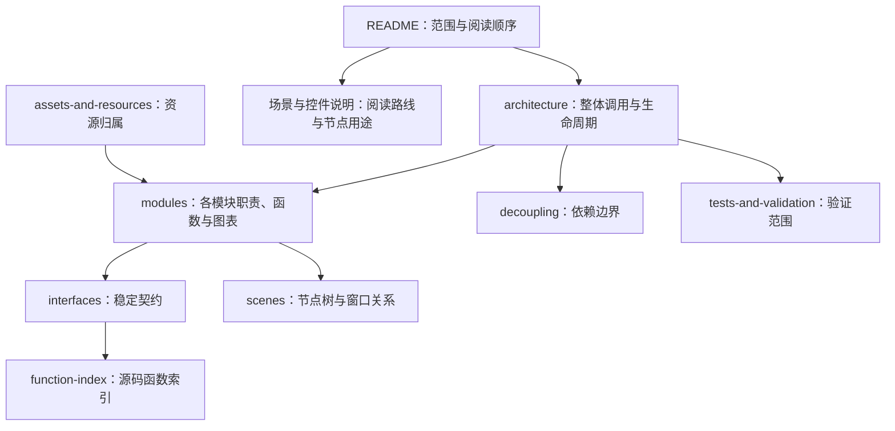

# Godot 客户端本地架构文档

本目录是给源码阅读、审查、维护和后续设计使用的中文文档包，实际工程位于 [client-godot/](../client-godot)。文档不参与运行时；是否纳入 Git 由仓库的实际跟踪和忽略规则决定，不再使用旧目录 `client/_godot/` 的忽略约定。

2026-10-01 已按 `f1cb9e2` 同步场景阅读路线、场景索引、架构、Session 补充说明、函数索引和测试工具入口。最新内容包括消息时间条、评论滚动分页/卡片重试、复杂度检查，以及拆分后的函数入口。之前的风格页、聊天 UI/UX 和构建交互说明继续保留。本次未重新执行客户端运行验收或真实导出。

## 阅读顺序

如果希望像上课一样一步步阅读，先按这三份独立讲义走：

- [R01：从 C 作业到 Godot 启动流程](R01-入口与应用装配详解.md)：只默认会变量、循环、数组和函数；26 个连续小课，逐步深入首次启动调用，最后完成三个隔离修改练习。
- [R02：账号登录详解](R02-账号登录详解.md)：从按钮到 HTTP、凭据存储和 UI 状态，含取消、失败及自动登录分支。
- [R03：登录后生命周期详解](R03-登录后生命周期详解.md)：账号启动、窗口工厂、草稿确认、注销和资源清理。

每讲都有具体打开顺序、关键代码摘录、停下来思考的小问题与答案，以及可选断点。读完前三讲后，继续下面的完整路线。

2026-10-02 已将 R01 重写为初学者连续教材：原先独立的函数精读并入实际调用位置，完整函数折叠放在对应小课供复习；旧入口链接保留。R02/R03 的每讲五个函数精读仍保留。R01 的文案、首次窗口尺寸和启动提示开关已在临时副本与独立用户目录中实际运行验证，范围见 [练习验证记录](r01-evidence/README.md)，不代表完整客户端回归通过。

1. [场景与控件说明](场景与控件说明.md)：推荐起点；15 阶段源码阅读路线、31 个场景控件说明及当前专项测试/构建入口。
2. [architecture.md](architecture.md)：启动、登录、账号切换、UI 风格、未读预览和依赖方向。
3. [scenes.md](scenes.md)：场景清单、节点树、父子窗口和注入顺序。
4. [function-index.md](function-index.md)：按当前源码路径、行号定位信号和函数，覆盖 99 个 `src` 脚本，包含新增 ChatTime 与重构后的辅助方法。
5. [modules/](modules/) 和 [interfaces.md](interfaces.md)：模块背景与接口参考；部分内容仍保留旧名称，须对照当前源码。
6. [decoupling.md](decoupling.md)：平台隔离与可替换实现背景。
7. [tests-and-validation.md](tests-and-validation.md)：运行回归、时间戳专项、静态复杂度检查和构建编排测试的入口与边界；同时查阅 [客户端测试说明](../client-godot/tests/README.md)。

文档以当前源码及对应接口契约为依据；历史快照只用于解释迁移背景。Godot 引擎版本与哈希见 [dependencies.lock.json](../client-godot/dependencies.lock.json)，客户端产品版本见 [release.json](../client-godot/release.json)，两者不是同一版本号。本包不声称 Android、真实系统 DPI、多屏、公共服务或长期运行已验证。

## 文档关系图

图中的“未来/预留”节点只表示替换点，不代表已经连接、轮询或提供成功结果。若旧模块文档中的路径、节点名或函数行号与源码冲突，以 `client-godot/src`、`client-godot/scenes` 及已同步的阅读路线和函数索引为准。
