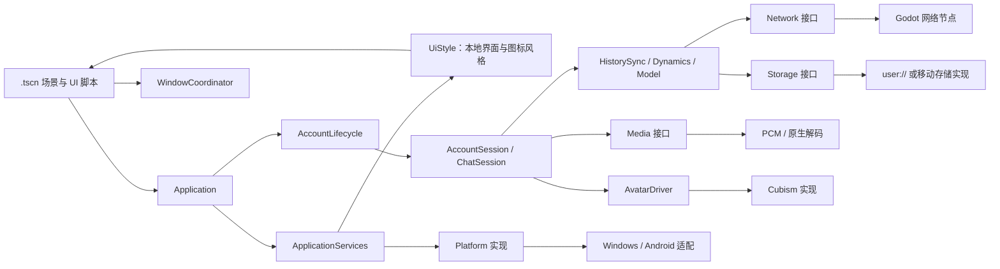
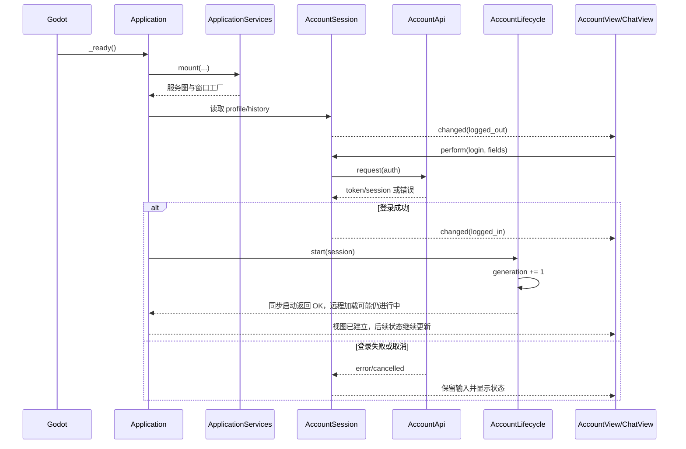
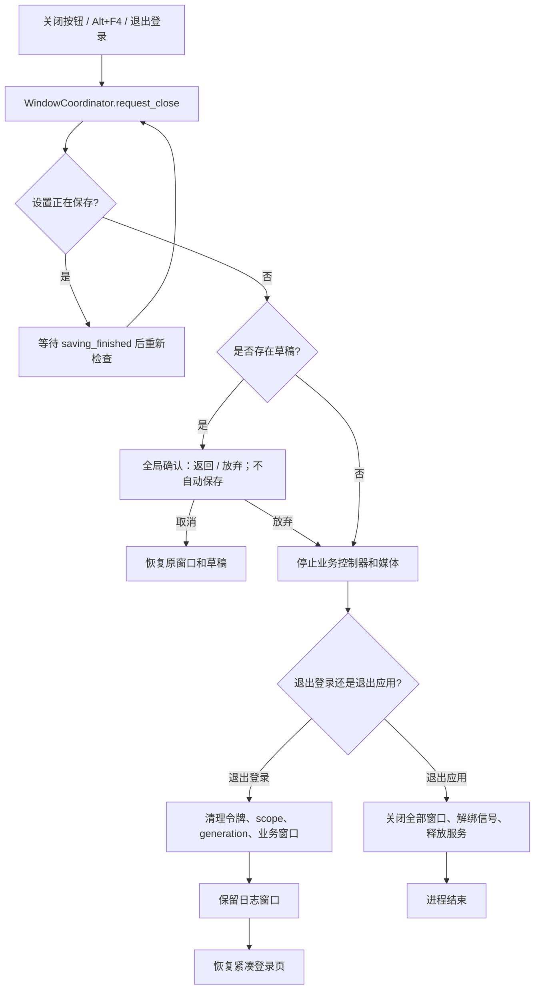
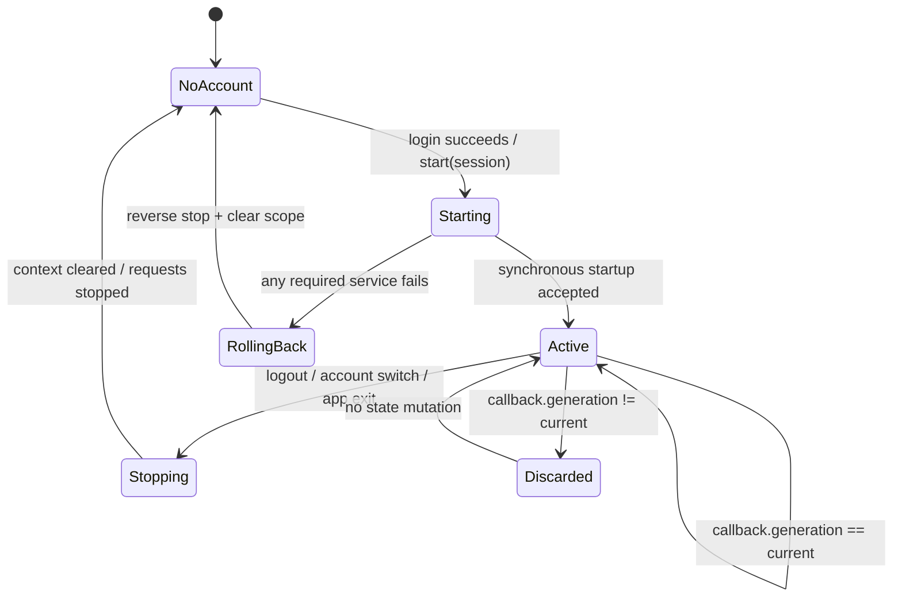
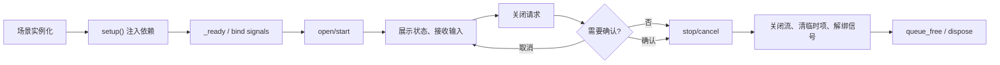

# 整体架构

2026-10-01 按 `f1cb9e2` 同步消息时间、评论分页及重构阅读入口，保留此前 UI 风格、未读预览说明；逐文件阅读顺序见 [场景与控件说明](场景与控件说明.md)。

## 依赖图

```text
.tscn 控件与 UI 脚本
        ↓ 信号、数据绑定、用户意图
Application / WindowCoordinator / AccountLifecycle
        ↓ 注入的 session 与 controller
AccountSession、ChatSession、HistorySync、DynamicsController、ModelSettings
        ↓ 稳定能力接口
Network / Storage / Media / Avatar / Platform
        ↓
Godot 节点、user:// 存储、Windows 原生实现或未来 Android 实现
```

`src/composition/application_services.gd` 是组装根，创建服务并把依赖挂到应用；它不决定业务流程。`src/application.gd` 绑定主场景、账号状态和窗口；`account_lifecycle.gd` 管理一次账号作用域；`window_coordinator.gd` 统一业务窗口复用和应用退出确认；`application/ui_style.gd` 管理客户端本地视觉配置。

## 启动与登录

1. Godot 进入 `scenes/main.tscn`，`Application._ready()` 创建或接收 `AccountSession`，装配聊天、日志、设置、动态、图片和角色节点。
2. `AccountSession` 从 `StorageService` 读取登录资料和按服务器隔离的账号历史；密码不落盘，令牌由受保护存储读取。
3. 未登录时主场景显示紧凑 `account_view.tscn`。登录、注册、重置和服务器验证均由 `AccountApi` 完成，UI 只提交字段并展示状态。
4. 登录成功后 Application 先创建/加入角色和聊天视图，再调用 `AccountLifecycle.start(session)`。Lifecycle 先检查 ChatSession 的同步启动结果，再发起模型/动态加载并检查可选扩展启动结果，随后标记 active；它没有 await 模型/动态网络加载，transport 的连接/认证也由后续事件推进。active 不代表所有远程初始化已成功完成。
5. 主场景默认展开为 1280×800 的角色/聊天双栏，角色区默认约占 1/3；已有窗口几何和比例优先恢复。日志仍可独立打开；窗口几何由 `WindowHost` 和 `WindowGeometry` 管理。

## 本地风格与共享主题

ApplicationServices 创建唯一 UiStyle 并用本地 SettingsStore 配置；正式应用把它传给角色、聊天、设置、动态、图片等界面。`style_page.tscn` 是设置窗口第四页，独立于服务器相处偏好。

下拉选择只更新页面草稿。SaveAll 先校验模型，再依次保存模型、服务器偏好和本地风格，最后汇总结果，允许部分成功。UiStyle 将 `ui/style`（flat/crystal）和 `ui/icons`（svg/emoji）一起保存，成功后才更新共享 Theme、已注册图标并发 `style_changed`；失败回滚存储值，原外观不变，草稿仍可重试。主题修改仅发生在内存，不改写 `.tres` 资源。

## 未读动态预览与展示

DynamicsController 除未读数量外，还通过分页读取动态生成最新未读预览，跳过用户发布的动态，并按最后已读时间判断。`unread_changed` 驱动导航圆点与 tooltip；`latest_unread_changed` 经 Application 转发到 AvatarPanel 的未读卡片。读取失败尽量保留已知预览，成功标记已读或停止账号作用域会清空。浏览动态、点击当前卡片刷新评论不自动标记已读。

动态列表通过滚动到底部加载/重试；详情评论也使用触底自动分页，已移除 LoadMore 按钮，失败时保留已有评论并提示点击动态卡片重试。详情切换及评论刷新保持阅读位置和草稿。发布层底部取消/Esc 走本层草稿确认，窗口关闭和应用退出另有汇总。

## 消息时间与显示分组

ChatSession 负责消息时间：本地发送时记录 Unix 秒时间；助手新回复取事件 `ts` 的有效正数毫秒时间，缺失或无效时退回本地到达时间。按 UUID 聚合分片时保留首次时间，ACK 不改变时间。历史与实时消息合并时采用历史 timestamp，同时保留实时正文。

UI 的 [ChatTime](../client-godot/src/ui/chat_time.gd) 负责多格式时间解析和 300 秒间隔分组。VirtualMessageList 生成标记并传给 MessageBubble；时间条是气泡内部节点，不是额外业务消息，不进入消息 ID 或阅读锚点。Unix/带时区时间按当前系统时区偏移显示，无时区日历字符串按本地墙上时间处理。业务时间来源与显示格式分开维护。

## 重构与静态检查

本轮将设置恢复、退出草稿收集、协议校验、音频解码/推帧、缓存元数据校验等步骤拆成辅助函数，主要公开入口及依赖方向仍保留。先按业务入口阅读，再沿辅助函数展开；当前签名和行号见 [函数索引](function-index.md)。[复杂度检查](../client-godot/scripts/check_complexity.py) 是独立开发工具，固定阈值为 10，检查失败与行为回归失败是不同证据，详见 [测试与验证](tests-and-validation.md)。

## 账号切换与 generation

账号作用域键由服务器和用户名生成，凭据代次变化会触发生命周期重新启动并递增 generation；可选扩展接收不含密码和令牌的上下文副本，业务控制器按其接口接收所需 session。退出或切换账号时由生命周期停止扩展、模型、动态和聊天，聊天再清理网络与媒体。异步结果接纳需检查所属作用域/请求代次，避免污染新账号。相同服务器、用户和消息 token 的重复 signed-in 通知不重启业务。

## 退出和窗口关闭

应用退出和退出登录进入 `WindowCoordinator.request_close()`，汇总聊天、动态发布/评论和设置草稿。单独关闭设置、动态、发布层和图片窗口则各有本层关闭处理，不是所有关闭按钮都直接经过协调器。设置未保存状态包含本地风格；保存期间的关闭等待结果，失败保留窗口。退出登录由设置页发出 `logout_requested`，应用清理业务窗口和令牌但保留日志。

全局确认仅提供放弃/返回，不会自动保存或发送草稿；设置窗口自身的 UnsavedDialog 才支持“保存后关闭”。全局请求遇到设置正在保存时等待 saving_finished，然后重新检查草稿。退出应用 cancel 后 quit，不等于调用 AccountSession.logout 清除记住的登录资料；具体推演见 [R03 讲义](R03-登录后生命周期详解.md)。

动态、日志和图片窗口独立于主窗口最小化。图片窗口只有一个实例，`ImagePresenter` 记录当前来源，替换图片时转移归属；来源关闭时才联动关闭。重复打开窗口恢复并聚焦已有实例，不创建副本。

## 数据流与边界

UI 只处理 Godot 控件、信号和可展示状态；网络模块组包和解析 HTTP/WebSocket；存储模块处理 `user://` 和原子写入；媒体模块负责附件、解码和播放状态；角色模块只暴露表情、动作、口型、视线和命中语义；平台实现封装 OS、文件、窗口、输入法、剪贴板、秘密保护和 DLL。

`StorageService.query_directory()` 的容量和目录大小始终为 64 位 bytes，未知值为 `-1`，UI 不能把未知转换为 0%。正式聊天不依赖 `preview`，离线预览使用独立 `DemoSession`。三个扩展接口默认立即返回 `ERR_UNAVAILABLE`/`NOT_IMPLEMENTED`，不连接、不轮询、不伪造成功。

## 资源所有权

组装者创建服务并负责最终释放；窗口协调器拥有窗口索引和关闭顺序；`ChatSession` 拥有媒体控制器的连接关系；播放器拥有并关闭 `ReadStream`；缓存和日志拥有临时文件清理；场景节点拥有其子节点。`stop()` 和 `close()` 设计为幂等，退出树时取消请求、解绑信号并释放资源。


## 组件架构图



UI 只提交用户意图并接收状态副本；`composition` 负责把具体实现注入到业务对象，避免业务代码自行寻找平台服务。

## 启动与登录流程



## 退出登录与退出应用流程



## 账号 generation 与迟到回调



每个异步回调在写入 UI、缓存或业务状态前比较 scope/generation；迟到结果只被记录或丢弃，不得复活旧账号。

## 窗口与资源生命周期



窗口几何由 `WindowHost`/`WindowGeometry` 持久化，草稿只存在当前运行；图片窗口还要释放来源归属并恢复来源窗口焦点。

## 当前能力边界

当前已实现 Windows 桌面、Godot UI、HTTP/WebSocket、账号、聊天、动态、设置、媒体缓存、Live2D 和离线预览。`AppearanceService`、`WorldService`、`DeviceService` 只有默认拒绝实现；Android、真实多屏/DPI、公共服务器和长期运行尚未交付或验证。
