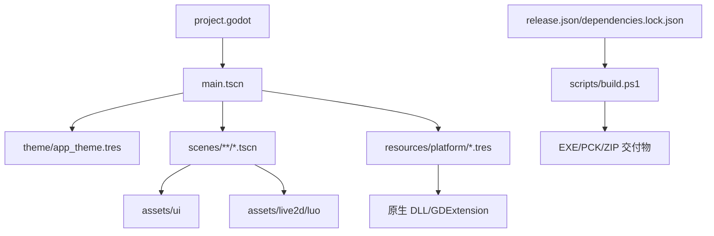
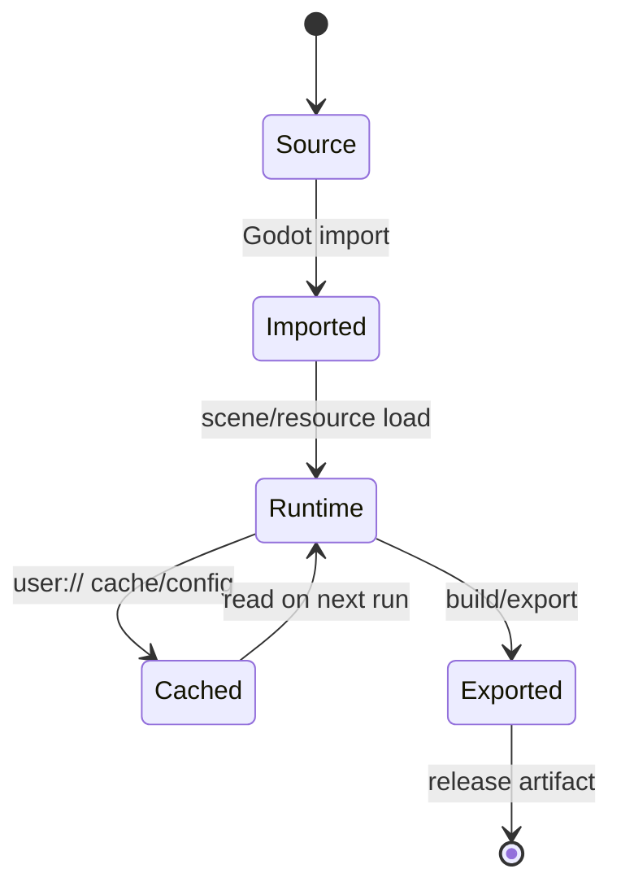

# 资源与生成物

## 源码资源

- `scenes/**/*.tscn`：固定节点树、布局和可见控件。
- `theme/app_theme.tres`、`theme/frost_popup.tres`：颜色、字体、StyleBoxFlat、焦点和浮层样式；正文使用实底，磨砂只用于应用内背景层。
- `assets/ui/`：应用图标、登录头像、复选框、菜单图标、滑块素材和 UI shader。
- `assets/live2d/luo/`：`model.model3.json`、Moc、纹理、表情、动作、Physics 和交互映射。

## 平台和原生资源

场景注入资源位于 `client_godot/resources/platform/`：`encryption.tres`、`secrets.tres`、`windows.tres`、`decoder.tres`、`runtime.tres` 分别选择安全、窗口、解码和运行环境实现。

`platform/cubism_avatar_driver.gd` 封装 Cubism 资源加载和参数更新；`native_*` 与 Windows 安全适配封装解码、DPAPI/BCrypt 等原生能力。原生 DLL 是构建产物依赖，不能让 UI 或业务代码依赖其文件名。

## 生成物与导出物

`.import` 文件、`.godot/` 导入缓存、临时导出目录、ZIP 和 EXE/PCK 属于生成物或交付物，不是源码契约。`release.json` 是版本单一来源；`dependencies.lock.json` 锁定外部依赖。构建脚本应在干净临时目录导出并验证后再移动到正式目录。

资源引用优先使用完整 `model.model3.json`；不修改旧客户端的原始资源。缺失角色或解码资源时显示明确错误，不能用静态图片冒充运行能力。

## 资源关系图

## 资源生命周期图

`app_theme.tres` 只负责颜色、字体、圆角、焦点和状态样式；`.import`、`.godot`、临时导出目录和 ZIP 属于生成物，不是源码契约。
