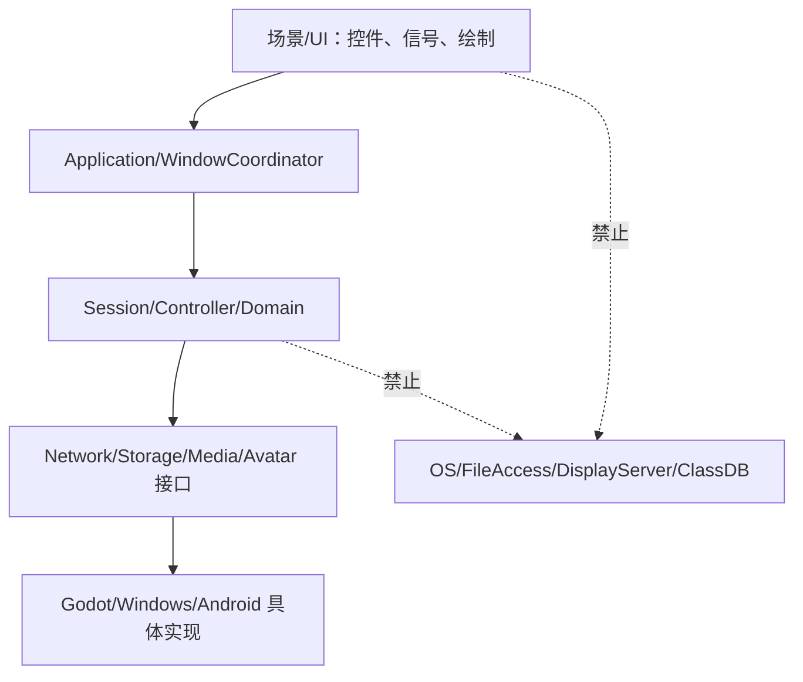
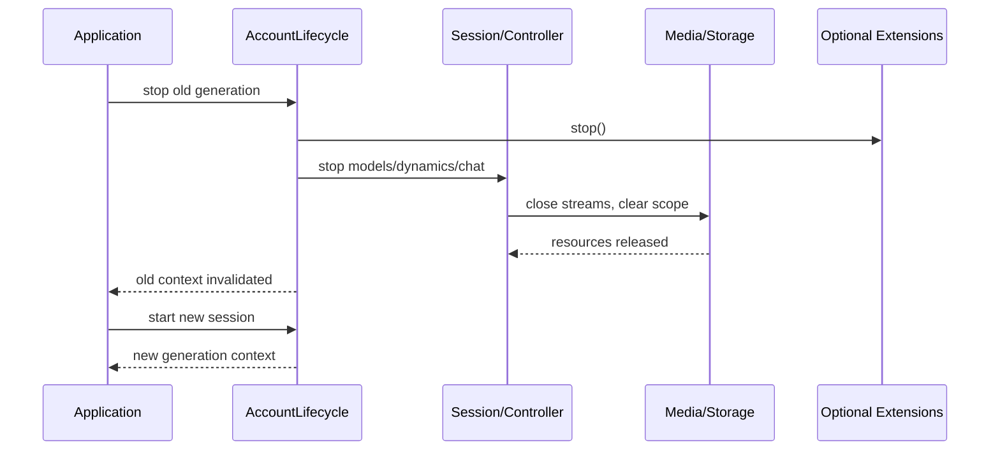
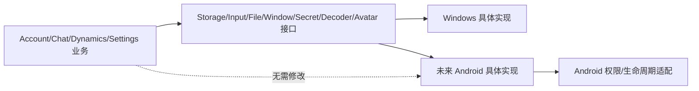
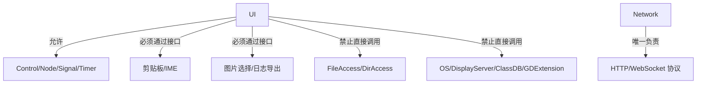

# 解耦与平台隔离

## 允许方向

| 调用者 | 可以依赖 | 禁止依赖 |
|---|---|---|
| 场景/UI | Godot 控件、信号、注入接口、状态字典 | FileAccess、DirAccess、OS、DisplayServer、ClassDB、原生 DLL、HTTP 组包 |
| 业务控制器 | domain、network、media、storage 接口 | 桌面窗口对象、具体平台类、场景内部路径 |
| Storage 实现 | 配置/缓存格式、Godot 文件 API或平台存储适配 | AccountApi、UI、万能 service locator |
| Platform 实现 | OS、窗口、输入法、剪贴板、原生插件 | 角色业务决策、聊天协议、长期账号状态 |
| Network | HTTP/WebSocket 协议 | 文件路径、控件、桌面窗口 |

所有依赖由 composition 或父节点显式注入，不新增全局服务定位器。`preview` 只依赖演示会话和共享 UI，不成为正式功能的后门。

## 为什么拆分

存储、日志、凭据、图片、音频和设置的数据格式、生命周期及失败语义不同，合并为万能存储会让 Android 替换和账号清理变得不可控。网络只在 network 模块组包，业务层拿到结构化结果即可。窗口协调器只管理复用、父子关系和草稿，不直接调用系统窗口 API；`WindowHost`/`WindowSystem` 才负责桌面实现。

## 账号隔离与局部降级

`AccountScope.key(server,username)` 为规范化服务器和用户名的哈希作用域。退出登录清理令牌、业务缓存、未完成请求和扩展状态，但日志窗口保留。解码器、角色驱动或未来能力缺失时只关闭对应媒体/扩展能力，文字聊天和日志仍可用；安全保护不可用则禁止登录并保留反馈入口。

## Android 扩展方式

Android 只需提供 `StorageService`、`WindowHost`、`InputService`、`FileInteraction`、`SecretProtection`、`DecoderFactory` 和 `AvatarDriver` 的新实现，并在 composition 中选择实现；AccountSession、ChatSession、DynamicsController、SettingsWindow 等业务代码不变。移动布局仍需另行验收，本轮没有 Android 实现。

## 未来模块

Appearance/World/Device 各自拥有上下文、请求 ID、完成信号和幂等 stop；默认实现立即返回不可用，不建立连接、不轮询、不进入聊天文本或现有协议。未来替换实现可独立测试，旧代次回调由 generation 丢弃。

## 依赖分层图

## 账号切换清理图

## Android 替换路径图

## 平台调用禁止矩阵

