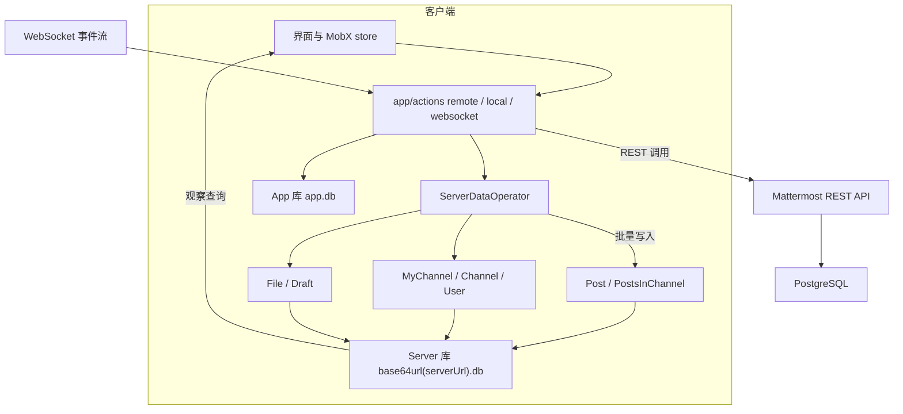

# Mattermost Mobile：WatermelonDB 本地消息存储分析

> 一句话结论：Mattermost Mobile 把 SQLite 当成服务端数据的本地缓存——一个 App 库加每个 serverUrl 一个 Server 库，发送先以 pending_post_id 乐观入库，失败保留行并标记 props.failed 交给用户手动重试；增量同步依赖 since 游标与 PostsInChannel 区间表，删除墓碑只能由 GetPostsSince 带回。

| 项 | 值 |
|---|---|
| 仓库 | `mattermost/mattermost-mobile` |
| Stars（2026-11-16） | 2,742（服务端主仓 `mattermost/mattermost` 为 39,616） |
| License | Apache-2.0 |
| 主语言 | TypeScript（React Native / Expo） |
| 分析 commit | `ffbc7675056bf35db4537c0c8eefedcf29fbf849` |
| 分析日期 | 2026-11-16 |

## 项目简介与定位

Mattermost Mobile 是 Mattermost 协作平台的官方 iOS/Android 客户端。Mattermost 可自托管，常被视为 Slack 的开源替代，因此这个客户端天生要面对「一台设备连多个实例」的场景。工程基于 React Native 与 Expo，业务代码为 TypeScript：`package.json:2` 声明包名 `mattermost-mobile`，`package.json:3` 版本 `2.46.0`，`package.json:8` 许可证 `Apache 2.0`。分层上，`app/actions` 按 remote、local、websocket 拆分动作，`app/queries` 承担查询，`app/store` 提供 MobX 风格状态，`app/client` 封装 REST 与 WebSocket。

它值得作为本地存储样本研究，原因不在功能多，而在取舍清楚：多实例要求数据库按服务器隔离；发送走「先本地、后远端」的乐观路径，pending 行有完整的创建、失败、重试生命周期；服务端是唯一权威，客户端只做缓存，所以同步问题被压缩成「游标加区间」两件事，代价则是删除与历史缺口都必须显式处理。

## 本地存储架构

存储引擎是 WatermelonDB 的 `SQLiteAdapter`，构造时开启 `jsi: true`（`app/database/manager/index.ts:6`、`app/database/manager/index.ts:112-118`）。表结构由 `appSchema` 与 `serverSchema` 声明，WatermelonDB 负责生成 SQLite 表与迁移。

数据库分成两级：

- App 库：库名固定为 `app`（`app/database/manager/index.ts:43`），由 `createAppDatabase` 建立（`app/database/manager/index.ts:101-134`），持有 `InfoModel`、`GlobalModel`、`ServersModel`（`app/database/manager/index.ts:53`），保存已登录服务器、当前服务器和全局偏好。
- Server 库：每个 serverUrl 一个，库名取 `urlSafeBase64Encode(serverUrl)`（`app/database/manager/index.ts:148`）。模型清单（`app/database/manager/index.ts:54-62`）覆盖 Post、PostsInChannel、PostsInThread、Channel、User、File、Draft、MyChannel 等。

文件位置按平台分叉。目录上，iOS 使用 `getIOSAppGroupDetails().appGroupDatabase`，Android 使用 `${Paths.document.uri}/databases/`（`app/database/manager/index.ts:64`）。文件名上，iOS 为 `${databaseDirectory}/${dbName}.db`，Android 为 `${databaseDirectory}${dbName}.db`（`app/database/manager/index.ts:631-633`）。合起来就是：Android 落在 `<document>/databases/<base64url(serverUrl)>.db`，iOS 落在 App Group 数据库目录下的同名文件，App 库则是 `app.db`。iOS 走 App Group，意味着主 App 与扩展可以共享同一份库。

零持久化模式是这套设计里比较特别的一支。当 server 记录满足 `persistenceFlag === 'zero-persistence'` 时，代码先删除磁盘库文件，再把 `dbName` 换成 `file:zpm_${databaseName}?mode=memory&cache=shared`（`app/database/manager/index.ts:155-168`，内存库名见 `app/database/manager/index.ts:166`），同时把 App 库中登记的 `databaseFilePath` 置空（`app/database/manager/index.ts:177`）。代码注释解释了不用裸 `:memory:` 的原因：WatermelonDB 的 reset 与 VACUUM 路径需要一个可重建的共享内存库。

进程与线程边界上，SQLite 访问被封装在 `SQLiteAdapter` 的 JSI 绑定里，业务代码不直接持有连接，也不拼 SQL；每个 serverUrl 的 Database 实例由 manager 缓存进 `serverDatabases` 映射（`app/database/manager/index.ts:47`），页面通过模型与查询读取，写入统一经过 operator。这样做的好处是连接生命周期集中管理，代价是调试时无法从业务代码直接看到最终执行的 SQL。

加密方面，在 `app/database` 目录检索 `encrypt|sqlcipher` 没有任何命中。能确定的只是「数据库层未发现加密配置」；文件是否受 OS 沙箱与设备加密保护，代码里没有体现，本次也没有检查 iOS/Android 原生工程是否另行接入 SQLCipher。

Schema 迁移由 WatermelonDB 的 `schemaMigrations` 管理。Server schema 为 `version: 24`（`app/database/schema/server/index.ts:51-53`），App schema 为 `version: 2`（`app/database/schema/app/index.ts:11`）。迁移表定义在 `app/database/migration/server/index.ts:33`。最新一版 `toVersion: 24` 给 ScheduledPost 增加 `repeat_type`、`repeat_timezone`（`app/database/migration/server/index.ts:34-45`）；`toVersion: 23` 给 POST 增加 `redaction_verified_epoch`、给 MY_CHANNEL 增加 `redaction_required_epoch`（`app/database/migration/server/index.ts:46-61`）。迁移过程由 `buildMigrationCallbacks` 打日志，记录 start 与 success（`app/database/manager/index.ts:592-601`）。整体是逐版本手写、只向前演进的路径，未见自动回滚。



## 数据结构

表名常量集中在 `app/constants/database.ts`：`POST: 'Post'`（`:32`）、`POSTS_IN_CHANNEL: 'PostsInChannel'`（`:33`）、`MY_CHANNEL: 'MyChannel'`（`:29`）、`FILE: 'File'`（`:24`）、`DRAFT: 'Draft'`（`:23`）。WatermelonDB 还会为每张表补 `id`、`_status`、`_changed` 等系统列，这些不出现在 tableSchema 里。

| 表 | 关键列 | 作用 | 出处 |
|---|---|---|---|
| `Post` | `channel_id`、`pending_post_id`、`type`、`user_id` 建索引；另有 `create_at`、`delete_at`、`edit_at`、`update_at`、`message`、`props`、`root_id`、`original_id`、`previous_post_id`、`redaction_verified_epoch` | 消息主体，含乐观发送留下的 pending 行 | `app/database/schema/server/table_schemas/post.ts:10-31` |
| `PostsInChannel` | `channel_id` 建索引；`earliest`、`latest` | 记录频道已连续缓存的时间区间 | `app/database/schema/server/table_schemas/posts_in_channel.ts:10-17` |
| `MyChannel` | `last_fetched_at` 建索引；`is_unread`、`last_post_at`、`last_viewed_at`、`viewed_at`、`manually_unread`、`mentions_count`、`urgent_mention_count`、`message_count`、`roles`、`redaction_required_epoch` | 当前用户对频道的视角：未读、已读位置、增量游标 | `app/database/schema/server/table_schemas/my_channel.ts:10-27` |
| `File` | `post_id` 建索引；`local_path` 可选；`mime_type`、`name`、`size`、`width`、`height`、`extension`、`image_thumbnail`、`is_blocked` | 附件元数据与本地路径 | `app/database/schema/server/table_schemas/file.ts:10-24` |
| `Draft` | `channel_id`、`root_id` 建索引；`message`、`files`、`metadata`、`update_at`、`type` | 离线草稿 | `app/database/schema/server/table_schemas/draft.ts:10-21` |

这五张表构成消息缓存的主干。`Post` 的 `pending_post_id` 特意建索引，是为了在收到服务端正式帖时按这个值找回本地临时行。`PostsInChannel` 不存消息，只存区间端点，因此「缓存是否连续」由它表达，而不是靠 `Post` 行数推断；区间按行记录，多段缓存意味着多行（推断）。`MyChannel` 同时承担未读状态与同步游标两种职责：`last_fetched_at` 是列名，模型层读作 `lastFetchedAt`，两者指向同一份数据。`File` 通过 `post_id` 挂到帖子上，`local_path` 为附件在设备上的落点留了可选字段。`Draft` 与消息表分离，草稿里的附件以 `files` 字符串描述，不进入 `Post`。

由于表以服务端 id 为主键，编辑不会产生新行，而是覆盖同一行；`edit_at` 与 `update_at` 只用于展示和排序，不构成版本链（推断）。删除则更直接，`handlePosts` 在持久化前就把删除帖丢弃，本地不会留下「已删除」标记行。这种「只留当前状态」的做法让读取简单，也意味着客户端无法离线回放编辑历史。

`props` 存的是字符串，`failed` 标记就塞在 `props.failed` 里，而不是独立列；这降低了迁移成本，也让「失败」变成业务层约定。`redaction_verified_epoch` 用于判断帖子的脱敏版本是否过期，属于合规相关字段。服务端 schema 里还声明了 Channel、User、Team、Thread、Reaction、Preference、CustomEmoji、Category、ScheduledPost、System、Config 等表（`app/database/schema/server/index.ts:53-100`），本次未逐列展开。

## 写入与读取路径

### 发送：乐观写入

入口是 `createPost(serverUrl, post, files)`（`app/actions/remote/post.ts:75`）。顺序如下：

1. 生成 pending id：`pendingPostId = post.pending_post_id || ${currentUserId}:${timestamp}`，时间戳取 `Date.now()`（`app/actions/remote/post.ts:89-91`）。
2. 幂等检查：若同 pending id 的行已存在且未失败，直接返回 `{data: false}`（`app/actions/remote/post.ts:93-96`）。
3. 本地插入：把 `id` 直接设为 pending id 后写库（`app/actions/remote/post.ts:116-119`）；有附件时先把每个 `f.post_id` 指向 pending id，再交给 `handleFiles`（`app/actions/remote/post.ts:123-130`）。
4. 批量提交：帖子走 `handlePosts` 的 `prepareRecordsOnly` 分支，随后与附件、最近表情一起 `batchRecords(..., 'createPost - initial')`（`app/actions/remote/post.ts:132-147`）。
5. 调远端：`client.createPost({...newPost, create_at: 0})`（`app/actions/remote/post.ts:156`）。

```ts
const currentUserId = await getCurrentUserId(database);
const timestamp = Date.now();
const pendingPostId = post.pending_post_id || `${currentUserId}:${timestamp}`;

const existing = await getPostById(database, pendingPostId);
if (existing && !existing.props?.failed) {
  return {data: false};
}
```

成功时用服务端返回的 `created` 再走一次 `handlePosts`，此时 `created.pending_post_id` 指回本地临时行，`batchRecords(models, 'createPost - success')` 完成替换，并顺带更新 `last_post_at` 与 CRT 线程模型（`app/actions/remote/post.ts:202-222`）。

失败时保留同一行，写入 `props.failed: true` 与新的 `update_at`（`app/actions/remote/post.ts:165-196`）。但有三类服务端错误属于不可恢复：根帖已删除、TownSquare 只读、插件拒收，对应 `DELETED_ROOT_POST_ERROR`、`TOWN_SQUARE_READ_ONLY_ERROR`、`PLUGIN_DISMISSED_POST_ERROR`，命中后直接 `removePost` 删本地行（`app/actions/remote/post.ts:177-183`）。

### 接收：按 id upsert，清理 pending

接收侧统一进 `ServerDataOperator.handlePosts`（`app/database/operator/server_data_operator/handlers/post.ts:490`）。对每个到来的帖子，如果它带 `pending_post_id` 且与自身 `id` 不同，就把「以 pending id 为 id 的副本」放进 `pendingPostsToDelete`（`app/database/operator/server_data_operator/handlers/post.ts:511-518`）。从这段代码推断：正式帖按 `post.id` 写入或覆盖，本地临时行按 `pending_post_id` 找到后删除，从而完成临时 id 到正式 id 的切换；素材把这一层标为推断，未做逐行验证。

所有变更先以 `prepareRecordsOnly` 收集，最后 `await this.batchRecords(batch, 'handlePosts')` 批量写入（`app/database/operator/server_data_operator/handlers/post.ts:696-711`）。删除的帖在持久化前被丢弃，注释明确写了 deleted posts are dropped before persistence（`app/database/operator/server_data_operator/handlers/post.ts:815-817`），避免留下孤立区间。区间表由 `handlePostsInChannel` 维护（`app/database/operator/server_data_operator/handlers/post.ts:751`），线程表由 `handlePostsInThread` 维护（`app/database/operator/server_data_operator/handlers/post.ts:724`）。

### 分页读取

默认页大小 60，围绕某帖取 10 条：`POST_CHUNK_SIZE: 60`（`app/constants/general.ts:8`）、`POST_AROUND_CHUNK_SIZE: 10`（`app/constants/general.ts:9`）。

- 首页：`fetchPosts(serverUrl, channelId, page, perPage, ...)`（`app/actions/remote/post.ts:542`），调 `client.getPosts`（`app/actions/remote/post.ts:551`），再 `handlePosts` 加作者用户与 CRT 线程，`batchRecords(models, 'fetchPosts')`（`app/actions/remote/post.ts:553-579`）。
- 向上翻页：`fetchPostsBefore`（`app/actions/remote/post.ts:593`），调 `client.getPostsBefore(channelId, postId, 0, perPage, ...)`（`app/actions/remote/post.ts:602`），动作类型 `POSTS.RECEIVED_BEFORE`，用于扩展区间（`app/actions/remote/post.ts:606-611`）。
- 重校验历史块：`revalidatePostsBefore`（`app/actions/remote/post.ts:656`）显式传 `skipPostsInChannel: true`（`app/actions/remote/post.ts:668-674`），避免把锚点之外的块接到最新区间，原因写在 `app/actions/remote/post.ts:651-653` 的注释里。
- 其他入口：线程 `fetchPostThread`（`app/actions/remote/post.ts:802`）、围绕某帖 `fetchPostsAround`（`app/actions/remote/post.ts:857`）、单帖 `fetchPostById`（`app/actions/remote/post.ts:993`）。

## 同步与一致性

增量同步的游标由两个来源兜底：

```ts
const since = myChannel?.lastFetchedAt || postsInChannel?.[0]?.createAt || 0;
```

即优先用 `MyChannel.lastFetchedAt`，没有则退到 `PostsInChannel` 首行的 `createAt`，再没有就是 0（`app/actions/remote/post.ts:358`）。同时计算 `needsReverification`：只要存在 `since`，且调用方要求忽略游标或本地存在未验证帖子，就需要重新校验（`app/actions/remote/post.ts:359-361`）。

有 `since` 时先走 `fetchPostsSince`（`app/actions/remote/post.ts:360-361`）。它调用 `client.getPostsSince(channelId, since, isCRTEnabled, isCRTEnabled, groupLabel)`（`app/actions/remote/post.ts:699`），动作类型 `POSTS.RECEIVED_SINCE`，结果 `batchRecords(models, 'fetchPostsSince')`（`app/actions/remote/post.ts:702-724`）。

删除只能从这条路径拿到。代码注释说明 since-fetch 是唯一能收到删除的通道，`handlePosts` 会把本地行销毁；若用普通分页替代，会漏掉删除，还会把最旧区间顶到 `postsInChannel[0]`（`app/actions/remote/post.ts:388-390`、`app/actions/remote/post.ts:431-434`）。因此 `fetchPostsSince` 之后必须再补一页常规分页，因为 since 只能带回增量，补不齐历史空洞（`app/actions/remote/post.ts:342-343`）。这是本方案最容易被误读的地方：since 负责墓碑与新增，分页负责历史连续性，两者不能互相替代。

区间模型由 `PostsInChannel.earliest` 与 `latest` 表达连续缓存范围。`RECEIVED_BEFORE` 向左扩展区间，`RECEIVED_SINCE` 更新或合并区间；空区间的特殊处理在 `app/database/operator/server_data_operator/handlers/post.ts:815-817` 有注释。

冷启动时的行为可以从同一段代码推断：新登录的频道没有 `lastFetchedAt`，`PostsInChannel` 也为空，`since` 落到 0，`if (since)` 不成立，于是不会调用 `GetPostsSince`，而是先取首页分页，再由 `PostsInChannel` 记下第一段连续区间。历史空洞只能靠后续向上翻页逐段补齐，这也是区间表存在的意义：它记录「哪一段是连续的」，而不是假装整个频道都已缓存。

一致性策略是服务端权威：本地不产生版本号，也不做字段级合并，收到什么就按 `post.id` 覆盖什么。唯一的保护是脱敏版本：`handlePosts` 用 `getSupersededPostIds` 拒绝过期的 sanitized payload（`app/database/operator/server_data_operator/handlers/post.ts:508`、`app/database/operator/server_data_operator/handlers/post.ts:528-530`）。幂等由两侧共同保证：发送侧靠 `pending_post_id` 判重（`app/actions/remote/post.ts:93-96`），接收侧靠 `post.id` upsert 并删除对应 pending 行（`app/database/operator/server_data_operator/handlers/post.ts:511-518`）。

崩溃一致性方面，素材只支持「写入通过 `batchRecords` 批量提交」，没有崩溃注入或事务隔离级别的证据，因此不应把它描述成某种原子事务保证。

## 离线消息处理

离线时能做的事分成三档：

- 可读：已缓存频道与帖子直接从 Server 库读出，`PostsInChannel` 决定哪些区间是连续的。
- 可写但不保证送达：新消息先落 pending 行，断网时远端调用失败，行被标记 `props.failed` 后留在库里（`app/actions/remote/post.ts:165-196`）。草稿独立存 `Draft` 表，按 `channel_id`、`root_id` 索引，可完全离线保存（`app/database/schema/server/table_schemas/draft.ts:10-21`）。
- 必然失败：任何需要服务端确认的操作，例如真正投递消息、拉取 since 增量。

重试是手动的。`retryFailedPost(serverUrl, post)` 位于 `app/actions/remote/post.ts:229`，步骤是：把 `props.failed` 置 false、清空 `id`、刷新 `create_at` 与 `update_at`（`app/actions/remote/post.ts:246-258`）；先本地 `prepareUpdate` 并 `batchRecords([post], 'retryFailedPost - first update')`（`app/actions/remote/post.ts:263-267`）；再调 `client.createPost(newPost)`，成功后用服务端帖 upsert 替换（`app/actions/remote/post.ts:270-285`）；若再次失败则恢复 `props.failed = true` 并 `batchRecords([post], 'retryFailedPost - error update')`（`app/actions/remote/post.ts:286-303`），不可恢复错误直接 `removePost`（`app/actions/remote/post.ts:289-294`）。

失败行与正式行共用一张 `Post` 表，只是 `id` 取 pending 值、`props.failed` 为真。这让列表渲染不需要合并两个数据源，代价是任何按 `id` 关联的逻辑都要意识到「这个 id 还不是服务端 id」；附件、表情、线程关系在 pending 阶段都挂在这个临时 id 上，替换时必须一起迁移。

素材在 `app/actions/remote/post.ts` 中没有找到「网络恢复后扫描 failed 帖自动重发」的实现，检索 `retry|failed|pending|offline` 也只命中上述函数与注释。因此可以写「只有手动重试入口，未发现后台自动重发」，但不能反推成「整个 App 绝对没有」：UI 层是否在某个组件里调用 `retryFailedPost`，本次未覆盖。

附件方面，发送时先把附件写入 `File` 表并绑定 pending post id（`app/actions/remote/post.ts:123-130`），API 只传 `file_ids`（`app/actions/remote/post.ts:107-114`），`File.local_path` 是可选的本地路径列（`app/database/schema/server/table_schemas/file.ts:16`）。上传与下载队列、失败重传、临时文件清理本次未覆盖，不能据此判断附件是否支持断点续传。

已读状态落在 `MyChannel` 的 `last_viewed_at`、`viewed_at`、`is_unread`、`manually_unread`、`mentions_count`、`urgent_mention_count`（`app/database/schema/server/table_schemas/my_channel.ts:13-24`），但已读上报的 action 以及断网时是否排队，素材未覆盖。编辑与删除的离线行为同样未覆盖。

## 设计权衡与适用场景

这套方案的核心判断是「本地永远是缓存」。好处很直接：

- 隔离干净。App 库与 Server 库分离，每个 serverUrl 一个文件，多实例不会互相污染。
- 读取响应快。业务层通过 WatermelonDB 的响应式模型层读写，界面可直接订阅表变化。
- 迁移可控。schema 版本与逐版本迁移显式可见，升级路径可审计。
- 合规场景有出口。zero-persistence 用共享内存库替代磁盘库，进程退出即丢（`app/database/manager/index.ts:155-168`）。

代价也同样明确：

- 连接与文件数随服务器数量线性增长，`serverDatabases` 常驻映射（`app/database/manager/index.ts:47`），登录多个实例时资源占用会累积。
- 没有发送队列。失败消息停在 `props.failed`，素材未发现应用重启后的后台重发路径，用户必须回到会话手动重试；这对「弱网下必须送达」的产品是硬伤。
- 删除依赖 since。只要某次同步跳过了 `GetPostsSince`，本地就可能留下服务端已删除的帖子；`PostsInChannel` 只描述区间，不会主动发现墓碑。
- 数据库层没有加密配置，安全边界外包给操作系统。
- pending 行替换依赖服务端回传 `pending_post_id`，一旦服务端不回传，临时行与正式行就可能并存。

适用场景因此比较清楚：服务端权威、消息以在线为主、需要多实例隔离与快速首屏的协作类客户端。它不适合把本地当权威、要求离线发送必达或本地强加密的 IM。同系列里若某项目自带 outbox 与重放队列，那类设计在离线投递上更强，但复杂度也高一个量级。

## 证据与限制

| 结论 | 出处 | 符号 |
|---|---|---|
| 使用 WatermelonDB SQLiteAdapter，开启 JSI | `app/database/manager/index.ts:6`、`app/database/manager/index.ts:112-118` | `SQLiteAdapter`、`createAppDatabase` |
| Server 库按 base64url(serverUrl) 命名 | `app/database/manager/index.ts:148` | `createServerDatabase` |
| iOS 用 App Group 目录，Android 用 document/databases | `app/database/manager/index.ts:64`、`app/database/manager/index.ts:631-633` | `databaseDirectory`、`getDatabaseFilePath` |
| 零持久化切换到共享内存库 | `app/database/manager/index.ts:155-168` | `zpm`、`memoryDbName` |
| Server schema 24，App schema 2 | `app/database/schema/server/index.ts:51-53`、`app/database/schema/app/index.ts:11` | `serverSchema`、`schema` |
| Post 表字段与索引 | `app/database/schema/server/table_schemas/post.ts:10-31` | `Post` tableSchema |
| PostsInChannel 区间端点 | `app/database/schema/server/table_schemas/posts_in_channel.ts:10-17` | `PostsInChannel` |
| MyChannel 未读与 last_fetched_at | `app/database/schema/server/table_schemas/my_channel.ts:10-27` | `MyChannel` |
| File.local_path 与 Draft 离线草稿 | `app/database/schema/server/table_schemas/file.ts:10-24`、`app/database/schema/server/table_schemas/draft.ts:10-21` | `File`、`Draft` |
| 发送乐观写入 pending 行 | `app/actions/remote/post.ts:75`、`app/actions/remote/post.ts:89-147` | `createPost` |
| 失败写 props.failed | `app/actions/remote/post.ts:165-196` | `createPost` |
| 手动重试失败帖 | `app/actions/remote/post.ts:229-303` | `retryFailedPost` |
| 接收 upsert、批量写入并清理 pending | `app/database/operator/server_data_operator/handlers/post.ts:490-518`、`app/database/operator/server_data_operator/handlers/post.ts:696-711` | `handlePosts`、`batchRecords` |
| since 游标来源与增量拉取 | `app/actions/remote/post.ts:358-361`、`app/actions/remote/post.ts:689-724` | `fetchPostsForChannel`、`fetchPostsSince` |
| 删除墓碑只由 since 带回 | `app/actions/remote/post.ts:342-343`、`app/actions/remote/post.ts:388-390`、`app/actions/remote/post.ts:431-434` | 注释与 `fetchPostsForChannel` |

未验证或材料未覆盖的点：

- Stars 为 2026-11-16 快照（2,742；服务端主仓 39,616），未在文中重复查询。
- 未做崩溃注入，`batchRecords` 只能表述为批量写入，事务边界与隔离级别未知。
- `handlePostsInChannel` 的区间合并算法（`app/database/operator/server_data_operator/handlers/post.ts:751-830`）未逐行阅读，gap 语义依据注释与调用点推断。
- 附件上传与下载队列、已读上报排队、编辑与删除的离线行为均未覆盖。
- 数据库层无 `encrypt|sqlcipher` 命中，但原生工程是否启用 SQLCipher 未检查。
- 仓库不存在 `app/sagas`，原先的 redux-saga 结构已由 `app/actions` 与 `app/store` 取代。