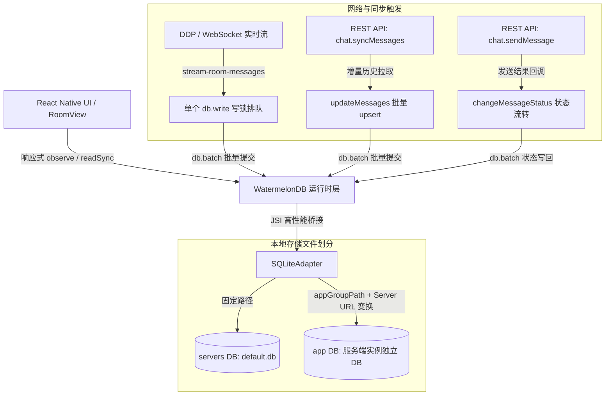

# Rocket.Chat Mobile：WatermelonDB 缓存与增量补齐

> Rocket.Chat 移动端采用基于 WatermelonDB 的双库与面向文档的 SQLite 缓存方案：通过服务端全局 `_id` 进行幂等 upsert 并利用 `last_open` 时间戳排空推进游标，换取了跨多服务端的轻量隔离与直观的响应式渲染体验；但缺乏数据库级加密、缺失 `(rid, ts)` 复合索引、未设持久化 Outbox 队列且重连不自动重发，决定了它本质上是一个偏向只读浏览与被动同步的弱一致本地缓存层，而非强离线能力的客户端数据中枢。

## 元数据

| 项 | 值 |
|---|---|
| 仓库 | `https://github.com/RocketChat/Rocket.Chat.ReactNative` |
| Stars（2026-11-16） | 2,423（服务端主仓 RocketChat/Rocket.Chat 为 46,533） |
| License | MIT |
| 主语言 | TypeScript / JavaScript（React Native） |
| 分析 commit | `1b487ca3f35f7327ffec7d4c8559ac19aef98d63` |
| 分析日期 | 2026-11-16 |

## 1. 项目简介与定位

Rocket.Chat.ReactNative 是 Rocket.Chat 官方基于 React Native 打造的移动客户端（支持 iOS 16.4+ 与 Android 7.0+，`README.md:3-5`），连接自建或官方托管的服务端实例。服务端技术栈根植于 Meteor 与 MongoDB，底层具备天然的文档型与非规范化特征。当移动端为了离线浏览引入客户端 SQLite 时，必然面临文档模型向关系表映射的架构抉择。

客户端选用了深度优化的响应式框架 WatermelonDB（版本 `^0.28.1-0`，`package.json:38`），以 SQLite 为底层引擎，将订阅列表、消息流、线程、用户元数据及附件持久化在本地。其通过 DDP 长连接流式监听实时变更，通过 REST API 执行操作与增量补齐。分析该项目有助于理解移动端在多工作区物理隔离、弱网增量补偿与响应式渲染驱动之间的工程取舍。

## 2. 本地存储架构

Rocket.Chat 移动端本地存储由多实例隔离机制、JSI 驱动的 SQLite 适配层、无加密的平铺存储以及版本化迁移链条组成。



### 2.1 双层数据库隔离设计

客户端采用「全局配置库 + 业务独立库」的双层物理隔离架构（`app/lib/database/index.ts:68-84`、`:95-97`）：
1. **全局 servers DB（`default.db`）**：存放全局服务端列表、登录凭据、用户信息及房间列表更新标记（`rooms_updated_at`），对应独立 schema（`version: 19`，`app/lib/database/schema/servers.js:4`）。
2. **实例级 app DB**：针对连接的每个服务端实例独立建库（`version: 30`，`app/lib/database/schema/app.js:4`）。工作区数据在物理文件层面彻底隔离，切服时通过切换激活连接（`setActiveDB`）变更上下文，杜绝多租户脏读。

### 2.2 数据库命名与落盘路径

数据库文件名由服务端 URL 计算得出：去除协议前缀并将斜杠 `/` 换为点号 `.`，拼接为 `${appGroupPath}${name}.db`（`app/lib/database/index.ts:31-36`）。在 iOS 上，`appGroupPath` 取自原生模块 `AppGroup.path`（`app/lib/methods/appGroup.ts:3-7`），推断其位于 App Group 容器内以供主 App 与通知扩展共享；Android 上 `appGroupPath` 为空串，由 SQLiteAdapter 按默认相对路径创建。

### 2.3 适配器与驱动配置

数据库连接采用 `SQLiteAdapter`，显式开启 JSI 模式（`jsi: true`）与原生复用（`experimentalUnsafeNativeReuse: true`，`app/lib/database/index.ts:35-46`）。JSI 允许 JS 直接调用 C++ 绑定的 SQLite 接口，消除传统 Bridge 通信延迟，保障批量写入与查询吞吐。此外，客户端通过 `readSync.ts` 绕过异步 API，直接读取 WatermelonDB 缓存或底层 adapter 同步接口（`findRecordSync`、`fetchQuerySync`），支撑头像 ETag 等关键渲染路径的同步取值（`app/lib/database/readSync.ts:3-24`、`app/containers/Avatar/useAvatarETag.ts:21-28`）。

### 2.4 本地无加密现状

适配器初始化未配置任何 `encryptionKey` 或 SQLCipher（`app/lib/database/index.ts:35-46`），数据库纯明文存储。虽然系统支持端到端加密（E2E），但加密仅覆盖传输与远端存储；在本地入库前，消息已通过 `Encryption.decryptMessages` 解密为明文（`app/lib/methods/updateMessages.ts:46`）。因此消息正文、附件信息与房间名在本地磁盘上均无加密保护。

### 2.5 Schema 版本迁移

业务库处于 schema v30（`app/lib/database/schema/app.js:4`），通过 `schemaMigrations` 从 v2 线性演进（`app/lib/database/model/migrations.js:1-4`、`:352-367`）。除常规 `addColumns` 外，迁移还利用 `unsafeExecuteSql` 清理非法 emoji 及设置状态。如 v30 为 `subscriptions` 增加 `category` 列时执行：
```sql
INSERT OR REPLACE INTO local_storage (key, value) VALUES ('fullRoomsSync', 'true');
```
该语句向内置 `local_storage` 表写入标记，强制客户端升级后首次启动执行全量房间列表同步（`app/lib/database/model/migrations.js:360-367`、`app/sagas/rooms.js:39`）。

## 3. 数据结构：文档型字段塞入关系表的取舍

Rocket.Chat 的底层数据结构体现了典型的「将 MongoDB 嵌套文档压平为 SQLite 宽表」的妥协设计。

### 3.1 核心数据表清单

业务库（app DB）核心表结构如下表所示：

| 表名 | 实体作用 | 主键与关键列（含索引） | 关联关系 | 行号出处 |
|---|---|---|---|---|
| `subscriptions` | 房间/订阅列表、未读计数、草稿、最后同步游标、E2E 密钥 | `_id`（主键）、`rid`(indexed)、`t`(indexed)、`name`(indexed)、`team_id`(indexed)、`last_open`、`unread`、`last_message`（JSON）、`draft_message` | `has_many messages (rid)`、`has_many threads (rid)`、`has_many uploads (rid)` | `app.js:7-80`、`Subscription.js:9-16` |
| `messages` | 房间主消息流 | `_id`（主键）、`rid`(**indexed**)、`ts`、`msg`、`status`、`tmid`、`tlm`、`tcount`、`u`（JSON）、`attachments`（JSON）、`reactions`（JSON）、`md`（JSON） | `belongs_to subscriptions (rid)` | `app.js:98-137`、`Message.js:6-12` |
| `threads` | 线程头记录与摘要 | `_id`（主键）、`rid`(indexed)、`tmid`、`tlm`、`tcount`、`draft_message`、`msg` | `belongs_to subscriptions (rid)` | `app.js:139-175` |
| `thread_messages` | 线程内部回复消息流 | `_id`（主键）、`rid`(indexed)、`subscription_id`(indexed)、`ts`、`msg`、`status` | `belongs_to subscriptions (subscription_id)` | `app.js:177-214` |
| `uploads` | 待上传/上传中附件任务 | `id`（`${path}-${rid}`）、`path`、`rid`(indexed)、`progress`、`error` | `belongs_to subscriptions (rid)` | `app.js:236-248` |
| `users` | 轻量用户头像缓存 | `_id`(indexed)、`username`(indexed)、`avatar_etag` | 无外键约束 | `app.js:282-288` |

### 3.2 复合索引缺失的查询代价

在 `messages` 表定义中，仅在 `rid` 上建立了单列索引（`app/lib/database/schema/app.js:102`），代表时间的 `ts` 仅为普通数值列，**未建立 `(rid, ts)` 复合索引**（`app/lib/database/schema/app.js:103`）。

IM 最核心的读取是「按房间倒序获取最新 N 条消息」。缺失复合索引时，SQLite 仅能通过 `rid` 滤出全房间记录，再在内存或临时文件中进行全量文件排序（File Sort）并截取 limit。在大房间累积数万条消息时，查询耗时会随本地消息增长而显著恶化。

### 3.3 文档型 JSON 字符串落地的利弊

本地模型将发送者 `u`、附件 `attachments`、反应 `reactions`、语法树 `md` 等复杂结构直接存为 JSON 文本列（`app/lib/database/schema/app.js:105-132`），Model 层通过 `@json('attachments', sanitizer, { memo: true })` 装饰器转换（`app/lib/database/model/Message.js:25-30`、`app/lib/database/utils.ts:37`）。

这种设计的权衡在于：
- **收益**：免除创建与维护子表的级联开销，与服务端 MongoDB 报文结构天然契合；配合 `{ memo: true }` 复用反序列化缓存，开发与写入开销低。
- **代价**：丧失 SQL 条件下推能力，无法在数据库级高效过滤嵌套字段（如筛选特定附件类型）；字段局部变更必须全量重写 JSON 字符串，放大了 I/O 开销。

## 4. 写入与读取路径

Rocket.Chat 移动端在写入链路中高度依赖 WatermelonDB 的事务锁机制，严格区分了发送态乐观写入与接收态幂等写入。

### 4.1 发送链路：乐观写入与手动状态机

文本消息发送集中在 `app/lib/methods/sendMessage.ts:94-236`，采用「先本地落库（`TEMP`）→ 后端 REST 提交 → 成功改 `SENT` 或失败改 `ERROR`」的三段式流程：

```
[UI 触发发送]
       │
       ▼
 1. 本地事务 (db.write)
    - 生成 17 位随机 messageId
    - E2E 加密正文 (若开启)
    - prepareCreate 创建 Message (status = TEMP)
    - 若为线程消息：联动更新/创建 Thread 头及 ThreadMessage
    - 清理房间草稿 (draft_message)
    - db.batch() 提交
       │
       ▼
 2. 网络调用 (sendMessageCall)
    - sdk.post('chat.sendMessage', { message })
       │
  ┌────┴──────────────────────────┐
  │ 成功                          │ 异常 / 失败
  ▼                               ▼
 3a. changeMessageStatus         3b. changeMessageStatus
     (status = SENT)                 (status = ERROR)
     合并服务端返回字段              保留本地消息
```

1. **本地乐观入库**：调用 `sendMessage()` 时，生成 17 位客户端临时随机字符串作为 `_id`（`app/lib/methods/sendMessage.ts:108`），若开启 E2E 则加密正文。随后在单次 `db.write` 事务中构造操作批次：
   - 创建 `messages` 记录并赋予 ID，状态置为 `messagesStatus.TEMP = 1`（`app/lib/methods/sendMessage.ts:195-208`、`app/lib/constants/messagesStatus.ts:2`）；
   - 若为线程消息，联动更新线程头 `tlm`/`tcount` 并在 `thread_messages` 创建 `TEMP` 记录（`app/lib/methods/sendMessage.ts:135-188`）；
   - 清空对应房间订阅的草稿内容（`subscriptions.draft_message`）；
   - `await db.batch(batch)` 一次性提交落盘（`app/lib/methods/sendMessage.ts:235`）。
2. **网络调用**：事务完成后，执行 `sendMessageCall(message)` 发送 `POST chat.sendMessage`（`app/lib/methods/sendMessage.ts:57-71`）。
3. **状态流转**：
   - 服务端返回成功后，调用 `changeMessageStatus(_id, messagesStatus.SENT, tmid, result.message)` 改为 `SENT = 0`，并把远端返回的 mentions、attachments、md 等字段合并回本地行（`app/lib/methods/sendMessage.ts:14-55`）；
   - 请求抛出异常或失败时，在 `catch` 块中调用 `changeMessageStatus(_id, messagesStatus.ERROR, tmid)` 改为 `ERROR = 2`。

### 4.2 接收链路：DDP 流消费与写锁串行化

实时消息经 DDP 的 `stream-room-messages` 事件推送，解码规范化后进入 `updateMessage`（`app/lib/methods/subscriptions/room.ts:47-62`、`:389-397`）。

源码指出了一项关键的并发控制设计（`app/lib/methods/subscriptions/room.ts:255-258`）：
```ts
// updateMessage is called sequentially using a lock mechanism to avoid concurrent prepareUpdate calls
// to records that already have pending changes.
```
WatermelonDB 模型被调用 `prepareUpdate` 后至提交前带有 pending changes。若外部并发流针对同一 `_id` 连续读取并调用 `prepareUpdate`，会触发底层断言异常。为消除冲突，更新逻辑整体包裹在单个 `db.write` 锁内串行化执行（`app/lib/methods/subscriptions/room.ts:283-385`）：
1. 在写锁保护下通过 `getMessageById(message._id)` 检索既有行；
2. 若记录已存在，调用 `prepareUpdate` 并通过 `Object.assign` 覆盖字段；
3. 若记录不存在，调用 `prepareCreate`，利用 `sanitizedRaw({ id: message._id }, schema)` 初始化，再执行赋值；
4. 若消息包含线程标记（`tlm` 或 `tmid`），在同一个批次内联动执行 `threads` 与 `thread_messages` 表的对应 upsert；
5. 最后单次执行 `db.batch(...batch)` 提交。

若推送中的附件 URL 未变，则保留本地下载路径（如 `title_link` 已为 `file://`），防止远端数据冲掉已缓存的本地媒体文件（`app/lib/methods/subscriptions/room.ts:266-282`、`app/lib/methods/updateMessages.ts:162-168`）。

### 4.3 历史分页与批量更新

历史消息加载由 `loadMessagesForRoom` 负责，采用固定步长批量拉取策略（`COUNT = 50`，最大批次数 `MAX_BATCHES = 10`，`app/lib/methods/loadMessagesForRoom.ts:16-17`）：
1. 客户端调用 `channels.history`、`groups.history` 或 `im.history`，传入 `{ roomId, count: 50, latest? }`（`app/lib/methods/loadMessagesForRoom.ts:53-71`）。
2. 若单页过滤系统消息后可见主消息不足 50 条且当前批次已满 50 条，会以最后一条的 `ts` 为 `latest` 递归翻页（最多 10 批），截断处插入 `load-more-${id}` 占位记录（`MessageTypeLoad.MORE`，`app/lib/methods/loadMessagesForRoom.ts:77-107`）。
3. 消息数组统一交给 `updateMessages` 批量 upsert（`app/lib/methods/updateMessages.ts:26-231`）：
   - 在写锁内先按 `rid` 与 `id oneOf` 一次性将数据库内已存在的记录查入内存数组；
   - 区分计算出待创建（`filteredMsgsToCreate`）与待更新（`filteredMsgsToUpdate`）列表；
   - 线程数据仅在本地 `_updatedAt < 服务端 _updatedAt` 时才更新，防止旧响应覆盖新状态（`app/lib/methods/updateMessages.ts:97-103`、`:137-143`）；
   - 汇总操作并调用 `db.batch(allRecords)` 瞬间入库（`app/lib/methods/updateMessages.ts:231`）。

向后更新方向的翻页则通过 `loadNextMessages` 调用 `getNextMessages({ rid, after: ts, count: 50 })`，同样在数据未完全对齐时插入 `NEXT_CHUNK` 占位符驱动 UI（`app/lib/methods/loadNextMessages.ts:12-41`）。

## 5. 同步与一致性

客户端重连后依赖时间戳游标实现增量对齐，依托服务端全局主键实现落库幂等。

### 5.1 增量同步与游标设计

客户端直接复用订阅表的 `subscriptions.last_open` 字段兼任增量同步游标（`app/lib/database/schema/app.js:23`、`app/lib/methods/loadMissedMessages.ts:62`）。

长连接重连时触发 `loadMissedMessages({ rid })`（`app/lib/methods/subscriptions/room.ts:53-54`、`:94-102`）：
1. 提取 `cursor = sub.lastOpen`；
2. 针对 ≥ 7.1.0 服务端调用 `chat.syncMessages`，传入 `{ roomId, next: cursor.getTime(), count: 50, type: 'UPDATED' | 'DELETED' }` 并行拉取更新与删除（`app/lib/methods/loadMissedMessages.ts:21-74`）；旧服务端降级传入 `lastUpdate: cursor.toISOString()`；
3. 结果返回后先 `updateMessages({ update: updated, remove: deleted })` 落库，若仍有 `updatedNext/deletedNext` 则递归续拉（`app/lib/methods/loadMissedMessages.ts:99-120`）。

### 5.2 游标推进时机与 Gap 处理机制

游标推进机制包含明确规则：
- **无游标回退**：首次打开房间且 `last_open` 为空时，回退至 `loadMessagesForRoom` 全量拉历史以建立初始游标（`app/lib/methods/loadMissedMessages.ts:82-89`）。
- **UPDATED 排空原则**：在分页拉取中，**必须等 `UPDATED` 集合全部排空（`!updatedNext` 为真）才允许更新 `last_open`**（`app/lib/methods/loadMissedMessages.ts:122-127`）：
  ```ts
  if (fetchedUpdatedPage && !updatedNext) {
      await updateLastOpen(args.rid, serverTimestamps);
  }
  ```
  新游标取本次拉取所有消息服务端 `_updatedAt` 的最大值：`lastOpen = new Date(Math.max(...timestamps))`（`app/lib/methods/updateLastOpen.ts:11-36`）。仅拉取 `DELETED` 续页时不更新游标。

**一致性权衡**：
- **崩溃安全**：多页同步中途崩溃或断网时，由于 `last_open` 尚未推进，下次重连仍以旧游标重拉。依托主键 upsert 机制，重复消息可被幂等吸收，**避免了中途推进游标导致的消息永久丢失（Gap）**。
- **时钟依赖代价**：方案依赖服务端时钟与 `_updatedAt` 单调递增。若服务端发生时钟回拨，本地已推进的 `last_open` 可能高于远端时间戳，导致回拨期消息被漏拉（推论，本地未见时间回拨滑动窗口补偿）。

### 5.3 幂等写入与服务端物理删除

- **主键幂等**：本地消息行将服务端 `_id` 注入内部主键 `id`（`sanitizedRaw({ id: message._id })`，`app/lib/methods/updateMessages.ts:106-112`），规避了自增主键系统在重复推流与分页重叠下的重复行问题。
- **物理删除**：通过 `stream-notify-room` 监听 `deleteMessage` 或 `deleteMessageBulk`，按条件查出行后调用 `destroyPermanently()` 物理删除（`app/lib/methods/subscriptions/room.ts:142-230`）。
- **已读回执**：`readMessages(rid)`（防抖 300ms）先发出 `POST subscriptions.read`，成功后清零订阅的 `unread`（`app/lib/methods/readMessages.ts:30-49`）；同时监听 `messagesRead` 事件将 `ts <= lastOpen` 消息标记为已读（`app/lib/methods/helpers/markMessagesRead.ts:10-28`）。

## 6. 离线消息处理

移动端离线能力侧重于静态历史的可读性，在离线发送与自动重发上采用了极简实现。

### 6.1 缺乏持久化 Outbox 的代价

在断网发送与重试机制上，Rocket.Chat 移动端存在显著限制：
1. **无独立持久化 Outbox**：待发消息直接保存在 `messages` 表中，仅以 `status = TEMP`（值为 1）标记（`app/lib/methods/sendMessage.ts:203`）。
2. **断网发送即转 ERROR**：离线发送时，本地写入 `TEMP` 记录后立即发起 REST 请求；因无网络请求失败，`catch` 块直接将本地记录标记为 `ERROR = 2`（`app/lib/methods/sendMessage.ts:57-71`）。
3. **重连不自动重发**：长连接重连时触发的 `handleConnection` **仅执行拉取遗漏增量（`loadMissedMessages`）与已读上报（`read`）**（`app/lib/methods/subscriptions/room.ts:94-102`），不会扫描本地 `TEMP/ERROR` 消息并重发。
4. **异常退出悬挂 TEMP**：若在网络挂起等待响应时被杀进程，本地行将永久保持 `TEMP`。因缺少启动扫描清理机制，UI 会长期显示为发送中（Pending）。
5. **纯手动重发入口**：失败消息必须由用户在 UI 点击呼出 `MessageErrorActions` 面板：选择「Resend」调用 `resendMessage` 重发，或选择「Delete」彻底删除记录（`app/containers/MessageErrorActions.tsx:18-113`、`app/lib/methods/sendMessage.ts:73-91`）。

### 6.2 附件上传的异构状态机

文本消息与附件上传在状态机上完全解耦：
- **独立 uploads 表**：附件不写入 `messages`，而是在 `uploads` 表建行，以 `${path}-${rid}` 为主键记录进度与错误（`app/lib/database/schema/app.js:236-248`、`app/lib/methods/sendFileMessage/utils.ts:43-57`）。
- **进度响应式驱动**：上传时高频写入 `progress`，UI 通过 `observeWithColumns(['progress', 'error'])` 渲染进度条（`app/lib/methods/sendFileMessage/sendFileMessage.ts:69-88`、`app/views/RoomView/components/UploadProgress.tsx:100`）。
- **流转完全分离**：上传成功后直接物理删除 upload 记录，真实消息由服务端流推回；上传失败置 `error = true`，在 `UploadProgress` 组件重试或取消（`app/views/RoomView/components/UploadProgress.tsx:126-166`）。附件失败不会在消息流产生 ERROR 行，两套状态机语义并不统一。

## 7. 设计权衡与适用场景

### 7.1 架构收益

1. **响应式 UI 体验优异**：依托 WatermelonDB 观察者模式与 JSI 直调，列表变更细粒度推送到组件，交互流畅。
2. **多租户物理隔离彻底**：按服务端 URL 独立切分 SQLite 文件，切换工作区重置连接上下文即可，阻断多服务数据污染。
3. **主键对齐消除并发复杂度**：完全采用服务端全局 `_id`，乱序推流与分页重叠直接降维为幂等 upsert。
4. **文档型存储降低维护成本**：复杂结构以 JSON 文本列平铺存储，省去繁重外键维护与级联操作，契合服务端格式。

### 7.2 局限与代价

1. **静态存储无加密**：未配置 SQLCipher，E2E 消息入库前已解密，本地存储为明文。
2. **大房间查询性能隐患**：缺少 `(rid, ts)` 复合索引，万级消息房间的倒序分页引发全量排序开销。
3. **离线弱容错与无自动重发**：无持久化 Outbox，断网发送即失败标错，重连不自动重试，被杀容易残留死锁 TEMP 状态。
4. **Schema 迁移不可逆风险**：如 v30 强制写入 `fullRoomsSync` 标记，大规模升级缺乏回滚机制。

### 7.3 适用与不适用场景

- **适用**：企业内网协同办公；网络相对稳定的多服务在线切换；主要依赖近端消息查看的场景。
- **不适用**：高保密合规要求通信系统（无库级加密）；弱网与高离线时长的作业调度（无自动重发与 Outbox）；单房间消息极庞大且频繁按时间检索的社群。

## 8. 证据与限制

### 8.1 关键事实证据表

| 核心技术结论 | 仓库相对路径与行号 | 对应代码符号 / 机制 |
|---|---|---|
| 使用 WatermelonDB SQLiteAdapter，JSI 开启，未配置 DB 加密 | `app/lib/database/index.ts:35-46` | `getDatabase` / `SQLiteAdapter` |
| 数据库路径按 URL 变换并拼接 appGroupPath | `app/lib/database/index.ts:31-36` | `getDatabasePath` |
| iOS 采用 AppGroup 原生路径，Android 留空 | `app/lib/methods/appGroup.ts:3-7` | `appGroupPath` |
| 业务库 Schema 版本为 30，服务器库版本为 19 | `app/lib/database/schema/app.js:4`、`servers.js:4` | `appSchema` |
| Schema v30 迁移写入 fullRoomsSync 强制全量同步 | `app/lib/database/model/migrations.js:360-367` | `schemaMigrations` |
| 消息表仅在 rid 上建立索引，ts 无独立或复合索引 | `app/lib/database/schema/app.js:98-113` | `tableSchema({ name: 'messages' })` |
| 发送链路先本地写入 TEMP 状态记录再调后端 REST | `app/lib/methods/sendMessage.ts:94-236` | `sendMessage` |
| 依据 REST 响应切换消息状态为 SENT 或 ERROR | `app/lib/methods/sendMessage.ts:57-71` | `sendMessageCall` / `changeMessageStatus` |
| 实时消息在单个 db.write 写锁内串行化处理 | `app/lib/methods/subscriptions/room.ts:255-385` | `RoomSubscription.updateMessage` |
| 批量 upsert 按 rid + id oneOf 过滤并结合 _updatedAt 比较 | `app/lib/methods/updateMessages.ts:26-231` | `updateMessages` |
| 增量同步拉取 chat.syncMessages 并以 lastOpen 为游标 | `app/lib/methods/loadMissedMessages.ts:14-74` | `loadMissedMessages` |
| 仅在 UPDATED 分页彻底排空后才推进 lastOpen 游标 | `app/lib/methods/loadMissedMessages.ts:122-127` | `loadMissedMessages` |
| 重连仅拉取增量与上报已读，完全不执行待发重发 | `app/lib/methods/subscriptions/room.ts:94-102` | `handleConnection` |
| 错误消息仅提供手动 Resend 与 Delete 交互操作 | `app/containers/MessageErrorActions.tsx:18-113` | `MessageErrorActions` |
| 附件独立使用 uploads 表跟踪进度与错误 | `app/lib/database/schema/app.js:236-248` | `tableSchema({ name: 'uploads' })` |

### 8.2 限制与未验证事项说明

1. **原生层实现细节**：iOS `AppGroup` 原生模块内部容器挂载机制、Android SQLite 实际落地文件系统的具体沙盒目录未深入查证，系依据 TypeScript 路径拼装逻辑推断。
2. **E2E 密钥管理体系**：端到端加密公私钥在移动端密钥链（Keychain/Keystore）中的生命周期与派生逻辑未在本素材范围内覆盖，仅核实了消息体在落库前解密为明文写入 SQLite 这一核心事实。
3. **本地消息生命周期修剪**：除登出和手动清理缓存调用 `db.unsafeResetDatabase()` 外（`app/lib/methods/logout.ts:70`、`app/lib/methods/clearCache.ts:28`），未在素材中发现针对单房间最大消息条数或过期消息的自动淘汰剪裁（Eviction）机制。
4. **Subscription 模型列存疑**：在 `app/lib/database/model/Subscription.js:76` 中声明了 `@field('notifications')`，但在当前 `schema/app.js:7-80` 中未发现该列定义，属于潜在的历史遗留死字段或 WatermelonDB 容忍行为。
