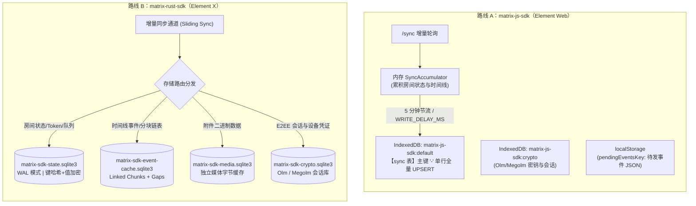

# Element / Matrix：两种客户端本地存储路线

> **一句话结论**  
> Matrix 协议坚持服务端全序权威，客户端本地存储本质上是可从增量游标（`next_batch`）随时重建的只读视图缓存；Element Web（matrix-js-sdk）以极简粗暴的 IndexedDB 单行全量 `/sync` 快照换取实现复杂度收敛，而下一代 Element X（matrix-rust-sdk）则通过多 SQLite 库解耦与双向链表分块（Linked Chunks + Gaps）实现了细粒度事件缓存和持久化保序发送队列。

---

## 统一元数据

| 项目 / 属性 | matrix-js-sdk（Element Web 使用） | matrix-rust-sdk（Element X 使用） |
|---|---|---|
| **开源仓库** | [matrix-org/matrix-js-sdk](https://github.com/matrix-org/matrix-js-sdk) | [matrix-org/matrix-rust-sdk](https://github.com/matrix-org/matrix-rust-sdk) |
| **Stars 快照** | 2,203（2026-11-16；参考 element-web 为 13,660） | 2,360（2026-11-16） |
| **开源协议** | Apache-2.0 | Apache-2.0 |
| **主要语言** | TypeScript（v45.1.0） | Rust |
| **分析 Commit** | `05f31bcb2ba435f0451279a32bec20ec610ef515` | `ce0552083826b15f41e05cf03abbca0d6b9e68d2` |
| **分析日期** | 2026-11-16 | 2026-11-16 |

---

## 项目简介与定位

Matrix 是一套开放、去中心化的联邦即时通讯协议标准。在 Matrix 的系统边界设计中，服务端的 Homeserver（如 Synapse）作为终极全序时钟与分布式状态机的主控方，牢牢掌握了事件全序、状态解析（State Resolution）以及房间拓扑变更的绝对权威。在此协议前提下，客户端无需在本地维护不可篡改的长期权威账本，终端数据仓库的核心定位是「**加速应用启动与减少全量同步开销的可重建视图缓存**」。

在 Element 生态的漫长演进中，官方客户端分裂出了两条截然不同却高度互为对照的本地存储技术路线：
1. **浏览器时代的传统路线（matrix-js-sdk / Element Web）**：受制于早期 Web 浏览器存储环境与快速迭代需求，SDK 放弃了在 IndexedDB 中拆分房间表与事件表的细粒度关系模型，而是采用一种近乎极端的「整包快照累积（Sync Accumulator）」设计——把整个同步响应合并后以单行巨型对象持久化，辅以 localStorage 容纳待发队列。
2. **现代原生终端路线（matrix-rust-sdk / Element X）**：针对移动端与桌面端的性能、内存占用以及大型房间冷启动瓶颈，SDK 使用 Rust 重构了存储抽象。它将房间状态、时间线事件、媒体文件与加密会话物理拆解为 4 个互相独立的 SQLite 数据库，并创新性地设计了带缺口标记的双向链表分块（Linked Chunks with Gaps）事件缓存与磁盘持久化的事务性发送队列（Send Queue）。

对比两条路线不仅能够清晰揭示客户端存储从「粗粒度快照转储」迈向「分层结构化缓存」的演进逻辑，更是研究去中心化协议客户端一致性设计的经典样本。

---

## 本地存储架构

两条路线由于目标运行环境与性能约束的差异，在存储介质、数据库划分、加密粒度以及进程生命周期控制上呈现出根本性分歧。



### 1. matrix-js-sdk（Web IndexedDB 路线）

- **数据库命名与实例隔离**：浏览器环境下默认主数据库命名格式为 `matrix-js-sdk:` + `dbName`（缺省值为 `"default"`，即 `matrix-js-sdk:default`，见 `src/store/indexeddb-local-backend.ts:127-129`、`:150-156`）。
- **Schema 版本与迁移流水线**：打开数据库时调用 `indexedDB.open(this.dbName, VERSION)`，其中 `VERSION` 恒等于静态迁移数组 `DB_MIGRATIONS` 的长度（当前代码为 5 次历史迁移，版本固定为 5，见 `src/store/indexeddb-local-backend.ts:26-56`、`:172`）。升级时顺次判断 `oldVersion <= index` 线性执行 DDL 升级（`:181-183`）。
- **对象仓库划分（7 个 Object Stores）**：最终 Schema 仅包含 `users`、`accountData`、`sync`、`oob_membership_events`、`client_options`、`to_device_queue`、`user_profile`（`src/store/indexeddb-local-backend.ts:30-52`）。
- **核心特征：无房间表与事件表**。`IndexedDBStore` 继承自 `MemoryStore`（`src/store/indexeddb.ts:60`），所有业务逻辑在运行时仅与内存中哈希映射交互。源码明确承认并不按实体存储房间与事件，而是把多轮 `/sync` 的结果在内存中累积后整体持久化到 `sync` 表中（`src/sync.ts:361-362`）。每个房间在快照中默认最多只保留 50 条最新时间线事件（`src/sync-accumulator.ts:37-45`）。
- **加密仓库物理隔离**：端到端加密（E2EE）密钥库脱离消息快照，被独立持久化在另一个单独的 IndexedDB 库中，其固定命名为 `matrix-js-sdk:crypto`（`src/browser-index.ts:38-41`）。其内部定义了 `account`、`sessions`、`inbound_group_sessions`、`outgoingRoomKeyRequests` 等 12 个 object store（`src/crypto/store/indexeddb-crypto-store-backend.ts:539-600`）。
- **容灾与静默降级**：当发生存储配额超出（`QuotaExceededError`）或底层 IndexedDB 崩溃时，SDK 捕捉异常并发出 `degraded` 事件，尝试执行 `deleteDatabase` 并就地将底层存储降级为全内存模式 `MemoryStore`（`src/store/indexeddb.ts:312-350`）。这从代码层面印证了「本地数据库仅作为可抛弃缓存」的设计假设。

### 2. matrix-rust-sdk（Rust 多 SQLite 路线）

- **多库分离布局**：Rust SDK 完全废弃了单库大一统设计，在运行时根据统一配置路径 `SqliteStoreConfig.path` 拆分出 4 个专职 SQLite 数据库文件（`crates/matrix-sdk-sqlite/src/lib.rs:302-314`）：
  - `matrix-sdk-state.sqlite3`：持久化房间基本信息、成员表、状态事件、已读回执、Sync Token 以及持久化发送队列（`crates/matrix-sdk-sqlite/src/state_store.rs:79`）。
  - `matrix-sdk-event-cache.sqlite3`：存储时间线事件、双向链表拓扑（Linked Chunks）与同步缺口（Gaps）（`crates/matrix-sdk-sqlite/src/event_cache_store.rs:73`）。
  - `matrix-sdk-media.sqlite3`：专用于音视频图片等媒体二进制流的读写缓存（`crates/matrix-sdk-sqlite/src/media_store.rs:69`）。
  - `matrix-sdk-crypto.sqlite3`：存放 Megolm/Olm 密钥交换状态、设备公私钥和跨签名凭证（`crates/matrix-sdk-sqlite/src/crypto_store.rs:69`）。
- **元数据与独立迁移机制**：各数据库不依赖 SQLite 自带的 `PRAGMA user_version`，而是在各自内部维护一个 `kv` 表，以字符串键 `"version"` 持久化版本整数（`crates/matrix-sdk-sqlite/src/utils.rs:508-510`、`:582-593`）。状态库与事件库拥有各自独立的 SQL 迁移脚本流水线（`state_store.rs:150-175`，`event_cache_store.rs:498-523`）。
- **破坏性清理策略**：在事件缓存库的迁移演化中（如 `019_events_timestamp.sql` 与 `020_events_state_key.sql`），当底层字段索引发生重大重构时，迁移脚本会直接执行 `DELETE FROM linked_chunks/event_chunks/gap_chunks/threads/events` 清空全部事件缓存，而不会尝试在线回填数据（`019_events_timestamp.sql:1-15`）。因为事件对于客户端而言是随时可向服务端重新拉取的缓存副本。
- **透明加密模型（键哈希 + 值加密）**：Rust SDK 未采用 SQLCipher 整库加密，而是基于 `StoreCipher` 实现了应用层加密。当配置密匙时，表中的查询键经过 `hash_key(table_name, key)` 计算得到定长哈希作为主键索引，字段值则调用 `StoreCipher::encrypt_value_data` 加密为二进制 BLOB（`crates/matrix-sdk-sqlite/src/utils.rs:743-777`）。
- **并发与连接池配置**：底层统一启用 WAL 日志模式（`PRAGMA journal_mode = wal;`，`state_store.rs:655-661`），并维护至少包含 2 条连接（1 写 1 读）的连接池，默认池上限为 `max(2, 物理 CPU 核心数 * 4)`（`crates/matrix-sdk-sqlite/src/lib.rs:117-135`）。

---

## 数据结构

### 1. matrix-js-sdk 数据表与快照模型

由于采用全量快照，IndexedDB 内部结构极其扁平，绝大多数表仅充当键值对映射，无外键或复杂二级索引：

| Object Store | 主键（keyPath） | 关键属性 / 数据载荷 | 索引定义 | 设计意图与说明 |
|---|---|---|---|---|
| `sync` | `["clobber"]`（固定为常量 `"-"`） | `nextBatch: string`<br/>`accountData: IMinimalEvent[]`<br/>`roomsData: IRooms` | 无 | **整库核心**。全库仅存放 1 行记录，每次持久化全量覆写 `/sync` 累积快照（`indexeddb-local-backend.ts:37`、`:446-455`）。 |
| `users` | `["userId"]` | `userId`, `event` | 无 | 用户在线状态（Presence）事件字典（`:30`）。 |
| `accountData` | `["type"]` | 原始 Matrix Account Data 事件 | 无 | 全局用户偏好与配置事件（`:34`）。 |
| `oob_membership_events` | `["room_id", "state_key"]` | 完整成员加入/离开状态事件 | `room` 索引（基于 `room_id`） | 仅用于带外（Out-of-band）懒加载成员信息时的临时快照（`:40-43`）。 |
| `client_options` | `["clobber"]` | `options: object` | 无 | 单行持久化客户端运行时配置（`:46`）。 |
| `to_device_queue` | 自增整数（`autoIncrement`） | `txnId`, `eventType`, `batch` | 无 | 端到端加密中待投递的 To-Device 批次消息队列（`:49`）。 |
| `user_profile` | `["userId"]` | Profile 元数据对象 | 无 | 本地已知用户的头像与昵称缓存（`:52`）。 |

在 `sync` 仓库中，单行对象所包含的 `roomsData` 结构涵盖了每一个活跃房间的最新状态集合（`state`）、时间线切片（`timeline.events`，受最多 50 条上限截断）、分页游标（`timeline.prev_batch`）、临时事件（`ephemeral`）与未读计数统计（`src/sync-accumulator.ts:739-781`）。

### 2. matrix-rust-sdk 核心关系型 Schema

Rust SDK 则回归标准的关系数据库设计，将状态、事件与缓存拓扑严密映射到底层表中。

#### A. 状态库（`matrix-sdk-state.sqlite3`）核心表

| 数据表 | 主键 / 复合主键 | 关键列与存储类型 | 二级索引 | 业务职责 |
|---|---|---|---|---|
| `kv_blob` | `key BLOB` | `value BLOB` | 无 | 存储加密后的 `SyncToken`、过滤条件与 Presence 游标（`state_store/001_init.sql:8-14`）。 |
| `room_info` | `room_id BLOB` | `state BLOB`, `data BLOB` | 无 | 房间基础属性、通知计数与归属空间元数据（`002_a...sql:2-6`）。 |
| `state_event` | `(room_id, event_type, state_key)` | `stripped INTEGER`, `event_id BLOB`, `data BLOB` | `(room_id, event_type, stripped, event_id)` | 房间最新状态机快照（如房间名、主题、权限等级）（`001_init.sql:26-38`）。 |
| `member` | `(room_id, user_id)` | `membership TEXT`, `stripped INTEGER`, `data BLOB` | `(room_id, membership)` | 房间成员关系表，用于按房间与加入状态快速过滤用户（`001_init.sql:53-62`）。 |
| `receipt` | `(room_id, user_id, receipt_type, thread)` | `event_id BLOB`, `data BLOB` | `(room_id, receipt_type, thread, event_id)` | 严格记录用户的已读回执、线程已读点与时间戳（`001_init.sql:72-82`）。 |
| `send_queue_events` | `(room_id, transaction_id)` | `content BLOB`, `wedge_reason BLOB`, `priority INTEGER`, `created_at TEXT`, `room_id_val TEXT` | 按 `priority DESC, ROWID ASC` 提取 | 磁盘持久化的待发事件请求队列（`003_send_queue.sql:1-9`）。 |
| `dependent_send_queue_events` | 复合键（见 SQL） | `parent_transaction_id BLOB`, `own_transaction_id BLOB`, `content BLOB` | 无 | 依赖上级任务的派生请求（例如媒体上传完成前暂扣的消息发送）（`005...sql:1-25`）。 |

#### B. 事件缓存库（`matrix-sdk-event-cache.sqlite3`）核心表

| 数据表 | 主键 / 复合主键 | 关键列与存储类型 | 二级索引 / 唯一约束 | 业务职责 |
|---|---|---|---|---|
| `events` | `event_id BLOB` | `room_id BLOB`, `event_type BLOB`, `content BLOB`, `relates_to BLOB`, `rel_type BLOB`, `timestamp INTEGER` | `(room_id, relates_to)`<br/>`(room_id, timestamp)` | 真正存放加密事件原始 JSON 的表；按关联事件与时间戳建索（`012...sql:11-47`）。 |
| `linked_chunks` | `(linked_chunk_id, id)` | `previous INTEGER`, `next INTEGER`, `type TEXT`（`'E'` / `'G'`） | 主键自带 | 记录每个房间或线程的时间线分块拓扑结构（双向链表节点）（`008...sql:11-27`）。 |
| `event_chunks` | `(linked_chunk_id, chunk_id, position)` | `event_id BLOB` | `UNIQUE(linked_chunk_id, event_id)` | 维护事件在特定事件分块（Event Chunk）内的绝对物理顺序（`018...sql:11-38`）。 |
| `gap_chunks` | `(linked_chunk_id, chunk_id)` | `prev_token BLOB` | 无 | 标记时间线断层分块（Gap Chunk），记录继续向服务端分页补齐的游标（`008...sql:56-73`）。 |
| `threads` | `(linked_chunk_id, room_id)` | `event_id BLOB`（根事件 ID） | 主键自带 | 建立聚合线程与独立时间线链表的绑定映射（`016_threads.sql:4-37`）。 |

---

## 写入与读取路径

### 1. matrix-js-sdk

#### A. 接收同步与快照落库路径
1. **增量累加**：每次 `/sync` HTTP 长轮询返回后，调用 `store.setSyncData(data)`。在底层实现中，数据并未直接写磁盘，而是送入 `SyncAccumulator.accumulate()` 在内存中完成增量合并（`src/sync.ts:904-906`，`src/store/indexeddb-local-backend.ts:403-406`）。
2. **写节流判断**：SDK 设置了保存防抖间隔 `WRITE_DELAY_MS = 1000 * 60 * 5`（5 分钟，见 `src/store/indexeddb.ts:35-40`）。每次 `/sync` 循环末尾调用 `store.wantsSave()` 判定：仅当累积时间超出 5 分钟或外部强制调用 `save(true)` 时，才触发真正的落盘操作（`src/sync.ts:926-929`）。
3. **整包覆写（UPSERT）**：落盘由 `doSyncToDatabase` 发起，它直接调用 `syncAccumulator.getJSON(true)` 序列化整库内存树，并在 `persistSyncData` 中开启 IndexedDB 的单事务：
   ```ts
   // src/store/indexeddb-local-backend.ts:446-455
   const txn = this.db!.transaction(["sync"], "readwrite");
   const store = txn.objectStore("sync");
   store.put({
       clobber: "-", // constant key so will always clobber
       nextBatch,
       roomsData,
   }); // put == UPSERT
   ```
   常量键 `clobber: "-"` 确保整个对象仓库仅占用 1 条物理记录，新状态直接覆盖旧状态。

#### B. 历史读取与启动装载
1. **冷启动加载**：应用启动时，`IndexedDBLocalBackend.init()` 并行读入 `accountData` 与 `sync` 仓库的单行记录（`src/store/indexeddb-local-backend.ts:221-233`）。
2. **内存重灌**：取出缓存数据后，调用 `SyncAccumulator.accumulate(savedSync, true)` 重新反序列化出各房间的 `roomsData`（`src/sync.ts:826-850`）。
3. **伪造同步帧**：`SyncApi.syncFromCache()` 将本地快照包装为一个带有 `fromCache: true` 标记的标准同步响应，直接驱动上层视图渲染最初的 50 条历史，随后无缝衔接网络增量同步（`src/sync.ts:826-850`）。

#### C. 待发消息写入（localStorage）
- 待发消息（Pending Events）并未纳入 IndexedDB。`savePendingEvents()` 将房间内存待发列表序列化后直接通过 `setPendingEvents()` 存入浏览器 `localStorage`，键名由 `pendingEventsKey(roomId)` 计算得出（`src/store/indexeddb.ts:361-385`、`src/models/room.ts:2861-2891`）。
- 安全取舍：在端到端加密房间中，若消息尚未完成加密，SDK **严禁将其明文写入 localStorage**，宁可丢弃待发事件，注释直言：“宁愿丢弃未加密消息，也不愿将其明文持久化供本地所有脚本读取”（`src/models/room.ts:2883-2887`）。

### 2. matrix-rust-sdk

#### A. 状态库与事件库的分离写入
1. **状态事务提交**：增量同步返回的元数据由 `StateStore::save_changes(&StateChanges)` 统一消费。它在底层 SQLite 开启一个 IMMEDIATE 事务，一次性将 `SyncToken` 写入 `kv_blob`，并通过 `INSERT OR REPLACE INTO state_event` 保证所有状态事件幂等落盘（`crates/matrix-sdk-sqlite/src/state_store.rs:796-810`、`:1335-1362`）。
2. **事件链表分块写入**：时间线事件流经 `EventCache::handle_room_updates()` 处理。若同步响应中包含 `prev_batch`，状态机判断可能存在断层，向当前房间链表尾部压入 `Gap { token }`；随后将新收到的事件集合打包推进：
   ```rust
   // crates/matrix-sdk/src/event_cache/caches/room/state.rs:638-656
   self.state.room_linked_chunk.push_live_events(
       prev_batch_token.map(|prev_token| Gap { token: prev_token }),
       &events,
   );
   ```
3. **事件幂等写入**：在底层 `handle_linked_chunk_updates` 中，所有事件均通过 `INSERT OR REPLACE INTO events` 持久化，并由 `event_chunks` 表的唯一约束 `UNIQUE(linked_chunk_id, event_id)` 杜绝同一时间线内的事件重复（`event_cache_store.rs:863-937`、`018...sql:28-33`）。

#### B. 渐进式读取与惰性加载
- **冷启动只读末尾分块**：首次点开某一房间时，SDK 并不扫表拉取全部历史，而是仅通过 `store.load_last_chunk()` 读出双向链表的尾部节点及其关联的事件切片（`crates/matrix-sdk/src/event_cache/caches/room/state.rs:140-168`）。
- **按需向前分页（Pagination）**：当用户向上滚动时间线时，通过 `store.load_previous_chunk(linked_chunk_id, prev_chunk_id)` 顺着链表的 `previous` 指针向上一级分块读取。如果遇到类型为 `'G'` 的 `gap_chunk`，则立即停止本地读取，取出 `prev_token` 发起远程服务端 `/messages` 分页请求（`state.rs:294-310`）。
- **内存收缩**：当房间长时间无 UI 订阅者或触发全量断层重置时，SDK 调用 `shrink_to_last_reloaded_chunk()` 卸载早前分块，仅保留最新切片（`state.rs:386-445`）。

---

## 同步与一致性

### 1. 服务端权威与本地可重建假设

在 Matrix 规范中，服务端是整个协议生态的绝对权威中心。任何客户端写入本地的消息，在获得服务端确认并分发正式 `event_id` 之前，都只是乐观预估的暂态。因此：
- **Web 端**：IndexedDB 内的 `next_batch` 与整个快照同存同取。无论本地在运行时经历了何种内部状态分化，一旦快照被清空或回滚，客户端只需以快照中的旧 `next_batch` 重新向 `/sync` 端点发起同步，服务端便会将差额事件完整重放（`src/sync.ts:826-850`）。
- **Rust 端**：事件缓存（`EventCacheStore`）在设计契约中明确被冠以「Cache」定性（`crates/matrix-sdk-base/src/event_cache/store/traits.rs:38-42`）。它不承担离线一致性主账本的职能，仅充当服务端事件流在本地的镜像视图。

### 2. Gap（同步缺口）断层处理机制

当客户端长时间离线或服务端事件积压过多时，增量同步会发生截断，产生历史断层：
- **Web 端（全清空防 gap）**：matrix-js-sdk 采取了简单激进的处理策略——一旦检测到同步响应中带有 `data.timeline.limited === true`，表明增量丢失，为了防止在本地产生无法衔接的空洞数据，SDK 直接将该房间累积的时间线数组完全置空：
  ```ts
  // src/sync-accumulator.ts:631-635
  if (data.timeline && data.timeline.limited) {
      currentData._timeline = [];
  }
  ```
  清空后，本地不再维护任何旧事件，完全强迫上层重新向服务器发起历史回溯。
- **Rust 端（双向链表 Gap 节点）**：matrix-rust-sdk 采用精细的 Linked Chunks 模型。当同步出现断层时，系统在双向链表对应位置插入一个明确的 `Gap` 节点，并将服务端的断点令牌持久化在 `gap_chunks.prev_token` 中（`caches/room/state.rs:638-656`、`008...sql:56-73`）。本地既有的更早事件分块依然被完好保留；当用户回滚到断层处时，SDK 会利用 `prev_token` 精准向服务端请求补齐这一段缺失历史，实现增量缝合。

### 3. 一致性边界与推断说明

虽然两者都依赖服务端作为最终一致性保障，但在异常崩溃场景下，两套架构呈现出不同的瞬态一致性特征：
- **Web 崩溃丢数据窗口（代码推断）**：由于 `WRITE_DELAY_MS` 设定为 5 分钟（`src/store/indexeddb.ts:40`），若浏览器或宿主标签页在两次写入间隔期发生强制崩溃或断电，本地 IndexedDB 将丢失最近最多约 5 分钟内已经接收和解密的时间线变更。然而，因为单行记录内的 `next_batch` 同样停留在 5 分钟前，重新打开后客户端将从旧 Token 发起重放，最终数据依然能够对齐。*需要明确指出，此 5 分钟丢失窗口是基于保存节流机制与同步流程的代码逻辑推断，未在物理断电环境下做精确计时验证。*
- **Rust 跨库非原子窗口（架构推断）**：Rust SDK 将 `SyncToken` 写入 `matrix-sdk-state.sqlite3`，而将事件数据写入 `matrix-sdk-event-cache.sqlite3`。由于 SQLite 不支持跨不同物理文件的多库原子提交，`StateStore::save_changes` 与 `EventCache::handle_room_updates` 必然运行在两个独立的事务中。若系统恰好在状态库事务提交完毕、而事件库事务尚未执行时发生致命崩溃，可能引发「状态游标已推进但本地事件分块未落盘」的不一致现象。SDK 目前依赖事件幂等替换（`INSERT OR REPLACE`）与 Gap 机制进行容错补偿。*这一跨库不一致窗口是基于多文件分离与执行调用顺序的技术推断，尚未进行故障注入测试。*

---

## 离线消息处理

两套客户端处理待发消息（Outbox）的设计取舍，是全文中最为鲜明的技术反差。

| 维度 / 机制 | matrix-js-sdk（Element Web） | matrix-rust-sdk（Element X） |
|---|---|---|
| **持久化载体** | 浏览器 `localStorage`（无数据库事务） | SQLite `matrix-sdk-state.sqlite3` 中 `send_queue_events` 表 |
| **队列结构与保序** | 数组列表；按房间持久化 JSON 字符串；无优先级调度 | 严密保序队列；按 `priority DESC, ROWID ASC` 提取；支持任务依赖 |
| **状态机模型** | `QUEUED -> ENCRYPTING -> SENDING -> SENT / NOT_SENT` | 异步状态机驱动：`NotSent` / `Sending` / `Wedged` / `Cancelled` |
| **队头阻塞策略** | 无阻塞；单消息失败置为 `NOT_SENT`，不阻断后续消息发送 | **严格队头阻塞**：出现不可恢复错误时标记为 `Wedged`，阻断同房间后续消息 |
| **错误恢复与重试** | 依赖用户界面手动点击 `resendEvent()` | HTTP 3 次短重试；瞬态错误挂起房间队列；刷新 Token 自动解封 |
| **多媒体与附件** | 仅持久化事件 JSON，不持久化大附件二进制数据 | 拆分为 `MediaUpload` 依赖请求，队列存引用，二进制入 media 库 |

### 1. matrix-js-sdk：localStorage 待发状态机

- **状态跃迁逻辑**：待发事件在内存中流转的状态迁移受状态机严密约束：`QUEUED -> SENDING -> ENCRYPTING -> SENDING -> SENT`（`src/models/room.ts:4049-4057`）。若网络故障或服务器报错，状态转移至 `EventStatus.NOT_SENT`；若用户主动取消，则转移至 `CANCELLED`。
- **持久化细节**：任何状态改变都会触发 `savePendingEvents()` 将列表直接覆写进 `localStorage`（`src/models/room.ts:3053`）。
- **重启恢复**：在应用重新加载构造 Room 实例时，从 `localStorage` 读取序列化事件，将其状态全部初始化标记为 `EventStatus.NOT_SENT`，并重新灌入内存待发列表（`src/models/room.ts:515-527`）。代码中确认存在手动重试接口 `resendEvent()`（`src/client.ts:2635-2658`），但*未发现启动时全自动并发重发的调度循环，需视应用层交互而定*。

### 2. matrix-rust-sdk：事务性持久化 Send Queue

- **持久化保证**：消息或反应（Reaction）被调用的瞬间，即通过 `save_send_queue_request` 写入 `send_queue_events` 数据库表（`crates/matrix-sdk/src/send_queue/mod.rs:1628-1638`）。数据写入伴随 WAL 保护，即使进程瞬间被杀，待发队列绝不丢失。
- **启动自动恢复**：后台进程唤起时，执行 `respawn_tasks_for_rooms_with_unsent_requests()`，扫描表中所有存在未完成请求的房间，并逐一拉起独立的房间发送 Worker 任务（`send_queue/mod.rs:226-246`）。
- **严格保序与 Wedged 队头阻塞**：为捍卫聊天时间线的因果先后关系，同一房间内的队列必须严格按先入先出（FIFO）顺序投递。当某一请求遇到不可恢复的业务错误（如权限不足、非法参数）时，SDK 会立即将其标记为 `Wedged`（死锁卡滞），并**主动终止该房间内所有排在其后的消息发送**（`crates/matrix-sdk/src/send_queue/mod.rs:30-34`）。队列将一直保持阻塞，直到用户通过操作界面显式调用 `unwedge()` 重试该消息，或调用 `abort()` 将其废弃删除。
- **瞬态错误容错与令牌解封**：
  - 发送请求默认应用 `RequestConfig::short_retry()` 进行最多 3 次指数退避重试（`crates/matrix-sdk/src/config/request.rs:110-112`）。
  - 若遭遇纯网络中断（`RetryKind::Transient`），SDK 会将请求保留在队列中但标记为「非发送中」，同时主动关闭该房间的发送循环（`send_queue/mod.rs:1134-1144`），避免盲目重试加剧耗电。
  - 特殊错误豁免：针对幂等操作（如重复点赞产生 `DuplicateAnnotation` 错误），SDK 判定服务器其实已成功处理该动作，直接在本地取消该请求，防止队列陷入意外 Wedged（`send_queue/mod.rs:1078-1111`）。
  - 若错误原因为凭证过期，则一旦底层会话发出 `TokensRefreshed` 通知，系统将自动触发 `unwedge_requests_with_expired_token()` 恢复队列投递（`send_queue/mod.rs:248-291`）。
- **复杂依赖请求树**：对于图片、文件等大附件，发送逻辑被原子拆解为父子两阶段依赖：先创建 `MediaUpload` 请求（仅记录媒体缓存键 `cache_key`，实际文件流走独立 media 库），再创建挂起在 `dependent_send_queue_events` 表中的子事件。只有当附件上传成功并返回 MXC URI 后，子请求才被释放并替换参数，转为正式消息投递（`crates/matrix-sdk-base/src/store/send_queue.rs:105-124`，`send_queue/mod.rs:2138-2184`）。

---

## 设计权衡与适用场景

| 比较维度 | matrix-js-sdk（Element Web 模式） | matrix-rust-sdk（Element X 模式） |
|---|---|---|
| **首要架构目标** | 实现极简、屏蔽浏览器异构性、降低开发调试门槛 | 原生端极速启动、内存可控、大规模群聊下的平稳帧率 |
| **主要技术优势** | 1. 结构极度简单，无需处理复杂的本地表外键关联与迁移<br/>2. 冷启动直接将快照反序列化进内存，加载链路极短<br/>3. 全量覆盖式 UPSERT 天然规避脏数据累积问题 | 1. 细粒度事件缓存，支持大规模历史的分块按需加载<br/>2. 事务化持久化发送队列，显著降低断网与崩溃丢消息的风险<br/>3. 物理分库解耦，媒体库与事件库清理不影响核心凭证 |
| **主要设计代价与局限** | 1. **无本地事件级索引**：无法在本地进行全文检索、跨房间聚合或历史分页<br/>2. **整包重写成本随房间数与状态量增长**：每 5 分钟重写一次巨型 JSON，单次落盘期间可能产生可感知停顿（推断）<br/>3. **内存中保留全部房间的累积快照**：常驻内存随房间数与状态量增长<br/>4. **待发脆弱**：localStorage 通常受浏览器数 MB 级配额限制，且无法保证事务安全 | 1. **架构与运维复杂度高**：维护 4 个物理文件与复杂的双向链表状态机<br/>2. **跨库一致性空洞**：状态库与事件库不在同一事务，存在崩溃非原子风险<br/>3. **严格队头阻塞代价高**：单条消息卡死可能导致整个房间暂时丧失即时发送能力<br/>4. **破坏性升级开销**：事件结构变更时常全量清库重拉 |
| **最契合场景** | 桌面端大内存浏览器、轻量级临时 Web 会话、无复杂历史检索诉求的协作系统 | 移动端原生应用、高性能桌面客户端、注重弱网离线可靠性与严密时间线因果关系的系统 |

---

## 证据与限制

### 1. 关键证据清单

| 结论编号 | 核心技术断言 | 源码路径与行号 | 关键符号 / 证据摘要 |
|---|---|---|---|
| **E01** | Web 默认数据库名为 `matrix-js-sdk:default` | `matrix-js-sdk/src/store/indexeddb-local-backend.ts:127-129`, `:150-156` | `LocalIndexedDBStoreBackend` 构造函数默认赋值 |
| **E02** | Web 放弃细粒度房间表，仅累积 `/sync` 响应 | `matrix-js-sdk/src/sync.ts:361-362` | 源码注释 `"we don't store rooms as such and instead accumulate entire sync responses atm."` |
| **E03** | Web `sync` 表为主键常量 `"-"` 的单行 UPSERT | `matrix-js-sdk/src/store/indexeddb-local-backend.ts:446-455` | `persistSyncData` 中 `store.put({ clobber: "-", nextBatch, roomsData })` |
| **E04** | Web 设定 5 分钟落盘节流以防频繁卡顿 | `matrix-js-sdk/src/store/indexeddb.ts:35-40`, `:231-247` | `const WRITE_DELAY_MS = 1000 * 60 * 5;` 与 `wantsSave` 判定 |
| **E05** | Web 遇到 limited sync 直接清空房间时间线 | `matrix-js-sdk/src/sync-accumulator.ts:631-635` | `if (data.timeline && data.timeline.limited) currentData._timeline = [];` |
| **E06** | Web 待发消息存放于浏览器 localStorage | `matrix-js-sdk/src/store/indexeddb.ts:361-385`, `src/models/room.ts:2861-2891` | `getPendingEvents` / `setPendingEvents` 读写 `localStorage` |
| **E07** | Rust 严格拆分为 4 个独立 SQLite 数据库文件 | `matrix-rust-sdk/crates/matrix-sdk-sqlite/src/lib.rs:302-314` | `state_store.rs:79`, `event_cache_store.rs:73`, `media_store.rs:69`, `crypto_store.rs:69` |
| **E08** | Rust 数据加密基于应用层键哈希与值加密而非 SQLCipher | `matrix-rust-sdk/crates/matrix-sdk-sqlite/src/utils.rs:743-777` | `EncryptableStore::encode_key` 与 `encode_value` |
| **E09** | Rust 状态库中 `SyncToken` 与状态变更同事务写入 | `matrix-rust-sdk/crates/matrix-sdk-sqlite/src/state_store.rs:1335-1362` | `StateStore::save_changes` 内 `txn.set_kv_blob` |
| **E10** | Rust 时间线事件写入基于双向链表拓扑且幂等替换 | `matrix-rust-sdk/crates/matrix-sdk-sqlite/src/event_cache_store.rs:877-885` | `INSERT OR REPLACE INTO events` 与 `UNIQUE(linked_chunk_id, event_id)` |
| **E11** | Rust 首次加载仅读最后一个分块，其余惰性拉取 | `matrix-rust-sdk/crates/matrix-sdk/src/event_cache/caches/room/state.rs:160-166`, `:294-310` | `store.load_last_chunk()` 与 `load_previous_chunk()` |
| **E12** | Rust 发送队列不可恢复错误会主动进入 Wedged 阻塞 | `matrix-rust-sdk/crates/matrix-sdk/src/send_queue/mod.rs:30-34`, `:1151-1159` | 模块文档与发送主循环中的 `mark_as_wedged()` 调用 |

### 2. 未验证与材料未覆盖的局限说明

1. **未深入 Element Web 壳层工程**：本分析针对 `matrix-js-sdk` 开源仓库本身。Element Web 客户端外壳是否在运行时自定义了 `dbName` 动态前缀、是否在外层启用了 Dedicated Worker 代理 IndexedDB 读写，本素材未包含壳层源码，无法作绝对断言。
2. **SQLite Schema 均基于 DDL 迁移推断**：Rust SDK 的数据表与字段定义均系阅读 `crates/matrix-sdk-sqlite/migrations` 目录下版本 001 至 020 的 SQL 文件综合复原得出，未在真实真机设备上执行 `sqlite3 .schema` 进行运行态物理转储核验。
3. **Web 端 pending 消息自动补发行为存疑**：代码明确确认启动时会将 localStorage 中的历史草稿置为 `EventStatus.NOT_SENT`，但未发现启动自发的循环重发逻辑，自动触发或需依赖上层应用的主动遍历。
4. **Rust 跨库非原子性未经过破坏性测试**：状态库与事件库两阶段写入期间产生崩溃的窗口，属于基于软件架构的理论推断，尚未开展针对移动端断电或 `kill -9` 的故障注入实验。
5. **Stars 为快照数值**：文中所有 Stars 统计（js-sdk 2,203、rust-sdk 2,360、element-web 13,660）均为 2026-11-16 当天的 GitHub 静态快照，后续会随时随社区活跃度动态变化。
