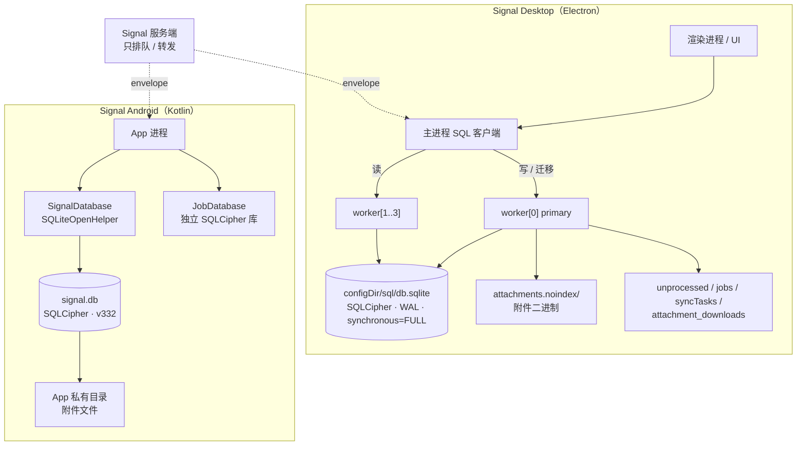

# Signal：SQLCipher 本地库与私密消息存储

> **一句话结论**
> Signal 把消息历史放在端上而不是服务端：Desktop 用 4 个 Node worker 共享一个 SQLCipher 库，所有写请求与 schema 迁移收敛到 primary；Android 用单进程 `SQLiteOpenHelper`，并以一条 `(date_sent, from_recipient_id, thread_id)` 唯一索引兜底。服务端只排队转发，本地库因此不只是缓存，而是历史权威，代价是密钥管理、两端 schema 分叉与多设备历史缺口。

## 统一元数据

| 项目 / 属性 | Signal-Desktop | Signal-Android |
|---|---|---|
| 开源仓库 | [signalapp/Signal-Desktop](https://github.com/signalapp/Signal-Desktop) | [signalapp/Signal-Android](https://github.com/signalapp/Signal-Android) |
| Stars（2026-11-16 快照） | 16,712 | 29,646 |
| License | AGPL-3.0 | AGPL-3.0 |
| 主语言 | TypeScript | Kotlin |
| 分析 commit | `848443afc3fcc74a0e127ba4f4d8554b95da856e` | `5e03b75f0239fcc03f0afa0746b223feafb934bd` |
| 分析日期 | 2026-11-16 | 2026-11-16 |

## 项目简介与定位

Signal 是主打端到端加密的即时通讯产品，客户端使用 Signal Protocol（X3DH/双棘轮、Sealed Sender、Sender Key），消息经 Signal 服务端转发但不以明文存储（素材「项目简介」）。Desktop 是 Electron + TypeScript，SQLCipher 跑在 Node worker 里；Android 是原生 Kotlin + SQLCipher。两端都把会话、消息、附件元数据与发送状态持久化在本地，构成典型的「本地库为主、服务端只做排队/转发」模型。

它值得研究的地方不在功能，而在隐私边界被压到了存储层：整库加密、消息主体大量塞进 JSON、双端各自维护一套 schema（1870 与 332），并且未发现可供回放的服务端历史。下面以 Desktop 为主线，Android 作对照。

## 本地存储架构

### Desktop：一个库、四个 worker、一个写者

- 驱动是 Signal 自己的 SQLCipher 包 `@signalapp/sqlcipher` 4.1.0（`package.json:138`），代码中 `import SQL from '@signalapp/sqlcipher'`（`ts/sql/Server.node.ts:6`）。
- 文件固定在 `configDir/sql/db.sqlite`：`dbDir = join(configDir, 'sql')`、`databaseFilePath = join(dbDir, 'db.sqlite')`（`ts/sql/Server.node.ts:1077-1082`）。
- 加密靠 `db.pragma()` 写入 `key = "x'${key}'"`（`ts/sql/Server.node.ts:927-930`）；首次打开失败时以 `cipher_compatibility = 3` 重试并 `cipher_migrate`（`:955-1002`）。
- 日志模式为 `journal_mode = WAL` + `synchronous = FULL`，并安装 WAL commit hook（`:932-937`）；启动时 `foreign_keys = ON`（`:1016`），关闭前先 `wal_checkpoint` 再 `PRAGMA optimize`（`:1132-1142`）。
- checkpoint 策略写明在 `ts/sql/WalCheckpoints.std.ts:8-21`：每 1000 页 `TRUNCATE` 一次、每次 commit 后最多每 30 秒一次、DELETE 后 5 秒一次；`run()` 执行 `wal_checkpoint(TRUNCATE)`（`:60`），遇 `SQLITE_LOCKED` 1 秒后重试（`:63-80`）。
- 并发边界：`WORKER_COUNT = 4`（`ts/sql/main.main.ts:22`），`pool[0]` 以 `isPrimary: true` 初始化，其余 3 个 false（`:197-216`）；写请求固定走 primary（`:395-400`），读请求从池中挑 worker（`:341`），`pageMessages` 一类分页也强制 primary（`:336-341`）；只有 primary 执行 `updateSchema`（`ts/sql/Server.node.ts:1094-1098`）。worker 消息用 `node:v8` 的 `serialize/deserialize`（`ts/sql/mainWorker.node.ts:4-5`）。
- schema 以 `PRAGMA user_version` 记版本，当前 1870；149 个 `ts/sql/migrations/NNNN-*.ts` 由 `SCHEMA_VERSIONS` 驱动（`ts/sql/migrations/index.node.ts:1695`），`updateSchema()` 逐版本执行，遇 VACUUM 以标志断点续跑（`:1768-1804`）。

这套划分的意图很直接：SQLite 只允许单写者，与其让 4 个连接争写锁，不如在协议层提前串行化。收益是写入有全序、迁移不会并发跑、分页读到的是 primary 刚提交的状态；代价是写吞吐被单个 worker 和 `synchronous=FULL` 的每次提交 fsync 封顶——4 个 worker 提升的是并发读，不是并发写。批量写入（75ms/30 条）正是对这笔 fsync 成本的摊销。

还有一个容易被忽略的细节：读请求虽然可以落到任意 worker，分页却被单独钉在 primary（`:336-341`）。这暗示读己之写在这条路径上被显式要求：消息刚写入、UI 立刻向上翻页时，不能因为调度到副本连接而看不到刚提交的行。普通读没有这个约束，最坏只是读到稍旧的快照——在 WAL 下这是可接受的。该判断是从路由代码推断，素材没有对应的注释或测试。

### Android：单进程 Helper，主库加独立任务库

- `SignalDatabase` 继承 `net.zetetic.database.sqlcipher.SQLiteOpenHelper`，构造参数依次为 `name`、`databaseSecret.asHex()`、`null`、`DATABASE_VERSION`、`0`、`SqlCipherErrorHandler`、`SqlCipherDatabaseHook()`、`true`（`app/src/main/java/org/thoughtcrime/securesms/database/SignalDatabase.kt:22-33`）。
- 库名 `signal.db`（`SignalDatabase.kt:225`），路径由 `context.getDatabasePath(DATABASE_NAME)` 给出（`:286-288`）；版本 `DATABASE_VERSION = 332`（`app/src/main/java/org/thoughtcrime/securesms/database/helpers/SignalDatabaseMigrations.kt:383`），`onUpgrade` 委托 `SignalDatabaseMigrations.migrate(...)`（`SignalDatabase.kt:172-182`）；打开时 `setForeignKeyConstraintsEnabled(true)`（`:83-85`）。
- 依赖 `net.zetetic:sqlcipher-android:4.17.0`（`gradle/libs.versions.toml:182`）与 `androidx.sqlite:sqlite:2.6.2`（`:141`）。
- 主库之外还有 `JobDatabase`，同样以 `databaseSecret.asHex()` 打开 SQLCipher（`app/src/main/java/org/thoughtcrime/securesms/database/JobDatabase.kt:39-52`），承载持久化任务队列。

Android 没有 worker 池：一个 App 进程、一个 Helper、一条（组）连接。并发压力转嫁给 SQLite 自身的锁与 WAL，因此它更依赖 partial index 和精确的 `INDEXED BY` 控制扫描量。

## 数据结构

Desktop 的策略是「JSON 为主、列为辅」：`messages` 以 `id STRING UNIQUE` 标识消息，主体放 `json TEXT`，只把需要索引、排序、约束的字段提升为真实列，并用一批 `GENERATED` 列从 JSON 派生（`DATABASE_SCHEMA.md:1296-1476`）。Android 相反，`message` 是一张宽表，编辑链、置顶、动态、导出状态都是显式列（`app/src/main/java/org/thoughtcrime/securesms/database/MessageTable.kt:250-315`）。

| 表 | 关键列 | 索引 / 约束 | 作用 |
|---|---|---|---|
| Desktop `messages` | `rowid`、`id`、`json`、`readStatus`、`seenStatus`、`sent_at`/`received_at`/`received_at_ms`/`timestamp`/`serverTimestamp`、`conversationId`、`type`、`body`、`sourceServiceId`/`sourceDevice`、`serverGuid`、`isErased`/`isViewOnce` | `id` UNIQUE（`:1298`）；`messages_by_date_addressable(conversationId, isAddressableMessage, received_at, sent_at)`（`:1529-1534`）；`messages_conversation(conversationId, isStory, storyId, received_at, sent_at)`（`:1640-1646`）；`conversationId` 无显式外键 | 消息主表，分页与未读/预览状态都从这里派生 |
| Desktop `conversations` | `id` PK、`json`、`active_at`、`type`、`members`、`name`、`serviceId`、`groupId`、`expireTimerVersion` | `conversations_active(active_at) WHERE active_at IS NOT NULL`（`:561-563`）、`conversations_serviceId`（`:599`）、`conversations_groupId`（`:590`） | 会话列表与成员元数据 |
| Desktop `message_attachments` | `messageId`、`editHistoryIndex`、`attachmentType`、`orderInMessage`、`path`、`size`、`contentType`、`localKey`、`digest`、`pending`、`error` | `messageId REFERENCES messages(id) ON DELETE CASCADE`（`:1122`） | 附件元数据；二进制在 `attachments.noindex/` |
| Desktop 队列表 | `unprocessed`：`id`、`attempts`、`receivedAtCounter`、`content BLOB`、`serverGuid`（`:3120-3143`）；`jobs`：`id`、`queueType`、`timestamp`、`data`（`:920-932`）；`syncTasks`（`:3047-3055`）；`attachment_downloads`（`:73-94`） | 各自以主键/排序键取件 | 入站 envelope、可持久化任务、下载重试 |
| Android `message` | `_id`、`date_sent`/`date_received`/`date_server`、`thread_id`、`from_recipient_id`/`to_recipient_id`、`from_device_id`、`type`、`body`、`read`、`server_guid`、`latest_revision_id`/`original_message_id`/`revision_number`、`remote_deleted`/`deleted_by` | `thread_id REFERENCES thread(_id) ON DELETE CASCADE`；`message_unique_sent_from_thread(date_sent, from_recipient_id, thread_id)` UNIQUE（`MessageTable.kt:351`）；分页索引 `(thread_id, date_received, story_type, parent_story_id, scheduled_date, latest_revision_id)`（`:343`） | 消息主表，去重靠唯一索引 |
| Android `thread` / `attachment` | `thread`：`recipient_id UNIQUE REFERENCES recipient`、`date`、`read`、`unread_count`、`archived`、`last_seen`（`app/src/main/java/org/thoughtcrime/securesms/database/ThreadTable.kt:134-164`）；`attachment`：`message_id`、`transfer_state`、`data_file`、`data_size`、`remote_key`、`remote_digest`（`app/src/main/java/org/thoughtcrime/securesms/database/AttachmentTable.kt:247-293`） | `recipient_id` 唯一 | 会话聚合与附件传输状态 |

两条 schema 的差别不只是列名：Desktop 的 `conversationId` 没有外键，一致性靠应用层；Android 的 `thread_id` 是硬外键并级联删除。前者便于迁移和批量导入，后者把引用完整性交给数据库。

JSON 路线的代价也清楚：`messages.json` 里的字段无法直接建索引，必须靠 `GENERATED` 列物化后再建（`DATABASE_SCHEMA.md:1322-1475`）；每新增一个可筛选维度，就要加一列并回填。好处是消息对象 schema 可以独立演进，迁移主要动生成列而不是整表重建。Android 的宽表相反：查询直接、类型明确，但每加一种消息能力（置顶、动态、导出）都要改表，332 个版本就是这样攒出来的。

## 写入与读取路径

### Desktop：批处理落库，按 `id` 覆盖

新消息先走 `saveAndNotify()`：把 `message.attributes` 交给 `saveNewMessageBatcher`，再排队附件下载、处理编辑/删除、通知 UI（`ts/messages/saveAndNotify.preload.ts:23-51`）。批处理器参数为 `wait: 75`、`maxSize: 30`，攒够或等够就调用 `DataWriter.saveMessages(..., { forceSave: true, ... })`（`ts/util/messageBatcher.preload.ts:49-71`）。

worker 侧 `saveMessage()` 分两支：有 `id` 且非 `forceSave` 时执行 `UPDATE messages SET ... WHERE id = $id`（`ts/sql/Server.node.ts:3407-3419`），`changes === 0` 直接返回（消息已被删除，`:3421-3424`）；无 `id` 时用 `generateMessageId(message.received_at).id` 生成 id 再 `INSERT`（`:3439-3453`），附件同事务写 `message_attachments`（`:3455-3457`）。批量保存共用一个外层事务（`:3475-3486`），失败则 `saveMessagesIndividually()` 逐条重试并收集 `failedIndices`（`:3489-3517`）。单条保存本身也是一个事务（`:3237-3245`），附件、jobs、附件保护记录都在同一事务内。

也就是说，Desktop 的「upsert」不是 SQL 的 `ON CONFLICT`，而是「先按 id 更新，更新不到再插入」，`id` 唯一约束是最后一道闸。

### Desktop：`(received_at, sent_at)` 双段分页

`getOlderMessagesByConversation()` / `getNewerMessagesByConversation()` 都转调 `getAdjacentMessagesByConversation()`（`ts/sql/Server.node.ts:4215-4224`、`:4286-4295`），默认 `limit = 100`（`:4139`）。older 方向的条件是两段：`received_at = ? AND sent_at < ?`，或 `received_at < ?`（`:4151-4156`）；newer 方向对称（`:4157-4163`）。两段用 `UNION ALL` 合并，`ORDER BY received_at ..., sent_at ...`，最后 `LIMIT`（`:4197-4202`）；older 结果再 `reverse()`，并在事务里 `hydrateMessages()`（`:4204-4212`）。

为什么不直接 `received_at < ?`？因为排序键是复合的 `(received_at, sent_at)`：只比较 `received_at` 会漏掉同一毫秒内剩下的消息，写成 `<=` 又会把边界行重复带回上一页。拆成两段等价于严格元组比较 `(received_at, sent_at) < (?, ?)`，同时仍能命中 `(conversationId, isAddressableMessage, received_at, sent_at)` 索引。若两条消息的 `(received_at, sent_at)` 完全相同，这个键没有第三列做 tiebreaker，翻页仍可能不稳定——这是推断，素材未给出该场景的处理。

单条与批量读取分别是 `getMessageById()`（`:3544`）、`getMessagesById()`（`:3566`）、`getMessagesBySentAt()`（`:6240`）。`MessageCache.findBySentAt()` 先查内存 `messageIdsBySentAt`，未命中再落盘（`ts/services/MessageCache.preload.ts:83-102`）。

### Android：插入即事务，冲突即重复

入站走 `MessageTable.insertMessageInbox(...)`（`MessageTable.kt:3135-3141`），组装 `ContentValues`（`DATE_SENT`、`DATE_SERVER`、`FROM_RECIPIENT_ID`、`THREAD_ID`、`TYPE`、`SERVER_GUID`、`LATEST_REVISION_ID` 等，`:3166-3187`），在 `insertMediaMessage()` 的 `withinTransaction` 中 `db.insert`；`messageId < 0` 就按重复消息处理（`:3906-3911`）。同一事务里还更新 `thread` 活跃时间、mentions、`attachment`、shared contacts 与 link previews（`:3913-3925`）。发送前同样先落库：`insertMessageOutbox(...)`（`:3425-3447`）。

读取用 `getConversation(threadId, offset, limit, dateReceiveOrderBy = "DESC", filterCollapsed)`：过滤 `thread_id`、`story_type = 0`、`parent_story_id <= 0`、`scheduled_date = -1`、`latest_revision_id IS NULL`，显式 `INDEXED BY message_thread_story_parent_story_scheduled_date_latest_revision_id_index`，`ORDER BY date_received DESC`，`LIMIT "$offset, $limit"`（`:5979-5997`）。它用 OFFSET 而不是游标，深页要跳过更多行；partial index 把「当前可见、非故事、非定时、非编辑副本」的行缩得很小，属于用索引换分页模型的简化——这一取舍是从 SQL 形态推断的。

## 同步与一致性

Desktop 通常作为已链接设备，不持有手机号主设备的库；它通过服务端 envelope 和 `syncMessage` 获得消息。`MessageReceiver.#handleSyncMessage()` 要求 `envelope.sourceServiceId === ourAci`，否则抛 `Received sync message from a different account`；并要求 `envelope.sourceDevice != ourDeviceId`，否则抛 `Received sync message from our own device`（`ts/textsecure/MessageReceiver.preload.ts:2991-3005`）。`syncMessage.content.sent` 处理其他设备发出的副本，带 `editMessage` 时走编辑路径，否则 `#handleSentMessage()`（`:3006-3071`）；`sentTranscript` 由 `processSent()` 展开（`ts/textsecure/processSyncMessage.node.ts:37-84`）。

素材没有找到「服务端历史同步游标 / gap 表」：检索 `cursor|gap|lastSync|syncCursor` 只命中分页游标和 `unprocessed`/`syncTasks`，没有类似 IMAP UID 的位点（素材「同步与一致性」）。这是「未找到证据」，不是「不存在」；`syncTasks`（`DATABASE_SCHEMA.md:3047-3055`）与 `unprocessed`（`:3120-3143`）是仅有的持久化同步状态。

幂等落在消息身份上，而不是服务端 guid。Desktop 在会话级 `queueJob` 里先按 `sent_at` 找已有消息，并要求 `sourceServiceId` 相同；命中且类型为 `incoming`（或同一 `storyDistributionListId` 的 story）就 `confirm()` 后返回（`ts/messages/handleDataMessage.preload.ts:121-147`）。代码注释写得很明确：`We dedupe by senderAci + timestamp, in the same way we address messages in the Signal ecosystem`（`:124-126`）。

为什么不用 `serverGuid` 唯一约束？素材能直接确认的是 `serverGuid` 可空（`DATABASE_SCHEMA.md:1296-1476`），而 SQLite 的 UNIQUE 允许多个 NULL——单靠它挡不住没有 guid 的本地、出站与同步消息。进一步推断：同一条逻辑消息还可能经发送、sync transcript、recipient update 多条路径到达，guid 标识的是传输批次而非逻辑消息；Signal 本身又以「发送者 + 时间戳」寻址，去重键跟协议身份对齐更稳。代价是边界条件：同一发送者在同一时间戳发出两条不同消息，第二条会被当成重复丢弃；去重只覆盖 `incoming` 与同列表 story，出站副本和 `isUpdate` 走别的分支。Android 则把这件事交给数据库：`(date_sent, from_recipient_id, thread_id)` 唯一索引（`MessageTable.kt:351`），`insert` 返回负值即重复（`:3906-3911`）；键里带 `thread_id`，所以跨会话同毫秒不冲突，但同会话同发送者同毫秒仍会碰撞，且键不含 `from_device_id`。

事务与崩溃一致性方面：Desktop 单条消息一个事务、批量共用一个事务（`Server.node.ts:3237-3245`、`:3475-3486`）；Android 消息、thread 更新、mentions、附件在同一个 `withinTransaction` 里（`MessageTable.kt:3906-3925`）。入站 envelope 先 `INSERT OR REPLACE` 进 `unprocessed`（`Server.node.ts:6390-6420`），处理完才删除（`:6588-6600`）；取件按 `receivedAtCounter ASC`（`:6531-6542`）且读取时 `attempts = attempts + 1`（`:6546-6565`），超过 45 天或 `attempts >= 10` 被清理（`:6500-6506`、`:6515-6522`，常量见 `:6388`）。这是 at-least-once 队列，崩溃后重放不可避免，去重逻辑就是它的配套。

把两端放在一起看，一致性策略是分层的：传输层用 at-least-once 保证不丢，应用层用消息身份去重保证不重，数据库层再用唯一索引兜底。三层里任何一层失效，结果都不是数据损坏，而是重复或缺失——这也解释了为什么两端都不把 `serverGuid` 当作主键。

## 离线消息处理

Desktop 没有独立 outbox 表。待发/失败状态存在消息 JSON 的 `sendStateByConversationId` 里，状态机为 `Pending -> Sent -> Delivered -> Read -> Viewed`，另有 `Failed`/`Skipped`（`ts/messages/MessageSendState.std.ts:11-42`）；发送结果返回后按收件人更新并 `saveMessage`（`ts/messages/send.preload.ts:84-135`）。可跨重启恢复的是 `jobs` 表：按 `queueType` 分组、`timestamp` 排序取任务（`ts/sql/Server.node.ts:9482-9501`），`insertJob()` 直接插入（`:9504-9517`）。附件下载另有 `attachment_downloads`，带 `attempts`/`retryAfter`/`lastAttemptTimestamp`/`active`（`DATABASE_SCHEMA.md:73-94`），取件入口 `getNextAttachmentDownloadJobs()`（`ts/sql/Server.node.ts:6692-6737`）；文件本体在 `attachments.noindex/`（`app/attachments.node.ts:29,72`），库里只存相对路径。已读落库为 `messages.readStatus`、`seenStatus`（`DATABASE_SCHEMA.md:1300,1330`）；编辑事件在 `edited_messages`（`:721-726`），当前 `editHistory` 在 `messages.json`；删除是 `DELETE FROM messages`（`Server.node.ts:3520-3521`），附件靠 `ON DELETE CASCADE`（`DATABASE_SCHEMA.md:1122`）。

素材没有定位到「发送失败后由哪个队列/定时器重新触发」的具体函数（「未覆盖与存疑」第 3 条），因此只能确认状态与任务表存在，不能确认重试调度闭环。输入状态也没有表，推断为内存/实时消息，未找到直接证据。

Android 的 outbox 就是 `message` 表里的一行：`insertMessageOutbox(...)` 先写库（`MessageTable.kt:3425-3447`），状态用 `type` 位掩码表达；失败与退避由持久化 `job_spec` 驱动，字段含 `run_attempt`、`max_attempts`、`next_backoff_interval`、`lifespan`、`serialized_data` 等（`JobDatabase.kt:55-93`），取件按 `global_priority DESC, queue_priority DESC, create_time ASC, id ASC`（`:193-201`）。Sender Key 重试另有 MSL 三表：`msl_payload` 存 `content BLOB` 与 `urgent`，`msl_recipient` 记收件人，`msl_message` 关联消息；收到回执删 recipient，无 recipient 时删 message，删除消息由触发器级联清理（`app/src/main/java/org/thoughtcrime/securesms/database/MessageSendLogTables.kt:25-90`）。附件把 `transfer_state` 与 `data_file`/`data_size`/`remote_key` 放同一张 `attachment` 表（`AttachmentTable.kt:247-293`），已读有 `message.read`、`thread.read`、`has_delivery_receipt`/`has_read_receipt`/`viewed`（`MessageTable.kt:261,270-272`；`ThreadTable.kt:140`），编辑用 `latest_revision_id`/`original_message_id`/`revision_number` 串成链（`MessageTable.kt:300-302`），删除用 `remote_deleted`/`deleted_by`（`:290,310`）。

断网时两端都能读历史、写待发消息并维护已读本地状态；一定失败的是需要服务端参与的动作——新消息投递、附件上传/下载、他人已读回执的获取。素材没有给出重连补拉的完整链路，尤其 Android 的 `jobs`/`storage` 同步游标未纳入检索范围。

把「能确认到什么程度」说清楚：Desktop 能确认的是状态枚举、状态持久化位置、任务表与附件下载重试字段；不能确认的是失败后由谁触发重试、退避曲线如何计算。Android 能确认的是 outbox 先落库、`job_spec` 的退避字段与取件优先级、MSL 的重发语义；不能确认的是附件文件目录与 linked-device 的补拉游标。已读方面，两端都只确认了本地状态列，回执的网络发送与对端合并路径不在素材范围内。

## 设计权衡与适用场景

**优点**：历史在本地，离线可用性接近完整；整库 SQLCipher 加密，静态数据不依赖服务端；Desktop 的单写者模型把一致性做在架构层，Android 的唯一索引把去重做在数据库层；分页都有专门索引，读取路径可预测。

**四项明确局限**：

1. **SQLCipher 的密钥管理与性能成本**。两端都把 hex key 直接交给 SQLCipher：Desktop 走 `pragma key`（`ts/sql/Server.node.ts:927-930`），Android 走 Helper 构造参数（`SignalDatabase.kt:22-33`）。素材没有覆盖密钥如何派生、存于何处、如何轮换，也没有任何加解密基准；能确认的只是 `cipher_compatibility = 3` 的兼容迁移路径（`Server.node.ts:955-1002`）。页级加密意味着每次读写都多一层加解密，叠加 `synchronous=FULL` 的提交 fsync，写路径天然比明文库重；具体开销不能从素材量化。
2. **两套 schema 独立演进**。Desktop 是 `user_version` 1870 + 149 个 TS 迁移（`ts/sql/migrations/index.node.ts:1695`），Android 是 `DATABASE_VERSION = 332` + Kotlin 迁移类（`SignalDatabaseMigrations.kt:383`）；表名、字段、去重键、编辑模型全不相同。任何跨端功能都要写两遍，且两端的历史语义只能靠约定对齐。
3. **无中心历史导致多设备历史不完整**。服务端只排队/转发，Desktop 依赖 `syncMessage` 获取其他设备的副本（`MessageReceiver.preload.ts:2991-3071`），素材未发现服务端历史游标或归档表。据此推断：新链接设备能看到的，只是链接后收到的 envelope 与主设备主动同步的 transcript；更早的历史没有可回放的权威源。这一条是推断，素材没有做多设备实测。
4. **去重键的边界条件**。Desktop 的 `sent_at + sourceServiceId` 对同毫秒两条消息、出站副本、`isUpdate` 分支都不完全覆盖（`handleDataMessage.preload.ts:124-147`）；Android 的 `(date_sent, from_recipient_id, thread_id)` 不含设备维度（`MessageTable.kt:351`）。键越简单，误判和漏判的窗口越明确。

**不适合的场景**：需要服务端全文检索、合规审计、跨设备完整历史回放的系统；以及不愿承担 SQLCipher 密钥生命周期管理的轻客户端。它适合「隐私优先、端上历史为准、可以接受设备间历史不完全一致」的 IM。

## 证据与限制

| 结论 | 证据 | 符号 |
|---|---|---|
| Desktop 使用 `@signalapp/sqlcipher` 4.1.0，key pragma 与兼容迁移 | `package.json:138`；`ts/sql/Server.node.ts:927-930,955-1002` | dependency, `keyDatabase` |
| DB 位于 `configDir/sql/db.sqlite` | `ts/sql/Server.node.ts:1077-1082` | `initialize` |
| WAL + `synchronous = FULL` + checkpoint 策略 | `ts/sql/Server.node.ts:932-937`；`ts/sql/WalCheckpoints.std.ts:8-25,60` | `switchToWAL`, `WalCheckpoints` |
| 4 worker、写固定 primary、仅 primary 迁移 | `ts/sql/main.main.ts:22,197-216,395-400`；`ts/sql/Server.node.ts:1094-1098` | `WORKER_COUNT`, `initialize` |
| schema 1870 / 149 个迁移 | `ts/sql/migrations/index.node.ts:1695,1727-1804` | `SCHEMA_VERSIONS`, `updateSchema` |
| `messages` 表与分页索引 | `DATABASE_SCHEMA.md:1296-1476,1529-1534,1640-1646` | `messages` |
| 单条/批量保存与 75ms、30 条批处理 | `ts/sql/Server.node.ts:3226-3517`；`ts/util/messageBatcher.preload.ts:49-71` | `saveMessage`, `saveNewMessageBatcher` |
| `(received_at, sent_at)` 双段分页 | `ts/sql/Server.node.ts:4133-4213` | `getAdjacentMessagesByConversation` |
| 入站去重 `sent_at + sourceServiceId` | `ts/messages/handleDataMessage.preload.ts:124-147` | `handleDataMessage` |
| `unprocessed` 持久化、重试与清理 | `ts/sql/Server.node.ts:6388-6600` | `saveUnprocessed`, `getAllUnprocessedIds` |
| Android Helper、`signal.db`、v332 | `app/src/main/java/org/thoughtcrime/securesms/database/SignalDatabase.kt:22-33,225`；`.../helpers/SignalDatabaseMigrations.kt:383` | `SignalDatabase` |
| Android 唯一索引与插入事务 | `.../database/MessageTable.kt:351,3906-3911` | `message_unique_sent_from_thread` |
| Android outbox 与 job 队列 | `.../database/MessageTable.kt:3425-3447`；`.../database/JobDatabase.kt:55-93,193-201` | `insertMessageOutbox`, `Jobs` |
| Android MSL 重发缓存 | `.../database/MessageSendLogTables.kt:25-90` | `msl_payload` |

**未验证与材料未覆盖**：

- Desktop 的同步游标/gap 只做了关键词检索，可能藏在未 checkout 的 `ts/jobs`/`ts/backbone`/`ts/state`；输入状态是否落库、发送失败的重试调度入口也未定位（素材「未覆盖与存疑」第 1–3 条）。
- Android 的 linked-device 同步游标、gap 与冲突合并未覆盖，`jobs`/`storage` 模块未纳入 sparse checkout；附件实际目录只确认到 `attachment.data_file` 列与私有库路径，文件目录未查（第 4–5 条）。
- Desktop `messages.conversationId` 无显式外键，是否有触发器/应用层兜底未查；Android 332 个迁移只核对了版本常量与 `V332_WidenAttachmentMediaNameIndex.kt`，未逐一核对（第 6–7 条）。
- 本文没有做崩溃注入、断电或多设备实测；所有关于「重放安全」「历史缺口」的判断都是基于代码路径的推断。
- Stars 为 2026-11-16 快照，会随时间变化。
