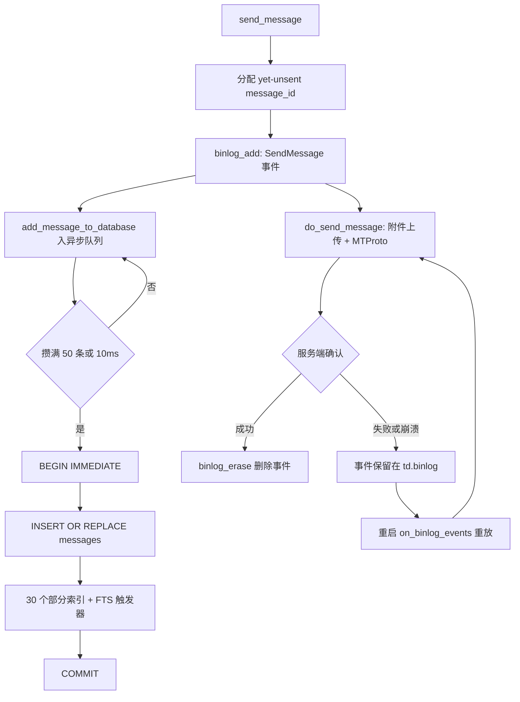

# Telegram TDLib：单库 + binlog 的消息持久化

> **一句话结论**：TDLib 把消息、会话、文件元数据和通用 KV 全部塞进一个 `db.sqlite`，消息正文以 TL 序列化 BLOB 存一行，再用一个追加式 `td.binlog` 同时承担更新游标与发送 outbox。它换来的是一套极稳定的表结构和跨平台一致的恢复语义，付出的代价是单库写锁、双份序列化和把 schema 演化责任推给应用层。

## 元数据

| 项 | 值 |
|---|---|
| 仓库 | https://github.com/tdlib/td |
| Stars | 9,292（2026-11-16 快照） |
| License | BSL-1.0 |
| 主语言 | C++ |
| 分析 commit | `c8828d50f5eac2fc7089ce1089d7ce9095c61b5e` |
| 分析日期 | 2026-11-16 |

## 项目简介与定位

TDLib 是 Telegram 官方提供的跨平台、全异步 C++ 客户端库，封装 MTProto 网络协议、加密、更新序列处理和本地存储，向上提供 C/JSON/Java/.NET 接口。README 列出的目标平台覆盖 Android、iOS、Windows、macOS、Linux、WebAssembly、watchOS、tvOS、visionOS 等（`README.md:21`）。它不只是网络 SDK：会话列表、消息缓存、文件下载元数据都落在本地，客户端启动后先读本地再向服务端补差。

服务端始终是权威。本地历史不够时向 `messages.getHistory` 拉取（`td/telegram/MessagesManager.cpp:20123-20142`）；更新游标由 `updates.getState` / `updates.getDifference` 给出（`td/telegram/UpdatesManager.cpp:1877-1910`）。本地库的角色是「已确认状态的物化缓存 + 未确认动作的日志」。

值得单独研究的原因是布局反常地克制：不按会话或账号拆库，不把消息正文拆成宽表，也没有独立发件箱表。整个持久化层只有两个文件——一个 SQLite 库和一个追加日志——却要同时支撑加密、全文搜索、多 DC 与离线重发。

## 本地存储架构

### 两个文件与命名规则

路径由 `TdDb::Parameters::database_directory_` 拼接（`td/telegram/TdDb.h:55-63`）。`get_sqlite_path` 与 `get_binlog_path` 只在测试 DC 时插入 `_test`（`td/telegram/TdDb.cpp:49-56`）：正式 DC 为 `<dir>/db.sqlite` 与 `<dir>/td.binlog`，测试 DC 为 `db_test.sqlite` 与 `td_test.binlog`。附件二进制不进 SQLite，而是放在 `files_directory_`（`td/telegram/TdDb.h:58`），库里只留 file id 到元数据的映射。

**不拆库**是这里最关键的决定。`dialogs`、`messages`、`scheduled_messages`、`stories`、`files`、`common` 等逻辑库全部建在同一个 `db.sqlite` 里，只靠 `dialog_id`、`message_id` 等列区分（`td/telegram/TdDb.cpp:399-490`）。所谓「消息库」「会话库」「文件库」只是同一连接上的不同表命名空间，不是一个文件一个库。

### tddb：SQLite 的薄封装

`tddb` 是随仓库分发的小型库，核心类型分工明确：`td::SqliteDb` 包住 `sqlite3*`，提供 `exec`、语句缓存、`begin_write_transaction`/`commit_transaction`、`user_version`、`change_key` 等（`tddb/td/db/SqliteDb.h:25-91`）；`td::SqliteStatement` 负责绑定与步进（`tddb/td/db/SqliteStatement.h`）；`td::SqliteConnectionSafe` 按 scheduler 线程惰性持有连接（`LazySchedulerLocalStorage<SqliteDb>`），首次取用时打开库并设置 WAL（`tddb/td/db/SqliteConnectionSafe.h:20-33`，`tddb/td/db/SqliteConnectionSafe.cpp:14-29`）；`td::SqliteKeyValue` 提供统一的 `(k BLOB PRIMARY KEY, v BLOB)` 键值表（`tddb/td/db/SqliteKeyValue.h:25-28`），`files` 和 `common` 都复用它。

打开时统一执行 `PRAGMA journal_mode=WAL` 与 `PRAGMA secure_delete=1`（`td/telegram/TdDb.cpp:385-386`），连接级 `busy_timeout` 为 5 秒（`tddb/td/db/SqliteDb.cpp:96`）。WAL 让读写可以并行，但写与写仍由 SQLite 的库级写锁串行——这正是后面批量写要解决的问题。

### 加密

加密走 SQLCipher，密钥抽象成 `DbKey`，支持空、32 字节原始密钥、口令三种形态。`db_key_to_sqlcipher_key` 把空 key 转成 `''`、口令转成 `'...'`、原始 key 转成 `"x'<hex>'"`（`tddb/td/db/SqliteDb.cpp:46-70`）。打开时执行 `PRAGMA key`，遇到旧库再补 `PRAGMA cipher_compatibility`，随后用 `check_encryption()` 验证（`:224-241`）。

值得注意：README 声称所有本地数据都用用户提供的密钥加密（`README.md:28`），但实现里空 `DbKey` 会退化成普通明文 SQLite（`SqliteDb.cpp:46-49`）。加密是能力而非强制，是否启用取决于调用方传入的 key。改密钥的成本也不低：无 key 到有 key 用 `ATTACH` + `sqlcipher_export` 整库导出再替换，反向同理，两边都有 key 才走 `PRAGMA rekey`（`:251-301`）；前两条路径的代价与库体积成正比。

### schema 版本与并发边界

全局版本存在 SQLite 的 `PRAGMA user_version`（`tddb/td/db/SqliteDb.h:55-56`），程序侧期望值为 `DbVersion::Next - 1`（`td/telegram/Version.h:88-99`）。各子库初始化时先读版本：没有表就从 0 建；版本高于当前程序则直接 `drop_message_db` 并重建（`td/telegram/MessageDb.cpp:45-55`，drop 见 `:174-177`）。版本落后时用 `ALTER TABLE ... ADD COLUMN` 和补建索引逐级升级，例如 FTS 需要的 `search_id`、`text` 列（`:146-171`）。所有子库的初始化包在同一个事务里，最后统一写 `user_version`（`td/telegram/TdDb.cpp:393-464`），避免出现「一半新一半旧」的库。

并发上，每个 scheduler 线程拿自己的连接，写事务靠库级写锁串行（`SqliteConnectionSafe.h:29-31`）。消息写入不直接落盘，而是进入 `MessageDbAsync` 这个 actor 排队，攒批后一次提交；读请求会先 `do_flush()`，保证读到自己刚写的数据（`td/telegram/MessageDb.cpp:1213-1214`）。binlog 是另一个 actor，按需 `sync()`/flush，而不是每条事件都 fsync（`tddb/td/db/binlog/Binlog.h:112`，`Binlog.cpp:414-441`）。

## 数据结构

### messages：窄列 + 完整消息 BLOB

核心表只有 12 列（`td/telegram/MessageDb.cpp:117-119`）：

| 列 | 类型 | 作用 |
|---|---|---|
| `dialog_id` | INT8 | 会话 ID，用户/群/频道/私密聊天共用 |
| `message_id` | INT8 | 复合编码的消息 ID |
| `unique_message_id` | INT4 | 服务端唯一消息 ID，仅用户/群聊场景填写 |
| `sender_user_id` | INT8 | 发送者 |
| `random_id` | INT8 | 客户端随机 ID，用于发送去重与回查 |
| `data` | BLOB | TL 序列化后的完整 `Message` |
| `ttl_expires_at` | INT4 | 自毁消息过期时间 |
| `index_mask` | INT4 | 30 位媒体/过滤位图 |
| `search_id` | INT8 | FTS 行 id，对应 `messages_fts.content_rowid` |
| `text` | STRING | 可搜索文本，附加 dialog/index 标记 |
| `notification_id` | INT4 | 通知 ID |
| `top_thread_message_id` | INT8 | 论坛主题顶层消息 |

主键是 `(dialog_id, message_id)`（`MessageDb.cpp:117-119`）。除主键外还有一族索引：`message_index_0..29` 共 30 个部分索引，谓词统一为 `(index_mask & (1<<i)) != 0`（`:56-61`），通话另有一套 `full_message_index_N`（`:91-97`）；`message_by_random_id`、`message_by_unique_message_id`、`message_by_ttl`、`message_by_notification_id` 都是带 `IS NOT NULL` 的部分索引（`:99-131`）。

全文搜索用 FTS5 外部内容表，`content='messages'`、`content_rowid='search_id'`、分词器 `unicode61 remove_diacritics 0`（`:67-71`）。同步靠两个触发器：删除前写 delete 行、插入后写新行（`:76-79`）。**UPDATE 触发器被注释掉了**（`:83-89`），编辑消息后的索引更新只能依赖上层重写。

### 其余逻辑库与 binlog

`scheduled_messages` 更窄，只有 `(dialog_id, message_id, server_message_id, data)` 四列，外加 `(dialog_id, server_message_id)` 部分索引（`MessageDb.cpp:105-110`）。`dialogs` 是 `(dialog_id, dialog_order, data, folder_id)`，`notification_groups` 是 `(notification_group_id, dialog_id, last_notification_date)`（`td/telegram/DialogDb.cpp:42-64`）。`files` 没有建表语句，直接复用 KV 结构（`td/telegram/files/FileDb.cpp:53-55`）；`stories` 系列同理落在 `db.sqlite`（`td/telegram/StoryDb.cpp:45-62`）。

`td.binlog` 不是表，而是追加文件。单条事件为固定头 + 负载 + CRC32：头长 `4+8+4+4+8`，尾长 4，单事件上限 16 MB（`tddb/td/db/binlog/BinlogEvent.h:51-63`）。解析按 `size/id/type/flags/extra` 顺序取，最后取 CRC（`BinlogEvent.cpp:17-27`）；`validate()` 对 `size - TAIL_SIZE` 字节重算 CRC32 并与存储值比对（`:35-50`）。KV 语义建在事件流上：每个 key/value 写成一条 `Event{key, value}`，重放时 `map_.set(key, {value, event.id_})`（`tddb/td/db/BinlogKeyValue.h:33-41,71-95`）。打开时顺序重放（`Binlog.cpp:204-215`、`:508-579`），也支持 `reindex` 与 `regenerate`（`:648-679`）。业务事件类型见 `LogEvent.h:73-76`，如 `SendMessage = 0x100`、`DeleteMessage = 0x101`。

### 窄列 + BLOB 的取舍

这套设计把「能索引的维度」和「完整对象」分开：窄列是给 SQL 用的投影，`data` 是权威副本。**好处**是表结构对服务端字段变化不敏感——Telegram 给 `Message` 加字段时，TL 序列化层自己处理兼容，SQLite 不需要 `ALTER TABLE`；写入永远是整行替换，读取一次拿到完整对象，不需要多表 JOIN 拼装。**代价**有三方面：外部工具（sqlite3 CLI、BI 导出）拿不到消息内容，只能看到 `dialog_id` 等冗余列；每新增一个过滤维度就要加列、加索引并回填历史数据；读取哪怕只为一个字段也要反序列化整个 `Message`，CPU 与内存放大随消息体增大而线性上升。推断：这套取舍成立的前提是「客户端只通过 TDLib 自己的 API 访问数据」，一旦外部进程想直接读库，BLOB 就变成黑盒。

## 写入与读取路径

### 发送：先写日志，再写库，再上网

`send_message` 校验内容后创建待发消息，消息 ID 取自本地 "yet unsent" 段而非服务端（`td/telegram/MessagesManager.cpp:21167-21168`，`get_next_yet_unsent_message_id` 在 `:28423`）。随后 `save_send_message_log_event` + `do_send_message`（`:21968-21969`）。日志事件在发网络请求之前写入：

```cpp
auto log_event = SendMessageLogEvent(dialog_id, m);
m->send_message_log_event_id =
    binlog_add(G()->td_db()->get_binlog(), LogEvent::HandlerType::SendMessage, get_log_event_storer(log_event));
```

（`MessagesManager.cpp:22148-22158`）事件负载就是 `td::store(dialog_id)` 加 `td::store(*m_in)`（`:21880-21884`）。落库则由 `add_message_to_database` 把 11 个窄列加 `log_event_store(*m)` 交给异步消息库（`:32050-32054`）；`use_message_database()` 为假时这一步直接跳过（`:32012-32014`）。消息对象的 TL 序列化在 `Message::store/parse`（`:2279`、`:2640`）。

这里有一个容易忽略的写放大：**同一条 `Message` 被序列化了两次**，一次进 binlog 的 `SendMessage` 事件，一次进 `messages.data`。前者是为崩溃后能重发，后者是为分页读取；两者的生命周期不同——binlog 事件在服务端确认后被删除（`:21571-21574`），SQLite 行则长期保留——所以不能简单合并。

### 批量提交：50 条或 10 ms

SQLite 侧写入走 `INSERT OR REPLACE`（`td/telegram/MessageDb.cpp:188-189`，`scheduled_messages` 同理 `:263-264`），主键冲突即整行替换，天然幂等。真正提交由 `MessageDbAsync` 控制：最多攒 `MAX_PENDING_QUERY_COUNT{50}` 条或等 `MAX_PENDING_QUERY_DELAY{0.01}` 秒，然后 `begin_write_transaction` → 执行整批 → `commit_transaction`（`MessageDb.cpp:1197-1222`）。事务实现使用 `BEGIN IMMEDIATE` 先拿写锁（`tddb/td/db/SqliteDb.cpp:190-197`）。读取前强制 flush（`MessageDb.cpp:1213-1214`），所以「读己之写」成立，代价是读会被尚未提交的批拖住最多一个批次窗口。KV 的 `set_all` 也自带写事务（`SqliteKeyValue.cpp:57-64`）。

### 写入/恢复流程



图中的并行分支是代码结构使然：binlog 写入同步返回，SQLite 落库是投递到 actor 的异步调用，两者提交时机并不绑定。网络请求与 SQLite 提交的精确交错素材未逐行核对，这里只表达依赖关系。

### 接收与历史分页

接收消息最终也走 `MessagesManager::add_message_to_dialog` → `add_message_to_database`（例如 `MessagesManager.cpp:31610` 与 `:32011`）。服务端消息带 server message id，`unique_message_id` 只在 User/Chat 场景填写（`:32036-32050`）。

历史分页由 `MessageDbMessagesQuery{dialog_id, from_message_id, offset, limit}` 发起（`td/telegram/MessageDb.h:29-35`），`from_database` 分支调用异步库的 `get_messages`（`MessagesManager.cpp:20090-20106`）。SQL 只有两条，方向相反：

```sql
SELECT data, message_id FROM messages WHERE dialog_id=?1 AND message_id>?2 ORDER BY message_id ASC LIMIT ?3
SELECT data, message_id FROM messages WHERE dialog_id=?1 AND message_id<?2 ORDER BY message_id DESC LIMIT ?3
```

（`MessageDb.cpp:211-221`）`offset` 不是行偏移，而是「以 `from_message_id` 为中心向前 `limit+offset` 条、向后 `-offset` 条」的双向窗口（`:860-898`）。带媒体/通话过滤时改查 `index_mask` 对应的部分索引（`:657-663`、`:783-787`），全文搜索走 `messages_fts MATCH`（`:221-224`、`:738-800`）。本地历史不足则回落到服务端 `messages.getHistory`（`MessagesManager.cpp:20123-20142`）。

### 崩溃一致性

binlog 每条事件都有 CRC32，读到损坏事件会在 `validate()` 处报错（`BinlogEvent.cpp:35-50`），加载时按顺序重放（`Binlog.cpp:508-579`）；SQLite 侧有 WAL 与显式事务。但**两个文件不在同一个事务里**：binlog 已落盘、SQLite 批还没提交时进程崩溃，恢复后只能靠事件重放把状态推回去。这是从代码路径推断出的窗口，素材没有做崩溃注入验证，实际收敛行为未测。

## 同步与一致性

### 游标存在 binlog，不在 SQLite

`pts`、`qts`、`date` 三个更新游标没有建表，而是写进 binlog 的 KV 层，键名为 `updates.pts`、`updates.qts`、`updates.date`（`td/telegram/UpdatesManager.cpp:600`、`:617`、`:703`）。`pts`/`qts` 的保存有节流：`MAX_PTS_SAVE_DELAY` 窗口内合并，超时后再写（`:588-631`）。启动时从同一个 KV 读回并初始化管理器，然后立刻 `get_difference("init_state")`（`:1877-1910`）；`updates.pts` 为空则改发 `updates.getState`。把游标放进 binlog 而不是 SQLite 的好处是：游标更新与业务事件共享同一个追加序列，不需要跨表事务；坏处是它和 `messages` 表的提交原子性同样只靠重放逻辑兜底。

`seq` 是另一种情况。全仓检索 `updates.seq` 没有任何结果，`seq_` 只在收到 `updates.getState` / `updates.getDifference` 结果时被赋值（`UpdatesManager.cpp:1384`、`:2073`），属于内存态。**未找到 `seq` 的持久化证据**，因此不能断言「不持久化」，只能说重启后它由服务端状态重新给出。

### gap 补齐

PTS 不连续时有两级处理。小缺口用 `repair_pts_gap` 只取一条更新：`GetPtsUpdateQuery::send` 实际发出 `updates.getDifference(pts-1, limit=1, ...)`（`UpdatesManager.cpp:344-370`、`:250-258`）。大缺口、seq gap、qts gap 统一走 `fill_gap` → `get_difference("fill_gap")`（`:373-479`），正常请求携带 `pts/date/qts`（`:506-532`，查询构造 `:202-203`）。

乱序更新不会丢：先进入按 pts 排序的 `pending_pts_updates_` multiset，缺口补上后批量应用；`getDifference` 期间到达的新更新暂存到 `postponed_pts_updates_`（`UpdatesManager.h:283-289`、`UpdatesManager.cpp:535-556`）。PTS 只允许单调上升，唯一例外是回退超过 1000009 时视为换账号或重置（`:648-650`）。这个魔数阈值是防御性的：既容忍服务端偶发的小幅回退，又能在真正换号时触发重新同步。服务端权威，本地只保存「已确认进度」，冲突解决不是 merge，而是后到的服务端状态覆盖本地；本地唯一有主动权的是未发送消息，靠 `random_id` 与服务端回执关联（`MessageDb.cpp:121-123,201-203`；`MessagesManager.cpp:1211-1242`、`:1266`）。

## 离线消息处理

### binlog 就是 outbox

TDLib 没有独立的 `outbox` 或 `pending_messages` 表。待发消息以 `SendMessage` 事件的形式躺在 `td.binlog` 里（`MessagesManager.cpp:22148-22158`），这就是发件箱。启动时 `on_binlog_events` 重放该类型事件：反序列化 `Message`、恢复 `send_message_log_event_id`、再 `continue_send_message` + `do_send_message`（`:36083-36127`）。一个例外：如果本次打开时消息库刚被重建（`have_old_message_database == false`），旧的 `SendMessage` 事件会被直接删除、不再重发（`:36087-36093`）——库都换了，重发旧消息只会制造重复。

与独立 outbox 表相比，这个方案少了一次「日志 + 表」的双写和两者之间的一致性维护，发送队列天然按写入顺序重放；代价是队列不能按业务字段查询（比如「列出所有失败的待发消息」），只能全量重放后在内存里筛，而且事件只能靠发送成功来清除。

### 失败、附件与后续动作

发送失败的消息留在内存与会话中，带 `try_resend_at` 做退避（`MessagesManager.cpp:2442`、`:2854`），`can_resend_message` 判断是否可重发（`:23500`），手动重发 `resend_messages` 会检查这两个条件，必要时删旧消息再重发（`:25381-25520`）。成功后才清除 binlog 事件与 `send_message_log_event_id`（`:21571-21574`）。

附件走另一条链路：`MessageQueryManager` 的 `create_upload_message_content_query` / `start_upload_message_content` / `cancel_upload_message_content` 管理上传，失败回调由 `UploadMessageContentCallback` 提供（`td/telegram/MessageQueryManager.h:91-122`）；上传完成后回到 `do_send_message`，先处理 covers 与文件再发请求（`MessagesManager.cpp:22191-22260`）。二进制在 `files_directory`，SQLite 只存元数据（`FileDb.cpp:53-55`；`TdDb.h:58`）。素材未展开分片重传与 `file_reference` 失效重取。

已读、删除、编辑这类「必须到服务端」的动作同样先写 binlog 再发请求，事件类型在 `TdDb.cpp:100-160` 分发。本地副作用是直接改表：删除执行 `DELETE FROM messages WHERE dialog_id=?1 AND message_id=?2`（`MessageDb.cpp:190-191`，调用点 `MessagesManager.cpp:32208`），清空历史按 `message_id <= ?2`、按发送者删除按 `sender_user_id`（`MessageDb.cpp:192-195`）；编辑则用 `INSERT OR REPLACE` 覆盖同一主键行，并 `binlog_rewrite` 更新待发事件（`MessagesManager.cpp:28217-28219`）。重连后重新 `getDifference`，PTS 大幅回退或跳变触发 `confirm_pts_qts` 或重新同步（`UpdatesManager.cpp:648-676`），请求失败由 `on_failed_get_difference` / `schedule_get_difference` 重试（`:1340-1350`）。

## 设计权衡与适用场景

**优点**：文件布局极简，备份、迁移、加密都只需处理两个文件（`td/telegram/TdDb.cpp:49-56`）；表结构对服务端字段演化免疫（`td/telegram/MessageDb.cpp:117-119`，字段变化由 TL 层吸收）；upsert 与事件重放让大部分路径天然幂等（`td/telegram/MessageDb.cpp:188-189`；`td/telegram/MessagesManager.cpp:36083-36127`）；binlog 同时解决游标持久化、发送队列和崩溃恢复，机制复用度高（`td/telegram/UpdatesManager.cpp:600`；`td/telegram/MessagesManager.cpp:22148-22158`）。

**代价**可以归成四条，每条都能落到代码：

1. **单库写锁 + binlog 增长与清理成本**。所有逻辑库共享一个 `db.sqlite` 的库级写锁（`TdDb.cpp:399-490`），并发写只能靠 50 条/10 ms 的攒批摊薄（`MessageDb.cpp:1197-1222`）；binlog 事件在确认前一直保留，长期失败的发送会持续占用空间（`MessagesManager.cpp:22148-22158`、`:21571-21574`），素材里只看到手工的 `regenerate`（`Binlog.cpp:648-679`），没有自动截断策略的证据。
2. **BLOB 模式把迁移压力推到应用层**。加字段不用改表，但任何新的过滤/排序维度都要新增窄列、补部分索引并回填历史；版本不兼容时直接 `DROP TABLE messages` 重建（`MessageDb.cpp:45-55`、`:174-177`），不是迁移而是丢弃。
3. **FTS5 维护成本被低估**。外部内容表依赖 `search_id` 与触发器，UPDATE 触发器被注释（`MessageDb.cpp:83-89`），编辑后的索引正确性要靠上层重写；FTS5 还需要 SQLite 编译期支持，是可选能力而非必然可用。
4. **加密与密钥管理完全依赖 tddb**。空 key 退化为明文（`SqliteDb.cpp:46-49`）；换 key 的整库导出路径成本与库体积成正比（`:251-301`）；密钥从哪来、怎么存、怎么轮换，TDLib 只接受一个 `DbKey`，不提供密钥派生或安全存储。

另有两个次要限制：历史分页只按 `(dialog_id, message_id)` 与部分索引组织，没有跨会话的全局消息序（`MessageDb.cpp:117-131,211-224`）；`seq` 不持久化意味着重启后要多一次与服务端的对齐（`UpdatesManager.cpp:1877-1910`）。

**适用场景**：单进程、单写者的桌面/移动客户端；消息量在本地可接受、需要强加密与全文搜索、且愿意用官方 API 而非直接读库的产品。**不适合**：多进程共享同一数据目录、需要外部工具直接查询消息内容、或要求把本地库当权威数据源做二次开发的场景。与「正文拆列 + 独立 outbox 表」的方案相比，TDLib 换来了 schema 稳定与实现简洁，牺牲的是可观测性与写入并发度。

## 证据与限制

| 结论 | 证据 | 符号 |
|---|---|---|
| 单库 + 单 binlog，测试 DC 加 `_test` | `td/telegram/TdDb.cpp:49-56` | `get_sqlite_path`, `get_binlog_path` |
| 全部逻辑库同库初始化 | `td/telegram/TdDb.cpp:399-490` | `TdDb::init_sqlite` |
| `messages` 12 列与复合主键 | `td/telegram/MessageDb.cpp:117-119` | `init_message_db` |
| 30 个 `index_mask` 部分索引 | `td/telegram/MessageDb.cpp:56-61` | `add_media_indices` |
| FTS5 外部内容表与触发器 | `td/telegram/MessageDb.cpp:67-89` | `add_fts` |
| `INSERT OR REPLACE` upsert | `td/telegram/MessageDb.cpp:188-189` | `add_message_stmt_` |
| 50 条 / 10 ms 批量写事务 | `td/telegram/MessageDb.cpp:1197-1222` | `MessageDbAsync::do_flush` |
| 发送前写 binlog | `td/telegram/MessagesManager.cpp:22148-22158` | `save_send_message_log_event` |
| 启动重放并重发 | `td/telegram/MessagesManager.cpp:36083-36127` | `on_binlog_events` |
| `pts/qts/date` 存 binlog KV | `td/telegram/UpdatesManager.cpp:588-631,687-705` | `save_pts`, `save_qts` |
| gap 补齐与 getDifference | `td/telegram/UpdatesManager.cpp:344-532` | `repair_pts_gap`, `get_difference` |
| binlog 事件头与 CRC 校验 | `tddb/td/db/binlog/BinlogEvent.h:51-63`; `tddb/td/db/binlog/BinlogEvent.cpp:35-50` | `BinlogEvent::validate` |

**未覆盖与存疑**：

- `database_directory_` 的最终形态未追踪到 `setTdlibParameters` 赋值链（`TdDb.h:57`），本文不推断「每账号一目录」。
- `seq` 只有「未找到持久化证据」，没有反证；不排除通过整体 `updates_state` 对象间接存储的可能。
- binlog 与 SQLite 之间的崩溃窗口未做注入验证，恢复行为是从重放代码推断的。
- 附件分片重传、`file_reference` 失效重取、secret chat 的独立加密与销毁路径均未展开。
- 实际 scheduler 数量与连接数未统计，并发描述以代码结构为准，无压测数据。
