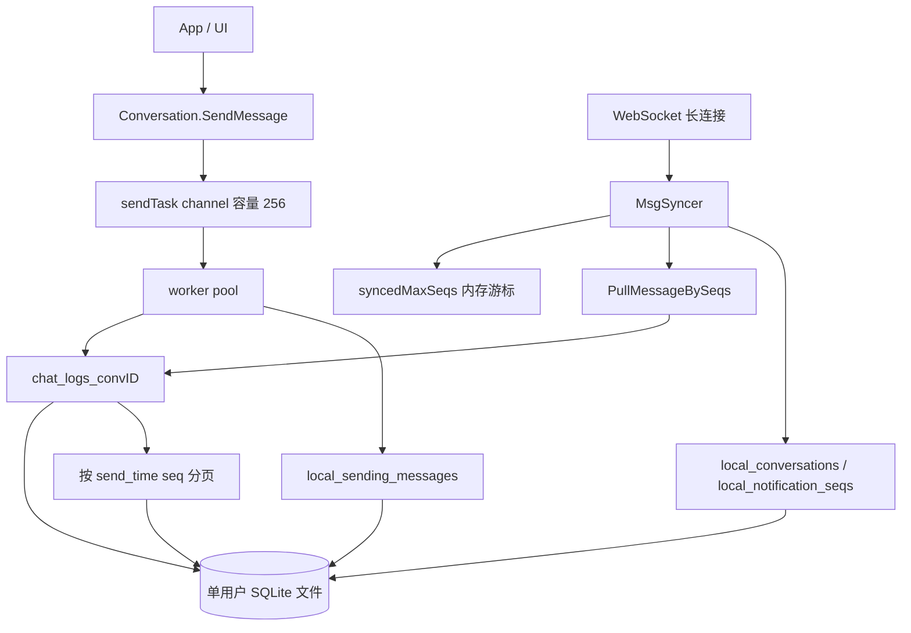

# OpenIM SDK Core：按会话分表的 SQLite 本地缓存

> **一句话结论**
> OpenIM SDK Core 用「每用户一个 SQLite 文件 + 每会话一张消息表」把会话隔离下沉到物理 schema；消息落库是乐观写入，服务端 `seq` 是唯一权威，客户端只负责缓存与补齐。代价同样鲜明：消息路径没有显式事务，schema 迁移近乎一次性，库文件明文落盘，离线发送也不是完整 outbox。

## 统一元数据

| 项目 | 值 |
|---|---|
| 仓库 | SDK：[openimsdk/openim-sdk-core](https://github.com/openimsdk/openim-sdk-core)；服务端参考：[openimsdk/open-im-server](https://github.com/openimsdk/open-im-server) |
| Stars（2026-11-16） | SDK 514；服务端参考 16,774 |
| License | SDK 为 GitHub API 识别的 AGPL-3.0，但部分源码文件头与 README 徽章写 Apache-2.0，存在不一致（`LICENSE:1`、`pkg/db/db_init.go:1-15`、`README.md:14`）；服务端参考为 Apache-2.0 |
| 主语言 | Go，模块 `github.com/openimsdk/openim-sdk-core/v3`，`go 1.23.0`（`go.mod:1-5`） |
| 分析 commit | `db36e316a00eef4b647666a828c689ad5d9460f7`，对应 SDK 版本 `3.8.0`（`version/version.go:7-8`） |
| 分析日期 | 2026-11-16 |

## 项目简介与定位

OpenIM 由服务端 `open-im-server` 与客户端内核 `openim-sdk-core` 组成。后者用 Go 编写，是 iOS、Android、PC、Web/WASM 各端 SDK 的公共内核（`README.md:33-36`）。初始化时 `InitSDK` 分别接收 HTTP 业务地址 `apiAddr` 与 WebSocket 长连接地址 `wsAddr`（`open_im_sdk/init_login.go:44-86`）：HTTP 承担业务请求，长连接承担消息推送与同步。原生平台使用 SQLite + GORM，Web/WASM 改用 IndexedDB，两侧通过同一套 `db_interface.DataBase` 接口收敛（`pkg/db/db_js.go:30-70`、`wasm/indexdb/chat_log_model.go:87-123`）。

这套存储值得研究，不是因为它「完整」，而是因为它把几个通常被隐藏的取舍直接写进了 schema：消息表按会话动态创建，同步游标只驻留内存，发送状态机靠少量 SQL 维护。它更像一个服从服务端序号体系的客户端缓存，而不是可独立演进的本地数据库。本文只分析原生 SQLite 路径；服务端实现仅作背景，未展开核验。

## 本地存储架构

### 文件、连接与安全边界

登录阶段，`UserContext.initialize` 调用 `db.NewDataBase(ctx, userID, u.info.DataDir, ...)`，随后立即执行 `checkSendingMessage` 处理上次遗留的未完成发送（`open_im_sdk/userRelated.go:391-398`）。`dataDir` 来自 `InitSDK` 配置中的 `IMConfig.DataDir`（`sdk_struct/sdk_struct.go:330`）。数据库文件名由固定前缀、大版本号和用户 ID 拼接（`pkg/db/db_init.go:121`），其中 `BigVersion` 为 `"v3"`（`pkg/constant/constant.go:244`），最终路径形如 `<dataDir>/OpenIM_v3_<userID>.db`；缺少用户 ID 时初始化直接报 `no uid`（`pkg/db/db_init.go:114-116`）。因此账号隔离首先发生在文件层：不同用户不共享表；从每用户独立调用 `NewDataBase` 推断，它们也不共享连接池。

打开数据库走 `gorm.Open(sqlite.Open(dbFileName), ...)`，底层是 `gorm.io/driver/sqlite` 与 CGO 驱动 `github.com/mattn/go-sqlite3`（`pkg/db/db_init.go:137-153`、`go.mod:7`、`go.mod:37`）。连接池上限为 3 个打开连接、2 个空闲连接，连接最长存活 1 小时、最长空闲 10 分钟；慢 SQL 阈值 200ms（`pkg/db/db_init.go:128-153`）。这个配置偏向移动端资源约束，而不是高并发写入。

更关键的是缺省项。打开路径没有执行任何 `PRAGMA`，没有切换 WAL、没有设置 `busy_timeout`，也没有传入加密密钥或 SQLCipher 参数（`pkg/db/db_init.go:137-153`）。素材的全仓库检索同样未命中 `PRAGMA`、`WAL`、`busy_timeout`、`encrypt`、`cipher`；唯一相关命中是工具函数里的 MD5（`pkg/utils/utils.go:47`）。从这些证据推断，数据库使用 SQLite 默认 journal 模式并以明文落盘，静态数据保护依赖宿主 App 的沙箱与系统磁盘加密，而不是数据库自身。

进程内并发由 `DataBase.mRWMutex` 兜底，各 DB 方法在入口加读锁或写锁（`pkg/db/db_init.go:76-82`）。这让同一进程内的 SQL 访问被串行化，但也意味着吞吐上限首先取决于这把进程锁，而不是 SQLite 连接数。

### 架构示意

### 惰性建表与迁移

消息表不是启动时统一建好的。任何消息读写前都会调用 `initChatLog`，用内存中的 `tableChecker` 判断该会话表是否存在；不存在就执行手写 `CREATE TABLE` 与两条 `CREATE INDEX`（`pkg/db/chat_log_model.go:37-83`）。表名规则是 `chat_logs_` 前缀拼接 `conversationID`（`pkg/constant/constant.go:165`、`pkg/utils/utils.go:180-182`）。这使建表成本被摊到首次访问某个会话时，也让 schema 变更必须同时照顾「已存在的旧表」和「未来新建的表」。

初始化迁移集中在 `versionDataMigrate`：首次建库、版本表为空时，对 14 个模型执行一次 `AutoMigrate`，然后写入当前版本号（`pkg/db/db_init.go:155-160`、`pkg/db/db_init.go:170-209`）。版本表 `local_app_sdk_version` 以 `version` 为主键，并用 `installed` 标记是否已完成初始化/重装全量同步（`pkg/db/model_struct/data_model_struct.go:313-321`、`internal/interaction/msg_sync.go:322-329`）。此后如果版本号变化，代码只命中一个写死的分支：`case "3.8.0"`，而且只迁移 `LocalAppSDKVersion` 自己（`pkg/db/db_init.go:200-209`）。换句话说，14 张基础表只在「空库」时获得结构对齐，运行期动态创建的会话表更是完全脱离 AutoMigrate。

还有一个容易误判的点：`AutoMigrate` 会按 GORM 默认命名创建一张 `local_chat_logs`，但消息读写全部显式 `Table(chat_logs_<convID>)`；素材未发现任何直接读写 `local_chat_logs` 的路径（`pkg/db/db_init.go:173-188`、`pkg/db/chat_log_model.go:105-124`）。这张表是否实际为空表，属于基于代码的推断，未打开真实数据库核验。

## 数据结构

基础模型覆盖好友、群、群成员、用户、黑名单、会话、通知序号、消息、上传分片、版本同步等对象（`pkg/db/db_init.go:173-188`）。核心表可以压缩成下面几类。

| 表 / 对象 | 主键 | 关键列 | 作用与索引 |
|---|---|---|---|
| `chat_logs_<conversationID>` | `client_msg_id` CHAR(64) | `server_msg_id`、`send_id`、`recv_id`、`content_type`、`content`、`status`、`seq`、`send_time`、`is_read` | 单会话消息；手写 DDL 除主键外只建 `index_seq_<convID>` 与 `index_send_time_<convID>` 两个普通索引（`pkg/db/chat_log_model.go:42-79`） |
| `local_conversations` | `conversation_id` CHAR(128) | `unread_count`、`latest_msg`、`latest_msg_send_time`、`max_seq`、`min_seq`、`draft` | 会话聚合与服务端序号快照；索引 `index_latest_msg_send_time`（`pkg/db/model_struct/data_model_struct.go:194-223`） |
| `local_sending_messages` | (`conversation_id`,`client_msg_id`) | `ex` | 在途发送标记，供启动恢复扫描（`pkg/db/model_struct/data_model_struct.go:277-285`） |
| `local_notification_seqs` | `conversation_id` | `seq` | 通知类会话已同步到的序号（`pkg/db/model_struct/data_model_struct.go:241-248`） |
| `local_sync_version` | (`table_name`,`entity_id`) | `version_id`、`version`、`id_list` | 非消息实体的增量版本游标（`pkg/db/model_struct/data_model_struct.go:301-311`） |
| `local_uploads` | `part_hash` | `upload_id`、`upload_info`、`expire_time` | 分片上传断点续传状态，`upload_info` 是 base64 分片位图（`pkg/db/model_struct/data_model_struct.go:250-260`） |
| `local_app_sdk_version` | `version` | `installed` | schema 版本与初始化/重装标记（`pkg/db/model_struct/data_model_struct.go:313-321`） |

消息表的结构有两个值得注意的细节。第一，`LocalChatLog` 没有实现 `TableName()`，因此结构体上的 GORM 索引 tag 不会作用于手写会话表；真正存在的只有 DDL 里写死的两个索引（`pkg/db/model_struct/data_model_struct.go:172-192`、`pkg/db/chat_log_model.go:72-79`）。第二，DDL 比结构体多出 `is_react`、`is_external_extensions`、`msg_first_modify_time` 三列，结构体没有对应字段（`pkg/db/chat_log_model.go:63-65`）。这可以解释为历史兼容或预留，但从代码看，GORM 按结构体写列时不会主动填这三列，属于 schema 与模型已经轻微漂移的证据。

消息状态只有五个值：发送中 1、成功 2、失败 3、已删除 4、被过滤 5（`pkg/constant/constant.go:132-136`）。状态机不复杂，复杂的是状态与 `seq` 的组合：`seq=0` 表示本地已有、尚未拿到服务端序号；`seq>0` 才进入服务端连续序列。

## 写入与读取路径

### 发送：先写两条记录，再等服务端回填

`Conversation.SendMessage` 本身不落库，它把任务投进进程内 `sendTask` 队列后立即返回（`internal/conversation_msg/api.go:625-637`）。队列容量 256，worker 数为 `runtime.NumCPU()` 且最少 4，文本与媒体分两条有序 lane；队列满时最多重试入队 100 次、每次间隔 5ms，仍失败则报 `send task queue full`（`internal/conversation_msg/send_queue.go:19-81`、`internal/conversation_msg/send_queue.go:83-111`）。这意味着「调用发送成功」只代表任务被接收，不代表消息已经出网。

真正的落库在 `sendMessage`（`internal/conversation_msg/api.go:292-323`）。非在线直发模式下，先按 `clientMsgID` 查本地：

- 不存在：把 `MsgStruct` 转成 `LocalChatLog` 插入会话表，再向 `local_sending_messages` 插入一条 `(conversationID, clientMsgID)` 标记。
- 已存在且状态不是 `MsgStatusSendFailed`：返回 `sdkerrs.ErrMsgRepeated`，不重复发送。
- 已存在且上次失败：允许重发，重新插入发送标记；代码同时在内存对象上把状态置为 sending（`internal/conversation_msg/api.go:307-319`）。

两条插入语句之间没有 `Begin/Commit`，也没有 GORM `Transaction` 包裹（`internal/conversation_msg/api.go:292-323`）。因此从代码顺序推断：如果消息行插入成功而发送标记插入失败，库里会留下一条没有在途标记的消息；启动扫描只读取 `local_sending_messages`，不会发现它。这是无事务路径的直接代价，但本次未做崩溃注入验证。

发送走长连接 `SendReqWaitResp`，成功后调用 `updateMsgStatusAndTriggerConversation` 回写状态、发送时间与服务端消息 ID，条件明确限定为 `client_msg_id = ? AND seq = 0`，即只回填尚未获得服务端序号的那一行；随后删除发送标记并刷新会话最新消息（`internal/conversation_msg/api.go:152-173`、`internal/conversation_msg/api.go:678-742`、`pkg/db/chat_log_model.go:151-156`）。如果服务端在响应里改写了消息内容，SDK 会用返回值重新转换并整条 `UpdateMessage`（`internal/conversation_msg/api.go:728-741`）。网络超时则回读本地：若已被其他路径标成成功，以本地成功为准；否则置为失败（`internal/conversation_msg/api.go:681-703`）。

### 接收：先批量查重，再批量插入

实时推送与增量拉取最终都进入 `doMsgNew`（`internal/conversation_msg/conversation_msg.go:229-437`）。它先抽出本批 `clientMsgID`，用 `GetMessagesByClientMsgIDs` 一次查出本地已存在的记录（`internal/conversation_msg/conversation_msg.go:262-268`），再处理删除态、补齐昵称头像，最后按会话调用 `batchInsertMessageList`（`internal/conversation_msg/conversation_msg.go:288-296`、`internal/conversation_msg/conversation_msg.go:402-437`）。

这里没有 upsert。全仓库未使用 `ON CONFLICT DO UPDATE` 或 GORM `clause.OnConflict`，去重完全依赖「先查后插」；批量插入失败时降级为逐条 `InsertMessage`，但不会回滚已经插入的部分（`internal/conversation_msg/conversation_msg.go:715-736`）。冲突消息也不会被覆盖合并，而是由 `handleExceptionMessages` 改写 `client_msg_id` 并加 `[SEQ_DUP]`、`[CLIENT_DUP]`、`[DELETED]`、`[SEQ_GAP_+seq]` 之类前缀，作为异常或占位记录写入（`internal/conversation_msg/message_check.go:369-417`）。这保证了本地行与服务端 `seq` 的物理连续性，但也制造了合成消息行。

### 历史分页：`send_time` 与 `seq` 双游标

历史入口是 `getAdvancedHistoryMessageList`（`internal/conversation_msg/conversation.go:53-100`）。如果调用方传入 `StartClientMsgID`，先用 `GetMessage` 取出该消息的 `send_time` 与 `seq` 作为游标，再进入 `fetchMessagesWithGapCheck`（`internal/conversation_msg/conversation.go:62-82`）。

DB 层 SQL 按方向选择排序：反向为 `send_time ASC, seq ASC`，正向为 `send_time DESC, seq DESC`；条件写成 `send_time < ? OR (send_time = ? AND (seq < ? OR (seq = 0 AND client_msg_id != ?)))`（`pkg/db/chat_log_model.go:165-190`）。`seq=0` 的本地未同步消息因此能和同毫秒消息一起排序，又不会因为 `seq` 相同而重复或漏页。分页之后还有缺口处理：块内用缺失 `seq` 列表补拉，块间用上一块边界 `seq` 判断 `lastEndSeq+1` 是否等于当前起点，块尾再用会话 `max_seq/min_seq` 判断是否到底（`internal/conversation_msg/message_check.go:23-71`、`internal/conversation_msg/message_check.go:76-154`）。补拉结果先落库再与当前页合并（`internal/conversation_msg/message_check.go:207-253`）。离线且 `startTime == 0` 时，代码直接跳过回填（`internal/conversation_msg/message_check.go:224-226`）。

## 同步与一致性

### 游标只驻留内存

同步器为每个会话维护 `syncedMaxSeqs map[string]int64`，记录本地已确认同步到的最大服务端序号（`internal/interaction/msg_sync.go:48-59`）。SDK 启动时 `LoadSeq` 遍历本地会话，用 `CheckConversationNormalMsgSeq` 对每张会话表执行 `SELECT IFNULL(max(seq),0)`，再把 `local_notification_seqs` 里的通知序号叠加进来（`internal/interaction/msg_sync.go:81-159`、`pkg/db/chat_log_model.go:423-432`）。如果本地一个会话都没有，且 `local_app_sdk_version.installed` 不为 true，则判定为重装，走全量同步（`internal/interaction/msg_sync.go:88-96`）。

所以「重启丢游标」的准确含义是：内存 map 必然清空，但游标可以从本地各会话表的最大 `seq` 重新推导。若本地已经写入了 `max_seq` 对应的消息，重启后不会重复拉取；若本地消息缺失或最大 `seq` 偏低，推导出的游标也偏低，重连后会再次补拉。消息同步没有一张独立的、持久化的「已同步到 X」元数据表；通知类序号才落在 `local_notification_seqs`。

### 重连：先问服务端最大序号，再按区间补拉

断线重连或冷启动后，`doConnected` 向服务端请求 `GetMaxSeqReq`，最多 3 次，首次失败后以 2 秒为起点翻倍等待（`internal/interaction/msg_sync.go:429-471`）。拿到各会话最大序号后，`compareSeqsAndBatchSync` 逐会话计算区间：本地有游标则取 `[syncedMaxSeq+1, maxSeq]`，没有记录则取 `[0, maxSeq]`，`maxSeq==0` 跳过（`internal/interaction/msg_sync.go:221-345`）。

拉取由 `pullMsgBySeqRange` 构造 `PullMessageBySeqsReq` 的 `SeqRanges` 完成（`internal/interaction/msg_sync.go:668-685`）。单批累计达到 `SplitPullMsgNum = 100` 条就触发一次请求，同时限制最多遍历 500 个会话、单次同步 100 个会话、10 个并发拉取 goroutine（`internal/interaction/msg_sync.go:40-43`、`internal/interaction/msg_sync.go:507-563`）。成功后把 `syncedMaxSeqs[conversationID]` 推进到本批终点（`internal/interaction/msg_sync.go:539-541`）。这是一条明确的「服务端权威」链路：客户端不产生消息序号，只消费区间。

推送路径同样做连续性校验。`pushTriggerAndSync` 期望 `lastSeq == syncedMaxSeq + len(storageMsgs)`；相等才直接接收并推进游标，否则在 `lastSeq` 更大时构造 `[syncedMaxSeq+1, lastSeq]` 补拉（`internal/interaction/msg_sync.go:378-426`）。`seq=0` 的在线信令消息绕过该检查，直接进入会话处理（`internal/interaction/msg_sync.go:393-399`）。补拉结果通过 `DispatchNewMessage` 投递到会话队列，最终仍由 `doMsgNew` 落库（`internal/interaction/msg_sync.go:721-733`）。

### 未读数与版本游标

会话未读数不在本地累加，而是由服务端 `MaxSeq - HasReadSeq` 计算，负值归零，只把结果写回 `local_conversations.unread_count`，同时把 `MaxSeq` 记入内存记录器（`internal/conversation_msg/sync.go:30-136`、`internal/conversation_msg/sync.go:63-84`）。`hasReadSeq` 本身不落本地；本地只有逐条 `is_read` 和会话级 `unread_count`。因此离线期间未读数可能滞后，直到下一次同步。

非消息实体走另一套版本游标：`local_sync_version` 保存 `table_name + entity_id → version_id/version`（`pkg/db/model_struct/data_model_struct.go:301-311`）。`IncrementalSync` 取本地版本、带版本请求服务端，并按 `Delete/Update/Insert` 处理；服务端返回 `Full` 时退回全量同步（`pkg/syncer/version_synchronizer.go:56-95`）。会话列表正是这条路径的使用者（`internal/conversation_msg/incremental_sync.go:26-89`）。

## 离线消息处理

### 收：没有离线表，靠重连补拉

SDK 没有「离线消息表」。离线期间对方发来的消息只存在服务端，客户端重连后按上一节的 `GetMaxSeq` + `PullMessageBySeqs` 区间补拉（`internal/interaction/msg_sync.go:194-200`、`internal/interaction/msg_sync.go:429-471`）。App 从后台唤醒走 `CmdWakeUpDataSync`，手工同步走 `CmdIMMessageSync`，两条路径分别复用同一套最大序号比对与批量同步逻辑（`internal/interaction/msg_sync.go:473-501`）。这也是「本地是缓存」最直接的体现：离线消息的权威副本不在客户端。

### 发：失败即定格，重启把 sending 改判 failed

发送失败时，SDK 把消息状态更新为 `MsgStatusSendFailed` 并删除 `local_sending_messages` 标记（`internal/conversation_msg/api.go:694-702`、`internal/conversation_msg/api.go:152-173`）。代码中没有定时重发、指数退避重发或后台补偿循环；发送队列只负责进程内调度，任务失败即回调 `OnError`（`internal/conversation_msg/send_queue.go:127-162`）。

启动时 `checkSendingMessage` 取出 `local_sending_messages` 的全部记录，逐条调用 `handlerSendingMsg`：只有本地消息仍是 `MsgStatusSending` 时才改为 `MsgStatusSendFailed`；如果这条消息正好是会话的 `latest_msg`，会话里的最新消息状态也同步改为失败；处理完删除标记（`open_im_sdk/userRelated.go:327-340`、`open_im_sdk/userRelated.go:342-368`）。这相当于把「进程在发送途中退出」一律降级为「发送失败」，避免界面永远停在转圈状态，但 SDK 不会替用户重发。

重试责任因此落在上层 App：用户再次发送时复用同一个 `clientMsgID`，才会命中「上次失败可重发」的分支（`internal/conversation_msg/api.go:307-319`）。这不是完整 outbox：持久化的只有消息行和一个在途标记，没有独立的待发 payload 队列、没有跨重启的退避策略、也没有自动重发保证。上层若不做重试，失败消息就只是一条本地记录。

### 附件：只存上传断点

消息本身不内嵌二进制，媒体消息的 `content` 是 JSON，文件走对象存储或分片上传（`internal/conversation_msg/api.go:328-360`、`internal/conversation_msg/api.go:500-525`）。`local_uploads` 以文件 hash 的 `part_hash` 为主键，保存 `upload_id`、base64 分片位图、过期时间与创建时间（`pkg/db/model_struct/data_model_struct.go:250-260`）。上传前若分片数大于 1、`upload_id` 非空且未临近过期，就复用原上传会话与位图继续传；否则重新初始化（`internal/third/file/upload.go:434-515`）。过期清理函数 `DeleteExpireUpload` 在仓库内没有调用点，只有接口声明与 WASM 实现，因此从代码推断过期分片记录不会被自动清理（`pkg/db/upload_model.go:62-73`）。

已读回执与编辑/撤回则没有独立的本地队列表。素材能确认的是：本地逐条保存 `is_read`，会话级只存 `unread_count`，`hasReadSeq` 由服务端提供（`pkg/db/model_struct/data_model_struct.go:194-223`、`internal/conversation_msg/sync.go:63-84`）；删除态消息仍会以 `[DELETED]` 等前缀写入占位行（`internal/conversation_msg/message_check.go:369-417`）。`notification.go`、`read_drawing.go`、`revoke.go` 的具体写路径未逐条核验，本文不展开。

## 设计权衡与适用场景

**收益**

- 会话隔离是物理级的。单会话分页只扫 `chat_logs_<convID>`，索引也按会话独立，热点会话不会和冷会话共享同一棵 B 树；这是单表方案最难直接复制的优势（`pkg/db/chat_log_model.go:42-79`）。
- 用户隔离是文件级的。`<dataDir>/OpenIM_v3_<userID>.db` 让账号切换不涉及表内 `user_id` 过滤，也天然避免不同账号的消息混库（`pkg/db/db_init.go:121`）。
- 同步模型简单。客户端不生成序号、不做冲突合并，只按服务端 `seq` 区间补齐；冲突用异常行隔离，主链路不需要分布式一致性协议（`internal/interaction/msg_sync.go:221-345`、`internal/conversation_msg/message_check.go:369-417`）。

**代价**

- **明文库**：打开路径没有 SQLCipher 或密钥参数，仓库也未发现字段级加密，落盘是明文 SQLite（`pkg/db/db_init.go:137-153`）。安全边界完全交给宿主沙箱、系统磁盘加密和 App 自身的文件权限。
- **无 WAL/PRAGMA 调优**：没有 WAL、`busy_timeout`、`synchronous`、`cache_size` 设置，连接池只有 3 个打开连接（`pkg/db/db_init.go:137-153`）。从默认 journal 模式推断，写操作会持有库级写锁，多个 goroutine 主要靠 `mRWMutex` 排队；热点会话的批量写容易成为瓶颈。
- **迁移不完整**：基础表只在空库时 AutoMigrate 一次，版本升级只硬编码了 `3.8.0` 且只迁移版本表；运行期创建的会话表没有统一 `ALTER TABLE` 管道（`pkg/db/db_init.go:170-209`）。升级时要兼容多少种历史表结构，代码本身没有给出答案。
- **分表数量膨胀**：每个会话至少产生 1 张表 + 2 个索引，首次写入该会话还要额外承担 `CREATE TABLE`/`CREATE INDEX` 的 DDL 成本；之后每次写入只维护本会话的两个索引（`pkg/db/chat_log_model.go:37-83`）。1 万个会话就是至少 3 万个显式 schema 对象，不含主键自动索引；代码注释已自认 10 万会话时 `LoadSeq` 可能阻塞（`internal/interaction/msg_sync.go:98`）。跨会话全局检索也无法用一条 SQL 完成，只能逐表查询后在应用层归并，这是从 schema 推断的代价。
- **失败恢复依赖上层**：消息写入无显式事务，批量插入失败逐条重试但不回滚；发送失败不自动重发，重启把 sending 一律改判 failed（`internal/conversation_msg/conversation_msg.go:715-736`、`open_im_sdk/userRelated.go:327-368`）。SDK 保证的是「状态可见」，不是「最终送达」。

**适用判断**

这套方案适合「服务端在线权威、客户端只做缓存」的 IM：会话数量可控、消息以单会话时间线为主、App 愿意自己承担重试、加密与合规。若目标是离线优先、严格本地持久化、跨会话全文检索、或需要数据库级静态加密，这套 schema 不是合适起点。它的事务边界也需要特别澄清：消息写入路径确实没有显式事务，但会话未读数更新使用了 `Begin/Rollback/Commit`（`pkg/db/conversation_model.go:394-417`），不能据此说「全仓库无事务」。

## 证据与限制

| 结论 | 证据 | 符号 |
|---|---|---|
| 每用户一个 `<dataDir>/OpenIM_v3_<uid>.db` | `pkg/db/db_init.go:121`、`pkg/constant/constant.go:244` | `DataBase.initDB`、`BigVersion` |
| GORM + mattn/go-sqlite3，连接池 3/2 | `pkg/db/db_init.go:137-153`、`go.mod:37` | `DataBase.initDB` |
| 打开路径无 PRAGMA/WAL/加密参数 | `pkg/db/db_init.go:137-153` | `sqlite.Open` |
| 首次空库 AutoMigrate 14 个模型 | `pkg/db/db_init.go:170-188` | `versionDataMigrate` |
| 版本升级只硬编码 3.8.0 | `pkg/db/db_init.go:200-209` | `versionDataMigrate` |
| 会话表惰性手写 DDL，仅 seq/send_time 两个索引 | `pkg/db/chat_log_model.go:37-83` | `initChatLog` |
| 消息主键 `client_msg_id`，结构体无 `TableName()` | `pkg/db/model_struct/data_model_struct.go:172-192` | `LocalChatLog` |
| 发送先插消息、再插 sending，二者无事务 | `internal/conversation_msg/api.go:292-323` | `sendMessage` |
| 重复 clientMsgID 返回 `ErrMsgRepeated` | `internal/conversation_msg/api.go:307-319` | `sendMessage` |
| 成功后按 `client_msg_id + seq=0` 回写 | `internal/conversation_msg/api.go:152-173`、`pkg/db/chat_log_model.go:151-156` | `updateMsgStatusAndTriggerConversation` |
| 接收批量查重后插入，失败逐条重试 | `internal/conversation_msg/conversation_msg.go:262-268`、`internal/conversation_msg/conversation_msg.go:715-736` | `doMsgNew`、`batchInsertMessageList` |
| 内存 `syncedMaxSeqs` 与启动重建 | `internal/interaction/msg_sync.go:48-59`、`internal/interaction/msg_sync.go:81-159` | `MsgSyncer.LoadSeq` |
| 重连 GetMaxSeq 3 次，2s 起翻倍 | `internal/interaction/msg_sync.go:429-471` | `doConnected` |
| 按 `[syncedMax+1, maxSeq]` 拉取，每 100 条一批 | `internal/interaction/msg_sync.go:507-563`、`internal/interaction/msg_sync.go:668-685` | `syncAndTriggerMsgs`、`pullMsgBySeqRange` |
| 会话未读数使用显式事务 | `pkg/db/conversation_model.go:394-417` | `DecrConversationUnreadCount` |
| 启动把 sending 改判 failed 并清标记 | `open_im_sdk/userRelated.go:327-368` | `checkSendingMessage`、`handlerSendingMsg` |

**未核验或未覆盖**

- 素材来自静态源码阅读，未编译、未连接服务端、未实际打开 SQLite 文件；会话表真实列与 `local_chat_logs` 是否为空表属于代码推断（`pkg/db/chat_log_model.go:42-79`、`pkg/db/db_init.go:173-188`）。
- 无 `TableName()` 的模型表名按 GORM 默认复数规则推断，例如 `local_users`、`local_blacks`、`local_chat_log_reaction_extensions`，未在数据库中实测（`pkg/db/model_struct/data_model_struct.go:132-157`、`pkg/db/model_struct/data_model_struct.go:236-239`）。
- `LocalConversationUnreadMessage`、`LocalSeq`/`LocalSeqData`、`DeleteExpireUpload` 等存在定义但主路径未调用或实现不完整，可能是遗留/未完成代码，未查到调用方（`pkg/db/seq_data_model.go:29-51`、`pkg/db/upload_model.go:62-73`）。
- 服务端 `GetMaxSeq`、`PullMessageBySeqs` 的 seq 生成规则、离线消息保留策略未阅读 `open-im-server` 实现；本文只确认 SDK 侧的消费方式（`internal/interaction/msg_sync.go:429-471`、`internal/interaction/msg_sync.go:668-685`）。
- 通知、已读回执、撤回等写路径未逐条覆盖；本文只涉及主收发、同步、未读数与附件断点（`internal/conversation_msg/sync.go:30-136`、`internal/third/file/upload.go:434-515`）。
