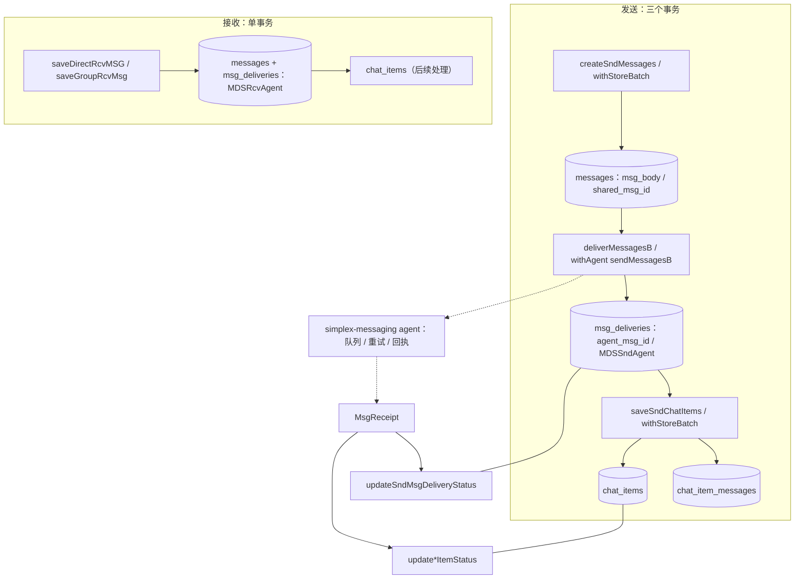

# SimpleX Chat：无标识符 IM 的本地消息库

> **一句话结论**
> SimpleX Chat 把消息拆成两层落库：agent 层的 `messages` 保存原始消息体与协议 ID，UI 层的 `chat_items` 保存可渲染的会话项，一次发送要跨三个事务；服务端只转发队列，历史只存在设备上。这样分层的收益是历史分页与状态更新都不必碰大消息体，代价是双写一致性、去重和群发游标全部由本地库自己兜。

## 统一元数据

| 项 | 值 |
|---|---|
| 仓库 | https://github.com/simplex-chat/simplex-chat |
| Stars（2026-11-16 快照） | 19,699 |
| License | AGPL-3.0 |
| 主语言 | Haskell |
| 分析 commit | `f44711b20cf580ac923c9d75fc1ce7e8339e28cc` |
| 分析日期 | 2026-11-16 |

## 项目简介与定位

SimpleX Chat 是主打「没有任何用户标识符」的去中心化即时通讯实现，README 的标题原文就是 `SimpleX - the first messaging platform that has no user identifiers of any kind - 100% private by design!`（`README.md:10`）。它没有中心化账号：消息经 SMP 服务器上的队列转发，客户端用一次性或双向队列地址与服务器通信，本地端是一套 Haskell 聊天核心，CLI/Terminal、移动端（经 C 接口）和 Library/Web 等多个前端共用。

没有账号，意味着没有一处「服务端消息表」可作权威。联系人、群组、消息体、投递状态、附件元数据都落在本地 SQLite，换设备或丢库就没有历史可拉。这让它的存储层比普通 IM 客户端更值得看：本地库不只是缓存，而是唯一的历史载体；而它又刻意把「协议记录」和「界面条目」拆成两套表示，这在同系列项目里并不常见（多数项目是一条消息一行）。

需要先划一条边界。本 commit **不存在** `src/Simplex/Chat/Store/SQLite.hs`，chat 侧的 SQLite 后端只有 `src/Simplex/Chat/Store/SQLite/Migrations.hs` 与 `Migrations/` 目录。真正打开数据库、处理加密与提供 `withTransaction` 的实现来自依赖库 `simplex-messaging`（`Simplex.Messaging.Agent.Store.*`），不在本仓库。因此本文能确认的是调用边界、参数与 SQL，不能把 SQLCipher 的 PRAGMA 细节写成已核实事实。

## 本地存储架构

### 两个库文件，同一前缀

数据库不是单文件，而是成对命名：`chatSuffix = "_chat.db"`、`agentSuffix = "_agent.db"`（`src/Simplex/Chat/Options/SQLite.hs:87-92`），`dbString` 也把两者并列输出为 `<prefix>_chat.db, <prefix>_agent.db`（`src/Simplex/Chat/Options/SQLite.hs:73`）。前缀由 CLI 的 `-d/--database` 给出，帮助文本明确写的是「Path prefix to chat and agent database files」，默认值由调用方传入（`src/Simplex/Chat/Options/SQLite.hs:27-45`）；Terminal 入口传入 `simplex_v1`（`src/Simplex/Chat/Terminal/Main.hs:27`），归档代码里也硬编码了 `simplex_v1_agent.db`、`simplex_v1_chat.db`、`simplex_v1_files`、`simplex_v1_assets`（`src/Simplex/Chat/Archive.hs:41-50`）。

这套命名把「聊天业务数据」和「agent 投递状态」分成两个可独立备份、独立打开的库。附件内容走独立的文件目录（归档里对应 `simplex_v1_files`、`simplex_v1_assets`），`files` 只存元数据、摘要、过期时间与文件级加密 key/nonce（`src/Simplex/Chat/Store/SQLite/Migrations/chat_schema.sql:285-316`），`snd_files` 按 `(file_id, connection_id)` 记录每连接的发送状态（`:317-329`）。下文把该路径简写为 `chat_schema.sql`，并把 `src/Simplex/Chat/Store/Messages.hs`、`src/Simplex/Chat/Library/Internal.hs`、`src/Simplex/Chat/Library/Subscriber.hs` 分别简写为 `Store/Messages.hs`、`Internal.hs`、`Subscriber.hs`。

### 打开与加密：只能追到调用边界

本仓库唯一的 chat store 构造点是 `createChatStore`，它直接把参数转交给库层的 `createDBStore`：

```haskell
createChatStore :: DBOpts -> MigrationConfig -> IO (Either MigrationError DBStore)
createChatStore dbCreateOpts = createDBStore dbCreateOpts migrations
```

（`src/Simplex/Chat/Store.hs:29-30`）

加密意图通过 `DBOpts` 表达：`dbFilePath`、`dbKey`、`keepKey`、`vacuum`、`track`（`src/Simplex/Chat/Options/SQLite.hs:76-84`），其中 `dbKey` 的类型是 `ScrubbedBytes`（`:21-26`）。CLI 的 `-k/--key` 是「Database encryption key/pass-phrase」，默认值为空字符串（`:37-45`）；`removeDbKey` 的注释说明数据库打开后选项里的 key 不再使用（`:112-114`）。移动端走 `chatMigrateInit dbFilePrefix dbKey`，同时设置 `trackQueries = TQSlow 5000`、`vacuumOnMigration = True`（`src/Simplex/Chat/Mobile.hs:341-351`）。

到此为止是事实。`dbKey` 如何变成 SQLCipher 的 key、KDF 参数、打开时的 PRAGMA，都在 `simplex-messaging` 的 `createDBStore` 内，本仓库不含实现。`--key` 默认空只能说明「不传即无 key」，不能据此断定未加密库的 journal 模式或 cipher 设置。

### 迁移是一串 Haskell 模块

迁移不是一份 SQL 脚本，而是可执行模块的有序列表：`module Simplex.Chat.Store.SQLite.Migrations (migrations)`（`src/Simplex/Chat/Store/SQLite/Migrations.hs:1-5`）。`Migrations/` 下共 183 个条目，按日期前缀排序执行，最早是 `M20220101_initial.hs`（11,253 B），后续每步一个小迁移，例如 `M20230705_delivery_receipts.hs`、`M20231215_recreate_msg_deliveries.hs`、`M20241023_chat_item_autoincrement_id.hs`。目录里还提交了当前 schema 的导出 `chat_schema.sql`（62,265 B）以及 `chat_query_plans.txt`（458,064 B）、`agent_query_plans.txt`（66,293 B），后者用于审查索引是否被查询计划命中。

迁移配置与错误类型来自库层：`DBStore`、`withTransaction`、`DBOpts`、`createDBStore`、`MigrationConfig`、`MigrationError` 全部从 `Simplex.Messaging.Agent.Store.*` 导入（`src/Simplex/Chat/Store.hs:20-22`）。打开后会执行迁移，`vacuumOnMigration` 控制是否 VACUUM，CLI 用 `--disable-vacuum` 关闭（`src/Simplex/Chat/Options/SQLite.hs:40-44`）。

### 连接与线程边界

素材能确认的只有「每次操作拿一个 `DB.Connection`，批量写包在 `withStoreBatch`/`withStoreBatch'` 里」，以及 `withTransaction` 由库层提供、业务侧直接使用（例如 `src/Simplex/Chat.hs:173`）。连接池、线程模型与 WAL 设置在 `simplex-messaging` 内，本文不推断。

## 数据结构

核心设计是两层：`messages` 是 agent 层收发的原始消息体，`chat_items` 是可直接渲染的会话项。`messages` 带 `chat_msg_event`（事件标签）、`msg_body BLOB`（注释原文 `agent message body as received or sent`）、`shared_msg_id`、`msg_chat_binding`、`msg_signatures`、`broker_ts`，以及 `connection_id`/`group_id` 两个可空外键（`chat_schema.sql:454-471`）。`chat_items` 带 `item_content TEXT`（JSON）、`item_text`、`item_status`、`item_deleted`、`shared_msg_id`、`quoted_shared_msg_id`、`timed_ttl`/`timed_delete_at`，并用 `created_by_msg_id INTEGER UNIQUE` 指向创建它的消息（`chat_schema.sql:479-536`）。

两表用 `chat_item_messages` 关联（`chat_schema.sql:537-542`）。这张表的名字像多对多，实际形状是「一个会话项可以挂多条消息，但每条消息最多属于一个会话项」——`message_id` 上有 `UNIQUE`，`chat_item_id` 没有；其后的 `UNIQUE(chat_item_id, message_id)` 在前者成立时是冗余的。`created_by_msg_id` 的 `UNIQUE` 是第二道同向约束。读 schema 可以直接得出这个结论，素材没有解释为何两处都设。

| 表 | 角色 | 关键字段 | 约束与索引 |
|---|---|---|---|
| `messages` | agent 层原始消息 | `msg_sent`、`chat_msg_event`、`msg_body BLOB`、`shared_msg_id`、`shared_msg_id_user`、`broker_ts`、签名 | `message_id` 主键；`STRICT`；`idx_messages_shared_msg_id`；`idx_messages_group_id_shared_msg_id`（非唯一） |
| `chat_items` | UI 会话项 | `item_sent`、`item_ts`、`item_content` JSON、`item_text`、`item_status`、`item_deleted`、`created_by_msg_id`、`timed_delete_at` | 自增主键；`created_by_msg_id UNIQUE`；直聊/群聊各一个 `shared_msg_id` 唯一索引 |
| `chat_item_messages` | 消息与会话项关联 | `chat_item_id`、`message_id`、时间戳 | `message_id UNIQUE`；`UNIQUE(chat_item_id, message_id)` |
| `msg_deliveries` | 每连接投递状态 | `message_id`、`connection_id`、`agent_msg_id`、`agent_msg_meta` JSON、`delivery_status` | `message_id` 非唯一；`agent_msg_id` 可空、非唯一；两个单列索引 |
| `pending_group_messages` | 待补发给某成员 | `group_member_id`、`message_id` | 主键 + 两个外键级联删除 |
| `delivery_tasks` / `delivery_jobs` | 大群分批投递 | `worker_scope`、`task_status`、`failed`、`cursor_group_member_id`、`body BLOB` | 任务/作业各一套状态与游标列 |

两个细节值得记住。其一，`chat_items.chat_item_id` 在 2024 年有一个名为 `M20241023_chat_item_autoincrement_id.hs` 的迁移，当前 schema 里它是 `AUTOINCREMENT`，说明它被当成跨会话稳定、可复用的分页游标，而不只是行号。其二，`item_ts` 的注释写明「received 用 creating message 的 broker_ts，sent 用 created_at」（`chat_schema.sql:479-536`），排序基准因此不是本地写入时间；以 broker 时间戳排序会让跨端顺序更接近转发顺序，这是从字段语义推断的收益。



## 写入与读取路径

### 发送：消息体、投递行、会话项分三次提交

发送不是一条 INSERT 到底，而是三个独立事务，中间还夹着一次跨库的 agent 调用：

| 步骤 | 调用点 | 写入 | 事务边界 |
|---|---|---|---|
| ① 建消息 | `createSndMessages`（`Internal.hs:2349-2360`）→ `createNewSndMessage`（`Store/Messages.hs:238-261`） | `messages`，随机生成 `shared_msg_id` | `withStoreBatch` |
| ② 交给 agent 并记投递 | `deliverMessagesB`（`Internal.hs:2577-2582`）→ `createSndMsgDelivery`（`Store/Messages.hs:263-274`） | `msg_deliveries`，初始 `MDSSndAgent` | `withAgent sendMessagesB` 之后 `withStoreBatch` |
| ③ 建 UI 项 | `saveSndChatItems`（`Internal.hs:3007-3033`）→ `createNewChatItem_`（`Store/Messages.hs:591-612`）→ `insertChatItemMessage_`（`:670-671`） | `chat_items` + `chat_item_messages` | `withStoreBatch` |

直聊调用点的顺序可以直接印证：先 `sendDirectContactMessages`，拿到 `msgs_` 后才 `saveSndChatItems`（`src/Simplex/Chat/Library/Commands.hs:4921-4924`）。广播场景则是先 `createSndMessages idsEvts`，再一次 `withStoreBatch'` 逐条 `createNewSndChatItem`（`Commands.hs:2684-2707`）。

`createNewSndMessage` 的 INSERT 带 11 个字段，`msg_sent` 写 `MDSnd`，`shared_msg_id_user` 写 `Just (BI True)`（`Store/Messages.hs:246-257`）；`shared_msg_id` 由 `createWithRandomId'` 生成（`:240`），也就是说协议 ID 在本地生成，而不是等服务器分配。`deliverMessagesB` 在交给 agent 前还会 `compressBodies` 压缩消息体（`Internal.hs:2577-2582`）。消息体在 chat 层不再加密，`msg_body` 存的就是 agent 收发的 BLOB；库是否加密取决于打开参数。

**消息写入没有 upsert。** `Store/Messages.hs` 里 14 处 `INSERT INTO` 都是普通插入，没有 `ON CONFLICT` 或 `INSERT OR REPLACE`；`ON CONFLICT` 只出现在 `Groups.hs:3527`、`Files.hs:503`、`Files.hs:849`（分块 `DO UPDATE`）等非消息路径。去重靠唯一索引与显式查重，不靠数据库的合并语义。

### 接收：消息体与投递行同事务，会话项稍后

`saveDirectRcvMSG` 把 `MsgMeta` 拆成 `agentMsgId`、`brokerTs`，然后一次 `withStore` 调用 `createNewMessageAndRcvMsgDelivery`（`Internal.hs:2920-2930`）。后者先 `createNewRcvMessage` 插 `messages`，再插一条 `msg_deliveries`，状态 `MDSRcvAgent`（`Store/Messages.hs:276-289`）。群消息入口 `saveGroupRcvMsg` 在同一 `withStore` 内走同一函数（`Internal.hs:2932-2956`）。

接收侧没有「三事务」的问题：消息体与投递行是同一事务。但会话项是随后才建的，素材只追到 `checkIntegrityCreateItem`（`Subscriber.hs:4113`），具体建项函数未展开，因此不能断言接收路径的会话项也另起事务。

### 去重：群聊显式查，直聊靠索引

群消息按 `(group_id, shared_msg_id)` 先查 `author_group_member_id`、`forwarded_by_group_member_id`，命中就抛 `SEDuplicateGroupMessage`；`shared_msg_id` 为 `Nothing` 时直接插入，**不去重**（`Store/Messages.hs:308-331`）。上层把重复当正常事件处理：转发者会收到 `XGrpMemCon`（`Internal.hs:2946-2954`）。

直聊路径没有这段查询，第二道防线是 `chat_items` 上的两个唯一索引：直聊、群聊各按 `shared_msg_id` 唯一（`chat_schema.sql:1031`、`:1036`）。`messages` 上的对应索引是非唯一的（`:1234`），所以同一条协议消息在 `messages` 里理论上可以出现多行，最终由 `chat_items` 的唯一约束兜住。若唯一索引在第三步才报错，第一步写入的 `messages` 行已经存在，会留下孤立消息体——这是从语句顺序推断的窗口，素材没有对应的清理逻辑。

### 读取：键集分页，游标是 chat_item_id

历史读取不用 OFFSET。`getDirectChat` 按 `ChatPagination` 分派 `CPLast`、`CPAfter`、`CPBefore`、`CPAround`，前后翻页都以 `ChatItemId` 为游标，`CPAround` 还返回 `NavigationInfo` 供界面定位（`Store/Messages.hs:1243-1256`）；`getChatItemIDs` 负责按区间和内容类型取一页 ID（`:1536-1537`）。群聊对应 `getGroupChat`，按 `item_ts`/`chat_item_id` 排序。

索引与这条路径是对齐的：`idx_chat_items_contacts_created_at`、`idx_chat_items_notes_created_at`、`idx_chat_items_groups_item_ts`（`chat_schema.sql:1262`、`:1267`、`:1303`）。因为 `item_ts` 和分页键都在 `chat_items`，翻一页历史不需要读 `messages` 的 BLOB 正文——这正是两层拆分最直接的收益。

## 同步与一致性

### 三种 ID 各管一段

| 名称 | 位置 | 来源 | 用途 |
|---|---|---|---|
| `message_id` | `messages` 主键 | chat 库自增 | 库内引用：`chat_item_messages`、`msg_deliveries`、`pending_group_messages` |
| `shared_msg_id` | `messages`、`chat_items` | 发送时本地随机生成 | 协议层去重、引用（`quoted_shared_msg_id`）、跨端识别 |
| `agent_msg_id` | `msg_deliveries` | agent 层返回 | 把 SENT/DELIVERED/READ 回执映射回具体连接上的投递行 |

`agent_msg_id` 是回执与投递行之间的关联键，这一点写死在 UPDATE 条件里：`WHERE connection_id = ? AND agent_msg_id = ?`（`Store/Messages.hs:347-357`）。`message_id` 在这里不够用，因为同一条群消息会对多个连接各有一行投递，必须靠「连接 + agent 消息」二元组定位。

### 回执同时改两处状态，但两侧事务不对称

投递状态是一套代数类型：`MDSRcvAgent`、`MDSSndPending`、`MDSSndAgent`、`MDSSndSent`、`MDSSndRcvd status`、`MDSSndRead`，序列化为 `rcv_agent`、`snd_pending`、`snd_sent`、`snd_read` 等字符串（`src/Simplex/Chat/Messages.hs:1252-1276`）；`MDSRcvAcknowledged` 明确标了 `-- not used`（`:1254`）。

回执到达时，`msg_deliveries.delivery_status` 与 `chat_items.item_status` 都要更新，但直聊与群聊的实现并不对称：

- 直聊：`withStore'` 里执行 `updateSndMsgDeliveryStatus`，随后单独调 `updateDirectItemStatus`（`Subscriber.hs:4111-4119`）。
- 群聊：在同一个 `withStore` 的 `do` 块里先 `updateSndMsgDeliveryStatus`，再 `updateGroupItemsStatus`，并把变更的会话项推给视图（`Subscriber.hs:4121-4130`）。

也就是说，群聊路径把「投递行 + 会话项」放进了一次事务，直聊路径是两次 store 调用。素材没有说明这是有意为之还是历史遗留；从调用结构看，直聊存在一个「投递行已改、会话项未改」的短暂窗口，群聊没有。

### 权威在 agent 层，chat 库只是镜像

chat 层保存的是发送意图与结果快照，真正的排队、重发、服务器确认在 agent（`simplex-messaging`）。证据是 `msg_deliveries.agent_msg_id` 的注释「internal agent message ID (NULL while pending), non UNIQUE for batched messages」（`chat_schema.sql:712`），以及 chat 层只消费 `MsgReceipt` 再写状态（`Subscriber.hs:4111-4130`）。

没有服务端历史，也就没有「增量同步 token」这回事：本地历史的前进完全由本地写入驱动，`getDirectChat` 的游标只服务翻页。随之而来的是 gap 处理能力有限——重复投递有 `shared_msg_id` 兜底，漏掉的消息却无处补拉。这是从「服务端不存历史」直接推出的结论，素材未做丢消息注入验证。

多设备同步在本 commit 的素材里没有覆盖：存在 `connections_sync` 表（`chat_schema.sql:819`），但未细读，不能据此判断是否有跨设备历史同步。

## 离线消息处理

### 发送队列不在这个仓库

chat 库只记录每连接的投递行，`agent_msg_id` 允许为空表示尚未进入 agent；排队、重试、重连触发都在 agent 层。chat 层能看到的只有 `RetryInterval` 配置，例如 `badgeRetryInterval` 是 30 秒起步、上限 3600 秒（`src/Simplex/Chat.hs:76`、`:139`，单位为微秒）——注意这是角标的重试节奏，不能当成消息重发退避。消息发送的完整队列（`APISendMessages` 到 `deliverMessagesB` 之间）素材只看了调用点，未展开。

断网时的可用面因此很清楚：读历史、写 `messages`、写 `chat_items`、把群消息记入补发队列都不依赖网络；真正的投递停在 agent，`delivery_status` 不会前进，回执也收不到。重连后的重发由 agent 的队列完成，chat 库只等 `MsgReceipt` 事件回来再改状态——触发条件在 `simplex-messaging`，本文未取证（此段为按调用边界推断）。

### 群成员补发：pending_group_messages

给尚未连上的成员补消息时，不为他单独复制一份 `messages`，而是往 `pending_group_messages` 写 `(group_member_id, message_id)`（`Store/Messages.hs:359-373`）。成员连上后，`getPendingGroupMessages` 按 `created_at, message_id` 升序 JOIN `messages` 取出 `shared_msg_id`、`msg_body`、`msg_chat_binding`、`msg_signatures`（`:375-395`），批量发送成功后在同一 `withStoreBatch'` 里逐条删除（`Internal.hs:2915-2918`）。

这里有个顺序上的取舍：先发后删。发送抛错时删除不会执行，记录留在表里，下轮重连会再发一次；对端靠 `shared_msg_id` 去重。这是从调用顺序推断的语义，素材没有失败注入记录。

### 大群投递：任务 + 作业 + 成员游标

大群投递没有把成员列表一次读完，而是拆成任务与作业。`delivery_tasks` 记录任务（`worker_scope`、`task_status`、`task_err_reason`、`failed`），`delivery_jobs` 记录按成员推进的作业，带 `cursor_group_member_id`、`body BLOB`、`job_status`、`sender_group_member_ids TEXT`（`chat_schema.sql:781-813`）。store 层导出的 API 覆盖领取、推进与清理：`createMsgDeliveryTask`、`getNextDeliveryTask(s)`、`updateDeliveryTaskStatus`、`setDeliveryTaskErrStatus`、`createMsgDeliveryJob`、`getNextDeliveryJob`、`updateDeliveryJobStatus`、`setDeliveryJobErrStatus`、`updateDeliveryJobCursor`、`deleteDoneDeliveryTasks`、`deleteDoneDeliveryJobs`（`src/Simplex/Chat/Store/Delivery.hs:14-30`）。

游标是这里推进进度的核心：worker 按 `worker_scope` 领任务，按 `cursor_group_member_id` 一页页推进，失败写 `failed` 与原因，完成后删除。它把「一条大群消息」拆成可恢复的多步，也把投递状态机的复杂度留在了本地库里。

### 附件与清理

小文件可以内联：`files.file_inline TEXT`、`snd_files.file_inline TEXT` 与 `last_inline_msg_delivery_id` 表示文件跟着消息一起投递（`chat_schema.sql:317-329`）；接收侧用 `rcv_files.to_receive`、`user_approved_relays`、`rcv_file_chunks.chunk_stored` 记录分块落盘进度（`:330-353`）。文件级加密的 `file_crypto_key`/`file_crypto_nonce` 在 `files` 表（`:307-308`），与整库加密是两回事。

清理有两条独立路径：`deleteOldMessages` 按 `messages.created_at` 截止时间删除（`Store/Messages.hs:392-394`）；`chat_items` 用 `timed_ttl`/`timed_delete_at` 做定时删除，并有 `idx_chat_items_timed_delete_at`（`chat_schema.sql:503-504`、`:1156`）。因为两层分开，消息体的保留期和会话项的保留期可以不同步——这是分离带来的灵活性，也意味着「消息已删、项还在」或反向状态需要调用方自己保证。

## 设计权衡与适用场景

**收益**

- 分页只扫 UI 表。历史查询走 `chat_items` 上的复合索引，BLOB 正文留在 `messages`，页大小稳定（`Store/Messages.hs:1243-1256`、`chat_schema.sql:1262-1303`）。
- 生命周期解耦。回执只改 `delivery_status` 与 `item_status`；删除和 TTL 只动 `chat_items`；补发时 `pending_group_messages` 再从 `messages` 取原始体和签名，协议记录不被 UI 状态污染（`Internal.hs:2915-2918`）。
- 群发天然一对多。一条 `messages` 对多个连接各一行 `msg_deliveries`，同一条消息的多个成员投递互不干扰（`chat_schema.sql:708-718`）。
- schema 可审计。183 个迁移、导出的 `chat_schema.sql` 与两份 query plan 都进了仓库，索引是否被用上有据可查。

**代价**

- 跨仓依赖切断存储边界。打开、加密、事务、发送队列都在 `simplex-messaging`，只读本仓库无法完整回答「消息怎么落盘、key 怎么派生」。
- 双写一致性窗口。发送路径三个事务，`messages` 已写、`chat_items` 未写时崩溃，会留下没有会话项的消息行；反向缺口也可能出现。素材未见补偿扫描逻辑，这是推断，未做崩溃注入。
- 无全局历史。设备即权威，换机、重装、库损坏都没有服务端可回拉；归档/恢复（`Archive.hs:41-50`）是独立于同步的另一条通道。
- 游标复杂度。大群投递要维护任务、作业、成员游标、失败标记与清理，任何一步中断都要靠游标恢复，测试面比单条 INSERT 大得多。
- 去重不完备。`shared_msg_id` 为空时群消息不去重；直聊没有显式查重，只能等唯一索引报错，而那时 `messages` 行可能已经写入。
- 加密可选。`--key` 默认空串，是否加密取决于调用方；不传 key 时消息体以 BLOB 原文落盘（`src/Simplex/Chat/Options/SQLite.hs:37-45`、`chat_schema.sql:454-471`，后一句为推断）。

**适用判断**

这套方案适合「设备即身份、历史不出端」的隐私型 IM：没有账号可查，没有服务端历史可调，本地库就是全部。若产品需要换机恢复、服务端全文检索、多设备已读同步，或要求强一致的双写，这套 schema 不是合适起点——它把一致性责任明确交给了本地事务和 agent 层，而不是中心服务。

## 证据与限制

| 结论 | 证据 | 符号 |
|---|---|---|
| 无用户标识符的定位 | `README.md:10` | README 标题 |
| chat/agent 两库后缀与前缀参数 | `src/Simplex/Chat/Options/SQLite.hs:87-92`、`:27-45` | `chatSuffix`、`agentSuffix`、`chatDbOptsP` |
| `DBOpts` 携带 dbKey/keepKey/vacuum | `src/Simplex/Chat/Options/SQLite.hs:76-84` | `toDBOpts` |
| chat store 唯一打开入口 | `src/Simplex/Chat/Store.hs:29-30` | `createChatStore`、`createDBStore` |
| 迁移是模块列表，183 个条目 | `src/Simplex/Chat/Store/SQLite/Migrations.hs:1-5` | `migrations` |
| `messages` 表 | `chat_schema.sql:454-471` | `messages` |
| `chat_items` 表 | `chat_schema.sql:479-536` | `chat_items` |
| 关联表 message_id 唯一 | `chat_schema.sql:537-542` | `chat_item_messages` |
| 投递表与 agent_msg_id 语义 | `chat_schema.sql:708-718`、`:712` | `msg_deliveries` |
| 发送消息 INSERT | `src/Simplex/Chat/Store/Messages.hs:238-261` | `createNewSndMessage` |
| 发送投递行初始 MDSSndAgent | `src/Simplex/Chat/Store/Messages.hs:263-274` | `createSndMsgDelivery` |
| 三事务发送链 | `Internal.hs:2349-2360`、`:2577-2582`、`:3007-3033` | `createSndMessages`、`deliverMessagesB`、`saveSndChatItems` |
| 会话项与关联写入 | `src/Simplex/Chat/Store/Messages.hs:591-612`、`:670-671` | `createNewChatItem_`、`insertChatItemMessage_` |
| 回执双更新（直聊/群聊） | `src/Simplex/Chat/Library/Subscriber.hs:4111-4130` | `directMsgReceived`、`groupMsgReceived` |
| 键集分页 | `src/Simplex/Chat/Store/Messages.hs:1243-1256` | `getDirectChat`、`ChatPagination` |
| 群补发队列 | `src/Simplex/Chat/Store/Messages.hs:359-395` | `createPendingGroupMessage`、`getPendingGroupMessages` |
| 大群投递 API | `src/Simplex/Chat/Store/Delivery.hs:14-30` | `createMsgDeliveryTask` 等 |

**未核验或未覆盖**

- SQLite 的打开细节、SQLCipher PRAGMA、key 派生都在 `simplex-messaging`，本仓库无 `Store/SQLite.hs`；本文只写到 `DBOpts` 边界（`src/Simplex/Chat/Store.hs:29-30`、`src/Simplex/Chat/Options/SQLite.hs:76-84`）。
- agent 层的发送队列、重试退避、重连触发未取证；`APISendMessages` 到 `deliverMessagesB` 之间只看了调用点。
- 接收侧 `chat_items` 的具体建项函数未展开，只追到 `checkIntegrityCreateItem`（`Subscriber.hs:4113`）。
- 连接池、线程模型、WAL 与 busy timeout 未覆盖，本文不做推断。
- 未编译、未运行、未实际打开数据库；所有结论来自静态源码与导出的 schema。
- `connections_sync` 表存在但未细读，多设备同步能力未验证（`chat_schema.sql:819`）。
- 消息编辑（edit）的存储路径素材未覆盖，本文不推断。
- Stars 为 2026-11-16 快照，会继续变化。
