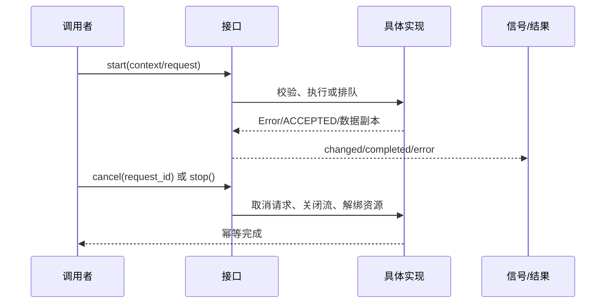
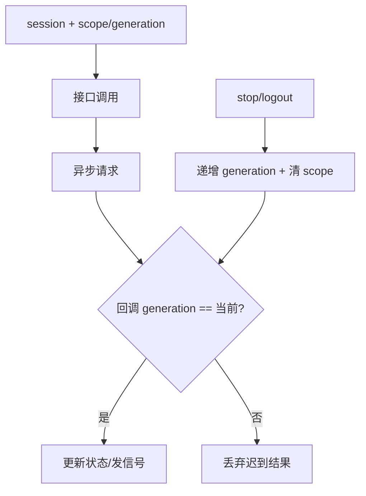

# 公开接口契约

本文只记录当前源码中的稳定调用面。每个条目说明调用者、输入输出、副作用、失败/取消、账号隔离和是否预留。具体函数签名以 `function-index.md` 和源码为准；UI 不接触平台对象、文件句柄或协议对象。

## ApplicationServices

- **调用者/输入输出**：`Application` 以布局路径、Runtime、加密/秘密/解码资源调用 `mount(...)`，并调用 `create_settings()`、`create_dynamics()` 获得服务/窗口工厂。
- **副作用/生命周期**：创建并挂接当前服务图；Application 负责销毁。重复 mount 不作为业务流程。
- **失败/取消/隔离**：缺失能力以 null/明确 Error 交给上层；组装本身不携带账号凭据，账号隔离由 session 负责。
- **预留**：否。

## AccountLifecycle

- **调用者/输入输出**：Application 调用 `start(session)->Error`、`get_context()->Dictionary`、`stop()`。
- **副作用/生命周期**：按 transport→聊天→模型→动态→可选扩展启动；失败逆序回滚；stop 幂等。
- **失败/取消/隔离**：扩展 `ERR_UNAVAILABLE` 可选降级；其他错误阻止激活。上下文仅 `scope_id/generation/character_id`，旧代次回调丢弃。
- **预留**：本接口已实现，扩展能力字段可为空。

## WindowCoordinator

- **调用者/输入输出**：Application/UI 调用 `open(kind)`、`request_close(action)`、`close_all()`、`dispose()`。
- **副作用/生命周期**：复用、聚焦、草稿汇总、确认和窗口释放；发出 `exit_requested`、`logout_requested`。
- **失败/取消/隔离**：取消关闭保留草稿；保存中等待；失败保留窗口；窗口按当前账号业务作用域关闭，日志例外保留。
- **预留**：否。

## AccountSession

- **调用者/输入输出**：AccountView/Application 调用 `perform(operation,server,fields,remember,auto_login)`、`resume()`、`login_saved()`、`set_server()`、`get_history()`、`logout()`。
- **副作用/生命周期**：通过 AccountApi 和 StorageService 读写资料/受保护令牌；登录成功发 `changed(state)`。
- **失败/取消/隔离**：`cancel()` 取消在途请求；服务器切换清密码并按服务器隔离历史；凭据不可解密不删除旧配置；logout 清当前令牌和自动登录。
- **预留**：否。

## ChatSession

- **调用者/输入输出**：ChatView/AccountLifecycle 调用 `start(session)`、`set_typing(active,text_length)`、文本/图片发送、音频和阅读操作。
- **副作用/生命周期**：启动 transport、历史、媒体和图片源；维护消息合并和草稿；退出时停止所有子能力。
- **信号/失败/隔离**：发 `changed/state_changed/message_audio_changed/message_image_changed/expression_requested/mouth_changed`；typing 为瞬态事件，不进可靠队列；旧 generation 不更新新账号。
- **预留**：否。

## WebSocketTransport

- **调用者/输入输出**：ChatSession 调用 `start(session)`、`send_event(type,payload,durable)`、`get_state()`、`stop()`。
- **副作用/生命周期**：连接认证、收发事件、驱动 ReliableOutbox；信号 `state_changed/delivery_changed/event_received/system_error`。
- **失败/取消/隔离**：`stop()` 关闭 socket 和队列；认证错误、协议错误、超大包明确报告；session scope/generation 隔离。
- **预留**：否。

## ReliableOutbox

- **调用者/输入输出**：Transport 调用 `enqueue/take_ready/acknowledge/disconnected/stop`。
- **副作用/生命周期**：内存可靠队列、退避、最大年龄和 delivery 信号；不写 UI 或文件。
- **失败/取消/隔离**：断线进入重试，过期以错误完成，stop 结束未完成项；队列属于一个 ChatSession 账号代次。
- **预留**：否。

## AccountApi

- **调用者/输入输出**：AccountSession 调用 `request()`、`probe_server()`、`cancel()`。
- **副作用/生命周期**：HTTP 认证、公钥和服务器验证；内部 `_http_finished` 回调。
- **失败/取消/隔离**：规范化地址失败、HTTP/JSON/超时和取消返回明确字典；不保存令牌；请求带当前 generation。
- **预留**：否。

## HistorySync

- **调用者/输入输出**：ChatSession 调用 `start/stop/get_state/retry/skip`，接收 `page_received/boundary_ready/state_changed`。
- **副作用/生命周期**：分页读取并维护首次边界和发送屏障；stop 取消 HistoryApi。
- **失败/取消/隔离**：页失败可 retry/skip；旧页回调按 scope/generation 丢弃；正文不写长期文件。
- **预留**：否。

## DynamicsController

- **调用者/输入输出**：DynamicsWindow 调用动态列表、详情、刷新、已读、发布和评论操作。
- **副作用/生命周期**：发 HTTP 请求、维护评论/发布草稿和 `changed/unread_changed` 信号；退出时取消。
- **失败/取消/隔离**：失败留稿，取消不发布；按账号 scope 隔离；重复刷新合并结果而不重复窗口。
- **预留**：否。

## ModelSettings / ModelExecutor

- **调用者/输入输出**：SettingsWindow/ModelPage 调用模型读取、草稿编辑、`validate/save/test`，Executor 发 `completed(response)`。
- **副作用/生命周期**：ModelStore 读写配置，Executor 发模型请求；保存按用途逐项报告，不伪装全部成功。
- **失败/取消/隔离**：校验失败不写入；请求可停止；秘密保护失败保留草稿；模型配置按服务器/账号 scope。
- **预留**：否。

## ReplyAudio / AudioCache

- **调用者/输入输出**：ChatSession/MessageAudio 调用分片追加、播放/暂停/停止、`set_scope`、`get_message_audio`、`clear_cache(older_than_days)`。
- **副作用/生命周期**：AudioCache 原子写 manifest/audio，ReplyAudio 使用 DecoderFactory 和 ReadStream；发音频/口型/状态信号。
- **失败/取消/隔离**：解码器缺失只禁用音频；损坏/孤儿缓存清理；停止和切账号关闭流；按账号 scope 隔离。
- **预留**：否。

## HistoryImageSource / HistoryImages

- **调用者/输入输出**：ChatSession/VirtualMessageList 调用 `start/stop/get_state/ensure/retry/preview/store_local`。
- **副作用/生命周期**：网络或缓存加载图片并发 `changed(id,state)`；退出时清理下载和临时文件。
- **失败/取消/隔离**：统一校验 MIME、base64、字节/像素/边长上限；取消/失败保留可重试状态；按账号 scope 隔离。
- **预留**：接口已实现，未注入实现时明确返回 `IMAGE_SOURCE_UNAVAILABLE`。

## StorageService

- **调用者/输入输出**：AccountSession、AudioCache/UI controller 调用登录 profile/token CRUD 和 `query_directory(path)`。
- **副作用/生命周期**：具体实现读写 `user://`、凭据和磁盘容量；业务/UI 不直接调用 OS/FileAccess/DirAccess。
- **失败/取消/隔离**：Error 或 `ok/code`；容量和目录大小单位为 64 位 bytes，未知值必须 `-1`；按 server/username scope 隔离。
- **预留**：否。

## SettingsStore

- **调用者/输入输出**：AvatarFraming、Preferences、WindowGeometry 调用 `load_settings/get_value/set_value/save_settings`。
- **副作用/生命周期**：具体实现保留旧 ConfigFile 格式并原子替换；UI 只传值。
- **失败/取消/隔离**：加载/保存失败返回 Error，草稿保留；设置按逻辑组和账号/布局键隔离。
- **预留**：否。

## InputService

- **调用者/输入输出**：ComposerInput 调用 `is_composing/has_clipboard_image/get_clipboard_image/copy_text`。
- **副作用/生命周期**：读取剪贴板/IME 状态或复制文本；平台不可用返回空图、false 或 Error。
- **失败/取消/隔离**：不吞掉普通文本粘贴；IME 合成期间不误发送；无账号持久化副作用。
- **预留**：否。

## FileInteraction

- **调用者/输入输出**：ChatView/LogWindow 调用 `bind/select_image/select_export/cancel`，接收 `image_selected/export_selected/canceled`。
- **副作用/生命周期**：由具体实现连接原生 FileDialog；图片交付 bytes/mime，导出交付受控目标句柄。
- **失败/取消/隔离**：取消不清已有附件；不可用返回 `FILE_PICKER_UNAVAILABLE`；目标句柄由存储实现关闭。
- **预留**：否。

## SecretProtection / PasswordEncryption

- **调用者/输入输出**：CredentialStore、ModelStore、AccountApi 调用 protect/unprotect 和公钥密码加密。
- **副作用/生命周期**：Windows 实现调用 DPAPI/BCrypt；结果为受控字节和诊断字典。
- **失败/取消/隔离**：DLL 缺失为 `SECURITY_UNAVAILABLE`；解析、输入、native code 分阶段报告；禁止明文降级；scope 参与保护。
- **预留**：否，Android 实现尚未交付。

## DecoderFactory

- **调用者/输入输出**：ReplyAudio/CacheReplay 调用 `create_decoder()`，得到统一 decoder 或 null。
- **副作用/生命周期**：创建 native/纯 Godot 解码器；播放器负责释放和关闭流。
- **失败/取消/隔离**：缺失返回 null，正文不受影响；finish/stop 幂等；按当前账号播放器隔离。
- **预留**：接口已实现，移动 native decoder 未交付。

## AvatarDriver

- **调用者/输入输出**：AvatarPanel/AvatarPreview 调用加载、表情、动作、口型、视线、命中和状态查询。
- **副作用/生命周期**：具体 Cubism 实现加载模型并更新参数；Panel 只展示语义状态。
- **失败/取消/隔离**：加载失败保留原模型；无驱动返回 `ERR_UNAVAILABLE`/false；不携带账号令牌。
- **预留**：接口已实现，换装资源管理不是本轮交付。

## WindowHost / RuntimeEnvironment

- **调用者/输入输出**：WindowChrome/Application 调用窗口 attach、布局、拖动、焦点、保存；Runtime 查询参数、headless、日志、截图、进程和 OS 名称。
- **副作用/生命周期**：具体桌面实现访问 Window/DisplayServer/OS；退出时保存并 detach、注销 logger。
- **失败/取消/隔离**：默认适配器返回不可用/空值；窗口操作幂等；几何按窗口 key 保存，不恢复最小化；不承载业务账号状态。
- **预留**：接口当前用于桌面，Android 宿主未交付。

## JsonRequest

- **调用者/输入输出**：AccountApi/HistoryApi 调用 `send(url,method,data,headers)` 和 `cancel()`，得到结构化 response。
- **副作用/失败/取消**：创建 HTTPRequest、限制响应体大小；超时、JSON/HTTP 错误和取消均返回失败字典；不保存账号数据。
- **账号隔离/预留**：由上层 request generation 隔离；否。

## HistoryApi

- **调用者/输入输出**：HistorySync 调用 `fetch_page(session,end_index)`、`cancel()`。
- **副作用/失败/取消**：读取历史分页；取消和退出树停止请求；页错误可由 HistorySync retry/skip。
- **账号隔离/预留**：session 的服务器/用户名/generation 隔离；否。

## PreferencesController

- **调用者/输入输出**：PreferencesPage 调用 `start/reload/edit/save/get_state/stop`。
- **副作用/失败/取消**：读写偏好模型；保存失败保留草稿，stop 取消在途请求。
- **账号隔离/预留**：按当前账号作用域；否。

## ReadingPosition

- **调用者/输入输出**：ChatSession/VirtualMessageList 调用 `start/update/get_state/interact/located/report_visible`。
- **副作用/失败/取消**：保存阅读锚点和可见消息；写入失败返回 Error，不改变内存锚点。
- **账号隔离/预留**：按规范化服务器/用户名隔离；否。

## VirtualMessageList

- **调用者/输入输出**：ChatView 调用 `set_messages/scroll_to_message/scroll_to_latest/get_visible_ids/get_reading_anchor/set_audio_state/set_image_state`。
- **副作用/失败/取消**：只实例化可见气泡并维护滚动锚点；节点退出时释放动态气泡。
- **账号隔离/预留**：消息由 ChatSession 提供，列表本身无持久化；否。

## ClientLog

- **调用者/输入输出**：Application、EngineLogSink、LogWindow 调用 `record/list_runs/read_entries/export_run/finish`。
- **副作用/失败/取消**：写运行记录、轮转和导出；超字节/条数停止继续写入并标 incomplete。
- **账号隔离/预留**：日志按运行记录，不混入其他账号业务草稿；导出失败返回 Error；否。

## PcmStreamDecoder

- **调用者/输入输出**：CacheReplay/ReplyAudio 通过 DecoderFactory 获得，调用 `append/finish/read_frames/get_status/get_amplitude/get_waveform`。
- **副作用/失败/取消**：增量解码并提供波形；native 缺失/格式错误返回受控状态；停止释放 decoder。
- **账号隔离/预留**：由当前播放器/账号 scope 持有；实现可按平台替换，接口否。

## AvatarFraming

- **调用者/输入输出**：AvatarPanel 调用 `zoom_by/pan_by/reset/get_transform/save_settings/load_settings`。
- **副作用/失败/取消**：读写布局设置和计算 Transform2D；失败返回 Error，取消无异步请求。
- **账号隔离/预留**：由布局 key/角色构图设置隔离；否。

## DemoSession / OfflinePreview

- **调用者/输入输出**：ChatPreview 调用 `select_scenario/get_messages/submit_text/settle`。
- **副作用/失败/取消**：只改变内存样例；未知场景/消息返回 false；不启动网络。
- **账号隔离/预留**：没有账号 scope；否，属于离线已实现能力。

## UnifiedDropdown

- **调用者/输入输出**：页面调用 `set_items/get_items/set_selected_id/get_selected_id/set_item_enabled/open_menu/close_menu/is_menu_open`。
- **副作用/失败/取消**：构造 authored PopupPanel 子项并发 `activated(id)`；第二次点击关闭，Esc/外部点击按控件规则处理。
- **账号隔离/预留**：只持有页面选择值，无持久化；否。

## ChatView

- **调用者/输入输出**：Application/主场景调用 `setup(session)`、`is_dirty()`；通过 `image_requested/attachment_requested/attachment_cleared` 发意图。
- **副作用/失败/取消**：绑定 ChatSession 状态、显示历史/媒体和输入；关闭时交给 WindowCoordinator 汇总草稿。
- **账号隔离/预留**：不持有令牌，随当前 ChatSession 代次切换；否。

## CredentialStore / ModelStore

- **调用者/输入输出**：AccountSession/ModelSettings 调用 token `save/read/forget`，模型 `set_scope/read/save`。
- **副作用/失败/取消**：经 SecretProtection 原子读写受保护数据；失败保留旧数据和草稿。
- **账号隔离/预留**：使用 AccountScope(server,username)；不允许跨账号读取；否。

## ImageAttachment / ImagePresenter

- **调用者/输入输出**：ChatView/MessageBubble 调用图片 bytes/URI 校验；ImagePresenter 调用 `open_image/close/close_confirmation`。
- **副作用/失败/取消**：附件统一 MIME/base64/尺寸上限；图片窗口单例、来源转属和焦点恢复；取消不清已有附件。
- **账号隔离/预留**：窗口来源归属而非账号持久化；否。

## AppearanceService / WorldService / DeviceService

- **调用者/输入输出**：AccountLifecycle 可选注入；Appearance 的 `request_change`，World 的 `apply_state/request_action`，Device 的 `request_control`，共同有 `get_capabilities/start/cancel/stop`。
- **副作用/生命周期**：未来实现可维护各自连接/订阅；当前默认实现不建立任何连接。
- **信号/失败/隔离**：完成/状态/事件信号按 request_id 交付；当前 start 为 `ERR_UNAVAILABLE`，请求为 `NOT_IMPLEMENTED`；context 只含 scope/generation/character_id，旧代次结果丢弃。
- **预留**：是。换装、箱庭、设备互联、Android 适配和产品入口均未交付。

## 接口生命周期图

## 账号隔离与迟到结果图

接口文档中的“预留”只表示当前已有替换点但默认不可用；`AppearanceService`、`WorldService`、`DeviceService` 不会建立连接、轮询或伪造完成信号。
