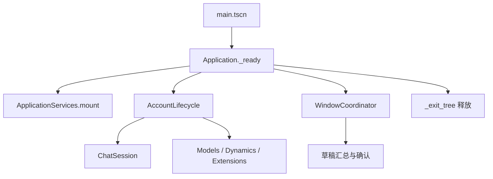
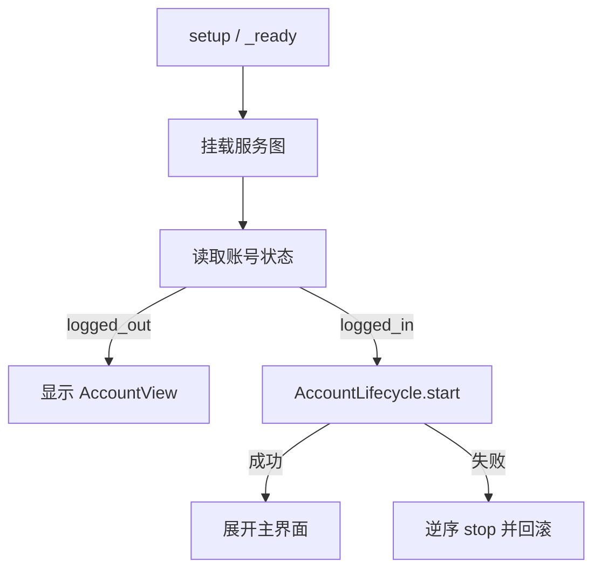
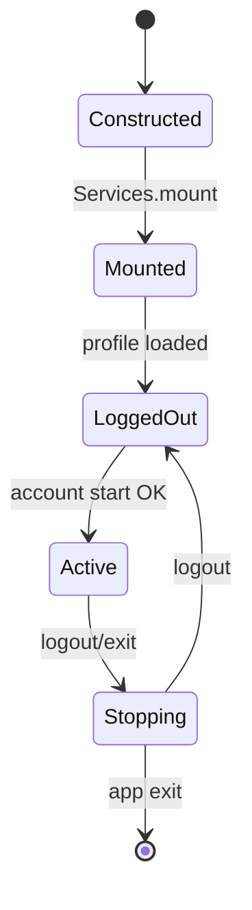

# Application 模块

## 模块目的
集中组装应用、账号生命周期和窗口关闭流程，让主场景不承担网络、存储和草稿业务。

## 职责边界
`application.gd` 绑定主场景；`AccountLifecycle` 启停账号作用域；`WindowCoordinator` 管理窗口复用、关闭确认和退出/退出登录信号。不组包 HTTP、不读文件、不实现控件细节。

## 依赖方向
由 composition 注入 session、controller、WindowHost、StorageStore 和窗口工厂；被 `main.tscn` 及 UI 信号调用。桌面 API 留在 platform。

## 状态与资源所有权
Application 拥有服务图和根节点；Lifecycle 拥有当前 generation；Coordinator 拥有窗口索引、确认框和关闭顺序。退出树时逆序 stop/dispose。

## 公开接口
`Application.setup(account_session, layout_path, external_links)`；`AccountLifecycle._init(chat, models, dynamics, appearance=null, world=null, devices=null)`、`start(session)->Error`、`get_context()->Dictionary`、`stop()`；`WindowCoordinator.open(kind)`、`request_close(action)`、`close_all()`、`dispose()`。

## 信号与数据结构
Coordinator 发出 `exit_requested`、`logout_requested`；上下文只含 `scope_id`、`generation`、`character_id`，不含密码、令牌和平台对象。

## 生命周期
`Application._ready()` 装配并绑定账号；登录成功后 Lifecycle 启动控制器；退出登录清理业务而保留日志；`_exit_tree()` 释放窗口、生命周期和日志 sink。

## 失败、取消和重复调用
Lifecycle 先验证 ChatSession transport，再启动模型、动态和可选扩展；可选扩展返回 `ERR_UNAVAILABLE` 不阻断文字聊天，其余错误逆序回滚。Coordinator 在保存中等待，取消保留草稿，放弃才释放；重复 open 聚焦已有窗口。

## 关键内部函数
`Application._account_changed` 切换登录态和布局；`_resize_split/_resize_window` 维护尺寸；`WindowCoordinator._confirmed/_cancel` 收敛确认结果。

## 为什么这样设计
应用层是深模块的组装根，移动平台只替换能力实现；关闭集中处理避免窗口各自退出造成孤立资源。

## 如何保持解耦
只通过信号、Callable 和注入对象协作；UI 不取得 Storage 路径或平台窗口对象。

## 相关场景
`scenes/main.tscn`、`scenes/ui/window_chrome.tscn`。固定控件由 `.tscn` 提供，脚本只绑定行为。

## 相关测试
`tests/application/test_account_lifecycle.gd`、`tests/application/test_platform_degradation.gd`、`tests/ui/test_logout_confirmation.gd`。测试只观察公开接口，不锁定私有调用次数。

## 当前限制
Android、真实系统 DPI、多屏、公共服务和长期运行环境未在本机验证。

## 模块架构图

## 主要流程图

## 生命周期图

## 主要函数解析

| 函数 | 输入/输出 | 状态与副作用 | 失败与清理 |
|---|---|---|---|
| `Application.setup(...)` | session、布局路径、外链适配器；无返回值 | 保存兼容注入参数，供 `_ready` 装配 | 不直接读文件；缺失依赖由组装阶段报告 |
| `Application._ready()` | 无；连接节点和服务 | 创建服务、绑定账号信号、选择登录/主布局 | 安全能力不可用时保留日志/反馈入口 |
| `Application._account_changed(state)` | 状态字典 | 更新登录态、启动或停止生命周期、调整双栏尺寸 | 旧 generation 不更新新视图 |
| `AccountLifecycle.start(session)` | session 字典；`Error` | 按 transport→业务控制器→扩展顺序启动并递增 generation | 必需步骤失败时逆序 stop，active 不置 true |
| `WindowCoordinator.request_close(action)` | `exit/logout`；无返回值 | 汇总草稿，可能显示确认框或等待保存 | 取消保留草稿，失败不销毁窗口 |
| `_exit_tree()` / `dispose()` | 无 | 解绑信号、停止请求、释放窗口和日志 sink | stop/close 幂等 |

## 源码核对补充

- `Application.setup(account_session, layout_path, external_links)` 只保存注入对象和布局路径，真正的服务创建发生在 `_ready()`；因此测试或预览入口可以在节点 ready 前替换 AccountSession。
- `_ready()` 先处理 `--preview` 和 `--capture=`，正式模式创建 `ImagePresenter`、`ApplicationServices`、日志窗口和 `WindowCoordinator`；密码加密能力不可用时只阻止账号/聊天装配，日志和反馈仍保持可用。
- `_account_changed(state)` 在 `signed_in` 时懒实例化 `avatar_panel.tscn`、`chat_view.tscn`，调用 `ChatView.setup(_chat)` 并把图片 provider 接到全局 `ImagePresenter`；退出登录先 `close_all()`、停止 lifecycle，再释放 ChatView/Avatar 并恢复紧凑登录布局。
- `WindowCoordinator.open(kind)` 只接受 `settings`/`dynamics`，复用已有窗口；新窗口加入 host、配置 `%Chrome`、监听 `tree_exited` 并执行 factory 返回的 start Callable。`close_all()` 先关闭图片窗，再 hide/queue_free 缓存窗口；日志窗口由 Application 单独持有，关闭只隐藏。
- `request_close()` 在设置保存中记录待执行 action；保存结束后重新汇总 dirty 状态，避免旧确认框绕过新保存结果。
