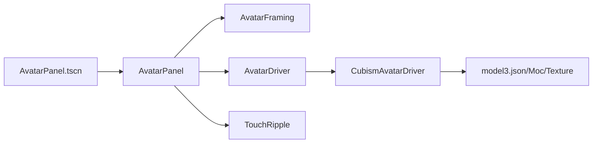
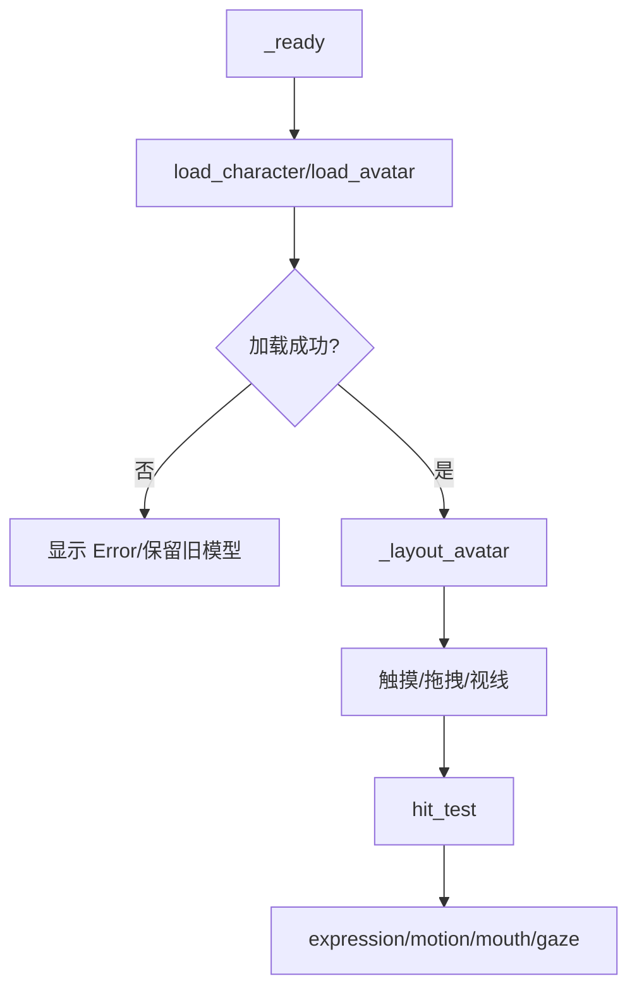
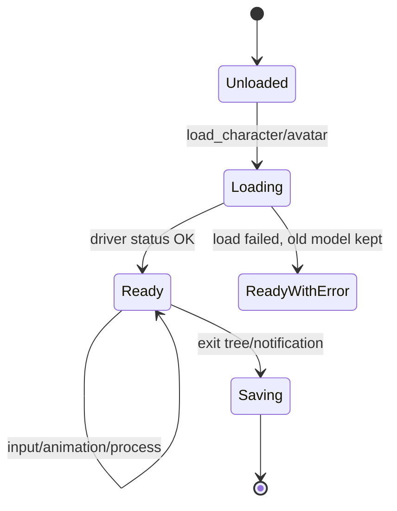

# Avatar 模块

## 模块目的
提供角色加载、表情、动作、口型、视线、触摸命中和构图保存的稳定语义。

## 职责边界
`AvatarDriver` 是抽象接口，默认不可用；`CubismAvatarDriver` 封装 Cubism 类型和资源；`AvatarPanel` 负责控件布局、输入和状态展示；`AvatarFraming` 只负责缩放、平移和设置。

## 依赖方向
由主场景和预览场景注入 Driver；Driver 才能依赖 Cubism/native，面板不能反向依赖平台类。

## 状态与资源所有权
Driver 拥有模型实例和参数；Panel 拥有触摸区域/涟漪节点；Framing 读写设置值而不持有路径。

## 公开接口
`load_character/load_avatar/apply_expression/play_motion/set_mouth_openness/set_gaze/hit_test/get_status`；面板信号 `touched(areas)`；构图 `zoom_by/pan_by/reset/get_transform/save_settings/load_settings`。

## 信号与数据结构
触摸区域是字符串数组，状态为可复制 Dictionary；失败状态含错误码和当前模型信息。

## 生命周期
Panel `_ready` 绑定 Driver 和输入，尺寸变化重新布局；退出树解绑并保存构图；Driver 失败不销毁已有模型。

## 失败、取消和重复调用
加载失败保留当前外观；重复 stop/重置幂等；缺少 Cubism 时返回 `ERR_UNAVAILABLE`，不生成静态假角色。

## 关键内部函数
`_layout_avatar`、`_handle_pointer`、`_notification`、Cubism 的 `_apply_parameters` 和命中测试映射。

## 为什么这样设计
角色语义稳定，具体 Cubism 资源可替换；构图独立使窗口调整不拉伸模型。

## 如何保持解耦
场景只依赖 AvatarDriver，不引用 Cubism 类型或资源读取 API。

## 相关场景
`scenes/avatar/avatar_panel.tscn`、`avatar_preview.tscn`、`preview/chat_preview.tscn`。固定控件由 `.tscn` 提供，脚本只绑定行为。

## 相关测试
`tests/avatar/*`、`test_avatar_driver.gd`、`test_avatar_framing.gd`。测试只观察公开接口，不锁定私有调用次数。

## 当前限制
Android、真实系统 DPI、多屏、公共服务和长期运行环境未在本机验证。

## 模块架构图

## 主要流程图

## 生命周期图

## 主要函数解析

| 函数 | 输入/输出 | 状态与副作用 | 失败与清理 |
|---|---|---|---|
| `AvatarDriver.load_character/load_avatar` | 描述文件、模型和映射；Error | 具体驱动加载模型资源 | 默认接口返回 `ERR_UNAVAILABLE`；失败不替换已有模型 |
| `AvatarPanel._layout_avatar()` | 当前面板尺寸；void | 使用 Framing 计算相对 Transform | 尺寸变化重复布局，不写平台状态 |
| `_handle_pointer(event)` | Godot 输入事件；void | 命中测试、拖拽、触摸信号和涟漪 | 右键/无效输入不误触发左键动作 |
| `AvatarFraming.zoom_by/pan_by/reset` | 缩放/位移；void | 修改构图草稿 | 边界限制由 framing 统一处理 |
| `CubismAvatarDriver._apply_parameters` | source、delta；void | 每帧更新口型、视线和物理参数 | native 对象缺失时状态不可用，不崩溃 |
