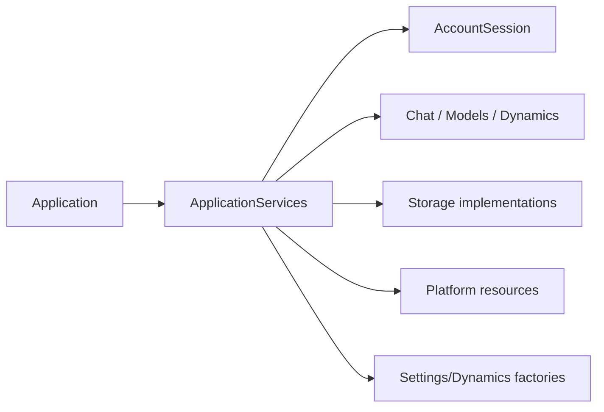
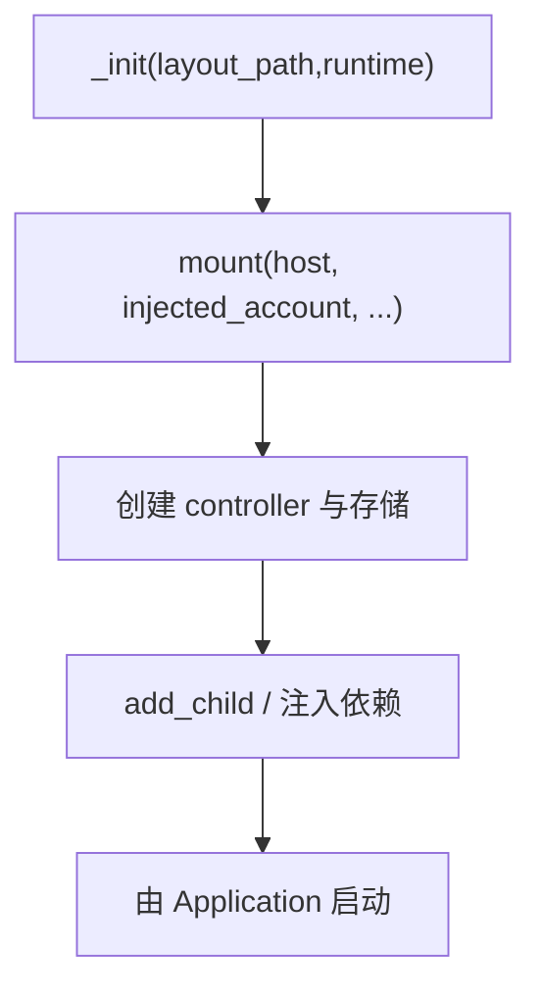
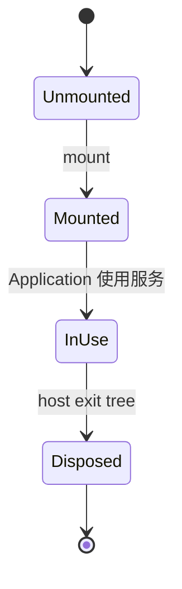

# Composition 模块

## 模块目的
在一个明确位置创建服务图、设置/动态窗口工厂和平台适配，控制依赖方向。

## 职责边界
`application_services.gd` 只负责构造、挂接和工厂，不作登录决策、草稿确认或协议处理。

## 依赖方向
被 Application 调用，向下依赖 session、network、storage、media、avatar 和 platform 的抽象或资源实现；不被业务控制器反向依赖。

## 状态与资源所有权
组装器创建节点并将所有权交给宿主；窗口工厂创建的实例由 WindowCoordinator 释放。

## 公开接口
`_init(layout_path, runtime)`；`mount(host, injected_account, layout_path, encryption, secrets, decoder_factory)`；`create_settings()`、`create_dynamics()`。返回服务字典/工厂描述，不直接返回平台路径。

## 信号与数据结构
不定义业务信号；返回字典中的对象必须是注入的服务、场景或 Callable。

## 生命周期
先构造实现，再 `mount` 注入；Application 销毁时按创建逆序释放。

## 失败、取消和重复调用
平台能力缺失以 null 或明确 Error 交给上层局部降级；重复 mount 不应由业务代码调用，测试应创建独立服务图。

## 关键内部函数
`mount` 连接 account、models、dynamics、history、reading、images、executor、audio、chat；`create_settings/create_dynamics` 负责可替换窗口装配。

## 为什么这样设计
只有一个组装接缝，避免业务方法中偷偷 new 具体平台对象，也方便 Android 选择新实现。

## 如何保持解耦
不使用全局 service locator；所有依赖由创建者显式传入。

## 相关场景
`scenes/main.tscn`。固定控件由 `.tscn` 提供，脚本只绑定行为。

## 相关测试
`tests/application/test_default_user_storage.gd`、`test_platform_degradation.gd`。测试只观察公开接口，不锁定私有调用次数。

## 当前限制
Android、真实系统 DPI、多屏、公共服务和长期运行环境未在本机验证。

## 模块架构图

## 主要流程图

## 生命周期图

## 主要函数解析

| 函数 | 输入/输出 | 状态与副作用 | 失败与清理 |
|---|---|---|---|
| `_init(layout_path,runtime)` | 布局路径、运行环境 | 保存组装配置、准备设置/日志资源 | 不启动网络；输入不完整由 mount 暴露 |
| `mount(...)` | 宿主、账号、加密/秘密/解码资源；无返回值 | 创建并挂接 session、controller、media、storage | 缺失能力保留 null/错误，禁止偷偷创建全局实现 |
| `create_settings()` | 无；工厂字典 | 返回设置窗口及其注入 Callable | 工厂失败由 Application 保留可见错误 |
| `create_dynamics()` | 无；工厂字典 | 返回动态窗口/控制器配置 | 不负责登录和草稿确认 |

## 源码核对补充

- `create_geometry(layout_path)` 实际将布局路径映射到 `window-geometry.cfg`，几何存储不与业务草稿混用。
- `mount()` 在有注入账号时复用它，否则创建 `AccountSession(AccountApi(encryption), storage)`；其余 ModelSettings、DynamicsController、HistorySync、ModelExecutor、ReplyAudio、ChatSession 均加入宿主节点。
- `create_settings()` 返回 `{window, start}`，start 使用 `account.get_session()` 启动 PreferencesController；`create_dynamics()` 的 start 是空 Callable，因为 DynamicsController 已由服务图启动。
