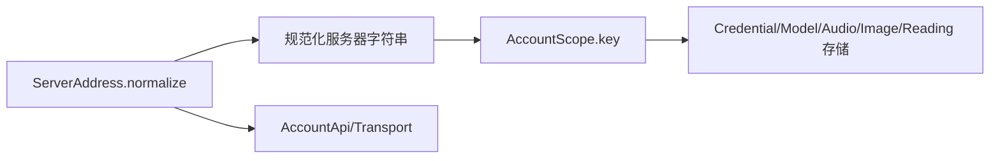
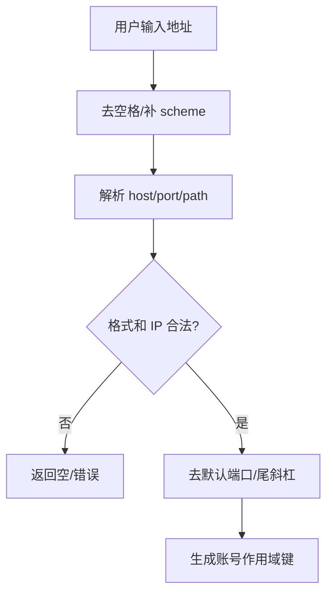
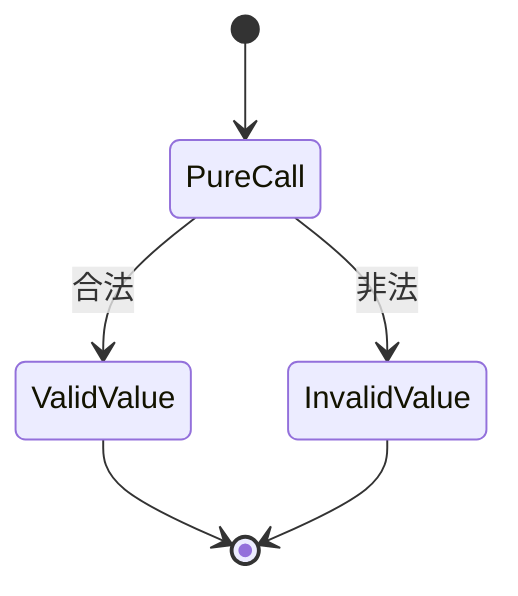

# Domain 模块

## 模块目的
提供无副作用的共同值对象：服务器地址规范化和账号作用域键。

## 职责边界
`server_address.gd` 只校验/规范化 http(s)、域名、IPv4、IPv6、端口和路径；`account_scope.gd` 只按规范化地址与用户名生成稳定 SHA-256 键。不做网络、文件和 UI。

## 依赖方向
被 AccountSession、AccountApi、CredentialStore、ModelStore、HistoryImages 和 ReadingPosition 调用；不依赖这些业务模块。

## 状态与资源所有权
纯静态/无副作用值转换，没有长生命周期资源。

## 公开接口
`ServerAddress.normalize(address)->String`；`AccountScope.key(server, username)->String`。非法地址由调用者转为明确错误。

## 信号与数据结构
无信号；作用域键是规范化地址与用户名组成的 JSON 数组的 SHA-256 字符串。

## 生命周期
调用即完成，无需 start/stop。

## 失败、取消和重复调用
规范化失败返回空/非法结果；重复调用是幂等纯函数，不触发网络或写盘。

## 关键内部函数
地址解析、全数字 IPv4 校验、IPv6 括号/端口处理和 scope 哈希。

## 为什么这样设计
集中作用域规则可保证登录、模型、图片、音频和阅读位置兼容旧数据，并可跨平台复用。

## 如何保持解耦
只使用字符串、数组、哈希等值类型；在线探测仍留在 AccountApi。

## 相关场景
无直接场景，作为控制器依赖。固定控件由 `.tscn` 提供，脚本只绑定行为。

## 相关测试
`tests/test_account_api.gd`、`tests/storage/test_login_storage.gd`、`tests/test_dependency_boundaries.py`。测试只观察公开接口，不锁定私有调用次数。

## 当前限制
Android、真实系统 DPI、多屏、公共服务和长期运行环境未在本机验证。

## 模块架构图

## 主要流程图

## 生命周期图

## 主要函数解析

| 函数 | 输入/输出 | 状态与副作用 | 失败与清理 |
|---|---|---|---|
| `ServerAddress.normalize(address)` | 原始地址；规范化字符串 | 规范化 scheme、host、端口和 path | 非法 IPv4/IPv6、端口或字符返回空；无网络副作用 |
| `AccountScope.key(server, username)` | 服务器、用户名；SHA-256 键 | 使用规范化地址组成稳定 scope | 重复调用结果相同；不写盘 |

## 源码核对补充

`ServerAddress.normalize()` 会拒绝反斜杠、非法全数字 IPv4、超范围端口和无效 IPv6；默认 HTTP/HTTPS 端口及尾斜杠会被移除。`AccountScope.key()` 对规范化 server 与 username 的 JSON 数组做 SHA-256，任一为空直接返回空字符串，因此所有持久化领域必须先确认 scope 非空。
