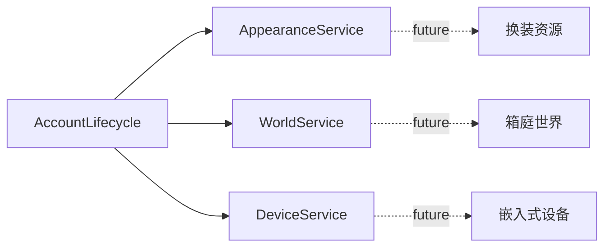
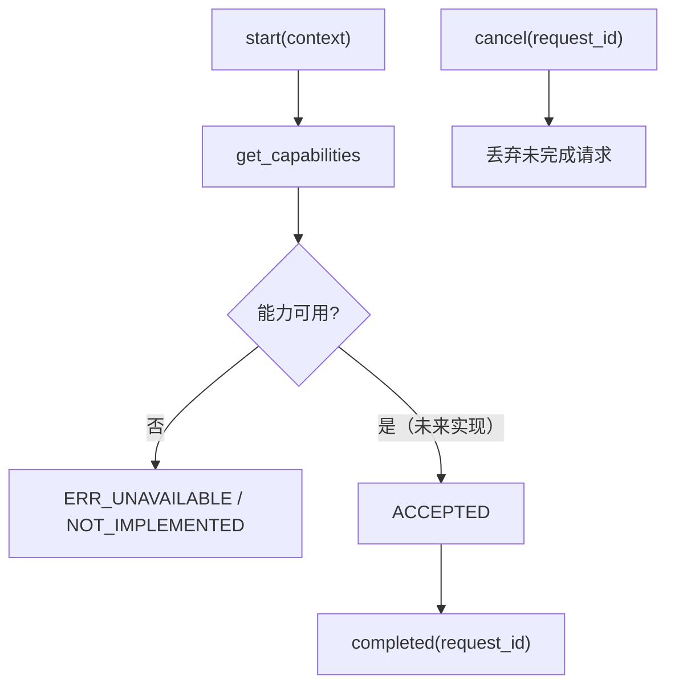
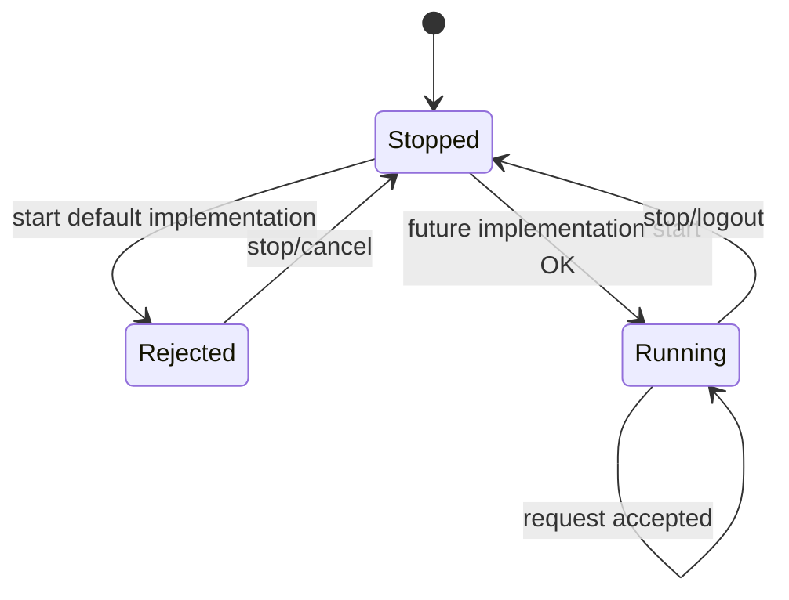

# Extensions 模块

## 模块目的
为未来换装、箱庭世界和嵌入式设备保留稳定替换点。

## 职责边界
Appearance、World、Device 只定义独立请求/状态接口，不实现 AI 决策、世界算法、设备协议或 UI。

## 依赖方向
由 AccountLifecycle 可选注入；不依赖聊天、网络协议、窗口或平台对象。

## 状态与资源所有权
每个扩展只拥有自身 request_id、订阅和连接；上下文是账号作用域、generation、character_id 的数据副本。

## 公开接口
Appearance：`get_capabilities/start/get_state/request_change/cancel/stop`；World：`get_capabilities/start/apply_state/request_action/cancel/stop`；Device：`get_capabilities/start/request_control/cancel/stop`。

## 信号与数据结构
Appearance `completed/state_changed`；World `interaction_received/completed`；Device `state_changed/event_received/completed`。载荷是不透明 Dictionary。

## 生命周期
登录时 start，退出/切换账号时 stop；旧 generation 的结果丢弃；stop 幂等。

## 失败、取消和重复调用
默认实现 start 返回 `ERR_UNAVAILABLE`，请求返回 `{ok:false,code:NOT_IMPLEMENTED}`；不创建等待任务、不触发完成信号；重复 cancel/stop 无副作用。

## 关键内部函数
当前 stub 仅返回能力字典、不可用结果和空状态，没有隐藏连接流程。

## 为什么这样设计
未来实现可独立替换，不迫使聊天协议承载世界事件或设备数据。

## 如何保持解耦
不设全局注册中心，不把事件转成聊天文本，不共享可变模块状态。

## 相关场景
当前没有产品场景入口，仅由 Application 注入。固定控件由 `.tscn` 提供，脚本只绑定行为。

## 相关测试
`tests/application/test_extension_contracts.gd`、`test_platform_degradation.gd`。测试只观察公开接口，不锁定私有调用次数。

## 当前限制
Android、真实系统 DPI、多屏、公共服务和长期运行环境未在本机验证。

## 模块架构图

## 主要流程图

## 生命周期图

## 主要函数解析

| 函数 | 输入/输出 | 状态与副作用 | 失败与清理 |
|---|---|---|---|
| `get_capabilities()` | 无；能力字典 | 只读查询 | 默认全部 false |
| `start(context)` | scope/generation/character；Error | 未来实现建立连接/订阅 | 当前立即 `ERR_UNAVAILABLE`，不留任务 |
| `request_change/request_action/request_control` | request_id 与模块载荷；结果字典 | 未来才接受请求 | 当前 `{ok:false,code:NOT_IMPLEMENTED}` |
| `cancel/stop()` | request_id/无；void | 取消请求并清空账号状态 | 未知请求和重复 stop 无副作用 |

## 源码核对补充

`AppearanceService` 的能力为 `{available:false,change:false}`；`WorldService` 的 apply_state/request_action 和 `DeviceService` 的 request_control 都立即返回 `NOT_IMPLEMENTED`。三个默认实现的 cancel/stop 是空操作，不创建 request、连接、轮询或 completed 信号。`AccountLifecycle` 只把 `scope_id/generation/character_id` 传入扩展，并允许 `ERR_UNAVAILABLE` 不阻断文字聊天。
