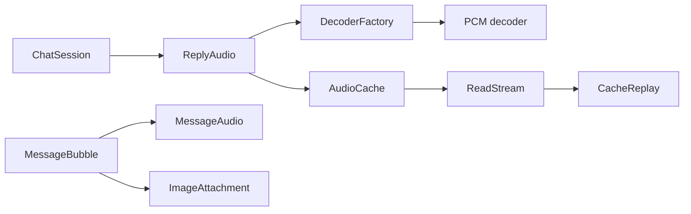
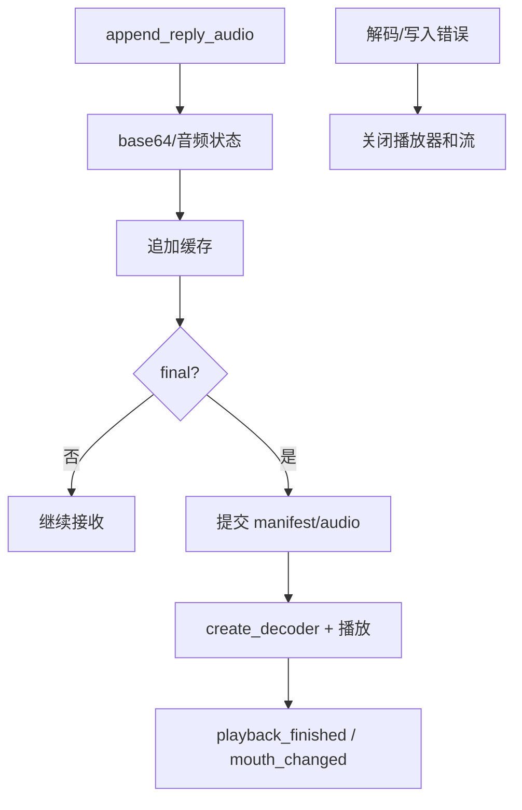
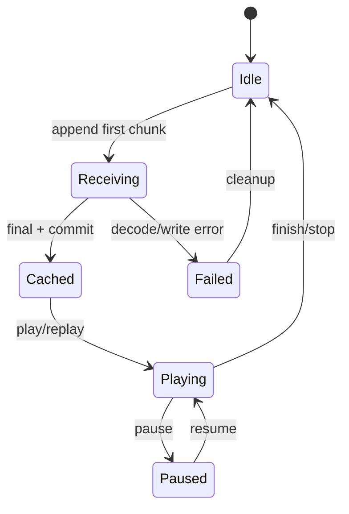

# Media 模块

## 模块目的
处理图片附件验证、在线回复音频、缓存重放和统一解码器。

## 职责边界
`ImageAttachment` 校验限定 MIME 的 data URI/bytes/image；`ReplyAudio` 接收分片、缓存和播放状态；`CacheReplay` 从 ReadStream 播放；`DecoderFactory` 隐藏 PCM/native 解码。

## 依赖方向
被 ChatSession、MessageBubble、MessageAudio 调用；只依赖 Storage、平台 Decoder 和 Godot 音频节点，不依赖账户 UI。

## 状态与资源所有权
ReplyAudio 拥有当前接收/播放状态；播放器拥有并关闭流；缓存拥有持久化文件；UI 只持有状态字典。

## 公开接口
ReplyAudio：`append_reply_audio`、`play_reply`、`set_scope`、`get_message_audio`、`replay/pause_replay/resume_replay/stop_replay/clear_cache`；Decoder：`append/finish/read_frames/get_status/get_amplitude/get_waveform`。

## 信号与数据结构
音频发 `message_audio_changed/replay_finished/receive_finished/playback_finished/mouth_changed/state_changed`；图片向上交付安全验证结果和原始尺寸。

## 生命周期
分片完成才提交 manifest；播放/失败/切账号均停止播放器并关闭流；退出树清除计时器和请求。

## 失败、取消和重复调用
解码器缺失只使音频不可用，文字仍完成；超限图片在分配前拒绝；重复 stop 幂等，失败不自动重试写盘。

## 关键内部函数
ReplyAudio 的 `_end_receive/_fail/_stop_player/_complete`；CacheReplay 的逐帧读帧和 `_end`；ImageAttachment 的 MIME、base64、头部尺寸校验。

## 为什么这样设计
在线和缓存重放共享解码器，避免两套音频行为；图片安全规则统一，降低资源耗尽风险。

## 如何保持解耦
播放器不接触 FileAccess，只接收 ReadStream；UI 不知道 native decoder 类名。

## 相关场景
`scenes/ui/message_bubble.tscn`、`message_audio.tscn`、`image_window.tscn`。固定控件由 `.tscn` 提供，脚本只绑定行为。

## 相关测试
`tests/media/*`、`test_voice_chat.gd`、`test_voice_replay.gd`、`test_image_attachment.gd`。测试只观察公开接口，不锁定私有调用次数。

## 当前限制
Android、真实系统 DPI、多屏、公共服务和长期运行环境未在本机验证。

## 模块架构图

## 主要流程图

## 生命周期图

## 主要函数解析

| 函数 | 输入/输出 | 状态与副作用 | 失败与清理 |
|---|---|---|---|
| `ReplyAudio.append_reply_audio(id,encoded,final,...)` | 分片和结束标记；信号 | 解码/聚合/写缓存，更新音频状态 | 错误码不被停止覆盖；失败清理临时文件 |
| `play_reply/replay(id)` | 回复 ID；void/Error | 创建播放器和 decoder 或从缓存打开流 | decoder/缓存缺失只禁用音频，不影响正文 |
| `CacheReplay.start/set_volume/pause/resume/stop` | ID、元数据、ReadStream、工厂；Error/void | 按帧读取并发波形/口型 | stop/退出树关闭 stream，重复 stop 幂等 |
| `ImageAttachment.from_data_uri/from_bytes` | bytes/URI；安全附件结果 | 校验 MIME、base64、字节/像素/边长并读可信头 | 超限在分配前拒绝，不接受 http URL |

## 源码核对补充

- `ReplyAudio.append_reply_audio()` 对每个 UUID 建流，限制在途数量和聚合内存；校验 Base64 字符集/长度/往返编码，decoder 或 cache 失败进入 `_fail()`。`final=true` 时 finish decoder、commit cache，再发 receive_finished。
- `stop_current()` 只停止当前播放，不阻断同 UUID 后续分片接收和最终缓存提交；`reset()` 才会 abort_all、标记所有在途流 interrupted 并清空状态。
- `ReplyAudio._process()` 等待约 80 ms 音频缓冲后播放，60 秒未完成的接收转为 AUDIO_TIMEOUT；自然 drain 后才发 playback_finished。
- `CacheReplay.start()` 要求非空 ReadStream 和 DecoderFactory；`_process()` 以 65536 bytes 增量读流，EOF 后 finish decoder，失败关闭流并发 REPLAY_FAILED。
- `HistoryImages` 和 `ImageAttachment` 共用安全图片规则；图片保持原始像素尺寸信息，UI 可以使用缩略图但不会把缓存缩略图当作原图尺寸。
