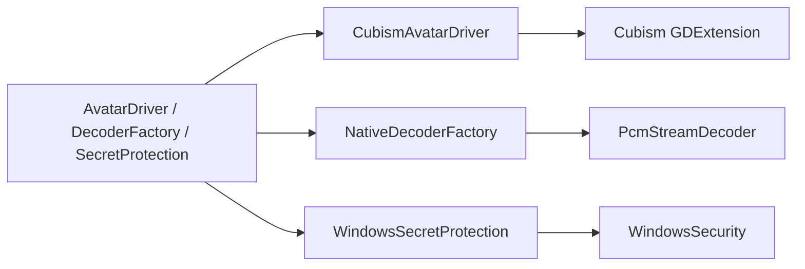
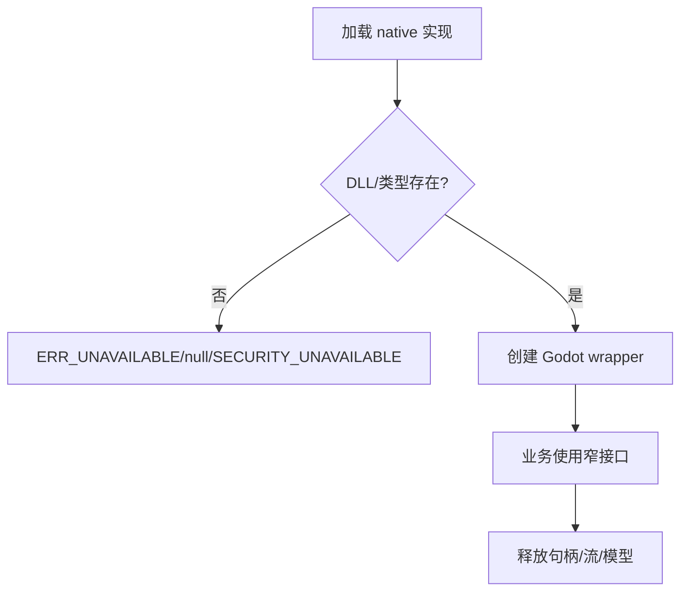
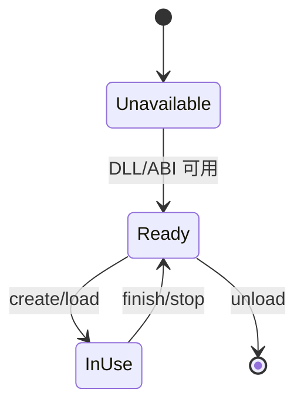

# Native 模块

## 模块目的
隔离 Cubism、PCM 解码、Windows 密钥保护等原生能力，向 Godot 业务提供窄接口。

## 职责边界
`CubismAvatarDriver` 实现 AvatarDriver；`NativeDecoderFactory/NativePcmDecoder` 实现 Decoder；Windows 安全类封装 DPAPI/BCrypt。原生模块不决定聊天或账号业务。

## 依赖方向
被 platform/avatar/media 的接口实现调用；不得被 UI、session 或 network 直接引用。

## 状态与资源所有权
原生 wrapper 拥有句柄和缓冲，Godot 侧只持有 Resource/RefCounted；停止和析构必须释放句柄。

## 公开接口
Decoder：`append/finish/read_frames/get_status/get_amplitude/get_waveform`；Cubism：AvatarDriver 全部方法；安全：`protect_secret/unprotect_secret`、`encrypt_password/is_available`。

## 信号与数据结构
不向业务发原生信号；返回字典、Error 或波形数组，安全诊断带 `stage/native_code`。

## 生命周期
由 composition 选择并注入；缺少 DLL/ABI 时初始化为不可用，不保留悬挂句柄。

## 失败、取消和重复调用
库不可用返回 `SECURITY_UNAVAILABLE` 或 null decoder；重复 stop/close 幂等；认证安全失败禁止登录，不自动明文降级。

## 关键内部函数
Cubism 的 `_apply_parameters`；Windows 安全的 `_security_unavailable`；PCM wrapper 的 append/finish 状态转换。

## 为什么这样设计
将供应商类型和 Windows 头文件限制在适配层，便于未来 Android/iOS 实现替换。

## 如何保持解耦
业务只依赖 AvatarDriver、DecoderFactory、SecretProtection，不知道 DLL 名称、ClassDB 类型或 native 指针。

## 相关场景
`scenes/avatar/avatar_panel.tscn` 注入角色驱动；主场景通过 platform 资源装配。固定控件由 `.tscn` 提供，脚本只绑定行为。

## 相关测试
`test_windows_security.gd`、`test_pcm_decoder.gd`、`verify_native_relationships.py`、`verify_native_dynamics.py`。测试只观察公开接口，不锁定私有调用次数。

## 当前限制
Android、真实系统 DPI、多屏、公共服务和长期运行环境未在本机验证。

## 模块架构图

## 主要流程图

## 生命周期图

## 主要函数解析

| 函数 | 输入/输出 | 状态与副作用 | 失败与清理 |
|---|---|---|---|
| `NativeDecoderFactory.create_decoder()` | 无；decoder/null | 创建 PCM wrapper | DLL 不可用返回 null |
| `NativePcmDecoder.append/finish/read_frames` | bytes/帧数；字典/音频帧 | 增量解码和波形读取 | 格式错误返回状态，stop 释放 native 句柄 |
| `CubismAvatarDriver.load_avatar` | 模型/映射路径；Error | 创建模型、纹理、参数映射 | 失败保留旧模型并返回错误 |
| `WindowsSecretProtection.protect_secret/unprotect_secret` | plaintext/cipher/scope；字典 | 调用 DPAPI/原生安全层 | 区分输入、native 和不可用错误，不明文降级 |

## 源码核对补充

- `CubismAvatarDriver.load_character()` 先校验 descriptor 的 character/resource/model/mapping 字段；`load_avatar()` 完整检查 model3.json 的 Moc、纹理、Physics、Pose、Expressions、Motions 等引用，只有候选模型通过 canvas 检查后才替换旧模型。
- `hit_test()` 拒绝非有限坐标，只测试可见且 alpha 大于阈值的 mesh，并以三角形几何命中返回去重区域名。
- `_apply_parameters()` 在主线程插值 gaze、处理约 4.5 秒眨眼、表情眼睛基值和 mouth override；UI 不接触 Cubism 对象。
- Windows 原生安全层区分密钥解析、BCrypt OAEP-SHA256、DPAPI protect/unprotect 和输入错误，返回 `stage="native_code"` 与 native_code；敏感缓冲析构前清零。
- `PcmStreamDecoder` 支持 PCM 8/16/24/32、float32、1/2 声道和 8000-192000 Hz；单片超过 8 MiB、格式不支持、截断或空音频均返回明确错误。
