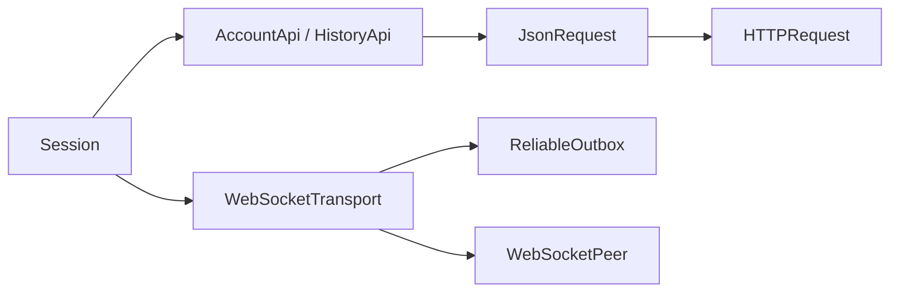
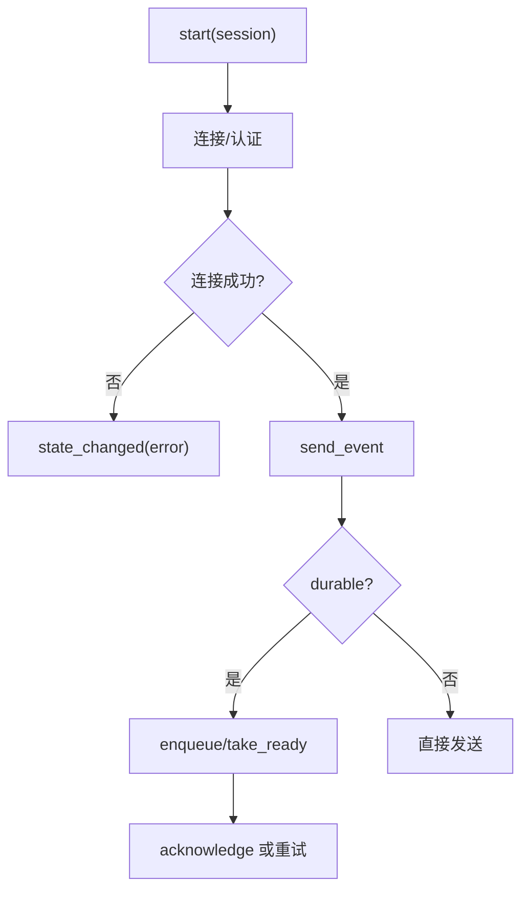
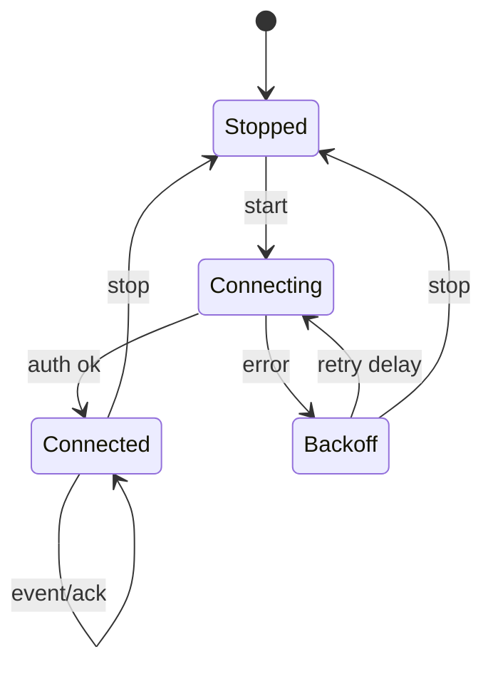

# Network 模块

## 模块目的
封装 HTTP、WebSocket、JSON 请求、历史分页和可靠发送协议。

## 职责边界
`AccountApi` 负责认证、公钥和服务器探测；`HistoryApi` 负责分页；`JsonRequest` 提供取消/大小上限；`WebSocketTransport` 负责连接和事件；`ReliableOutbox` 负责重试/过期/确认。UI 不组包。

## 依赖方向
被 AccountSession、ChatSession、HistorySync 调用；只依赖 Godot 网络对象和 domain 地址规范化，不依赖 UI、文件和窗口。

## 状态与资源所有权
Node 持有 HTTP/WebSocket 请求；Outbox 持有可靠消息状态和重试时间；调用者负责在账号退出时 stop/cancel。

## 公开接口
`request/probe_server/cancel`、`fetch_page/cancel`、`send/cancel`、`start/send_event/get_state/stop`、`enqueue/take_ready/acknowledge/disconnected/stop`。

## 信号与数据结构
Transport：`state_changed`、`delivery_changed`、`event_received`、`system_error`；Outbox：`delivery_changed(id,state,code)`；事件和 payload 为字典副本。

## 生命周期
按账号 session 启动；网络节点 `_exit_tree` 取消请求；WebSocket 每帧泵送，停止时关闭 socket 和队列。

## 失败、取消和重复调用
认证失败单独报告；超大包、非法 JSON、重复确认和旧 generation 结果被拒绝；typing 是瞬态事件不进 outbox；取消不触发成功回调。

## 关键内部函数
`_connect_socket/_handle_event/_disconnect/_protocol_error`；Outbox 的退避、过期和 `_finish`；HTTP 的 `_exchange`。

## 为什么这样设计
协议细节集中，业务控制器只看到结构化事件；Outbox 可用 fake clock 单独测试，移动端不需改聊天流程。

## 如何保持解耦
不返回 HTTPRequest/WebSocketPeer 给 UI，所有协议字段在此模块转换。

## 相关场景
UI 由 session 间接使用，无直接场景。固定控件由 `.tscn` 提供，脚本只绑定行为。

## 相关测试
`tests/test_websocket_transport.gd`、`test_reliable_outbox.gd`、网络 runner。测试只观察公开接口，不锁定私有调用次数。

## 当前限制
Android、真实系统 DPI、多屏、公共服务和长期运行环境未在本机验证。

## 模块架构图

## 主要流程图

## 生命周期图

## 主要函数解析

| 函数 | 输入/输出 | 状态与副作用 | 失败与清理 |
|---|---|---|---|
| `JsonRequest.send(url,method,data,headers)` | HTTP 请求参数；response 字典 | 创建请求并限制响应大小 | 超时/解析/取消返回错误；`cancel` 终止请求 |
| `WebSocketTransport.start(session)` | 服务器、认证、scope；`Error` | 创建连接并绑定事件/队列 | 认证失败单独报告；stop 关闭 socket |
| `send_event(type,payload,durable)` | 事件和可靠标记；消息 ID | durable 进入 Outbox，typing 直接发送 | 未连接返回可识别状态，不丢 durable |
| `_handle_event/_disconnect` | 服务端事件/错误码；无返回值 | 更新状态并通知上层，断线进入退避 | 旧 generation 回调丢弃，退出时解绑 |
| `ReliableOutbox.take_ready/acknowledge` | 时间、连接状态、回执；数组/void | 按退避窗口取待发项并完成 delivery | 过期转失败，stop 完成所有未结束项 |

## 源码核对补充

- `AccountApi.request()` 是单请求状态机，只允许 `login/register/reset/auto_login`；非 auto-login 先获取 `/auth/public_key`，通过 PasswordEncryption 加密密码，再调用 `/auth/{operation}`，reset 映射到 `/auth/reset_account`。
- `HistoryApi.fetch_page()` 要求 server、username、message_token 和合法 end_index，固定拉取 50 条并严格检查 `history` 数组和 `start_index`。
- `JsonRequest` 默认 body 上限 8 MiB，要求成功响应顶层为 Dictionary；DynamicsController 通过它访问动态接口，并发上限为 8，不直接创建 Godot HTTPRequest。
- `ReliableOutbox` 最多保留 128 条，durable 消息在断线时保留并按年龄/退避处理，非 durable 事件断线立即失败；ACK 超时可转 retry 或 delivery uncertain。
- `WebSocketTransport._process()` 每帧最多消费 64 个包，校验 JSON、type/payload 和 8 MiB 上限；认证成功后发送 heartbeat，断线退避约为 2 秒到 30 秒。
