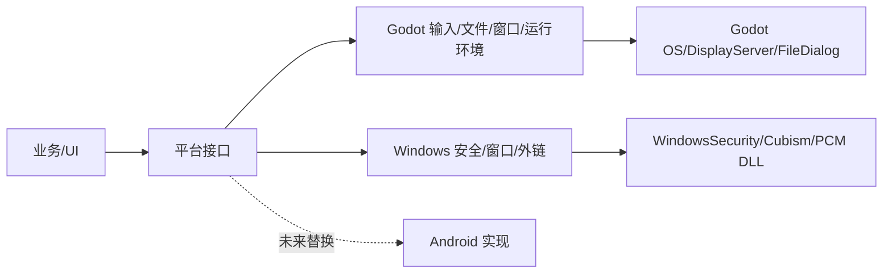
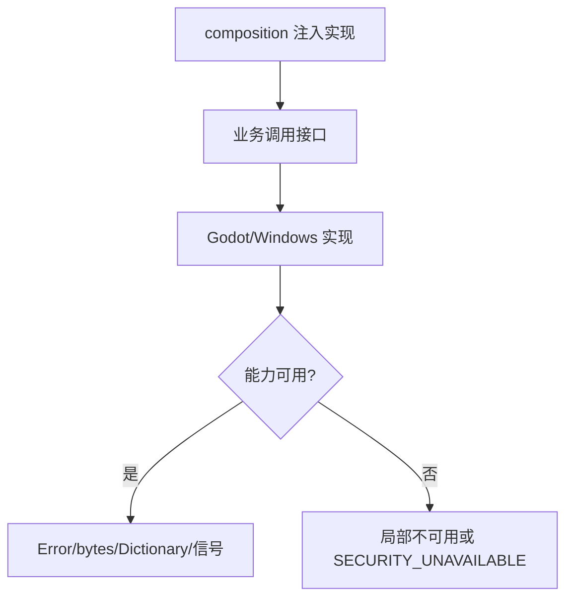
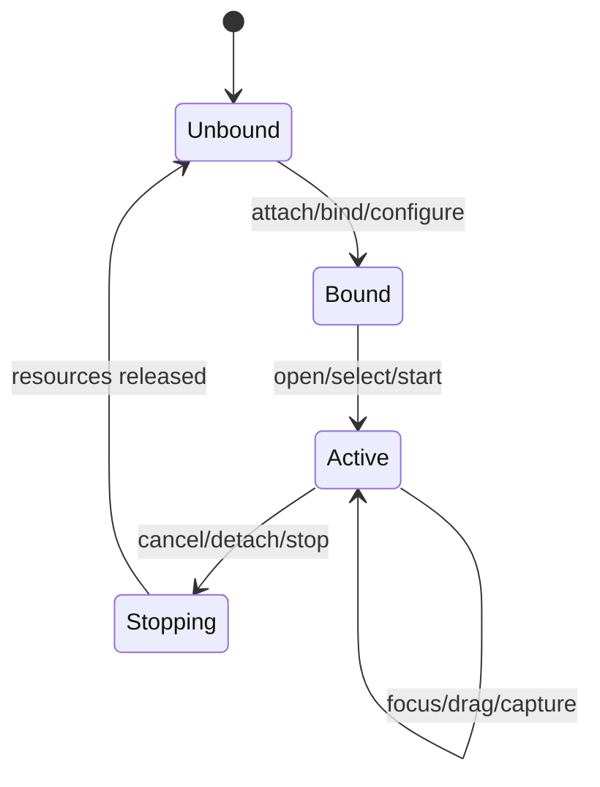

# Platform 模块

## 模块目的
封装桌面窗口、运行环境、输入法/剪贴板、文件选择器、外链和系统安全能力。源码在 `client_godot/src/platform/`，场景资源装配在 `client_godot/resources/platform/`。

## 职责边界
`WindowSystem`、`WindowHost`、`RuntimeEnvironment`、`InputService`、`FileInteraction`、`ExternalLinkOpener`、`PasswordEncryption`、`SecretProtection` 是抽象接口；Godot/Windows 类提供具体实现。

## 依赖方向
被 composition 和少数业务能力调用；平台实现可以使用 OS、DisplayServer、FileDialog、ClassDB 和 DLL，但业务/UI 不得反向依赖它们。

## 状态与资源所有权
WindowHost 负责窗口几何/模式；RuntimeEnvironment 负责日志注册；FileInteraction 负责对话框连接；安全适配器负责 native 句柄和错误转换。

## 公开接口
Window：`attach/set_login_mode/configure/select_layout/open_window/tick/save/detach`；Runtime：`arguments/is_headless/register_logger/unregister_logger/capture/process_id/process_running/os_name`；输入/文件/安全接口见 `interfaces.md`。

## 信号与数据结构
FileInteraction 发 `image_selected(result)`、`export_selected(target)`、`canceled`；安全结果使用 `ok/code/stage/native_code`，不返回原生对象。

## 生命周期
窗口绑定进入场景树、退出时 detach；文件选择取消可重复；安全 DLL 缺失时能力保持不可用；原生音频流由 decoder wrapper 释放。

## 失败、取消和重复调用
窗口不可用返回默认值；文件选择返回 `FILE_PICKER_UNAVAILABLE`；安全 DLL 缺失返回 `SECURITY_UNAVAILABLE`，不降级明文；close/detach 幂等。

## 关键内部函数
DesktopWindowHost 的 `_restore/_clamp_visible_frame`；Godot 文件交互的 `_selected/_canceled`；Windows 安全的 `_security_unavailable`。

## 为什么这样设计
所有 OS、文件和原生访问集中在适配层，Android 只需新增实现并在 composition 注入。

## 如何保持解耦
业务收到 Error、字典、bytes、受控句柄和信号，不知道系统窗口句柄或 DLL 名称。

## 相关场景
`scenes/main.tscn` 通过 `resources/platform/*.tres` 装配。固定控件由 `.tscn` 提供，脚本只绑定行为。

## 相关测试
`test_windows_security.gd`、`test_native_window_controls.gd`、`verify_native_*.py`、依赖边界扫描。测试只观察公开接口，不锁定私有调用次数。

## 当前限制
Android、真实系统 DPI、多屏、公共服务和长期运行环境未在本机验证。

## 模块架构图

## 主要流程图

## 生命周期图

## 主要函数解析

| 函数 | 输入/输出 | 状态与副作用 | 失败与清理 |
|---|---|---|---|
| `DesktopWindowHost.attach/configure/select_layout` | Window、存储、key、尺寸；void | 绑定窗口宿主并恢复可见几何 | 多屏不可见时修正位置；不恢复最小化 |
| `GodotFileInteraction.select_image/select_export/cancel` | 文件对话框/文件名；信号 | 交付 bytes/mime 或受控导出目标 | 用户取消发 canceled；不可用返回 `FILE_PICKER_UNAVAILABLE` |
| `GodotRuntimeEnvironment.register_logger/capture` | logger/viewport/path；void/Error | 注册日志或截图 | headless/路径不可用返回 `ERR_UNAVAILABLE` |
| `WindowsSecretProtection.protect_secret/unprotect_secret` | bytes/scope；结果字典 | 通过 DLL 保护/解密秘密 | 缺 DLL 为 `SECURITY_UNAVAILABLE`，不明文降级 |
| `GodotInputService.is_composing/get_clipboard_image/copy_text` | 无/文本；状态/Image/Error | 查询 IME、读剪贴板、复制文本 | 平台无能力返回 false/空图/明确错误 |

## 源码核对补充

- `DesktopWindowHost.select_layout()` 从 WindowGeometry 恢复位置/大小/最大化状态，并把窗口移回可见屏幕范围；`WindowChrome` 只是 WindowHost 的场景转发器。
- `GodotFileInteraction` 把原生 FileDialog 的 path 读取交给 `ImageFileReader`，向上只交付 bytes/mime 或受控导出目标；取消不清附件。
- `GodotRuntimeEnvironment` 封装参数、headless、logger、截图、进程和 OS 查询；默认抽象实现返回不可用值，不能被普通 UI 直接调用。
- `WindowsSecretProtection` 先检查 `ClassDB.class_exists("WindowsSecurity")`；DLL 缺失返回 SECURITY_UNAVAILABLE，不调用通用实现，也不自动降级明文。
- `NativeDecoderFactory` 检查 `PcmStreamDecoder` 类型，不存在返回 null；ReplyAudio 将其转换为 DECODER_UNAVAILABLE 并保留文字消息。
