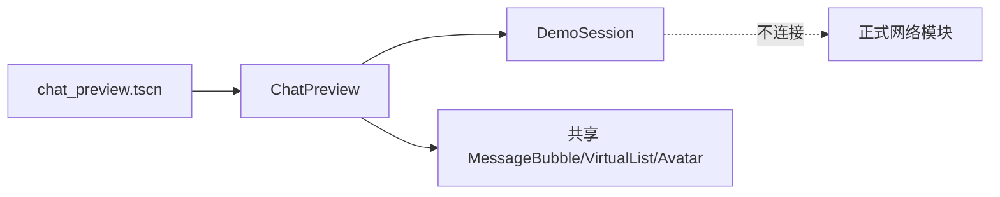
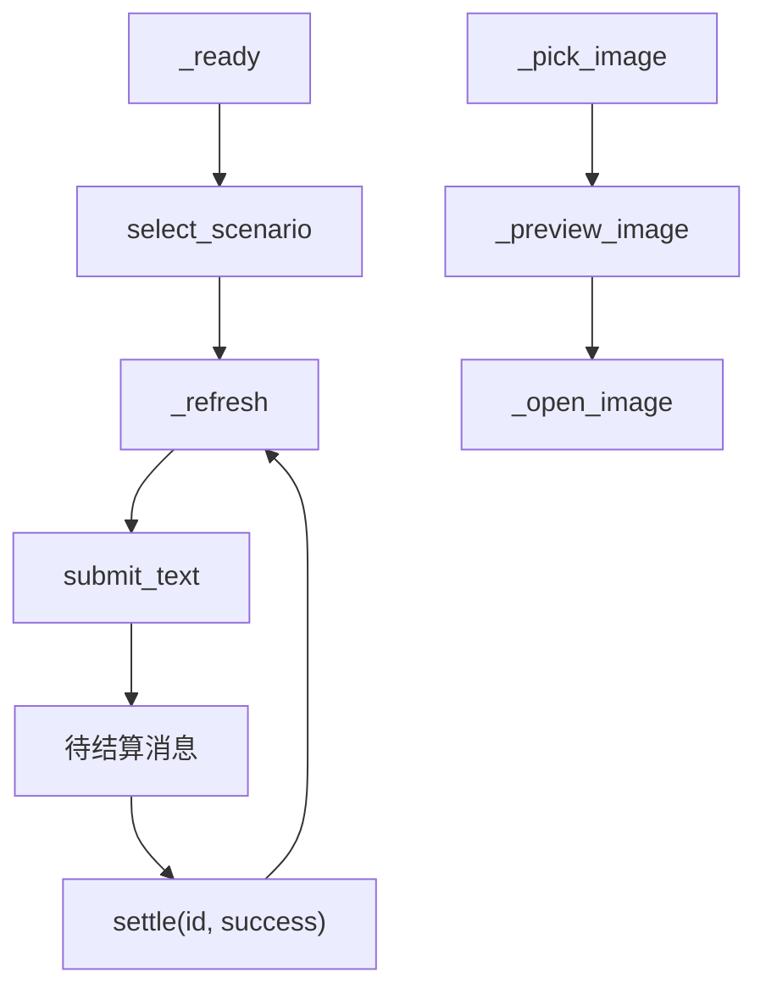
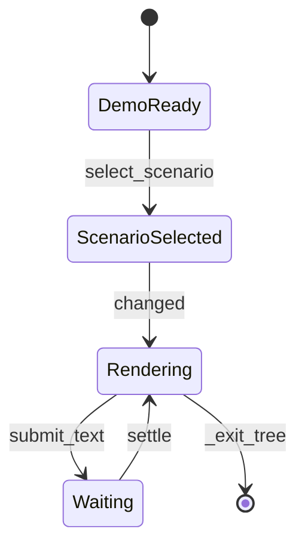

# Preview 模块

## 模块目的
提供离线、可重复的聊天和角色预览，供视觉验收和调试。

## 职责边界
`DemoSession` 管理固定场景、消息和 settle；`ChatPreview` 连接共享气泡、图片、音频和角色控件。不连接服务器、不写正式账号缓存、不修改 AccountSession。

## 依赖方向
依赖共享 UI、AvatarPanel、ImagePresenter 和本地演示 session；不依赖 AccountApi、WebSocketTransport 或正式业务控制器。

## 状态与资源所有权
DemoSession 持有样例消息；Preview 持有场景内控件和临时图片/音频状态；退出树时解绑。

## 公开接口
`select_scenario(name)->bool`、`get_messages()->Array`、`submit_text(text)->String`、`settle(id,success)->bool`。

## 信号与数据结构
DemoSession 发 `changed`；消息是可复制 Dictionary，ID 只在本次预览内有效。

## 生命周期
Preview `_ready` 创建 DemoSession 并刷新；用户发送/切换场景后重新渲染；`_exit_tree` 停止临时播放。

## 失败、取消和重复调用
未知 scenario/消息 ID 返回 false；图片取消不改变已有附件；重复刷新只替换演示列表。

## 关键内部函数
`_change_scenario/_refresh/_send/_pick_image/_open_image/_toggle_play`。

## 为什么这样设计
视觉测试不依赖网络，且共用正式消息控件，避免预览形成第二套 UI。

## 如何保持解耦
演示数据通过独立 RefCounted 提供，不把假数据混入正式 AccountSession。

## 相关场景
`scenes/preview/chat_preview.tscn`、`scenes/avatar/avatar_preview.tscn`。固定控件由 `.tscn` 提供，脚本只绑定行为。

## 相关测试
`test_demo_session.gd`、`test_preview_input.gd`、preview capture。测试只观察公开接口，不锁定私有调用次数。

## 当前限制
Android、真实系统 DPI、多屏、公共服务和长期运行环境未在本机验证。

## 模块架构图

## 主要流程图

## 生命周期图

## 主要函数解析

| 函数 | 输入/输出 | 状态与副作用 | 失败与清理 |
|---|---|---|---|
| `DemoSession.select_scenario(name)` | 场景名；bool | 切换固定样例并发 changed | 未知场景返回 false，不触网络 |
| `get_messages()` | 无；消息数组副本 | 提供当前演示列表 | 不修改内部数组 |
| `submit_text(text)` | 文本；演示消息 ID | 添加 pending 消息 | 空输入/重复提交由视图阻止 |
| `settle(id,success)` | 消息 ID、结果；bool | 更新 pending 状态并发 changed | 未知 ID 返回 false |
| `ChatPreview._exit_tree()` | 无 | 停止临时播放、解绑图片和信号 | 不清理正式账号缓存 |

## 源码核对补充

`ChatPreview` 使用与正式聊天相同的 `message_bubble.tscn`、图片展示和角色面板，但 `DemoSession.submit_text()` 只返回本地演示 ID，`settle()` 只改变内存消息状态；不会创建 WebSocket、写账号 token 或进入正式缓存 scope。
