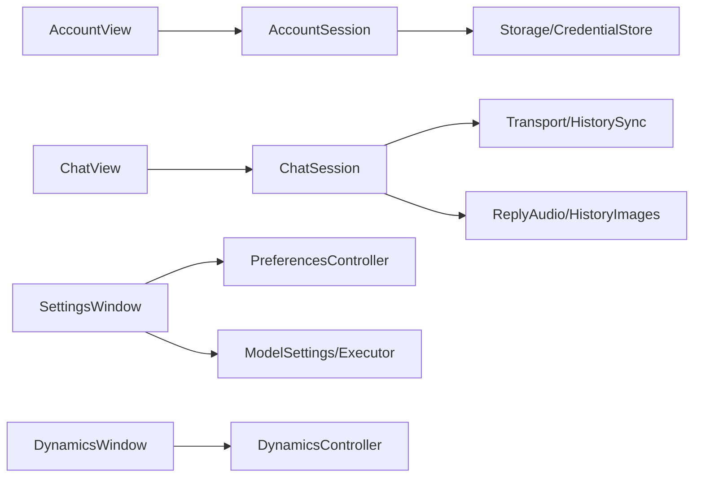
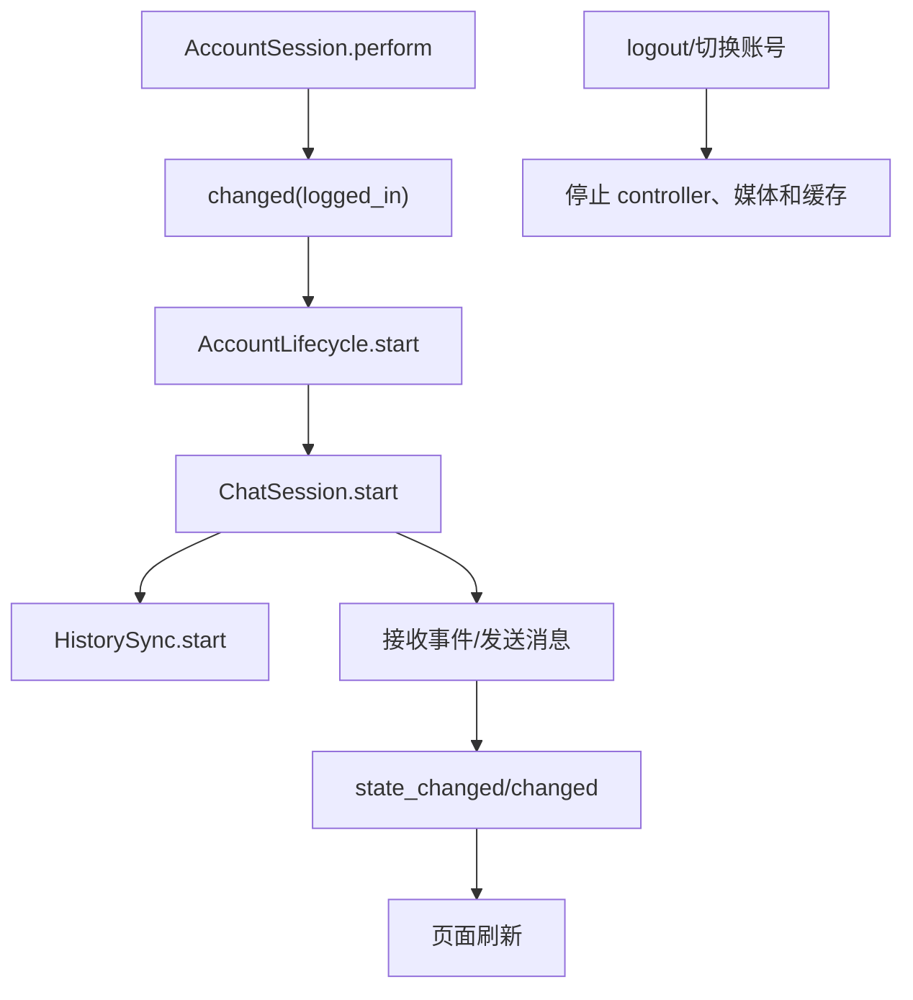
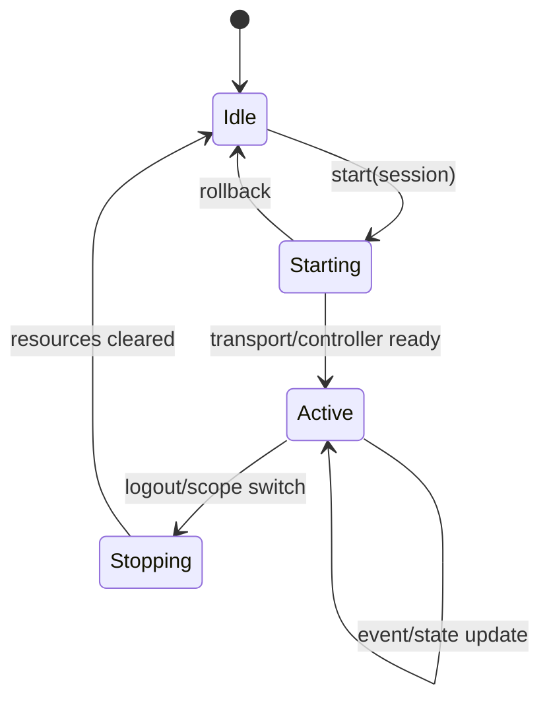

# Session 模块

2026-10-01 补充 `f1cb9e2` 的消息时间与分页重构；当前函数位置查 [函数索引](../function-index.md)，完整阅读顺序查 [场景与控件说明](../场景与控件说明.md)。

## 模块目的
保存账号、聊天、历史、动态、模型和偏好业务状态，把网络/存储结果转换为 UI 可观察状态。

## 职责边界
`AccountSession` 管理登录历史和令牌；`ChatSession` 管理消息、typing、附件、音频、图片和阅读位置；`HistorySync` 管理分页；`DynamicsController` 管理动态/评论/发布；Preferences/Model 对应设置。它们不直接访问 OS、控件或文件 API。

## 依赖方向
向下依赖 network、storage、media 和扩展接口；被 Application 和各 UI 页面通过 `setup`/信号调用。

## 状态与资源所有权
Session 持有当前账号 scope、generation、请求取消句柄和控制器；媒体流由 media/storage 所有，窗口只展示状态。

## 公开接口
Account：`perform/resume/login_saved/logout`；Chat：`start/set_typing/send_text/send_image`；History：`start/retry/skip/stop`；Model：`validate/save/test`；Preferences：`start/reload/edit/save/stop`。

## 信号与数据结构
Account `changed(state)`；Chat `changed/state_changed/message_audio_changed/message_image_changed/expression_requested/mouth_changed`；History `page_received/boundary_ready/state_changed`；Dynamics `changed/unread_changed/latest_unread_changed`；Model `changed/completed`。状态字典为数据副本。

## 生命周期
登录建立新 generation；退出/切换账号先取消网络和媒体，再停止控制器并清空 scope；重新登录创建新上下文。

## 失败、取消和重复调用
所有异步回调检查 scope/generation；重复 signed-in 不重启业务；网络失败保留草稿；stop 幂等；安全能力不可用禁止登录但保留日志/反馈。

## 关键内部函数
Chat 的事件合并、发送屏障和旧消息分页；History 的边界推进；Dynamics 的评论/发布状态机；Model 的草稿校验和部分失败汇总。

## 为什么这样设计
业务状态与窗口分开。消息和分页状态由 session/controller 管理，动态发布/评论及部分设置输入草稿由 UI 持有，因此关闭窗口前必须处理草稿，不能假定销毁窗口后草稿仍在控制器中。基础能力通过注入替换。

## 如何保持解耦
只向 UI 发信号和状态字典，不暴露协议对象、文件句柄或场景路径。

## 相关场景
`scenes/ui/account_view.tscn`、`chat_view.tscn`、`settings_window.tscn`、`dynamics_window.tscn`。固定控件由 `.tscn` 提供，脚本只绑定行为。

## 相关测试
`tests/test_account_session.gd`、`test_live_chat.gd`、`test_history_sync.gd`、`test_dynamics.gd`、`test_model_settings.gd`。测试只观察公开接口，不锁定私有调用次数。

## 当前限制
Android、真实系统 DPI、多屏、公共服务和长期运行环境未在本机验证。

## 模块架构图

## 主要流程图

## 生命周期图

## 主要函数解析

| 函数 | 输入/输出 | 状态与副作用 | 失败与清理 |
|---|---|---|---|
| `AccountSession.perform(...)` | operation/server/fields/remember/auto_login；结果字典 | 调用 AccountApi，成功后持久化 profile/token 并发 changed | 失败保留输入；取消不删除旧凭据 |
| `ChatSession.start(session)` | 账号上下文；`Error` | 先验证 transport，再启动历史、媒体、图片能力 | transport 失败不启动其他服务 |
| `ChatSession.set_typing(active,text_length)` | 瞬态输入状态；`Error` | 发送 typing，不进入可靠 outbox | 断线/stop 自动结束 typing |
| `HistorySync.start/retry/skip` | session/分页动作；信号状态 | 维护边界、发送屏障和重试 | 旧页 generation 不写入新账号 |
| `ModelSettings.validate/save` | 模型草稿；结果字典 | 校验所有用途后逐项保存 | 部分失败保留对应草稿和错误定位 |
| `stop()` | 无 | 取消请求、关闭媒体、清 scope | 幂等，迟到回调被 generation 丢弃 |

## 源码核对补充

- `AccountSession._load_profile()` 兼容旧版 `{server, username, remember}`，迁移为 version 2 accounts 数组；`set_server()` 先 probe 新地址，成功后按服务器选择最近账号并清理密码草稿。
- `AccountSession.perform()` 会先退出旧 session；登录时按 remember 决定是否请求 token。受保护存储失败不会写明文，必要时清理内存 token 并关闭 remember。
- `ChatSession.start()` 的顺序是 transport → models → reading/images → audio scope → history；历史边界完成前，`send_text()` 将消息放进最多 128 项的 pending 队列，边界或 skip 后才转为 durable transport 包。
- `_receive_reply()` 按 reply UUID 聚合 text/expression/audio/error/final，`_present_replies()` 只展示 display=true 的回复并按顺序播放音频；`stop()` 清 typing/touch、模型、图片、历史、transport、媒体和所有聚合状态。
- 消息时间：`send_text/send_image` 创建本地消息时写入 Unix 秒时间；`_receive()` 把 envelope `ts` 传给 `_receive_reply(payload, event_timestamp)`，`_reply_timestamp()` 将有限正数协议毫秒转换为秒，无效值回退到本地到达时间。分片与重复终包不改变首次时间，ACK 只改投递状态；`_history_page()` 合并相同 UUID 时采用历史时间、保留已有实时正文。
- `HistorySync._load()` 通过 `_valid_page_bounds/_valid_page_start`、`_page_messages/_valid_history_row/_valid_history_content`、`_deduplicate` 分别做页边界、行校验和去重；这是原流程拆分，不表示新增分页协议。
- 时间展示由 [chat_time.gd](../../client-godot/src/ui/chat_time.gd) 负责；session 不创建时间条节点。新增证据入口为 [test_message_timestamps.gd](../../client-godot/tests/session/test_message_timestamps.gd) 与 [test_chat_timestamps.gd](../../client-godot/tests/ui/test_chat_timestamps.gd)，分别检查数据时间与显示/锚点。
- `DynamicsController._request()` 使用 `src/network/json_request.gd`；`_write()` 发布/评论时验证非空文本、busy、返回 item 和 generation，失败或不确定结果保留草稿。
- `PreferencesController.save()` 先取服务端最新偏好，再只合并用户修改字段；`ModelSettings.save()` 先完成全部 validate，避免一部分模型配置在前置校验失败时写入。
- `ModelExecutor.submit()` 对 request_id 去重并限制结果长度；请求完成前若 generation 变化或 executor 已 stop，结果丢弃，不发给新账号。
