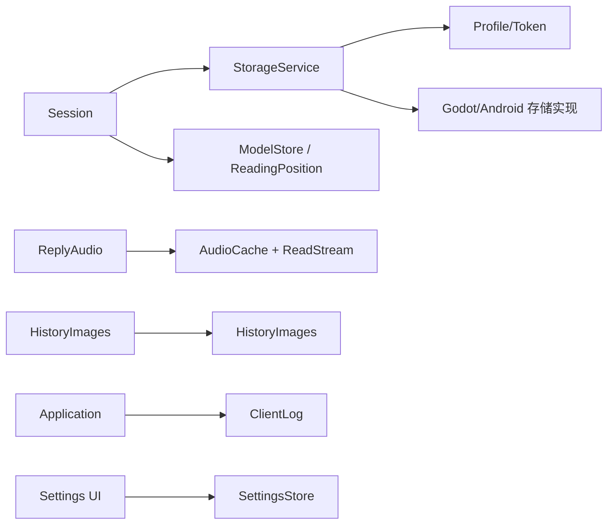
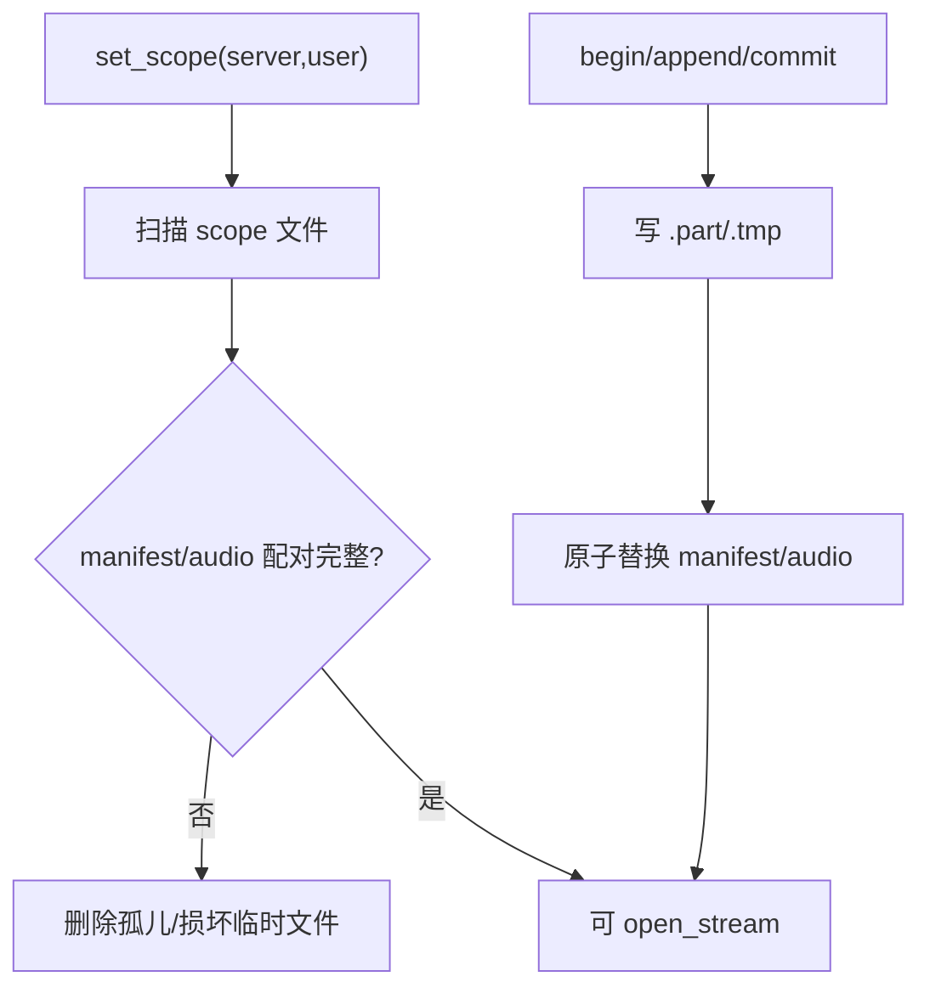
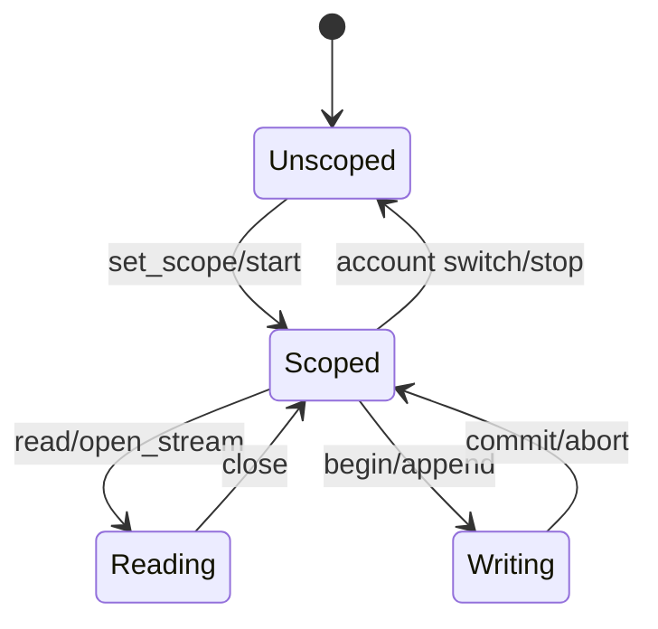

# Storage 模块

## 模块目的
隔离登录资料、受保护令牌、模型、音频、图片、阅读位置、设置、日志、窗口几何和版本资源。

## 职责边界
抽象接口是 `StorageService`、`SettingsStore`、`ReadStream`、`HistoryImageSource`；具体 `Godot*` 实现才接触 FileAccess/DirAccess。各领域存储不合并成万能存储。

## 依赖方向
被 session、media、UI controller 和 platform 实现调用；Storage 不依赖 AccountApi、窗口或 UI。

## 状态与资源所有权
每个存储对象拥有自己的 scope、临时文件、流或 ConfigFile；账号切换由调用者先 stop/close。

## 公开接口
`StorageService` profile/token CRUD 与 `query_directory(path)`；容量单位是 64 位 bytes，未知必须 `-1`。`SettingsStore.load/get/set/save`；`ReadStream.get_buffer/get_length/get_position/close`；图片源 `start/stop/get_state/ensure/retry/preview/store_local`。

## 信号与数据结构
图片源发 `changed(id,state)`；日志发 `entry_added/write_failed`；其余接口返回 Error、字典或受控流，不暴露路径给 UI。

## 生命周期
音频缓存扫描并清理孤儿；日志运行记录原子写入并标记 incomplete；窗口几何保存位置/大小/最大化且不恢复最小化；流 close 幂等。

## 失败、取消和重复调用
写入失败返回 Error 且保留草稿；损坏缓存不提供流；清理按账号隔离；重复 stop/close 无副作用；安全保护失败不明文降级。

## 关键内部函数
scope 路径生成、原子替换、缓存 manifest 配对校验、历史图片可信头部解析、日志轮转和窗口可见范围修正。

## 为什么这样设计
格式和平台路径集中在实现，业务层和手机端只依赖 bytes、字典和受控流。

## 如何保持解耦
业务/UI 禁止直接调用 FileAccess、DirAccess、OS；平台差异只在 GodotStorageService 等实现。

## 相关场景
`scenes/ui/settings_window.tscn`、`audio_settings_page.tscn`、`log_window.tscn` 间接使用。固定控件由 `.tscn` 提供，脚本只绑定行为。

## 相关测试
`tests/storage/*`、`test_client_log.gd`、`test_reading_position.gd`、`test_history_media.gd`、依赖边界测试。测试只观察公开接口，不锁定私有调用次数。

## 当前限制
Android、真实系统 DPI、多屏、公共服务和长期运行环境未在本机验证。

## 模块架构图

## 主要流程图

## 生命周期图

## 主要函数解析

| 函数 | 输入/输出 | 状态与副作用 | 失败与清理 |
|---|---|---|---|
| `StorageService.query_directory(path)` | 逻辑路径；bytes 字典 | 查询容量/目录大小 | 不可用值为 `-1`，不能伪装成 0 |
| `GodotStorageService.read/write_login_profile` | profile 字典；Error | 读写兼容配置格式 | 原子替换失败保留旧文件 |
| `CredentialStore.save/read/forget` | server/user/token；Error/字典 | 通过 SecretProtection 写受保护令牌 | 解密/安全组件失败不明文降级 |
| `AudioCache.set_scope/open_stream/clear` | scope、音频 ID、天数；流/Error | 扫描配对文件、按天清理、返回只读流 | 其他账号和接收中 `.part` 保留 |
| `HistoryImages.ensure/retry/preview` | 图片 ID；状态/纹理 | 加载、可信头部校验并缓存原始尺寸 | 超限/损坏返回明确错误，可 retry |
| `ClientLog.record/finish/export_run` | 事件、运行 ID、目标句柄；Error | 轮转、元数据、导出和 incomplete 标记 | 超限停止写入并清理临时元数据 |

## 源码核对补充

- `AudioCache.set_scope()` 先 abort 当前在途写入，再以 `AccountScope.key` 建目录，清理 `.part`、`.json.tmp` 和反向孤儿；完整缓存不会因为切换账号被删除。
- `AudioCache.commit()` 要求 status.ok、status.finished、input_bytes 与实际写入长度一致；顺序是 flush/close `.part` → rename `.audio` → 写 `.json.tmp` → 原子 rename `.json`。任一步失败都删除半成品且不公开部分流。
- `AudioCache.clear(older_than_days)` 中 0 表示清当前账号全部缓存，正数按 `saved_at_unix` 严格删除早于边界的配对文件；损坏或缺时间元数据的记录不自动删除。
- `HistoryImages.start/stop()` 用 generation 取消旧 HTTP 请求并清内存状态，但保留持久 `.image`；`ensure()` 并发上限为 3，`_decode()` 先校验 PNG/JPEG/WEBP、16 MiB、8192 边长和 1600 万像素，再调用 Godot 解码。
- `ClientLog.record()` 对事件名、字段白名单、字节/条数上限进行检查；达到上限时返回 `ERR_OUT_OF_MEMORY`、标记 incomplete 且停止继续写入。`finish()` 写 `client_stopped` 并原子保存 metadata，历史坏行会使归档保持 incomplete。
- `GodotStorageService` 未注入 credentials 时不会隐式创建 WindowsSecurity；登录 token 读写返回基类不可用结果。`query_directory()` 查询失败或容量未知统一返回 -1，不返回部分大小。
