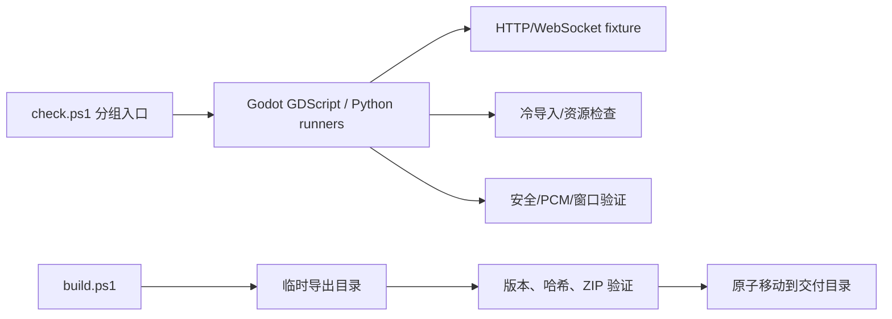
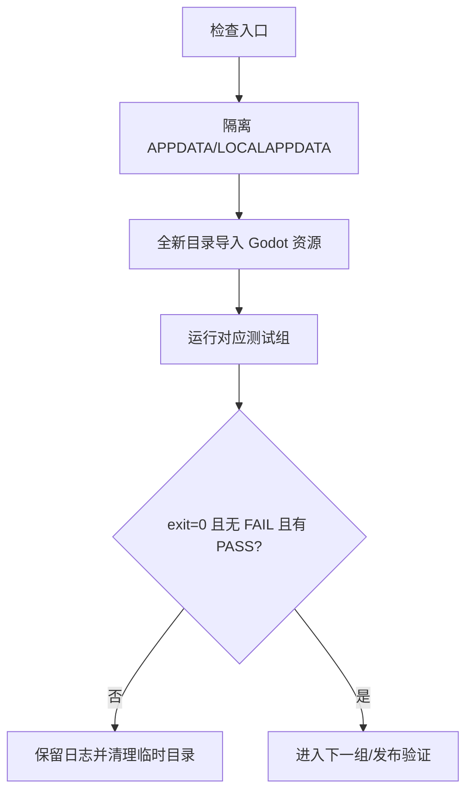
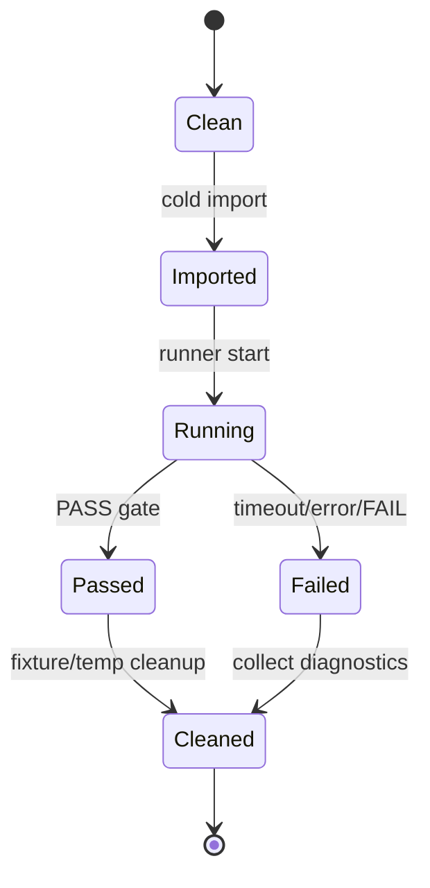

# Tests and Build 模块

## 模块目的
定义客户端检查、冷导入、原生构建、导出和归档验证的入口与边界。

## 职责边界
`scripts/check*.ps1` 和 `tests/run_*.py` 负责编排；GDScript/Python 测试观察公开接口；构建脚本只生成和验证产物。不把测试 runner 当成产品服务。

## 依赖方向
runner 启动 Godot、隔离 fixture 和本地 loopback 服务；验证器读取独立期望清单和锁文件，不从待验证产物推导答案。

## 状态与资源所有权
每次 runner 拥有自己的 APPDATA/LOCALAPPDATA、端口、临时导入目录和日志；退出时清理。发布脚本拥有临时导出目录和临时 ZIP，验证通过才移动。

## 公开接口
基础入口为 `check.ps1`；账户、网络、功能入口为 `check_accounts.ps1`、`check_network.ps1`、`check_features.ps1`。Python runner 有账户、WebSocket、历史、功能、动态和安全互操作入口。

## 信号与数据结构
测试以进程退出码、`PASS`/`FAIL:` 文本、fixture 错误记录和哈希/清单结果交付；不把截图作为 headless 行为证据。

## 生命周期
冷缓存先导入再测行为；runner 启动 fixture 后执行 Godot 并在 finally 清理；原生构建前检查源码树、工具链和 SDK，构建后检查锁定哈希。

## 失败、取消和重复调用
runner 必须同时满足进程成功、无 `FAIL:`、包含明确 PASS；超时、脚本错误、导入错误、哈希不匹配都失败并清理临时目录。重复运行使用新隔离目录，不依赖旧产物。

## 关键内部函数
`common.ps1` 的 Godot 版本/哈希校验和 `Invoke-GodotChecked`；各 runner 的 fixture 启动/停止；发布脚本的临时目录、ZIP CRC 和原子移动。

## 为什么这样设计
把测试环境污染和发布半成品隔离，避免旧导入缓存、旧 APPDATA 或未锁定 DLL 掩盖问题。

## 如何保持解耦
领域 fixture 继续独立；测试通过公开接口，不合并成共享可变服务器或万能运行器。

## 相关场景
`client_godot/scenes` 的 GPU capture 和真实窗口驱动；发布入口为 `scripts/build.ps1`。

## 相关测试
`tests/README.md`、四组 check、`verify_release_archive.py`、`verify_native_*.py`、所有 `tests/ui`/`tests/storage`/`tests/media`。

## 当前限制
当前环境未执行 Godot/Windows 原生构建；Windows 10、系统 DPI、多屏、Android、公共服务器、低端集显和长期运行仍未验证。

## 模块架构图

## 主要流程图

## 生命周期图

## 主要函数解析

| 函数 | 输入/输出 | 状态与副作用 | 失败与清理 |
|---|---|---|---|
| `Invoke-GodotChecked` | Godot 参数、日志路径；进程结果 | 执行并收集 stdout/stderr，检查脚本错误 | 超时/Parse Error/ERROR/FAIL 失败 |
| `run_*_tests.py` | Godot/Python/fixture 配置；退出码 | 创建随机端口 fixture 和隔离用户目录 | finally 停止进程、删除临时目录 |
| `build.ps1` | Godot、版本、导出目标；交付包 | 临时导入、导出 EXE/PCK、复制许可和说明 | 任何验证失败不移动正式目录 |
| `verify_release_archive.py` | ZIP、release.json、锁定哈希；退出码 | 验证精确清单、CRC、逐文件内容和 DLL 哈希 | 清单/哈希/版本不一致立即失败 |

## 源码核对补充

- `scripts/common.ps1` 校验 Godot 版本、GUI/console 路径哈希并在 `Invoke-GodotChecked` 中捕获 Parse Error、SCRIPT ERROR、ERROR、FAIL。
- 账户、WebSocket、history、feature、dynamics runner 都使用 127.0.0.1 随机端口和隔离 APPDATA/LOCALAPPDATA；runner 通过退出码、错误输出和明确 `PASS` 联合判定。
- 原生窗口测试依赖真实 Windows user32 鼠标输入；headless 只能验证结构和状态，不能替代拖拽、最大化、缩放和 DPI 验收。
- `verify_release_archive.py` 使用独立期望清单检查 release metadata、精确文件集合、ZIP CRC、逐文件字节和两个 DLL 的锁定 SHA-256。
