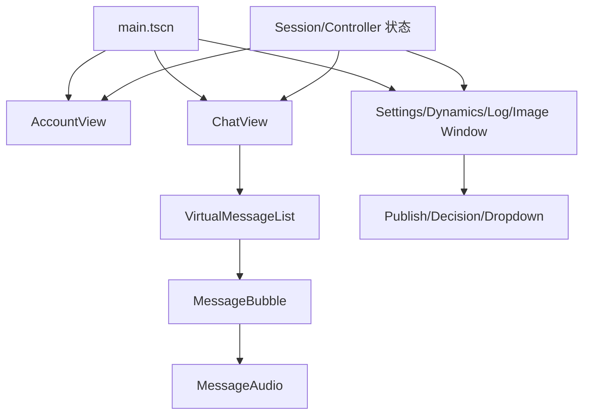
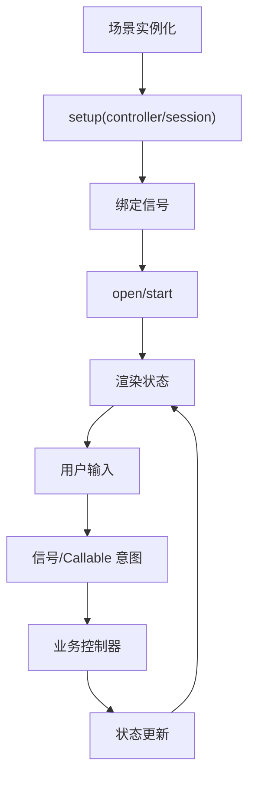
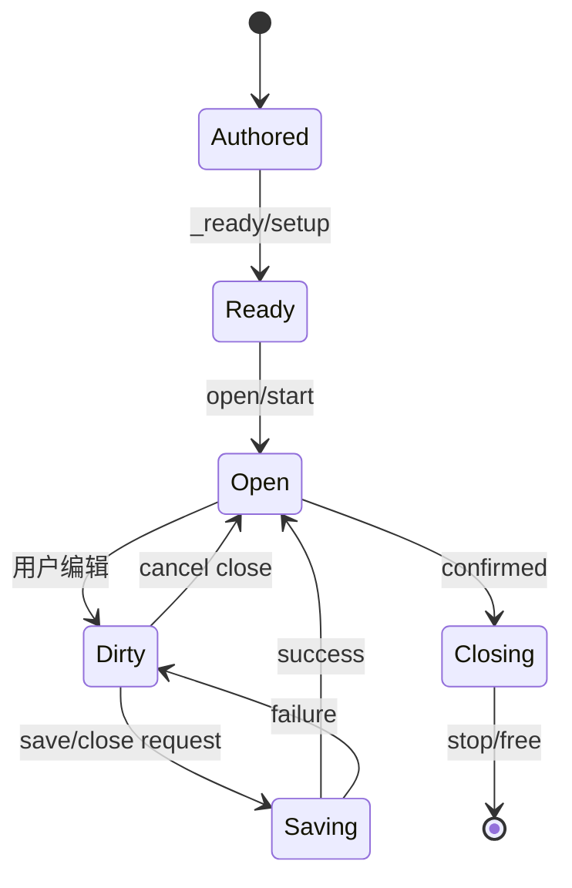

# UI 模块

## 模块目的
把 `.tscn` 节点、主题和业务状态组合成登录、聊天、设置、动态、日志、图片和预览界面。

## 职责边界
UI 通过 `setup` 注入 session/controller，通过信号提交意图；不访问文件、OS、网络协议或原生对象。固定控件在场景，运行期只创建列表行、气泡和窗口实例。

## 依赖方向
向上被 Application/WindowCoordinator 装配，向下只依赖 session/controller 和能力接口；共享消息控件可被正式聊天与 preview 使用。

## 状态与资源所有权
页面持有草稿和显示状态；控制器持有业务请求；窗口协调器持有窗口索引；弹层由所属窗口销毁。

## 公开接口
`AccountView.setup/select_mode`；`ChatView.setup/is_dirty`；`SettingsWindow.setup/select_page/save_changes/request_close`；`DynamicsWindow.setup/select_post`；`LogWindow.setup/open`；`ImagePresenter.open_image`；`UnifiedDropdown.set_items/open_menu/close_menu`；`VirtualMessageList.set_messages/scroll_to_latest`。

## 信号与数据结构
登录/退出/反馈、附件、设置保存、评论发布、音频/图片动作均用信号或 Callable；状态字典只含可展示数据，不携带路径、令牌和原生对象。

## 生命周期
场景实例化 → `setup` → 绑定信号 → `open/start`；父窗口关闭先汇总草稿，再停止控制器和销毁子节点。

## 失败、取消和重复调用
设置部分失败保留草稿；菜单第二次点击关闭、Esc 关闭最上层浮层；确认框默认取消；附件取消不清已有内容；重复打开聚焦旧窗口。

## 关键内部函数
气泡测量和布局、虚拟列表锚点恢复、设置保存聚合、动态评论状态、图片来源转属和窗口关闭确认。

## 为什么这样设计
场景负责结构、脚本负责行为、主题负责视觉，便于替换移动布局而不搬业务代码。

## 如何保持解耦
不从节点路径寻找服务，不调用平台 API；能力由父级显式注入。

## 相关场景
`scenes/main.tscn`、`scenes/ui/*.tscn`、`scenes/preview/chat_preview.tscn`。固定控件由 `.tscn` 提供，脚本只绑定行为。

## 相关测试
`tests/ui/*`、场景/主题契约、GPU capture 和窗口验收。测试只观察公开接口，不锁定私有调用次数。

## 当前限制
Android、真实系统 DPI、多屏、公共服务和长期运行环境未在本机验证。

## 模块架构图

## 主要流程图

## 生命周期图

## 主要函数解析

| 函数 | 输入/输出 | 状态与副作用 | 失败与清理 |
|---|---|---|---|
| `AccountView.setup/select_mode` | AccountSession、页面模式；void | 绑定登录/注册/重置和菜单状态 | 请求中禁用重复提交；失败保留输入 |
| `ChatView.setup/is_dirty` | ChatSession；状态/布尔 | 连接消息、历史、音频、图片和输入 | 退出树解绑信号，草稿交协调器 |
| `SettingsWindow.save_changes/request_close` | 无；结果字典/void | 聚合偏好、模型、缓存页保存和退出登录 | 部分失败保留对应草稿，保存中等待 |
| `VirtualMessageList.set_messages/scroll_to_latest` | 消息数组；void/bool | 虚拟化可见气泡并维护阅读锚点 | 图片/字体变化重新布局，保持锚点 |
| `MessageBubble.configure/update_message` | 消息字典/图片纹理；void | 计算文字气泡尺寸，绑定音频/图片动作 | 超长文本换行，不让状态控件撑大正文 |
| `UnifiedDropdown.open_menu/close_menu` | 无；void | 第一次打开、第二次关闭，发 `activated` | Esc/外部点击按弹层规则关闭，不创建副本 |
| `ImagePresenter.open_image/close` | 来源窗口、provider；Window/void | 单例图片窗口切换来源和焦点 | 关闭来源时联动，加载失败提供重试 |

## 源码核对补充

- `AccountView._send()` 只接受 ASCII 密码字符，注册/重置校验确认密码；登录成功清除密码等敏感字段，网络/认证失败保留当前页输入。菜单、服务器对话框和历史账号弹层均由 authored 场景提供。
- `ChatView._initialize()` 连接历史重试/跳过、虚拟列表媒体信号、ComposerInput、FileDialog 和 ChatSession；`_send()` 只有 `send_text/send_image` 成功后才清空输入或附件。
- `VirtualMessageList` 使用 `_heights/_offsets/_nodes/_indices` 做像素布局，实测行高为 `max(54, minimum)+17`，窗口宽度变化会清高度缓存；渲染视口前后额外保留约两行并释放视口外节点。
- `MessageBubble.configure()` 区分 system/user/image 布局；`set_audio_state/set_image_state()` 只更新已有媒体控件，不让语音状态或错误文案撑大短文本气泡。
- `SettingsWindow.save_changes()` 先全量 validate ModelPage，再按 model → preference 顺序保存；保存中 `_request_close()` 只设置 close-after-save，失败继续保留窗口。
- `DynamicsWindow` 只继承 `DraftWindow`，发布使用当前窗口内的 `publish_overlay.tscn` Control 浮层；`dynamic_detail` 会把 ReplyBox reparent 到具体评论行，取消回复时保留文本草稿。
- `LogWindow` 关闭只 hide；实时 entry 只有在窗口可见、当前 run 且筛选命中时追加，导出始终读取完整运行记录，不受筛选影响。
- `ImagePresenter` 全局只保持一个 ImageWindow；切换来源时 reparent，关闭时释放纹理/provider/confirm 并恢复来源窗口焦点。
- `UnifiedDropdown.set_items()` 校验 id/label 唯一性，`open_menu()` 根据窗口几何选择上下位置；程序性 set_selected 不发 activated，只有用户 `_activate()` 发信号。
- `WindowChrome` 只转发 WindowHost 的 attach/configure/open/tick/save/detach，不在业务窗口内调用 DisplayServer。
