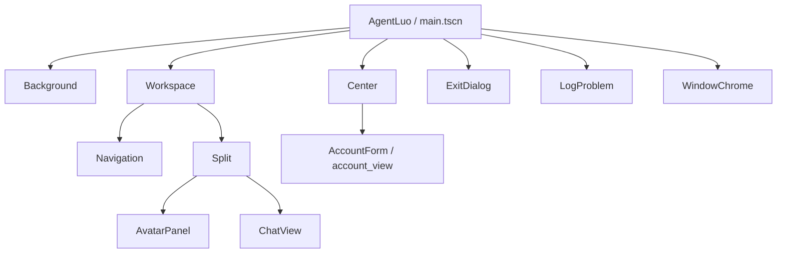
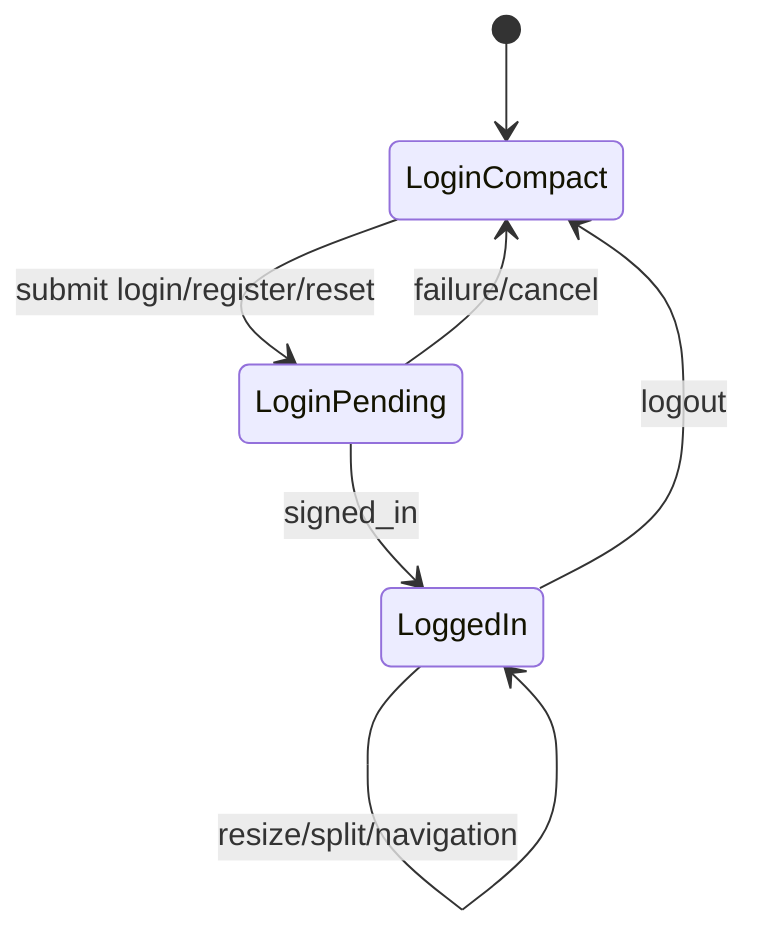
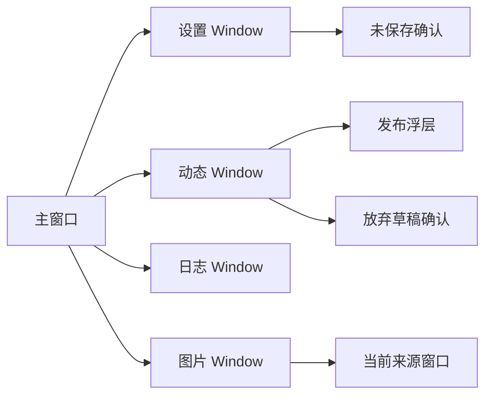
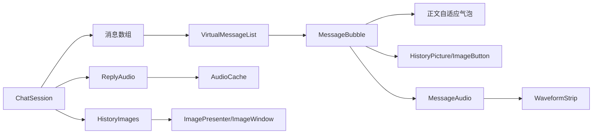
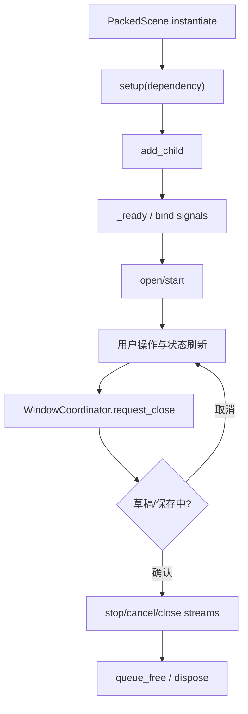

# 场景与节点关系

核对日期：2026-10-01，基准 `f1cb9e2`。逐节点用途及阅读顺序见 [场景与控件说明](场景与控件说明.md)。

固定控件及默认样式由 `.tscn`、主题和资源提供；脚本负责依赖注入、信号连接、状态绑定和运行期列表项实例化。公共控件的正常、悬停、按下、禁用、焦点样式集中在 `theme/app_theme.tres`：同类控件同一状态共用一份 StyleBoxFlat，场景只保留确有局部语义的样式（如音量环形底的半径、日志正文等宽字体）。`UiStyle` 只在运行时复制并改写这些样式，不写回主题资源文件。

## 主场景与账户

工程入口由 `client-godot/project.godot` 指向 `res://scenes/main.tscn`。主场景根节点 `AgentLuo` 下固定有渐变 `Background`、`Workspace/Navigation`、`Workspace/Split`、`Center/AccountForm`、日志/账号错误提示、`ExitDialog` 和 `Chrome`；`tests/test_ui_scenes.gd` 是公开节点契约的压缩清单。

`scenes/main.tscn` 是应用入口。未登录时显示紧凑 `account_view.tscn`；登录成功后动态加入角色和聊天视图，默认展开 1280×800，角色区默认约占 1/3，窗口几何和分隔比例可恢复。`Center` 保留但隐藏，不属于 `Split`。左侧导航使用面板而非旧 `Glass` 节点；`ActiveMark` 标记聊天入口，`DynamicsUnread` 圆点及按钮 tooltip 展示未读状态。账号表单提供登录、注册、邀请码重置、历史账号、服务器设置和菜单，通过 `AccountSession` 提交。

## 聊天与消息

`chat_view.tscn` 分为 `HeaderMargin` 身份区、`MessagesMargin` 消息区与 `ComposerSurface` 输入区。输入区上排是图片、音量、最新和未读入口，下排 `InputRow` 横排输入框和发送按钮。音量位于根节点下的 `VolumePopup`，全局 `StopVoice` 已移除，单消息语音行保留停止操作。

虚拟列表只实例化视口附近消息；气泡根据内容自适应尺寸，正常投递不显示额外 Caption，失败/不确定才显示异常提示。图片加载完成后隐藏加载按钮。气泡、语音行和图片窗口接入共用 UiStyle；播放生命周期仍由 ReplyAudio 管理。

MessageBubble 根已改为 VBox：上方 `TimeMarker/TimePanel/TimeText`，下方 `Row` 内放 `System/Avatar/Body`。`chat_time.gd` 对首条有效非系统消息及与此前最高有效时间相差至少 300 秒的消息生成时间条；当天只显示时分，其他日期显示日期和时分。时间条属于原气泡，不新增消息 ID，虚拟列表重算标记时同步失效高度缓存并保留阅读锚点。

## 独立窗口

设置、动态、日志和图片均是真正的 `Window` 场景；确认框是 borderless transient 窗口，属于触发它的业务窗口。设置默认 880×760，动态 1000×780，日志 960×620，图片 900×720，具体最小尺寸由各 `.tscn` 定义。

- `dynamics_window.tscn`：默认 35:65 列表/详情双栏、未读、刷新和发布入口。左侧无 More 按钮，滚到底部加载/重试；再次点当前动态刷新评论，切换详情保留阅读位置。评论区 LoadMore 也已移除，评论触底自动分页，失败提示点击动态卡片重试。发布浮层标题不再有关闭按钮，底部取消或 Esc 进入草稿保护。
- `settings_window.tscn`：分类侧栏和内容区，嵌入 `preferences_page.tscn`、`model_page.tscn`、`audio_settings_page.tscn`、`style_page.tscn` 四页，底部统一保存/关闭/退出登录。保存依次处理模型、服务器偏好、本地风格；缓存清理独立执行。
- `style_page.tscn`：选择扁平/清透界面和 SVG/emoji 图标。下拉只改草稿，保存成功后统一生效；失败保留草稿与原外观。
- `log_window.tscn`：日志筛选、搜索、复制、导出、跟随最新；登录前后复用同一窗口。
- `image_window.tscn`：关闭、缩放、适应窗口、原始比例、重试；由 `image_presenter.gd` 维护全局单例和来源归属。
- `unified_dropdown.tscn`：按钮、弹层、滚动项目和分隔线；第一次打开，第二次关闭，键盘和 Esc 由控件处理。
- `decision_dialog.tscn`：确认/取消/自定义动作，Esc 等同取消，不可最小化。
- `window_chrome.tscn`、`frost_surface.tscn`：窗口几何和应用内背景效果，不把桌面采样暴露给正文。

## 窗口契约

所有业务窗口都使用系统标题栏：拖动、最小化、最大化、关闭交给平台，`desktop_window_host.gd` 只锁定登录态的固定尺寸并保存几何，不自绘圆角或标题栏按钮。窗口的 `close_requested` 统一走应用关闭流程，有草稿时先确认再关闭。

图片入口（气泡缩略图与大图）都可获得键盘焦点：Enter/Space 与鼠标点击走同一个 `activated` 信号，焦点环取自主题 `ImageEntry/styles/focus`；预览打开后焦点落在可用动作上（失败时是重试），Esc 关闭并把焦点还给来源控件。

## 角色与预览

`avatar_panel.tscn` 的 `Stage` 包含 `Background/Veil/Driver`；根下还有未读动态卡片 `Heading/Identity/Name/Companion`、悬浮右下角 `Reset`、`Border` 和 `Error`。背景使用圆角 Shader，Veil 默认透明。`avatar_preview.tscn` 继承完整面板，独立预览不注入未读数据。

`scenes/avatar/avatar_panel.tscn` 提供 Live2D 驱动、错误状态、重置按钮和触摸区域；`avatar_preview.tscn` 是独立角色验收入口。`scenes/preview/chat_preview.tscn` 使用 `DemoSession` 固定样例，不连接服务器、不复用正式账号状态，但共用消息气泡、图片展示和角色控件。

## 注入顺序

场景实例化 → `setup(dependency...)` → `add_child`/绑定信号 → `open` 或 `start`。父窗口关闭先通知协调器汇总草稿，再停止控制器，最后销毁子窗口；图片窗关闭后把焦点还给来源窗口。动态行、评论行和下拉项目必须由所属场景创建并在清空时释放。

## 资源路径索引

当前 `client-godot/scenes` 共 **31** 个 `.tscn` 场景（不含测试场景）：

- `res://scenes/avatar/avatar_panel.tscn`
- `res://scenes/avatar/avatar_preview.tscn`
- `res://scenes/avatar/touch_ripple.tscn`
- `res://scenes/main.tscn`
- `res://scenes/preview/chat_preview.tscn`
- `res://scenes/ui/account_view.tscn`
- `res://scenes/ui/audio_settings_page.tscn`
- `res://scenes/ui/chat_view.tscn`
- `res://scenes/ui/decision_dialog.tscn`
- `res://scenes/ui/dropdown_item.tscn`
- `res://scenes/ui/dropdown_separator.tscn`
- `res://scenes/ui/dynamic_comment_row.tscn`
- `res://scenes/ui/dynamic_detail.tscn`
- `res://scenes/ui/dynamics_post_row.tscn`
- `res://scenes/ui/dynamics_window.tscn`
- `res://scenes/ui/frost_surface.tscn`
- `res://scenes/ui/image_window.tscn`
- `res://scenes/ui/log_window.tscn`
- `res://scenes/ui/login_account_row.tscn`
- `res://scenes/ui/message_audio.tscn`
- `res://scenes/ui/message_bubble.tscn`
- `res://scenes/ui/model_page.tscn`
- `res://scenes/ui/model_purpose_card.tscn`
- `res://scenes/ui/preferences_page.tscn`
- `res://scenes/ui/publish_overlay.tscn`
- `res://scenes/ui/settings_window.tscn`
- `res://scenes/ui/style_page.tscn`
- `res://scenes/ui/unified_dropdown.tscn`
- `res://scenes/ui/virtual_message_list.tscn`
- `res://scenes/ui/waveform_strip.tscn`
- `res://scenes/ui/window_chrome.tscn`

## 完整场景清单

| 场景 | 根节点/脚本 | 作用与固定节点重点 |
|---|---|---|
| `main.tscn` | `AgentLuo/Control` → `src/application.gd` | 应用根、Navigation、Split、AccountForm、日志/退出状态和 Chrome。 |
| `preview/chat_preview.tscn` | `ChatPreview/Control` → `src/preview/chat_preview.gd` | 离线消息、场景选择、AvatarPanel、Input、Send、图片选择。 |
| `avatar/avatar_panel.tscn` | `AvatarPanel/Control` → `src/avatar/avatar_panel.gd` | Stage/Background/Veil/Driver、未读 Heading、Error、Reset、Border。 |
| `avatar/avatar_preview.tscn` | 继承 AvatarPanel → `src/avatar/avatar_preview.gd` | 独立角色预览，不复制基场景节点。 |
| `avatar/touch_ripple.tscn` | `TouchRipple/Panel` → `src/avatar/touch_ripple.gd` | 触摸反馈特效。 |
| `ui/account_view.tscn` | `AccountForm/PanelContainer` → `src/ui/account_view.gd` | 登录/注册/重置、历史账号、菜单、ServerDialog、RemoveAccountDialog。 |
| `ui/login_account_row.tscn` | `LoginAccountRow/HBoxContainer` | 历史账号行，Choose/Remove 由父级连接。 |
| `ui/chat_view.tscn` | `ChatView/MarginContainer` → `src/ui/chat_view.gd` | HeaderMargin、MessagesMargin、ComposerSurface、InputRow、VolumePopup。 |
| `ui/virtual_message_list.tscn` | `VirtualMessageList/ScrollContainer` → `src/ui/virtual_message_list.gd` | Canvas 和可见消息气泡虚拟化。 |
| `ui/message_bubble.tscn` | `MessageBubble/VBoxContainer` → `src/ui/message_bubble.gd` | TimeMarker/TimePanel/TimeText；Row 下的 Avatar、Bubble/Text、图片与 Caption。 |
| `ui/message_audio.tscn` | `MessageAudio/VBoxContainer` → `src/ui/message_audio.gd` | Play、Wave、Time、Stop、Error。 |
| `ui/waveform_strip.tscn` | `WaveformStrip/HBoxContainer` → `src/ui/message_waveform.gd` | 24 个 Bar 绘制音频波形。 |
| `ui/settings_window.tscn` | `SettingsWindow/Window` → `src/ui/settings_window.gd` | 四个分类页、StyleTab/StylePage、UnsavedDialog、Chrome。 |
| `ui/style_page.tscn` | `StylePage/Control` → `src/ui/style_page.gd` | UiStyleField/Presets、IconStyleField/Presets，本地风格草稿。 |
| `ui/preferences_page.tscn` | `PreferencesPage/Control` → `src/ui/preferences_page.gd` | 关系/表达等预设下拉和偏好状态。 |
| `ui/model_page.tscn` | `ModelPage/Control` → `src/ui/model_page.gd` | 模型用途卡片、测试、错误定位和保存。 |
| `ui/model_purpose_card.tscn` | `ModelPurposeCard/PanelContainer` → `src/ui/model_purpose_card.gd` | 单模型用途编辑、复制、测试和错误提示。 |
| `ui/audio_settings_page.tscn` | `AudioSettingsPage/MarginContainer` → `src/ui/audio_settings_page.gd` | 缓存圆环、占用量、按天清理；音量在 ChatView。 |
| `ui/dynamics_window.tscn` | `DynamicsWindow/Window` → `src/ui/dynamics_window.gd` | Toolbar、未读、列表/详情 Split、DiscardDialog、Chrome。 |
| `ui/dynamics_post_row.tscn` | `DynamicsPostRow/Button` → `src/ui/dynamics_post_row.gd` | 动态头像、作者、时间、摘要。 |
| `ui/dynamic_detail.tscn` | `DynamicDetail/ScrollContainer` → `src/ui/dynamic_detail.gd` | 正文、Comments、ReplyBox、Status，评论自动滚动分页与失败提示。 |
| `ui/dynamic_comment_row.tscn` | `DynamicCommentRow/VBoxContainer` → `src/ui/dynamic_comment_row.gd` | 评论头像、作者、正文、时间和回复。 |
| `ui/publish_overlay.tscn` | `PublishOverlay/Control` → `src/ui/publish_overlay.gd` | 动态发布浮层、FrostSurface、确认框。 |
| `ui/log_window.tscn` | `LogWindow/Window` → `src/ui/log_window.gd` | Filters、Search、等宽 Text、Actions、导出 Picker、Chrome。 |
| `ui/image_window.tscn` | `ImageWindow/Window` → `src/ui/image_window.gd` | 图片滚动、错误/重试、缩放/适应/原始比例/关闭工具栏。 |
| `ui/unified_dropdown.tscn` | `UnifiedDropdown/Button` → `src/ui/unified_dropdown.gd` | Menu/PopupPanel、Scroll、Rows，重复点击开关。 |
| `ui/dropdown_item.tscn` | `DropdownItem/Button` → `src/ui/dropdown_item.gd` | 单下拉选项。 |
| `ui/dropdown_separator.tscn` | `DropdownSeparator/HSeparator` | 下拉分隔线，无脚本。 |
| `ui/decision_dialog.tscn` | `DecisionDialog/Window` → `src/ui/decision_dialog.gd` | Header、Message、SaveAndClose/Confirm/Cancel；transient、borderless。 |
| `ui/frost_surface.tscn` | `FrostSurface/ColorRect` → `src/ui/frost_surface.gd` | 应用内背景效果，不采样桌面。 |
| `ui/window_chrome.tscn` | `WindowChrome/Control` → `src/ui/window_chrome.gd` | 复用窗口几何/宿主绑定，不承载业务协议。 |

所有固定节点由上述场景 authored；脚本运行期只实例化动态行、气泡、窗口工厂和必要的 Live2D/native 对象。

## 主场景节点树图

登录时 `Center/AccountForm` 是主要内容；`_account_changed` 成功后隐藏 Center，在 Split 下动态加入角色和聊天视图，并显示导航。退出登录释放双栏业务视图、恢复 Center。

## 登录态切换图

## 独立窗口父子关系图

日志窗口不随主窗口最小化而隐藏；图片窗口只有一个实例并记录来源，来源关闭时才联动关闭。

## 消息与媒体数据流图

## 场景注入与释放流程

固定 UI 节点在 authored `.tscn` 中，动态评论行、帖子行、下拉项和消息气泡由所属场景按需实例化并释放。
