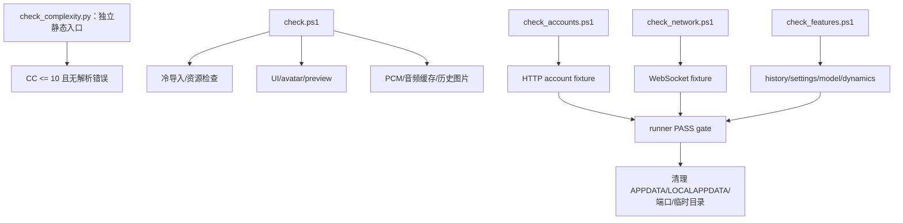
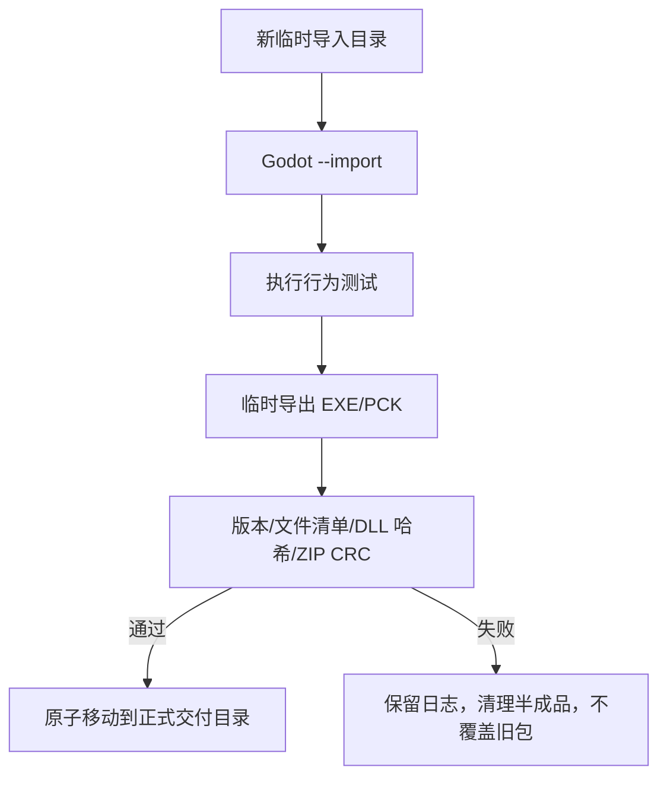
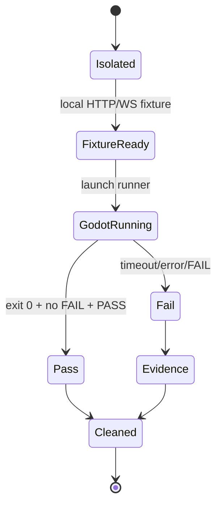

# 测试与验证入口

2026-10-01 按 `f1cb9e2` 更新。本文描述检查入口及其证据边界，不把用例存在、静态通过或历史截图当作当前版本的运行验收结论。

## 默认入口

`client-godot/scripts/check.ps1` 是基础入口；账户、网络、功能检查分别由 `check_accounts.ps1`、`check_network.ps1`、`check_features.ps1` 调用。Python runner 位于 `tests/run_account_tests.py`、`run_websocket_tests.py`、`run_history_tests.py`、`run_feature_tests.py`、`run_dynamics_tests.py` 和 `run_security_interop.py`。`capture_*.gd` 与 `drive_native_window.py` 属于 GPU/真实窗口检查，不能由 headless 结果替代。

以下示例从 `client-godot` 目录运行，引擎路径按本机配置，版本与 SHA 必须符合依赖锁：

```powershell
./scripts/check.ps1 -Godot $env:GODOT_BIN
./scripts/check_accounts.ps1 -Godot $env:GODOT_BIN -Python python
./scripts/check_network.ps1 -Godot $env:GODOT_BIN -Python python
./scripts/check_features.ps1 -Godot $env:GODOT_BIN -Python python
```

各组 Python 依赖与 GPU 参数查 [测试 README](../client-godot/tests/README.md)。检查脚本与下面的复杂度工具是独立入口。

## 消息时间与评论操作专项

| 用例 | 证明范围 |
|---|---|
| [test_message_timestamps.gd](../client-godot/tests/session/test_message_timestamps.gd) | 本地发送时间、服务端毫秒时间、缺失回退、重复分片时间稳定、历史合并保留正文 |
| [test_chat_timestamps.gd](../client-godot/tests/ui/test_chat_timestamps.gd) | 多格式时间解析、300 秒边界、系统/乱序/无效时间、时间条布局与阅读锚点 |
| [test_dynamics_review_actions.gd](../client-godot/tests/ui/test_dynamics_review_actions.gd) | 无手动 More/LoadMore、滚动分页、当前卡片刷新/失败重试、草稿与阅读位置 |
| [test_chat_review_layout.gd](../client-godot/tests/ui/test_chat_review_layout.gd) | 实际主场景中的输入、音量、角色卡片及独立窗口布局 |

`render_chat.gd` 的另绘展示界面不等于产品场景；视觉验收应使用挂载真实场景的用例。

## 严格圈复杂度检查

在独立 Python 环境中安装锁定依赖后，从 `client-godot` 运行：

```powershell
python -m pip install -r tests/requirements-complexity.txt
python scripts/check_complexity.py
python scripts/check_complexity.py --format json
python tests/test_complexity_check.py
```

入口为 [check_complexity.py](../client-godot/scripts/check_complexity.py)。阈值固定为 10，CC=10 合法；超限或解析错误均返回退出码 1。JSON 包含所有分析记录、超限项和错误；缺依赖或版本不符是失败，不能以“0 violations”忽略同时存在的 parse errors。

| 范围 | 实现与统计边界 |
|---|---|
| `src/**/*.gd`、`tests/**/*.gd` | 固定 gdtoolkit AST；函数、lambda、属性访问器、脚本/内部类初始化分别统计 |
| `scripts/**/*.py`、`tests/**/*.py`、`native/SConstruct` | Python AST；包含 assert、except、推导式循环与过滤条件 |
| `scripts/**/*.ps1` | 本机 PowerShell AST；优先 pwsh，否则 powershell，函数、scriptblock 和主流程分别统计 |
| 自有 `native` C/C++/头文件 | 固定 tree-sitter-cpp 做结构解析，Lizard 计数，独立 lambda、条件编译分支也纳入 |
| `assets/**/*.gdshader` | 将 uniform/精度/提示声明规范化后结构解析，原文参与复杂度计数；不替代 Godot Shader 编译 |

检查器按文件系统扫描，不依赖 Git 跟踪状态；排除 `native/godot-cpp`，第三方 addons、生成物和二进制不在上述扫描模式中。当前模式不扫描 `tests/**/*.ps1`，不要把“所有 PowerShell”理解为全仓递归扫描。

固定依赖见 [requirements-complexity.txt](../client-godot/tests/requirements-complexity.txt)：gdtoolkit 4.5.0、tree-sitter 0.25.2、tree-sitter-cpp 0.23.4、lizard 1.24.0。没有 PowerShell 或语法无法由当前版本解析时也报错；仅需 PowerShell 7 的测试在没有 pwsh 时明确跳过。

阅读顺序：入口 → [公共记录与版本校验](../client-godot/scripts/complexity/__init__.py) → [各语言分析器](../client-godot/scripts/complexity/) → [边界测试](../client-godot/tests/test_complexity_check.py)。边界用例覆盖 10/11、短路条件、默认分支、嵌套回调、accessor、注释字符串、C++ lambda、解析失败和第三方排除。

复杂度通过只说明所扫描代码按当前规则未超限，不证明行为、网络互操作、原生编译、真实窗口或实际导出通过。

## 构建编排测试

```powershell
python tests/test_build_prompt.py
```

[该测试](../client-godot/tests/test_build_prompt.py) 使用 fake exporter 和临时工程，核对版本交互重试、三/四段版本同步、缺字段/非法版本时不部分写入、同版本旧包保留等 PowerShell 编排行为。不需要真实 Godot，不等于真实 EXE/PCK/ZIP 已成功导出。实际导出仍需 [build.ps1](../client-godot/scripts/build.ps1) 和归档验证。

## 覆盖边界

| 组别 | 观察的公开接口 |
|---|---|
| 基础 | domain、ReliableOutbox、StorageService、场景/主题契约 |
| 账户 | AccountSession、AccountApi、CredentialStore、AccountLifecycle、SecretProtection |
| 网络 | WebSocketTransport、HistoryApi、JsonRequest、可靠发送和取消 |
| 功能 | ChatSession、HistorySync、Dynamics、Model、ReplyAudio、HistoryImages |
| UI/视觉 | AccountView、SettingsWindow、Dropdown、气泡、图片窗口、窗口关闭和角色触摸 |
| 原生/安全 | DecoderFactory、WindowsSecretProtection、窗口宿主、Cubism 关系校验 |

每个合并后的测试目标应能独立实例化和释放被测对象；不共享上一组的控制器、时钟、信号记录或临时目录。

## 冷缓存与发布

冷缓存流程先把 Godot 导入写到全新临时目录，再执行行为检查，避免旧 `.godot` 导入文件掩盖主题或资源问题。runner 为 `APPDATA`、`LOCALAPPDATA` 使用一次性隔离目录，退出时清理。发布脚本输出到全新临时目录，独立期望清单验证版本、EXE/PCK/DLL、许可和说明，再原子移动到正式目录；ZIP 需要 CRC、文件清单、逐文件哈希和 SHA-256。

runner 只有在进程成功、输出不含 `FAIL:` 且包含明确 `PASS` 时才算通过。`git diff --check`、Godot 脚本解析、依赖边界扫描和 `git check-ignore` 是文档/工程交付检查，不替代行为测试。

## 验证结论的适用范围

仓库提供 Windows 本机、loopback、GPU/原生窗口和离线预览检查入口；当前版本是否通过必须看实际执行记录。Windows 10、系统 DPI、多屏移除、Android、公共服务器、低端集显、长期运行和真实移动硬件需对应环境验证，不能从 headless 或局部截图推断。

## 相关源码

- 测试契约：[client-godot/tests/README.md](../client-godot/tests/README.md)
- 构建脚本：[client-godot/scripts](../client-godot/scripts)
- 版本与锁定依赖：[client-godot/release.json](../client-godot/release.json)、[client-godot/dependencies.lock.json](../client-godot/dependencies.lock.json)


## 测试编排图



## 冷导入与发布流程图



## runner 生命周期图


