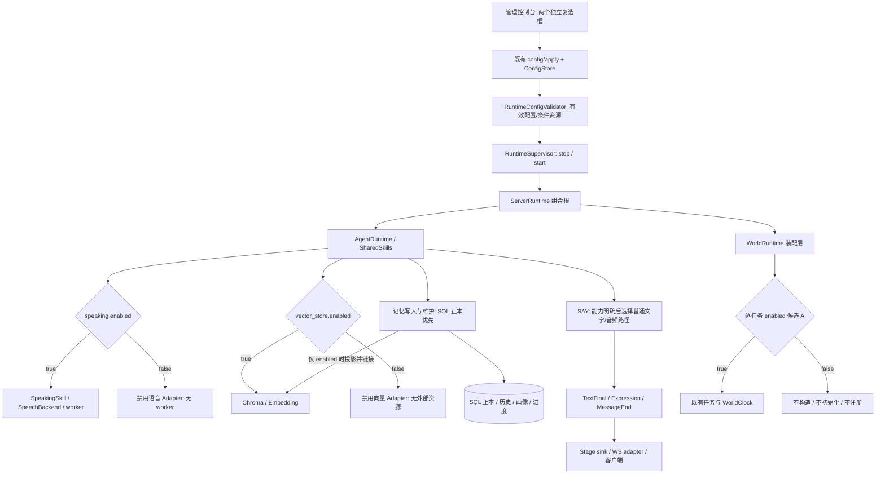

# #412 服务端组件级启动开关

> **状态：完整规格已通过非作者 D3 attempt 2/3 审核，可作为分阶段实施依据；A1–A6 尚未验收。**
>
> 关联工单：[Issue #412](https://github.com/SheepLiu712/Agent-LuoTianyi/issues/412)。2026-11-17 读取的最新 body 更新时间为 `2026-11-16T15:37:16Z`，comments 为空。本文以 `ee718b21536e410ce5e4073b068f03b9bfcd68dc` 为实现调查基线。
>
> 规格阶段只新增本文与 [AI_DECISIONS.md](https://github.com/SheepLiu712/Agent-LuoTianyi/blob/b307df6897800776cdb354ea36069c8a27000b8b/AI_DECISIONS.md)；没有修改运行代码、测试、现用配置或密钥，没有进行业务启动、资源测量或 GitHub 写操作。lead 已单独授权本次两文档原子提交；未授权推送。下文“必须”是目标契约，不表示现状已支持。
>
> 按 [spec 文档模板](<../模板/spec文档模板.md>)组织；流程依据为 [开发守则](<../开发守则.md#人与ai的行为边界>)。2026-11-17 非作者 D3 attempt 2/3 报告确认 N1/M1-S 和 N2 均闭合，G1–G6 无新增必修，完整规格可进入分阶段实施。审查冻结输入为原 418 行 spec SHA-256 `9a60e13c4f23447f5bb093347476354f38e36222976f918c9805c66350cffae8`、260 行 AI_DECISIONS SHA-256 `39d63748ffafd4c911a10ac25738c7e6aef50b07f74c9d6a9a399b17a47770db`；本次仅机械登记审核状态，不改已审契约。文内“待 attempt 2”等措辞保留为修稿历程，均由此状态与文末裁定覆盖；不代表仍有未决产品选择，也不表示 A1–A6 或实现已通过。

## 用户故事

1. **作为客户端开发者，我希望**在隔离的开发配置中逐项关闭语音合成和向量记忆资源，再启动服务端，**以便**不准备本次联调不使用的权重、向量服务密钥和常驻进程，仍可注册、登录、收发文字、查询历史、上传下载媒体。
2. **作为测试维护者，我希望**不增加开关键时仍获得原有全量行为，显式禁用时才发生有说明的降级，**以便**现有部署和测试不会被偷偷切到另一种运行模式。
3. **作为管理员，我希望**在管理控制台分别勾选两项能力并点击“修改”，沿用现有校验、保存和业务运行时重启，刷新后能读回配置，**以便**不手改 JSON、不误以为能力已经热切换。
4. **作为需要保留记忆的用户，我希望**向量检索关闭时，“请记住”仍可靠保存内容，但不会被误告知可以相似检索，**以便**关闭开发资源不等于无声丢弃记忆。
5. **作为运维人员，我希望**仅看 [服务端 README](<../../server/README.md>)就能找到每项开关、默认值、降级、重新启用限制和核心聊天联调步骤，**以便**不读源码也能配置、验证及回退。

### 操作界面草图

复用当前“服务配置”页，新增“组件启动”面板；不新增一键预设、全局开发模式、批量全关按钮或 world 管理面板。ASCII 图表示布局与状态，不规定像素样式：

```text
+----------------------------------------------------------------+
| 服务配置                                                       |
| Runtime: running       [启动] [重启] [停止]                     |
+----------------------------------------------------------------+
| 组件启动                                                       |
| [x] 语音合成 (TTS)                                             |
|     关闭后：普通 SAY 仅文字/表情，无预制或合成音频；通话不可用。 |
| [x] 长期记忆向量检索                                           |
|     关闭后：长期召回为空；记忆保存 SQL 正本，不建向量索引。      |
|                                                                |
| 配置修改后会重启正在运行的业务 runtime；不是热切换。             |
| [修改] [放弃草稿]                                              |
| 状态：未修改 / 修改中... / 已保存且重启完成 / 已保存但启动失败   |
+----------------------------------------------------------------+
| 其他模型面板：各自保留尚未提交的草稿                             |
+----------------------------------------------------------------+
```

- 两个复选框均有可访问名称、可用键盘操作，提示不只依赖颜色；提交中防止重复保存。
- 只清理已成功保存面板的草稿；修改失败保留该面板草稿，其他面板草稿不丢失。
- 配置已落盘但重启失败时，明确显示“已保存但 runtime 未运行”及现有错误信息，不把 `restarted=true` 当作运行成功。

## 验收标准

下列是待实现的验收输入/输出。**当前 A1–A6 均未执行，不勾选完成。** 自动测试可替换昂贵外部实现，但必须保留配置解析、实际业务装配、HTTP/WS 转换、SQL 持久化及清理调用链；替身自身返回“成功”不能作为闭环证据。

| 编号 | 状态与明确输入 | 必须观察到的输出 | 证据与反例 |
| --- | --- | --- | --- |
| **A1 默认兼容** | 使用一份原本能全量运行的隔离配置；省略两个新 `enabled` 键、所有 world 开关键保持原值；TTS/向量及其他资源齐全。另以同份配置显式写入两项 `true` 比较。 | 两种配置均全量装配；原有 TTS/向量检索、普通 SAY、prepared SAY、Sing、通话可用性条件及已启用 world 任务/频率不变；无配置重写。 | 比较装配资源和既有相关回归；真实全量启动单列。不是“空配置也能启动”，也不是用 fake 全绿代替真实全量资源证据。 |
| **A2 关闭语音** | `agent_runtime.skills.speaking.enabled=false`，移除该隔离实例的 `speaking.characters` 和 TTS 权重；其余必需资源合法。通过真实 WS 连续发送“请只回复：你好，412”和“请只回复：第二条”。固定生成器分别给出同名正文。补 prepared 欢迎及无文字触摸场景。 | 运行时启动；无 TTS worker 构造/权重加载/就绪等待；普通 SAY 正文准确送达，每个消息有成功终态；所有包 `audio=""`，不出现非空 `audio`；下一条可继续。prepared SAY 同样禁止音频。无文字瞬时反应不制造空聊天气泡，但有终态。 | 真实 WS 收包、资源构造陷阱与关闭记录；成功终态见 §3.4。不是抛 `EmptySpeechError` 或 `TTS_EMPTY` 的故障降级。A2 测试不触发 Sing。 |
| **A3 关闭向量** | `agent_runtime.vector_store.enabled=false`，不提供 embedding 配置/密钥，不存在向量持久目录。用户 U、角色 C 发送“请记住我的测试编号是412”；再按相同稳定来源身份重试写入。以授权 USER/CHARACTER 查询“测试编号412”。 | 启动且聊天正常；无 Chroma client、embedding 实例/HTTP、Chroma 线程池/新目录；长期记忆查询 `hits=()`；SQL 有真实正本且重试不重复，真实 `memory_ids` 非空，无新向量关联。查询和显式写入不因主动禁用而报错。 | 检查 SQL 与关联表、构造陷阱和 HTTP 调用计数；补维护/清理和重新启用，见 §3.5。真实 SQL、授权、身份或供应商错误不能被一律吞掉。 |
| **A4 管理修改** | 以管理员登录隔离实例 `/admin`：只关闭 TTS→修改；刷新读回；再只关闭向量→修改；分别重新开启并补齐所需资源。预先在另一模型面板留一项未保存草稿。另提交 `"false"` 非布尔值。 | 每次只有所选开关变化，其他 JSON/密钥与其他面板草稿不变；正在运行则经旧 runtime 安全停止、新 runtime 装配；刷新与实际行为一致。非法值不写入、不停止旧 runtime。停止状态下保存不自动启动。缺权重重新开启不得显示成功运行。 | 真实浏览器操作、网络响应、隔离配置读回、运行时状态与 A2/A3 行为；自动管理路由/草稿测试不能代替实际控制台操作。 |
| **A5 核心闭环** | 两重组件为 `false`，§3.3 九项 world 定时任务均设 `enabled=false`，使用新隔离数据目录，不提供 TTS/embedding/AMAP/B站/QQ音乐专属资源；保留其余 §3.2 核心条件。用隔离邀请码注册 `spec412_user`、用 RSA 加密测试密码登录，鉴权 WS 发送“请只回复：核心链路412”，再查询历史，并发送“再说一句你好”验证后续可继续。离线测试的固定生成器明确输出首条“核心链路412”；实际模型使用同一输入但不约束逐字回答。 | 两路均要求注册/登录成功、取得消息令牌；WS 两轮正文非空并各有成功终态、无音频；历史包含输入及本次实际 WS 正文，身份/内容对应，后续对话未悬挂。**只有固定生成器分支**逐字断言“核心链路412”；真实模型分支不因合理自由正文不同而失败。world 定时注册数、定时执行数均为 0；关闭后无遗留 world/TTS 任务。另做一次已授权媒体上传/下载回归。 | §3.3 组合根门控 A 的范围原则已获 D3 attempt 1 接受；完整规格待 attempt 2。注册→登录→WS→历史必须是真实链路，不以 `runtime.running=true` 代替；外部模型替身只用于离线生成端。WS 事件、注册接口和历史接口沿用现有协议。world 以外的心跳/Stage/观测计时器不属“world 定时任务”。 |
| **A6 文档可操作** | 非作者在一份新隔离实例中只使用更新后的 README，逐项定位两项新键、九项 world 键，按步骤运行 A5，修改一项后重启，再按文档重新开启。 | 不读源码即可操作；明确默认 `true`、哪些为既有/新增、语音/Call/记忆/维护/数据重置/重新启用的限制及 citywalk 混合组合的显式执行跳过；说明源码联调与全量生产部署的区别。 | 非作者记录操作步骤、必要核心资源与实际结果；区别 D3 接受的设计与基线尚未实现的开关，不将 fixed-generator 精确文案当作真实模型要求，不伪造现有能力。 |

### 补充边界验收

1. 两项新开关及九项任务开关的值只接受 JSON `true/false`；`0`、`1`、`null`、`"false"`、数组/对象均报含完整配置路径的校验错误，不按 truthiness 转换。省略键解释为 `true`；不是省略所有核心配置。
2. TTS 禁用但 `call_transport.enabled=true` 时，能力接口仍返回 `available=false`。在可信宿主、实时供应商等较早条件均满足时，`reason="call_tts_unavailable"`；若较早条件已失败，沿现有优先级返回 `disabled`、`untrusted_host`、`provider_unavailable` 等，不伪造唯一原因。直接呼叫不能绕过准入；普通聊天仍可用。
3. 关闭向量不删除已有 SQL/向量文件、不开放跨用户/跨角色查询；重新启用时不会自动扫描补写正本、重算 embedding 或新增迁移。既有合法向量按原授权条件恢复，新 SQL-only 记录不保证可召回。
4. 维护时有冻结候选、画像和摘要：禁用向量仍保存候选的 SQL 正本、提交画像/摘要/进度；没有 embedding 调用及向量链接。真实数据库冲突、取消和进度冲突维持原失败/冲突语义。
5. 新无索引实例执行空闲用户数据重置可完成；如果禁用时磁盘已有旧向量资料，不能以向量删除数 `0` 冒称完成清除。按 §3.5.5 报告未清除步骤及可操作原因；不自动删除旧目录。
6. 启用分支的正常音频、空音频故障、超时、取消、投递失败、数据库故障与 embedding 故障回归都保留。主动禁用不是捕获任意异常并返回成功。
7. **混合组合 M1（D3 N1 修订候选）**：`vector_store.enabled=false`、有效 `citywalk.enabled=true` 且 AMAP/核心条件齐备时，整个服务仍可启动、聊天正常；不改 requested enabled、不自动持久化 false。按 §3.5.7 在 WorldRuntime 现有依赖装配接缝把 citywalk service 标为不可用，保留原任务注册及周期；每次触发返回 `ok=true,skipped=true,message="citywalk service is unavailable"`、`data={}`。报告/SQL travel/观察事实均不产生、向量写入调用为 0，无假 ID/写入数；validator 明示 warning 原因。该组合不承诺 citywalk 正常完成，不能默默跳过。向量重新开启并重启后恢复原服务；world 其他独立开关不变。

## 模块与架构

### 1. 现状与设计依据

#### 1.1 已核实的现状

| 责任/事实 | 基线证据 | 对设计的限制 |
| --- | --- | --- |
| 业务 runtime 与进程不是同一生命周期；管理壳可在业务配置不全时运行 | [ServerRuntime](<../../server/src/server_runtime.py#L118-L225>)、[RuntimeSupervisor](<../../server/src/application/admin/runtime_supervisor.py#L174-L264>) | 复用 Supervisor，禁止另开旁路启动或热切换。 |
| 每角色 SpeakingSkill 构造 worker；SAY 预制与 TTS 两分支均可输出音频 | [技能](<../../server/src/agent/skills/expression/speaking/skill.py#L44-L119>)、[后端](<../../server/src/agent/skills/expression/speaking/backend.py#L15-L32>)、[SAY](<../../server/src/agent/handlers/action/say.py#L27-L112>) | 必须在创建昂贵资源前选择禁用实现，并在普通 SAY 选择纯文字成功分支；只令 TTS 流为空不够。 |
| 向量库必建，初始化会创建目录、线程池、embedding 与 PersistentClient | [AgentRuntime](<../../server/src/agent_runtime/agent_runtime.py#L123-L139>)、[向量库](<../../server/src/infrastructure/persistence/database/vector_store.py#L127-L199>) | disabled 不是 `None`、空配置兜底或先创建后关闭。 |
| 召回可能先 embed_query；写入要求真实 upsert ID，再链接正本 | [召回](<../../server/src/agent/skills/adapters/memory/facade.py#L139-L164>)、[显式写入](<../../server/src/agent/skills/memory_write.py#L126-L175>) | 必须绕过 embedding、投影与链接，不返回伪造 ID。 |
| 维护先整批 embedding 后写正本，供应商依赖失败会跳过记忆但保留其他维护 | [维护写入](<../../server/src/agent/skills/adapters/memory/writer.py#L251-L319>)、[维护结算](<../../server/src/agent/skills/cognitive_maintenance/skill.py#L284-L321>) | disabled 与 `SKIPPED_EMBEDDING` 不同；不能触发已有“故障跳过”而丢失本来可保存的正本。 |
| AMAP 仍与 JWT 并列 core 必需，另又有 world disabled 检查 | [validator](<../../server/src/infrastructure/config/validation.py#L41-L129>)、[world 检查](<../../server/src/infrastructure/config/validation.py#L444-L508>)、[管理 Secrets](<../../server/src/web/admin/admin_interface.py#L244-L261>) | **目前缺 AMAP 仍阻断业务启动。** 本草案提出条件化改动，不能描述成已解决。B站/QQ缺凭据已有 world 降级，不照抄“任缺一个都不能启动”的旧概述。 |
| 现有管理面板保留局部草稿、校验后落盘并重启 | [视图/映射](<../../server/src/infrastructure/config/model_editor.py>)、[apply 路由](<../../server/src/web/admin/admin_interface.py#L296-L338>)、[前端](<../../server/res/admin_ui/src/main.tsx#L1521-L1649>) | 新开关应加入同一安全链，局部修改不覆盖模型参数或其他面板。 |

#### 1.2 先检索再选择

2026-11-17 使用 Context7 检索官方资料后选择如下可借鉴原则；页面为滚动文档，未将文档版本假称成项目已安装版本。

- [FastAPI 官方 Lifespan](https://fastapi.tiangolo.com/advanced/events/)：昂贵共享模型应在受控启动阶段加载、在关闭阶段释放，而不是导入模块就加载。这支持“装配前选择 + 既有 owner 负责清理”；**不要求**把本项目已有 `ServerLifecycle/RuntimeSupervisor` 改写成 FastAPI lifespan，项目的管理壳与业务 runtime 分离必须保留。
- [FastAPI 官方生命周期测试](https://fastapi.tiangolo.com/advanced/testing-events/)：测试要实际进入/退出生命周期才能观察初始化及释放。这支持真实装配/关闭测试，不能只 mock `runtime.running`。本项目正式入口显式管理生命周期，因此测试也须显式经过对应入口，不假定 TestClient 自动运行被关闭的 lifespan。
- SQL 正本/可选向量投影的技术依据与补充参考见 [AI_DECISIONS.md](https://github.com/SheepLiu712/Agent-LuoTianyi/blob/b307df6897800776cdb354ea36069c8a27000b8b/AI_DECISIONS.md)，其中区分本项目已存在的索引职责与作者新提出的保留语义。外部参考只能佐证技术约束，不能替代本项目的产品及 scope 审核。

### 2. 模块划分



| 所属模块 | 本次目标职责 | 不承接的职责 |
| --- | --- | --- |
| `infrastructure.config` | 严格布尔校验、默认值、条件资源验证、保存投影的局部映射 | 不创建模型/向量库，不自动修改现用配置或写密钥。 |
| `agent_runtime` / `SharedSkills` | 在真实/禁用 Adapter 之间选择，保证具名依赖非空且生命周期完整 | 不接管角色记忆业务，不把 flags 散布到 Stage/所有 Handler。 |
| `speaking` / `SayHandler` | 稳定语音能力事实、无资源禁用实现；普通 SAY 纯文字/表情及成功结束 | 不关闭 Sing，不让 CALL 假装是纯文字通话。 |
| `persistence.database` / 记忆 skills | 禁用向量 Adapter；记忆调用在受控接缝区分正本保存与可选投影 | 不伪造索引、不建新的任务队列/自动回填系统，不吞 SQL 错误。 |
| `world.WorldRuntime` | **候选 A**：沿已有逐任务约定补三项门控、允许合法空任务集 | 不改 WorldTask 子类、采集/学习/提醒/清理内部算法或 enabled 时的触发频率。 |
| 管理前后端 / `application.admin` | 两项开关编辑及现有校验→保存→重启→状态反馈 | 不新增热应用端点、preset 或第二套进程管理。 |
| README/配置模板 | 可复制的逐项键、默认及资源/数据语义、隔离运行路线 | 不放真实密钥，不把完整资产部署流程降低为可缺资源的生产发布。 |

实现后的文件归属以 [代码地图](<../代码地图.md#3-server-模块职责与边界>) 为准。本文不是改动清单的强制逐文件拆分；小型能力事实、禁用 Adapter 和必要测试可放在上述现有 owner 内，不新建全局“轻量 runtime”框架。

### 3. 接口规范

#### 3.1 配置键、缺省与加载

| 配置键 | 类型 / 缺省 | 关闭的精确定义 | 当前状态 |
| --- | --- | --- | --- |
| `agent_runtime.skills.speaking.enabled` | bool / `true` | 普通 SAY 无合成/预制音频，无 TTS worker；通话 TTS 能力不可用 | 本次新增候选 |
| `agent_runtime.vector_store.enabled` | bool / `true` | 不初始化向量/embedding 资源，长期记忆召回为空，SQL 保存保留 | 本次新增候选 |
| `world.<task>.enabled` | bool / `true` | false 时仅该项任务不构造/初始化/注册/立即执行；true 是请求启用，不代表可选依赖必然可用，citywalk 混合组合按 §3.5.7 明示跳过 | 既有六类 + 三类待实现门控，完整列表在 §3.3 |

读取顺序：读取 raw JSON → 现有变量替换/路径解析 → 严格解析开关 → 条件校验 → 依赖装配。不得把 `bool("false")` 当禁用；允许禁用组件省略其**专属**配置，不允许省略整个 `agent_runtime.skills` 或必要核心节点。

只新增上述配置叶子；不改已有 `store_type/vector_store_type` 命名、不额外添加 store 类型选择入口。禁用时先判断 `enabled=false`，再绕过后端类型、embedding 模型/密钥、向量目录、TTS 角色权重路径的必需校验与初始化；无关核心错误照常失败。重新启用时恢复其原有校验/构造失败语义，不能静默回退 disabled。

目标配置片段（合并到**隔离副本**，不是可覆盖现用文件的完整配置，也不是 preset）：

```json
{
  "agent_runtime": {
    "skills": {"speaking": {"enabled": false}},
    "vector_store": {"enabled": false}
  },
  "world": {
    "citywalk": {"enabled": false},
    "auto_song_learner": {"enabled": false},
    "qq_music_credential_refresh": {"enabled": false},
    "song_knowledge": {"enabled": false},
    "bili_dynamic_fetcher": {"enabled": false},
    "dynamic_interaction": {"enabled": false},
    "diary": {"enabled": false},
    "proactive_topic_check": {"enabled": false},
    "expired_event_cleanup": {"enabled": false}
  }
}
```

其中三项尚未支持的 world 叶子虽然已获 D3 attempt 1 的装配范围原则接受，仍须完整 spec 复审通过并实现后才生效。此片段不宣称能在当前基线达到 A5。

#### 3.2 条件校验与仍然必需的核心资源

- `JWT_SECRET`、账号/会话存储、SQL 正本/历史、媒体路径、角色资料/提示词/表情映射、当前装配所用 LLM/VLM/音频理解引用、歌曲知识静态库及 singing 曲库仍按原规则需要。此次是免启用**运行资源**，不是拆分安装依赖；不承诺免装 `chromadb`/TTS Python 包、CUDA 全套环境，也不承诺主进程完全没有传递 import 开销。
- speaking 为 `false`：不要求 `speaking.characters` 非空、不遍历 TTS 角色权重/参考音频/推理配置路径、不创建 `SpeechBackend`。`prepared_speech` 的文字/表情清单及当前静态资源要求保留，禁止据“无需 TTS 权重”扩大成“全部音频资产都不需要”。执行普通 SAY 时不读取预制音频内容。
- vector 为 `false`：不要求 embedding 配置/密钥、向量持久目录或 Chroma client；不为检查禁用而初始化后端。SQL/画像/维护模型并未关闭，不取消它们的核心要求。
- **AMAP 拟定改动**：`world.citywalk.enabled=false` 时，不再把 `AMAP_KEY` 列为 core error，也不读取城市漫步的专属依赖；缺 key 返回“citywalk 已由配置禁用”的信息项。省略/`true` 时沿原有 AMAP 来源与必需语义校验，不能借缺 key 自动放行 A1。为了最小且可预测，本次仅顶层 `citywalk.enabled=false` 解除核心要求，不根据所有 per-character 覆盖推断全局禁用。
- Secrets 管理页必须与 validator 使用同一条件判断：JWT 永远 required；AMAP 仅在 citywalk 开启时 required。关闭不删除已保存 key、不生成占位 key、不向日志输出 key。现状常量仍同时列出 JWT/AMAP，**这是一项待实现变更**。
- B站/QQ对应任务显式 `false` 时，不检查/迁移/刷新其凭据，不弹扫码，不启动 browser。未显式关闭时保留既有缺凭据 world disablement。QQ 刷新还依赖自动学歌任务存在。
- 禁用状态用现有校验条目的 `status="disabled"` 和说明表达，`core_ok` 不因主动禁用为 false；错误类型、完整路径及相关组件名可读。不得因此跳过其他核心校验。
- `call_transport`、实时语音模型配置是独立既有能力；若选择不使用通话，可按其已有 `enabled` 规则操作，不添加新 env 或替客户端决定。只关 TTS 不自动删/改通话配置；明确启用但内容非法的独立配置仍按现有规则报错。

#### 3.3 world 全关闭：现有合法接缝、范围判断与候选

**已尽力核实，无现成“全关但不改装配”的解法：**

- [WorldRuntime](<../../server/src/world/world_runtime.py#L66-L118>) 无条件构造 song_knowledge、proactive_topic_check、expired_event_cleanup；[WorldTask](<../../server/src/world/types/world_task.py>) 未统一识别 enabled。
- 现有 `_task_enabled` 能在构造前门控其他六类，故同一装配接缝可扩展到三类；不是往任务内部塞判断。
- [WorldClock](<../../server/src/world/world_clock.py#L50-L93>) 要求 interval > 0，daily 时间为合法时分。设 `0` 是错误，设超大周期只是延期，未知 type 会产生告警且仍构造/初始化任务；均不是合法 disable。
- `crawler.activated=false` 不是整个歌曲知识任务关闭；[候选采集](<../../server/src/world/get_new_songs/daily_new_song_fetcher.py#L149-L166>) 仍先 fetch 远端歌曲列表。不能据此承诺“不联网”。

| task / 完整键前缀 | 基线已有构造门控 | 关闭后不再发生 | 依赖/注意 |
| --- | --- | --- | --- |
| `world.citywalk.enabled` | 是 | 城市漫步任务及其定时动作 | 顶层 false 压过角色覆盖，并解除 §3.2 AMAP 核心要求。 |
| `world.auto_song_learner.enabled` | 是 | 自动学歌任务、凭据初始化/学习流程 | 不是 singing 曲库开关；现有歌仍可演唱，显式学歌请求不承诺完成。 |
| `world.qq_music_credential_refresh.enabled` | 是 | QQ 定时/启动即刷新 | 即便 true，自动学歌任务为空也不创建刷新任务。 |
| `world.bili_dynamic_fetcher.enabled` | 是 | B站定时/立即采集与该任务的 browser | 关闭不读取 B站 cookie。 |
| `world.dynamic_interaction.enabled` | 是 | 动态互动轮询 | 不关闭 HTTP 动态数据读写。 |
| `world.diary.enabled` | 是 | 定时日记规划 | 不修改 DiarySkill 算法。 |
| `world.song_knowledge.enabled` | **否，候选新增** | VCPedia 歌曲知识任务的构造/注册/抓取 | 不关闭现有 SQL 歌曲知识读取与目录。 |
| `world.proactive_topic_check.enabled` | **否，候选新增** | world 主动提醒扫描 | 不等价于关闭 ChatStage 自有 deadline/登录欢迎。 |
| `world.expired_event_cleanup.enabled` | **否，候选新增** | 过期事件清理任务 | 关闭会积累过期数据，启用后仍沿原清理语义。 |

**方案 A（world 范围原则已获 D3 attempt 1 接受，尚未实现）：**只在 `WorldRuntime` 按已有 `_task_enabled` 约定给上述三类**构造与注册**补门控，缺省 true；`tasks=[]` 在已完成装配时是合法依赖，不再触发当前 [空 tasks 拒绝](<../../server/src/world/world_runtime.py#L138-L155>)。全部 false 时不得构造/初始化任何 WorldTask，WorldClock 注册/执行数量都是 0。可保留一个空 WorldClock 对象及原启停 Interface；它不应产生定时动作。

- **排除项解释及已接受边界**：工单排除“world 任务代码改动”；D3 attempt 1 接受“组合根装配/注册可纳入，不编辑任务类/基类/算法、启用项周期、`run_immediately` 或内部触发规则”的解释。它沿用六类任务已有约定，可满足 A5 且保持缺省兼容；这是非作者方案审核结论，不新增或放宽用户既定排除项。
- **本轮补充仍待审**：§3.5.7 的 mixed citywalk 依赖降级是 N1 新修订，不能凭 G1 原则接受就宣称它已过完整 gate。若没有这个装配级接缝，禁止作者直接改任务内部来保留 report/SQL。
- **不含 A 的保留边界 B**：只交付 TTS/向量开关、AMAP 条件校验、管理台、现有六类 world 文档及真实资源对比，覆盖 A1–A4 和准确的 A6；三类常驻定时任务仍存在，**A5 不满足，#412 不能按全部验收关闭**。B 仅保留作审查/范围退回时的准确边界，当前不是对 A5 的缩减。不得通过伪配置、猴补丁生产代码、测试专用 runtime、改系统时钟或大周期来伪装 A5。

**一次性启动工作单列**：[start_background_services](<../../server/src/world/world_runtime.py#L120-L164>) 还启动节假日正本初始化，这不是定时任务。保持该次初始化及原错误日志/关闭语义；[ensure_holidays](<../../server/src/infrastructure/persistence/database/services/event_store.py#L675-L744>) 使用 `source="system"` 的精确匹配与 SQL 保存，不据此推导会调用 LLM。九类定时任务全关仍不等于整个进程“零后台工作/零网络”；观测采样、Stage 回收、WS 心跳也不在九类任务中。本工单不为它们新增开关，不暗改 A5。

#### 3.4 语音禁用 Interface 与输出契约

**推荐最小 Interface**：`SpeakingSkill` 对调用者增加只读 `enabled: bool`（或同义的稳定能力事实，最终命名须在实现审查固定），原有 `supports_call_audio(character_id)`、`stop()`、`abort_initialization()` 保留。禁用 Adapter 不拥有 `SpeechBackend/AsyncTTS`，stop/abort 可重复调用且无副作用，`supports_call_audio` 对所有角色为 false。禁止现有测试注入 engine 时的“backend=None 视为 CALL 可用”误覆盖主动禁用。

1. `SayHandler` 在普通非 CALL 路由，**在 prepared/TTS 二分支之前**检查禁用事实；不调用 `speak`、`read_audio` 或 `read_call_pcm`。正常启用分支不受影响。
2. `delivery=CONVERSATION` 且 `action.content` 非空白：按原正文输出 `TextFinalDraft`；不把 `sound_content` 当新正文、不删改或重复正文。有表情时按原规则输出 `ExpressionDraft`。随后仅一个 `MessageEndDraft(status=COMPLETED,error_code=None)`，`ActionResult=COMPLETED`。原本纯文字 SAY 也按该成功路径完成。
3. prepared SAY 的正文仍按同一规则送达；音频引用只被抑制，不读取预制音频内容。`EPHEMERAL_REACTION`/空正文 prepared SAY 保持“不显示聊天气泡”，可输出表情且仍有唯一成功终态。不伪造朗读文字，不恢复表情时序。
4. WS 外部协议不新增类型。成功最终包沿 [现有转换](<../../server/src/adapter/websocket/chat/_protocol_translate.py#L118-L133>)，核心字段如下；完整包仍有原 `uuid`/序号/显示属性，`audio` 默认空串由 [投递层](<../../server/src/adapter/websocket/chat/_delivery.py#L177-L192>) 填充：

```jsonl
{"text":"你好，412","audio":"","is_final_package":false}
{"text":"","audio":"","is_final_package":true,"audio_error":false,"error_code":null}
```

5. 取消、sink 拒绝及连接失败继续走原生命周期，不能为了“必须成功终态”忽略真实失败/发重复终态；成功分支只在实际接收投递后完成。投递接收不等于客户端已播放，本分支根本无播放。
6. 原始 `speak(...)` 在禁用态若被误调用，必须可诊断地拒绝（禁用专用错误或现有 `UnsupportedCallAudioError` 的适用分支），不返回假音频或仅空流。CALL 路由不得走普通文字成功回退；准入先依据 `call_tts_character_ids=()` 拒绝。单独 TTS 关闭不应把供应商错误计成一次正常 TTS 请求。
7. **Sing 明确排除**：独立 `SingHandler/SingingSkill` 继续可输出歌曲音频；开关不是全局静音。A2“无音频”精确定义为普通 SAY（包括 prepared），测试输入不含演唱意图。README 必须解释这个区别。

#### 3.5 向量禁用 Interface、SQL 正本与恢复

##### 3.5.1 装配与低层向量 Interface

保留非空向量依赖，以禁用 Adapter 代替真实 Chroma；新增只读 `enabled: bool`，真实实现为 true，禁用实现为 false。调用者依赖这个显式事实，不依赖类名、`None`、捕获普通异常或虚构“成功 upsert”。工厂必须在昂贵构造**之前**选择 Adapter。

| 操作 | disabled 契约 |
| --- | --- |
| `search(...)` / `get_document_by_id(...)` | 返回空列表，不 embed、不打开 Chroma；不绕过调用入口已有身份校验。 |
| `embed_query` / `prepare_embeddings` | 不产生零向量；正常业务应在调用前绕过，误用抛明确的禁用错误。不能返回 `[]` 冒充一批有效 embedding。 |
| `add_documents` / `upsert_documents` / `update_document` | 不伪造成功 ID/true；正常业务按能力跳过投影，低层误用显式拒绝。 |
| `delete_documents` / 用户向量删除 | 不打开旧向量库；无旧索引时幂等空操作，旧索引存在时严格重置按 §3.5.5。 |
| `close` | 幂等，无 client/HTTP/线程池需要关闭；初始化失败回滚同样可安全调用。 |

关闭期间不得新建向量持久目录、worker/Chroma 线程池或 SiliconFlow embedding 实例/请求，也不向全局共享槽位遗留旧 store。Runtime 仍负责资源所有权及引用清理；旧 runtime 关闭失败不允许重启覆盖它。

##### 3.5.2 检索的“空”指什么

- 对 `MemoryRetrievalSkill.search` 的 USER/CHARACTER 长期记忆范围返回 `MemorySearchResult(hits=())`；从能力接缝提前结束，不先 `embed_query`。这一空结果也覆盖同一 Interface 中 `/YesterdayCityWalk` 的长期角色记忆特例，避免“向量关闭但长期召回非空”的惊讶；此派生语义的原则已获 D3 attempt 1 接受，不将其改写为用户原先逐项明说的要求。
- USER 身份校验、合法查询结构、角色存在性、limit 校验仍执行；不能用 disabled 获得更宽授权。
- `PUBLIC_KNOWLEDGE` 的 SQL 歌曲资料、`get_song/list_songs` 与 singing 目录不是长期向量记忆，保留原行为。混合范围只屏蔽 USER/CHARACTER 命中，公共资料仍可返回；README 不得笼统写“所有查询都为空”。
- SQL 历史、近期上下文、用户画像不会被清空，也不代表用户数据完全不保存。

##### 3.5.3 显式/事件记忆保存

推荐 **SQL 正本保留 + 可选投影跳过**，不选 no-op 丢弃方案：

- `MemoryWriteSkill.commit_fact/remember_event` 保留受信身份、来源 envelope/候选冻结、稳定正本 ID、SQL 幂等及冲突检查。disabled 时写入/读取真实正本后跳过 `Document` upsert 及 `link_agent_memory_embeddings`，返回真实 `memory_ids`；`CREATED/DUPLICATE/NO_CANDIDATE` 描述正本结果，不宣称向量已索引。
- 同一来源重试只保留一份正本；同一稳定身份不同内容仍是冲突。关闭后没有向量相似去重，不能承诺语义相似但不同来源的输入会自动合并。
- 其他仍可调用的公开写入口（`AgentMemory.write_user_memory/write_event_memory`、旧 intentional commit 及维护 writer）必须采用同一 SQL-only 规则；不得只改聊天新入口而遗漏补偿逻辑：旧路径不能因“没有 embedding links”把已存在的正确 SQL-only 正本当损坏、补偿删除或重复创建。无需复活未使用的旧调用链，但对保留 Interface 的契约要一致。
- 聊天“请记住”仅在正本实际提交后确认；不能硬编码承诺“下次一定可召回”。若现有生成确认会误导，给生成材料明确标注“已保存正文；当前长期检索关闭，恢复时不自动建索引”，不强制模型逐字复述。验收看真实 SQL 与无错误，而不是把自由模型回复固定为精确文案。
- SQL 错误、非法来源、权限错误、取消照常传播；**只有显式配置关闭**才跳过投影。enabled 下 Chroma/embedding 故障不得被转成主动禁用或成功。

##### 3.5.4 认知维护

维护仍走现有唯一入口，不改 Stage 调度/切换策略，不混入 #411 的“维护失败是否允许切通话”。推荐维护 writer 增加明确结果 `CANONICAL_ONLY`（候选值 `"canonical_only"`），含义是冻结批次的正本已保存、投影未执行；不复用 `SKIPPED_EMBEDDING`，也不伪报索引 WRITTEN。

- disabled + 非空候选：按既有 maintenance_id/candidate_index 稳定 ID 保存所有 SQL 正本；不调用 `prepare_embeddings/upsert/link`；再按原顺序提交画像、摘要和进度。`memory_skipped_count=0`，日志区分 `index=disabled`；不是丢了候选。
- 空候选仍为 `EMPTY`；enabled 仍保持“先整批 embedding，再正本/投影”，真实供应商最终失败仍为现有 `SKIPPED_EMBEDDING`，不能改原有失败安全网。
- 冻结批次/进度冲突或数据库错误不能被标记 completed；取消与 owned-operation 的等待/清理语义保留。此处无需增加一个长期迁移队列或持久“待回填”任务。

##### 3.5.5 数据重置的隐私边界

[UserResetService](<../../server/src/application/user/user_reset.py#L69-L103>) 包含严格向量删除步骤。禁用时无旧索引的隔离实例可返回删除数 `0` 并继续清理 SQL/媒体等；**磁盘有旧向量数据时不能这样宣称全部删除**，尤其 [legacy 向量兜底](<../../server/src/agent/skills/adapters/memory/facade.py#L211-L225>) 可能在重新启用后恢复召回。

D3 attempt 1 已接受的保守契约：disabled Adapter 可对配置的持久目录做只读存在性检查；目录不存在/确认为空时视为没有需清除的向量。目录非空、旧资料存在或无法判断时，严格删除抛 `VectorDeletionUnavailable`（候选异常名），不打开 Chroma。沿现有 reset 汇总返回 `vectors.success=false`、`vectors.error="VectorDeletionUnavailable"`、HTTP 500 `USER_DATA_RESET_FAILED`；当前聚合器只保留异常类型，因此不假称接口已能返回异常正文。README 必须把该错误解释为“向量检索关闭且有旧索引；请先启用向量库后重试重置”，无需为本工单新增长文本错误字段。其他步骤遵循既有部分成功规则，不能据此声称事务回滚。

这不阻断 A3 的启动、对话或显式写入。此候选宁可报告尚未完全清除，也不伪报成功；不引入自动 tombstone、懒删除、启动后清库或删除整个共享目录。若维护者要求禁用期间仍能完整重置旧向量，应另审可持久的删除意图及授权过滤设计，不能未经确认扩大本工单。

##### 3.5.6 重新启用

重新设 `true` 后必须重启；按现有配置重新打开原集合，不删除、不迁移、不改变 collection/path。旧的有效索引照原规则查询；关闭期间新 SQL-only 正本不会自动索引。**不自动回填，也不假定未来一定提供回填命令。** 若以后有运维回填需求，应另建规格，明确授权、幂等、失败恢复和资源成本。重试某个尚未完成的原业务操作仍按原调用语义执行，不承诺借重启重放已完成的历史写入。

##### 3.5.7 组合 M1：向量关闭而 citywalk 请求开启（D3 N1 修订候选）

**真实调用链与原风险**：[CitywalkTask.initialize/_build_citywalk_service](<../../server/src/world/citywalk/task.py#L87-L108>)、[直接构建服务](<../../server/src/world/citywalk/task.py#L233-L248>) → [CitywalkRuntimeService.run_once](<../../server/src/world/citywalk/runtime_scheduler.py#L19-L36>) 先保存报告/历史，再直接构造 Ingestor → [ingest_session](<../../server/src/world/citywalk/memory_ingestor.py#L93-L118>) 调用 `vector_store.add_documents(docs)`，无视返回 ID 而返回 `len(docs)`。当前 service/ingestor 没有可注入的投影策略 Interface。若 disabled Adapter 一律拒绝写入，异常发生在报告已落盘但 Task 后续 SQL travel/观察事实尚未提交之前；若把 `add_documents` 变成 `[]` no-op，又会日志虚报“记忆写入=N”。两者都不能称混合组合已得到正常降级。

**推荐最小候选 M1-S（仅组合根依赖降级，不改任务内部）**：

1. 保持 `world.citywalk.enabled=true` 的 raw 配置和有效请求事实；不自动设置 false、不拒绝整个服务启动。validator 增加 `scope="world",name="citywalk.vector_projection",status="warning"`，明确文字“城市漫步已请求开启，但向量库关闭；本次运行跳过整个城市漫步，未生成报告、SQL travel 或观察事实；启用向量库并重启可恢复”。该条不是 `disabled`，`apply_world_disablements` 不得借此自动改配置。AMAP 仍按请求 `citywalk.enabled=true` 的 §3.2 条件校验，不因执行跳过暗中改变已审的 AMAP 规则。
2. 在 `WorldRuntime` 已有任务初始化/依赖派发接缝中，当向量 `enabled=false` 时，为所构造的城市任务选择既有 `citywalk_service=None` 的不可用依赖状态，且在注册/启动前完成；不编辑或猴补丁 Task/RuntimeService/Ingestor 的方法，不传递假 vector_store。任务仍按既有 enabled/角色覆盖保留注册、名称、周期，组合根记录一次明确降级原因；任务内部原有 `run_once` 早返回路径自然生效。
3. 每次触发输出沿 [既有 unavailable 分支](<../../server/src/world/citywalk/task.py#L105-L108>) 与 [WorldTaskResult](<../../server/src/world/types/task_result.py#L19-L21>)：`ok=true,skipped=true,message="citywalk service is unavailable",data={}`。这是**未执行的跳过**而非城市漫步完成；不会进入 `CitywalkRuntimeService.run_once`，不产生报告/城市历史文件、不写 SQL travel、不投递观察事实、不调用向量写入；不存在可报告的 ID 或“写入 N 条”。既有依赖构造产生的轻量对象不等于执行，不能宣称 citywalk 专属配置全免。
4. 其他 world 任务、聊天、显式记忆和 SQL-only 维护独立保持其契约；此依赖不可用不得传播成整条对话链失败。配置保存和重启恢复 `vector_store.enabled=true` 后重新装配原 citywalk service，沿原采样/周期执行，不承诺补跑跳过轮次。
5. README、validation 和验收必须显式说“请求开启但因依赖关闭而整个执行跳过”，**不写“citywalk 正常但只少了向量索引”**。M1-S 限制了该混合组合的城市漫步能力，但保留服务及聊天可用；它不偷偷自动关闭用户选择，仍需 D3 attempt 2 接受这一组合降级。A5 的 citywalk 本已 false，不受此候选影响；A1 默认向量 true 也不受影响。

**未选候选**：在 `runtime_scheduler` 或 `memory_ingestor` 增加显式 capability/ingestor 注入，跳过投影而继续返回 report，让 Task 保存 SQL/观察，可以保留更多能力；但当前没有该 Seam，必须改 world 工作流内部，落入本工单排除项。本版不选、不授权。另一方案是拒绝配置 `vector=false + citywalk=true`，虽无假成功却会使关闭向量阻断整个聊天启动，且比明确的可选任务降级更偏离 A3，故不选。低层返回假 ID/count、捕获任意异常后伪报成功和悄悄设置 citywalk false 均禁止。

**最小验证**：以向量 false、城市顶层 true/合法角色覆盖、AMAP 有效、概率 1.0 的隔离配置进入真实 WorldRuntime 装配；记录任务仍注册、warning 明确且不改配置。对 service `run_once`/Ingestor `ingest_session`/vector add 设置执行陷阱，验证触发不进入它们（不把 service 轻量构造误当任务执行），断言上述真实 skipped result、无 report/SQL travel/观察事实，随后实际文字链路正常。再以向量 true 复核原 citywalk 执行链与产物，不能用替身 `CitywalkTask.run_once` 的自定返回值证明降级。

#### 3.6 管理接口与保存/重启

推荐扩展现有、已管理员鉴权的 `GET /admin/api/llm/config` 与 `POST /admin/api/llm/config/apply`，新增 **DTO 字段** `component_startup`，不是新的持久配置节点：

```json
{
  "component_startup": {
    "speaking_enabled": false,
    "vector_store_enabled": true
  }
}
```

- GET 始终投影两个有效 bool，缺省显示 true。POST 中省略 `component_startup` 不改变任何开关；对象内省略某叶子不修改它；允许只传一个。未知叶子/非 bool 用 `422` 拒绝并指明完整 DTO 路径。
- `speaking_enabled` 只映射到 `agent_runtime.skills.speaking.enabled`；`vector_store_enabled` 只映射到 `agent_runtime.vector_store.enabled`。在 raw 副本逐叶 merge，保留 characters、权重路径、embedding 参数、`$VAR` 原文与所有其他字段。禁止用整个 panel 草稿替换 raw 全配置。
- 沿 `apply_llm_config_draft` → 解析副本 → validator → `ConfigStore.write_raw` → `RuntimeSupervisor.restart`；配置校验不通过沿既有 `{ok:false,written:false,restarted:false,validation,runtime}`，不落盘/不重启旧 runtime。
- 校验通过落盘时沿既有备份/原子替换；原 runtime 正在运行才请求 stop/start，停止状态保存只刷新 validation。启动状态以 `runtime.state/running` 为准；`restarted` 只表示发起过重启，不是成功承诺。停止失败必须保留旧资源所有权并拒绝新实例，不能同时启动第二套 worker。
- 成功响应在原 config DTO 增加 `component_startup`；其他端点与字段兼容。只清已提交面板草稿；未授权请求仍被拒绝，错误信息不泄露密钥。
- 不给 world 新增 UI 批量入口；九项逐任务键由 README 指导编辑隔离配置并通过已有 runtime 重启生效。

## 备注

### 关键技术选型与否决项

完整理由及官方证据在 [AI_DECISIONS.md](https://github.com/SheepLiu712/Agent-LuoTianyi/blob/b307df6897800776cdb354ea36069c8a27000b8b/AI_DECISIONS.md)。推荐“装配时真实/禁用 Adapter + owner 清理 + 少量显式能力事实”，不是重构通用插件系统。

- 不选 `None` 扩散：多个依赖门禁和调用点需要非空向量/语音对象，调用者容易漏判，关闭/回滚难一致。
- 不选空流/假 ID 的 Null 实现：空 TTS 流是失败；假 upsert ID 会破坏正本与真实向量一致性。
- 不选 lazy 到首次调用才加载：不满足显式关闭后的无资源、无音频、空检索契约，首个聊天仍可能拉起重资源。
- 不选仅调度周期绕过：0 非法、大周期仍注册任务，不能证明 A5。
- 不改安装/发布体系以逃避运行验证；不让测试替身的配置代替生产可选能力。

### README 的最小可操作内容

实现阶段必须更新 [配置模板](<../../server/config/config.json.template>) 与 [服务端 README](<../../server/README.md>)，**本轮未修改它们**。主目录现用配置不能由代理顺手替换。README 必须包含：

1. 两项新键和九项 world 键的逐项表、默认 true、候选获准后的当前支持状态及全部降级，强调无 preset/新 env。
2. **从源码隔离联调**的路线：使用已有 Python 环境和当前源码运行入口；从模板建立独立 config 副本，以现有 `AGENTLUO_CONFIG_DIR/DATA_DIR/RUNTIME_DIR/ASSET_DIR/RESOURCE_DIR` 路径隔离机制选实例，不为能力新增环境变量；密钥仅由操作者放在该隔离实例原有 SecretStore 中。具体来源见 [ServerPaths](<../../server/src/utils/server_paths.py#L20-L60>)。
3. 提供明确可复制的启动命令及 cwd：进入 `server/`，选择已安装项目依赖的 Python，执行 `python server_main.py`；Linux 亦可沿现有启动器，Windows 沿 [start_server.bat](<../../server/scripts/deploy/startup/start_server.bat>)。说明默认端口与如何避免同现用服务冲突；不要启动替代服务冒称现用实例更新。
4. 保留角色/模型引用、静态歌曲知识/曲库、预制文字/表情资源、SQL/媒体等 §3.2 条件；只免所选禁用资源，非“零依赖”服务。`--check-startup` 只检查配置解析和监听设置，不证明真实 A5。
5. 从管理员初始化到邀请码、RSA 注册/登录、WS 鉴权、发送文字及历史查询的完整操作者步骤；可引用已有 CLI 的操作说明，不要求操作者猜协议。例用 `spec412_user` 与“请只回复：核心链路412”，密码/邀请码由隔离实例操作者提供，不放真实凭据。逐字“核心链路412”只适用于离线固定生成器；真实模型只验证非空正文、成功终态、无音频及历史与实际回复一致，不要求自由模型逐字服从该示例。
6. 管理两项复选框→修改→自动重启/未运行状态→刷新→行为复核；JSON 手改后需显式重启；启用失败如何查看 validation/last_error。
7. 明确关闭期间 SQL 仍保存，长期召回为空但公共歌曲资料可查；禁用时历史索引重置限制、重新启用不自动回填；Sing 非全局静音；Call 准确不可用；`citywalk=true + vector=false` 的 M1-S 明确跳过整个城市任务，不产生报告/SQL travel/观察、没有索引写入成功数，恢复需启向量并重启。
8. **与全量部署分开**：[现有全量资产安装](<../../server/scripts/deploy/release/bootstrap.py#L103-L153>) 仍检查完整 `tts/`、`song_learner/` 清单。本工单不保证全量生产 install/apply 能略过资产校验；“无需 TTS 权重”验收走隔离源码实例，不弱化发布锁和资产安全检查。依赖安装耗时/体积不是启动开关的验收指标。

### 验证计划与预算

#### V0：本轮文档验证（当前阶段）

仅检查两个获准文档、模板段落、相对链接/行号、JSON 示例可解析、代码围栏/ASCII/mermaid 结构与 `git diff --check`；检查实际改动路径没有越过两文档。不会运行服务、供应商、TTS/Chroma、业务测试或全量 CI，不产生 A1–A6 成功结论。mermaid 未渲染时明确说明，不冒充视觉验证。

#### V1–V5：审核通过后的最小证据集

| 验证组 / 单一 owner | 最小非重复证据 | 预算与升级条件 |
| --- | --- | --- |
| V1 配置/装配 owner | 省略/true/false/非法值矩阵；TTS、embedding、Chroma 构造陷阱；九项任务独立关闭/缺省/全关；禁用清理/部分初始化回滚 | 离线针对性测试一轮，先复用既有 [WorldRuntime 测试](<../../server/tests/unit/world/test_world_runtime.py>)、[Speaking 测试](<../../server/tests/unit/agent/test_speaking.py>)、[管理 runtime 测试](<../../server/tests/integration/system/test_admin_runtime.py>)。只对失败或实质变化重跑；不借此下载权重。 |
| V2 行为 owner | 真实 SQL 的显式记忆/维护/权限/旧索引重置；M1-S 混合组合的真实 citywalk 注册+skipped/无报告/无 SQL travel/无观察事实；真实 SAY→WS 无音频成功终态、连续消息、prepared/瞬时反应；enabled 故障回归；Call capability | 使用现有 [记忆写入](<../../server/tests/integration/persistence/test_memory_write_skill.py>)、[投影维护](<../../server/tests/integration/persistence/test_maintenance_memory_projection.py>)、[检索](<../../server/tests/integration/persistence/test_memory_retrieval_skill.py>) 及 WebSocket 回归；新增用例以公开 Interface 为断言，不固定私有调用次序。新文件/命令由实现阶段固定。 |
| V3 闭环 owner | 隔离 A5：注册→登录→WS→历史；无 world timer 的直接注册/执行记录；媒体回归；进程退出清理 | 离线固定生成器逐字断言“核心链路412”先证明主链；随后用操作者已具备的真实模型接入，只要求实际非空正文+成功终态+无音频+历史一致，不固定自由生成文案。两路分别报告，前者不替代后者。外部资源缺失只报告缺证，不安装 pip 或改现用密钥。真实供应商/设备未测不得说全量通过。 |
| V4 控制台非作者 | A4 两项依次保存/刷新/重启、其他草稿保留、非法值/启用失败；A6 只看 README 复现 | 一次真实浏览器会话，在隔离实例；保存截图/响应/动作记录，不以 TypeScript 检查替代交互。 |
| V5 性能 owner | 同机同基线全量与最小配置的原始启动耗时、主进程内存、递归子进程清单/数量及关闭证据 | 每种配置至少 3 次受控启动，固定采样/就绪定义，报告全部原始值和中位数；存在资源/宿主/模型差异就分组或重测，不混表。 |

实现阶段可从 `server/` 使用已安装依赖的 Python 运行下列**现存回归入口**，再补新的开关/闭环用例；本文没有执行这些命令：

```text
python -m pytest tests/unit/world/test_world_runtime.py tests/unit/world/test_world_clock.py tests/unit/agent/test_speaking.py
python -m pytest tests/integration/persistence/test_memory_write_skill.py tests/integration/persistence/test_memory_retrieval_skill.py tests/integration/persistence/test_maintenance_memory_projection.py
python -m pytest tests/integration/system/test_admin_runtime.py tests/integration/websocket/test_websocket_adapter.py
```

范围稳定后的离线门禁由统一 verifier 调度，避免多个 lane 重复跑全量；仓库入口规范见 [AGENTS](<../../AGENTS.md>)。实际执行还须遵守 lead 指定的主工作区现行门禁：推送/PR 前使用统一验证入口完成与 CI 对齐的离线检查，不得据工作树内较旧的规范快照豁免。文档本身不提供任何提交/推送授权。

#### 资源测量口径（不拿静态估值当实测）

- 固定 OS/CPU/GPU/RAM、Python/依赖版本、同一源码提交、同一角色/模型/资源集、相同数据起始快照和端口；每轮创建新的**隔离数据副本**，不开其他重任务。全量与最小只差开关值，不能让全量用真 TTS、最小用不同模型/替身而不披露。
- `t0`：操作者启动服务端进程的单调时钟；`t_ready`：业务 runtime 进入 running 且核心鉴权入口可用，不是仅 TCP 监听/AdminShell ready。另记首条固定 WS 文字收到成功终态的耗时，不把它混进纯启动耗时。
- 就绪后固定 30 秒窗口、每秒采样主进程 RSS（字节；统一换算 MiB）；报告中位数/最大值及采样时刻。Windows RSS/working set 与 Linux RSS 分开标注，不能称“总系统内存”。递归列全部子进程 PID/角色/数量；需要总体资源时另报进程树 RSS，不以主进程数字代替 TTS 子进程开销。GPU 内存若未测，写未测。
- 对启动即运行的 world 任务保留时间戳；冷热文件缓存分组，按交替顺序比较，任何失败/超时留在原始记录中。600s 是现有 TTS 等待上限，不是启动实测。
- PR 描述中表格至少包括：配置、轮次、开始/就绪时间、耗时秒、30s RSS 原始采样/中位/峰值、子进程清单、world 注册数、首次 WS 终态、清理结果、环境/资源限制。**当前所有数值为“未测”，不填 150–300 MB、GB 级估计或虚构节省百分比。**
- 若没有真实全量资源，只能提交离线契约证据及最小实测，明确标注“全量对比未验证，工单此项证据未齐”；不能借全量配置解析成功算基准完成。

### 风险与回滚

| 风险 | 防线 | 回滚/恢复 |
| --- | --- | --- |
| 缺省误变轻量，或布尔值误解析 | 缺省/显式 true 同输入比较；严格 bool，禁用状态可读 | 删除新增叶子或设 true 并恢复资源后重启；不是自动改现用配置。 |
| 普通 SAY 等待音频或客户端悬挂 | 成功 MessageEnd + 真实 WS 连续消息；prepared/瞬时反应覆盖 | 还原 TTS 开关并重启；保留原 enabled 故障契约。 |
| SQL-only 正本被伪链接/补偿删掉或旧索引隐私复活 | 正本/关联表直接检查、稳定身份重试、旧索引 reset 显式失败 | 关闭不删除文件；如需彻底清除先在隔离/授权条件下启用向量后重置，不手删共享目录。 |
| world scope 超界、依赖关闭后混合组合跑到半途失败、误停维护导致过期资料积累 | A 的装配边界已接受；M1-S 明确 warning+真实 skipped、不改请求开关、不报假产物；九项准确说明，不改内部算法 | 恢复具体 enabled/向量依赖并重启，按原周期执行；不承诺补跑所有错过任务。 |
| AMAP 条件校验与 Secrets 页不同步 | 同一有效条件的 validator/API/UI 用例 | citywalk 要启用时补合法 key，再启用；不降级 JWT 要求。 |
| 保存成功但重启失败/资源未释放 | 显示实际 runtime.state，沿 Supervisor 串行停止/所有权门禁 | 保留已保存配置及错误；操作者修复资源或恢复备份后重试，不并行起第二 runtime。 |
| 回退旧版本不识别新键/SQL-only 旧假设 | 实施前在旧版隔离副本核对兼容 | 先由运维确认配置/数据兼容；不自动删除 SQL-only 数据或替现用实例恢复。 |

任何实现应保持独立可回退的功能提交；本轮没有 commit。测试不能降低现有 enabled 保证来迁就 disabled。回滚不清理用户数据、向量目录、旧 worktree、资源或密钥。

### 非目标

- 一键轻量 preset、开发模式、自动猜机器资源、新环境变量开关或默认关闭。
- singing 曲库开关/全局静音、取消所有静态音频、修改各客户端协议或界面。
- world 任务类/基类/内部流程、算法、频率、数据采集策略或任务内容改造；§3.3 的组合根门控 A 原则已接受，§3.5.7 M1-S 仅提装配依赖降级，未授权为保留 citywalk 报告/SQL 产物去改内部工作流。
- 安装依赖瘦身、重建 Python 环境、pip 安装、模型下载、生产资产清单降级或改造部署 install/apply。
- 自动迁移/删除旧向量、自动补索引、记忆清库、自动重放关闭期间所有 world 工作；新增删除意图队列。
- 变更 #410 的通话预算、#411 的维护失败准入策略、服务通话协议或回声/降噪；上述 lane 仅在将来合流时做受影响回归。
- 修改当前使用的 config/Secrets、提交、推送、创建/更新 GitHub Issue/PR、越过非作者审核实施运行代码。

### 依赖、审查门禁与本轮修订

外部 Issue 无新增前置依赖；实现需要现有配置管理/生命周期、SQL 正本与 WS 终态契约。当前工作树固定 base，不 merge/rebase 其他 lane。D3 attempt 1 针对旧版 401 行 spec（SHA-256 `5a0fab64438a026d4109c1e22a5b3214f7802ded0d86146517057c9802c3e410`）及 208 行决策记录做非作者审查，结论为“有限修稿后复审，不放行实现”。报告存于 lead 的外部审查档案；它不是新版本已批准的证据。

| 项目 | attempt 1 裁定 | 本版变化 / attempt 2 核对范围 |
| --- | --- | --- |
| G1 world scope | **accept**：组合根三门控 + 合法空 tasks 纳入范围，不改任务内部；不另等人类批准 | 原则不变；M1-S 仅作依赖不可用的装配级选择，不借 G1 改内部工作流。 |
| G2 SQL-only 保存 | 主体 **accept**；N1 必修：遗漏 citywalk 直接 add_documents 消费者 | §3.5.7 明示 M1-S 的真实 warning/skipped、无产物/假 count；该新候选仍待 attempt 2。 |
| G3 旧索引重置 | **accept**：无资料可 0，旧/未知严格失败，不偷启 Chroma | 不改原则，不新增删除队列或用户确认题。 |
| G4 召回范围 | **accept**：USER/CHARACTER 含 SQL 特例为空；公共歌曲资料不变 | 不改原则，授权检查保留。 |
| G5 TTS/Call/AMAP | **accept**：普通 SAY 含 prepared 纯文字成功终态，Sing 排除、Call 不可用、顶层 citywalk false 解除 AMAP | 不改原则；M1-S citywalk 请求 true 时仍按原 AMAP 必需。 |
| G6 验证/DTO | DTO/证据分层 **accept**；N2 必修：固定生成器精确文本与真实模型预期混用 | A5、README、V3 已拆成精确离线 / 实际非空正文与终态历史闭环；等待 attempt 2 核对。 |

**后续裁定：D3 attempt 2/3 已通过。** 非作者对上述冻结 418/260 行输入确认 N1/M1-S 与 N2 闭合，接受已有组合根依赖派发后的真实 skipped 接缝，以及固定生成器/真实模型分层验收；无新增必修，不重开 G1–G6。此处仅登记报告结论，不改任何目标契约。本文作者未实现，A1–A6、真实控制台、资源对比和 CI 均未验证；lead 单独授权两文档原子提交，运行代码仍按后续明确 phase scope 与独立 gate 执行。

### 未来目标

本工单不预先承诺后续项目。若以后提出依赖安装瘦身、索引回填或禁用期间完整清除旧向量，应独立讨论/起草规格，不能借本开关自动引入。
