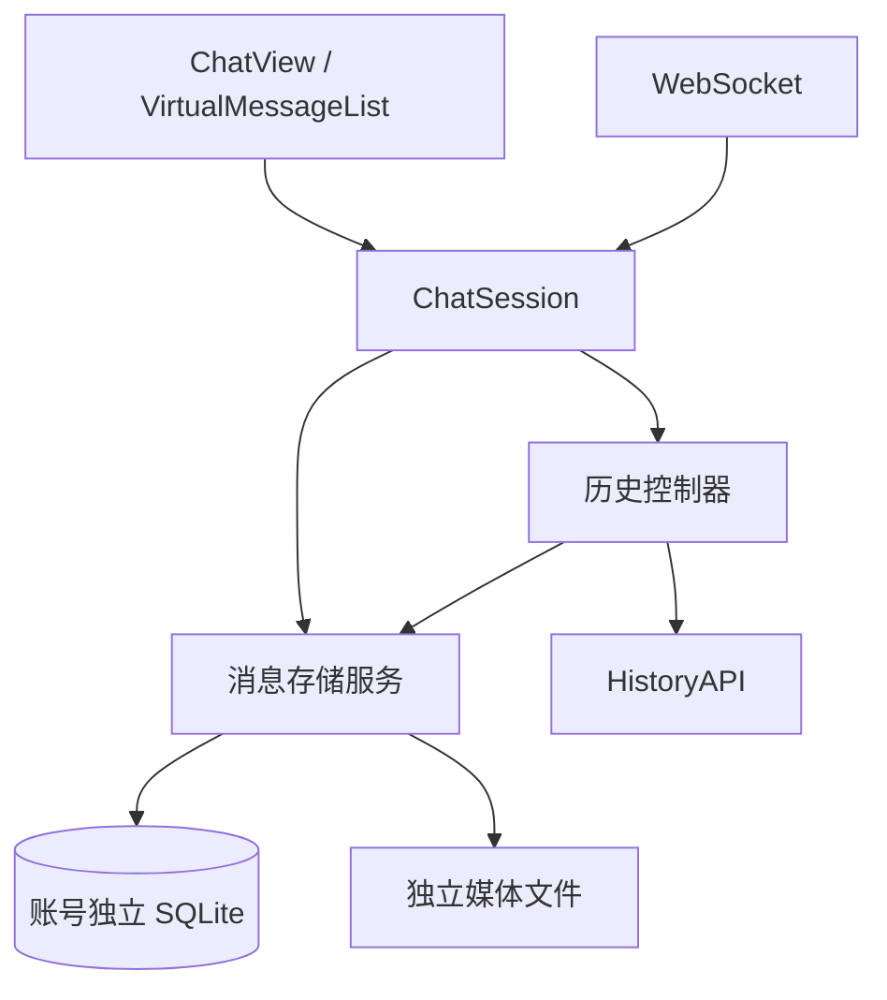

# Godot 消息增量加载与 SQLite 持久化

状态：方案草案，待非作者开发者审核；本文不代表功能已经实现或验收通过。

## 用户故事

1. 作为聊天用户，我希望登录后立即看到本机保存的最近消息，再补齐离开期间的新消息，以便尽快继续聊天。
2. 作为聊天用户，我希望向上翻阅时分批显示更早的消息，已经保存的内容直接从本机读取，以便避免每次打开都下载全部历史。
3. 作为聊天用户，我希望同一秒内连续收发的消息保持已经看到的顺序，以便对话不会因时间精度或随机 UUID 而跳动。
4. 作为聊天用户，我希望退出应用后保留消息和发送结果，下次打开时能辨认未发送、失败和结果不确定的记录，而不是自动重复发送。
5. 作为聊天用户，我希望阅读旧消息时不会被新消息打断，并能点击提示回到最新消息。
6. 作为聊天用户，我希望保存失败时明确知道哪些内容尚未保存，并能重试，以免误以为已经显示的消息一定落盘。

### 已确认的范围

| 项目 | 约定 |
| --- | --- |
| 修改范围 | 只修改 Godot；沿用服务端 HTTP 和 WebSocket 协议 |
| 保存内容 | 已获取的历史、非临时实时消息、本地发送记录和发送状态 |
| 保存期限 | 长期保留，退出登录不删除，不自动清理 |
| 数据载体 | SQLite 保存消息及引用；图片、音频保存在独立文件 |
| 首次加载和分页 | 每批 30 条；打开默认定位最新 |
| 历史下载 | 不主动下载全部旧历史；启动补齐新增范围，向上翻阅时补取更早内容 |
| 离线访问 | 不新增离线登录入口；登录成功后可在断网时浏览已有本地内容 |
| 未完成发送 | 重启后保留状态，不自动重发 |
| 用户消息重复 | 接受本地发送与服务器历史形成两条记录，不按正文和时间猜测合并 |
| 存储故障 | 明确提示，暂以内存继续聊天，不自动删除数据库 |

## 验收标准

| 编号 | 状态与输入 | 可观察输出 |
| --- | --- | --- |
| AC01 | 无本地记录，服务器有 10,000 条历史，登录成功 | 请求最近 30 条并落盘；在内容足够滚动时，不自动继续下载旧历史 |
| AC02 | 本地有 600 条记录，将 HTTP 响应延迟 | 在 HTTP 返回前显示本地最近 30 条，默认定位最新，不整库加载到会话内存 |
| AC03 | 上次已建立历史边界，离开期间新增 95 条，测试服务器在本轮分页期间不再修改数据 | 按 30 条分页补齐至原连续区间；已提交消息重启后仍可查询；UI 不一次加入全部补齐记录 |
| AC04 | 向上滚动至顶部一屏内，本地存在连续的前 30 条 | 从 SQLite 扩展 30 条，不发起历史 HTTP 请求；同一操作不产生连续多页请求 |
| AC05 | 当前区间和更早缓存之间有未获取历史 | 显示缺口/加载状态并获取缺失范围，不把两段记录默认为连续 |
| AC06 | 三条消息的服务端时间均为同一秒，UUID 字典序与收到顺序相反 | 按已确定的时间线顺序显示，重启后不变；不按 UUID 或时间重新排列 |
| AC07 | 用户消息已展示，稍后收到助手消息；历史校准助手时间到同一秒或更早 | 更新原始时间及时间气泡，不移动已确定位置，不生成第二条助手消息 |
| AC08 | 向前插入一页，包含长文本、图片和新的时间条 | 布局稳定后保持相同阅读消息及偏移，正常布局下偏移误差不超过 2 像素 |
| AC09 | 用户离开底部，收到同一 UUID 的多个流式更新及两条新回复 | 新消息计数只增加两次；历史补齐不增加；点击提示后到底部并清零 |
| AC10 | 阅读旧消息时发送文字或图片 | 本地接纳后到底部；发送拒绝时不跳转并保留输入/附件 |
| AC11 | 保存排队、发送中、ACK 和失败记录后重启 | 恢复对应状态；在途显示结果不确定；不会恢复到传输发送队列 |
| AC12 | 本地用户发送内容随后出现在服务器历史中，UUID 不同 | 保留两条；本地条目标注“本机发送记录”；相同文字不作为合并依据 |
| AC13 | 网络超时一次后成功，或者连续失败 | 前者延迟 1 秒自动重试并恢复；后者只自动重试一次，保留内容、边界和手动重试入口 |
| AC14 | 注入 SQLite 写入失败 | 回滚事务，界面提示尚未保存；重试成功后数据与同步进度一起提交，提示清除 |
| AC15 | 提交历史页期间异常终止进程 | 重开数据库后消息与范围记录没有半提交；不会把未提交范围标为完整 |
| AC16 | 请求或数据库任务未结束时切换账号/服务器 | 旧结果不进入新账号 UI 或数据库；重新登录原账号仍保留原记录 |
| AC17 | 相同消息重复导入、同一秒有大量消息 | 服务端 UUID 唯一约束有效；本地分页稳定，无静态数据重复或遗漏 |
| AC18 | 目标导出程序保存消息并退出，再次启动 | SQLite 扩展可加载，读取正确；媒体缺失时不影响正文展示 |

### UI 示意

```text
┌─────────────────────────────────────────┐
│ 正在加载更早消息… / 加载失败 [重试]       │
├─────────────────────────────────────────┤
│ 更早的历史气泡                           │
│                                         │
│ 当前阅读消息 ← 前插后保持屏幕内位置       │
│                                         │
│                    [有 2 条新消息 ↓]    │
├─────────────────────────────────────────┤
│ 部分消息尚未保存到本机 [重试保存]         │
│ 输入框                           [发送] │
└─────────────────────────────────────────┘
```

状态栏和缺口提示不属于业务消息，不分配消息 ID，不计入分页条数和未读数。已有“定位未读”入口改成本次新消息提示；原阅读位置文件保留但不再读写。

## 模块与架构

### 当前基础与问题

当前历史接口支持 `count/end_index`，但历史控制器自动循环至起点；UI 已有虚拟节点和阅读锚点，但会复制全部已加载消息并重算布局。仓库已引入 SQLite 插件，数据库 schema 和封装仍是未接入的草稿。

服务器历史时间仅返回到秒。用户本地 ID、wire ID 和服务器用户历史 UUID 没有可靠映射；ACK 仅确认接收，不能证明历史已经提交。正式助手回复通常可以通过 UUID 与历史合并。

因此：消息身份、显示时间、时间线位置必须分开建模。

### 模块划分

| 模块 | 职责 |
| --- | --- |
| composition/application | 创建数据库服务，注入数据根，管理账号作用域和生命周期 |
| storage | SQLite 连接、迁移、事务、排序位置分配、索引查询和媒体引用 |
| session 历史控制器 | 本地优先、最新范围补齐、历史缺口、网络分页与重试 |
| ChatSession | 实时聚合、发送状态、持久化协调，向 UI 发布变更来源 |
| network | 沿用历史与 WS 协议；历史请求明确传入 30 条 |
| ChatView | 提交加载意图，展示同步、存储和新消息状态 |
| VirtualMessageList | 维护阅读锚点，识别用户上翻，有限节点渲染 |



### 1. 身份、时间与排序

#### 1.1 身份

- `local_id` 是本地主键，采用 UUIDv4，生成后不改变。历史首次写入时同样分配本地 UUIDv4。
- `server_uuid` 可空并有唯一约束。服务端历史和正式助手回复按此字段 upsert，保留原 `local_id`。
- 本地用户消息的 `server_uuid` 为空；wire ID 保存到发送尝试表，不冒充历史 UUID。
- 同一作用域内只有数据库串行队列负责创建、查重和提交消息，避免查询后插入的竞争。

#### 1.2 时间

- `timestamp_json` 保存协议原始时间；显示继续调用现有时间工具。
- 时间只负责展示和时间分组，不作为消息分页、位置或去重依据。
- 历史校准时间时更新该字段；若正文来自当前实时流，保留既有实时正文优先策略。
- 同秒记录不以 UUID 重新排序，也不将显示顺序宣称为真实全局事件顺序。

#### 1.3 timeline_order

`timeline_order` 是账号内唯一的 SQLite 有符号 64 位整数，负责消息排序和 keyset 分页。

- 顺序值初始间隔为 `1,048,576`，允许负值。
- 普通实时新消息在当前尾部追加；当前 UI 与数据库操作共享串行的消息接纳事件顺序。流式更新、ACK、历史时间校准不再分配位置。
- 旧历史页在当前历史头部前插，按服务器数组中的旧到新顺序分配位置，不能按到库时间追加到尾部。
- 补齐页中的已知 UUID 是锚点。先按已知 UUID 将页切成多个连续未知消息块；每块保持数组顺序。首个锚点之前的块插在其前，末个锚点之后的块插在其后，中间块插在相邻锚点之间。例如 `[新A, 已知B, 新C]` 必须形成 `A < B < C`，不能整页放在 B 一侧。现有消息相对顺序保持不变。
- 区间中有本地独有记录时仍保留这些记录的位置。新历史块放在右侧已知锚点之前；只有左侧锚点时放在左侧锚点之后，不覆盖本地记录。
- 没有重叠锚点的启动最新页属于一个未接合的历史段：暂按返回顺序放在历史刷新开始时的本机尾部边界，新的实时消息继续排在其后，并保留缺口标识。只有本地发送记录而没有历史时，也采用此明确的暂定顺序，不把它表述为真实先后。普通向前翻页没有 UUID 重叠但位置连续时，放在本轮历史段头部，并扩展该段；位置不连续则另建未接合段，不直接宣布拼接完成。
- 历史段显式保存成员和起止边界。补齐接合时，仅允许移动未接合段内的历史成员到验证后的锚点之间，可以跨越本地独有记录，但不能移动或逆转本地独有记录及已确认消息的相对顺序。按同一锚点分块规则插入后，事务内更新段状态、范围关联和顺序版本；恢复 UI 阅读锚点。首次无旧历史区间的有效首批可确认为一个独立区间，但不宣称它与本地发送记录具有服务端确认的顺序关系。
- 已知锚点在服务端页中的相对顺序与本地相反时，整页不应用排序或范围更新，不部分保存该页。原子使位置 epoch 失效，保留此前已提交消息并标记顺序冲突；重新从最新页建立分页边界。同一次自动恢复又遇到冲突则停止，显示手动重试入口，不能通过创建新 epoch 无限重试。

位置分配优先使用整数间隔。间隔不足或即将越界时，数据库事务内按现有顺序重编号：先在临时映射表计算新顺序，暂时移除唯一排序索引，应用映射后重建索引并提交；任一步失败整体回滚。重编号不改变相对顺序。该操作在数据库工作线程完成，不能阻塞主线程或在 UI 展示中间结果。

`sync_state.order_revision` 是作用域内持久递增整数，初始为 1。任何修改已有消息 timeline_order 的事务，都在同一事务中增加此值；新消息分配位置不单独增加。重编号使用 `BEGIN IMMEDIATE`，索引撤销、映射应用、重建和版本更新必须一起提交。分页在同一读事务中读取版本、锚点位置及结果；调用方版本过期时先重新解析锚点，结果返回当前版本。UI 丢弃晚到的旧版本结果并重查当前窗口，阅读锚点始终使用 `local_id`，不是顺序值。

#### 1.4 保证边界

保证客户端不再用秒级时间和随机 UUID 打乱已知顺序；不能保证仅凭现有服务端数据还原所有同秒消息的真实发生顺序。历史段首次出现或缺口接合时的位置可能修正；时间校准本身不得引起移动。

### 2. SQLite 结构与索引

数据库位置：`user://history/<scope_hash>/history.db`，scope 沿用规范化服务器地址与用户名的现有账号作用域。

核心表结构：

```sql
CREATE TABLE messages (
    local_id TEXT PRIMARY KEY NOT NULL,
    server_uuid TEXT UNIQUE,
    timeline_order INTEGER NOT NULL,
    origin TEXT NOT NULL,
    source TEXT NOT NULL,
    message_type TEXT NOT NULL,
    content TEXT NOT NULL DEFAULT '',
    timestamp_json TEXT NOT NULL,
    delivery_state TEXT NOT NULL,
    error_code TEXT NOT NULL DEFAULT '',
    stream_complete INTEGER NOT NULL DEFAULT 1,
    created_at_ms INTEGER NOT NULL,
    updated_at_ms INTEGER NOT NULL
);
CREATE UNIQUE INDEX messages_timeline ON messages(timeline_order);
```

`origin` 区分本地发送、历史、实时助手回复；若实时回复后来被历史确认，不丢失正文来源信息。允许多个 `server_uuid IS NULL` 的本地记录。

辅助表：

| 表 | 最小职责与约束 |
| --- | --- |
| send_attempts | 尝试 ID、本地消息 ID、wire ID、状态、错误码；关联 messages；不保存自动重发队列 |
| message_media | 本地消息 ID、媒体类型、相对文件路径、文件可用状态 |
| history_positions | 分页 epoch、ordinal、server_uuid；唯一 `(epoch, ordinal)` 与 `(epoch, server_uuid)` |
| cached_ranges | epoch 内已成功取得的连续位置范围及两端 UUID；重叠范围合并 |
| history_segments / segment_members | 段 ID、接合状态、边界 UUID、成员 server_uuid 及段内顺序；保留已观察的 UUID 邻接关系，不以旧 offset 永久推定连续 |
| sync_state | scope、schema/顺序版本、历史边界、分页进度、缺口与位置有效状态 |

不建立时间排序索引作为聊天分页依据。诊断或未来时间搜索需要时再单独增加时间索引。

配置：外键开启，WAL，`synchronous=FULL`，`busy_timeout=3000`。SQLite 连接只由一个工作线程拥有，不跨线程调用；Godot 节点和 UI 信号回到主线程处理。业务参数使用绑定，不拼 SQL。

历史页的消息、位置、缓存区间和同步进度必须在同一事务提交。写失败不能把范围标记为已缓存。

通过 `user_version` 管理迁移。新库建立正式结构；发现已有草稿库须检查实际表结构并迁移，不能因“尚未发布”而直接删除。迁移前关闭正常写入，完成 WAL checkpoint 后在连接关闭状态备份；无法获得一致性备份则停止迁移。未知较高版本拒绝写入，保留原文件。

### 3. 接口规范

所有数据库操作异步返回 `{ok, code, data}`，调用携带 scope generation。状态变化和数据结果分别发布。

| 接口 | 输入 | 输出/约束 |
| --- | --- | --- |
| open_scope | 数据根、scope | 打开及迁移结果，初始元数据 |
| read_latest | limit=30 | 按 timeline_order 倒序查询，返回前反转为旧到新；游标及 order_revision |
| read_before | anchor_local_id、limit=30 | 在同一读任务中解析锚点位置后查询前一页；锚点不存在返回明确错误 |
| save_history_page | history/start_index、epoch、请求边界 | 校验整页，匹配 UUID，分配顺序，原子保存消息和区间；返回受影响 ID 及位置版本 |
| save_live_message | 本地 ID/服务端 UUID、内容、接纳事件序号 | 新消息追加或原位更新；返回是否首次创建 |
| update_send_attempt | local_id、wire_id、状态 | 原位更新投递状态，不改变顺序 |
| read_sync_state | scope | 历史边界、连续区间、缺口和未完成任务 |
| retry_pending_writes | scope | 串行重试内存待写事务，成功后更新持久化状态 |
| close | scope | 正常待写完成后关闭；失败保留未保存状态交上层处理 |

本地查询：

```sql
-- 首批
SELECT * FROM messages ORDER BY timeline_order DESC LIMIT 30;

-- 更早一批：边界由 anchor_local_id 在当前事务中解析
SELECT * FROM messages
WHERE timeline_order < ?
ORDER BY timeline_order DESC
LIMIT 30;
```

不使用大 OFFSET，也不启动时读取整库。由于 timeline_order 唯一，无须追加 UUID 作为第二排序键。

ChatSession 新增 `load_older_history()`；历史控制器提供启动、加载、重试、跳过首批、暂停补齐和停止接口。消息变更携带 `initial/prepend/live_insert/update/reconcile` 来源，UI 不从数组长度猜测是否收到新消息。

### 4. 加载与同步流程

#### 4.1 启动

1. 登录成功，打开作用域数据库。
2. 查询最近 30 条并显示，首批默认到底部；恢复发送记录但不重建发送队列。
3. 获取服务器最新 30 条，使用原 `/history` 参数和 Bearer 认证。
4. 校验并事务提交后，更新当前 UI 所需记录，不将所有后台补齐内容加入视图内存。
5. 无旧历史边界：首批后停止自动历史下载。有旧边界：向前补齐，直到接上启动前的已验证连续区间或到达起点。

只有历史页建立的区间可作为补齐停止依据；不能遇到任意一条已知实时回复就停止。只保存本地发送/实时消息而没有历史区间的数据库，按无历史边界处理。

若旧边界不存在，补齐可能一直到服务器起点；期间允许暂停，不删除旧本地记录。失败保留已提交内容和缺口。跨启动恢复先请求最新页校验边界，不直接复用旧 offset。

有缓存时，后台联网同步不阻塞发送。无缓存时沿用首批屏障；最终失败可重试或跳过并放行发送，跳过后仍可补载且不重新阻塞。

#### 4.2 上翻

先查本地更早记录，同时检查历史连续区间。连续则显示；遇到缺口先补缺口，不把未知区间静默折叠。断网时允许用户明确选择“继续查看本地记录”，在区间边界保留缺口提示，不宣称历史完整。

每次有效向上操作最多触发一批；内容不足一屏时自动补到可滚动或耗尽。程序定位、窗口缩放、图片高度变化不算上翻。请求运行中不积累多个意图。

历史网络请求只允许一个在途。用户正在阅读的缺口优先于后台补齐；待当前请求结束后切换任务，不共享错误的请求边界。

#### 4.3 服务器页校验

- 请求显式 `count=30`，移除现有 50 条硬编码。
- 整页字段和位置校验通过后再提交；首批空页且 start_index=0 合法。
- UUID 重复只展示一条，并记录范围无法确认的原因；不能通过去重掩盖分页漂移。
- 服务端已知位置/UUID 不一致时使该 epoch 的位置提示失效，重建边界，消息本身保留。
- 协议没有稳定快照，因此客户端验证只能发现部分不一致，不能承诺不漏项。

epoch 切换是独立原子事务：标记旧位置轮次无效、将旧段标记待重新验证、分配新 epoch、设置 active_epoch、清空网络请求游标和同步完成标志。所有位置范围查询必须同时过滤 active_epoch 及有效状态，旧范围不得再参与当前网络连续性判断；保留旧消息和已观察的段内顺序供本地阅读。切换完成后再发送新首批请求。新页通过 UUID 重用消息，更新当前 epoch 的位置；同一页重试按 epoch/位置/UUID 幂等合并，不重复分配消息位置。仅切换 epoch 不修改显示顺序，不增加 order_revision；需要重排时由重排事务递增。

### 5. 实时消息与媒体

用户消息接纳时建立本地记录，后续保存 wire 映射及状态。ACK 表达“服务端已接收”，不表达已入历史。重启后排队未发显示“未发送”，在途显示“发送结果不确定”；用户手动重发才创建新的尝试，并提示可能重复。

助手正式消息按 UUID 聚合，首次展示确定位置，后续正文/媒体更新保持位置。流式正文最多每 500 毫秒合并提交一次，结束、错误或正常退出立即提交。异常退出最多丢失尚未提交的流式尾段，重启以未完整状态展示；历史补齐可修复正文。`is_ephemeral` 消息不写长期库。

图片/音频独立存文件，库内只存相对路径和状态。用户发送附件需落本地文件以支持重启展示和明确重发。未下载媒体不主动全量下载；文件缺失不删除消息，显示不可用/重试。文件先写临时文件，完成后原子替换，再登记引用；孤立文件允许后续维护处理，本次不自动清理。

### 6. UI 与性能

- 前置消息前捕获当前 `local_id + 像素偏移`，布局稳定后恢复。采用应用结果当时的位置，不使用请求发起时的旧锚点。
- 首次定位最新只执行一次；用户主动滚动后，后台同步不抢占位置。
- 离开底部时按首次展示的实时助手 UUID 计新消息，流式更新和历史补齐不计数。
- 返回底部或自己发送被接纳后清空计数；发送失败不强制跳转。
- 延续虚拟气泡节点；增加 prepend/append/update 的批量变更接口，避免每个流式包深复制全部消息并重算全部高度。
- 消息更新只失效对应气泡高度；前插/历史段接合允许一次批量更新偏移，保持现有高度缓存。时间条边界变化只额外失效邻接消息。
- 数据库不整库加载，媒体不在主线程集中解码。本次 UI 已浏览消息可留内存，不增加窗口淘汰；长时间翻遍数万条不属于本次恒定内存承诺。

### 7. 错误与生命周期

网络超时、网络错误、HTTP 408/429/5xx 在 1 秒后自动重试一次；鉴权、格式和边界错误不自动重试。最终失败保留旧内容及重试入口。

存储状态、最新同步状态、更早历史状态分别维护，不能用“全历史加载完”表示可聊天。

数据库失败保留原文件，事务回滚；内存保留待写事件，显示尚未保存和重试入口。恢复后按原顺序重试，原事务已经成功但回调丢失时仍通过 ID 幂等写入，避免重复分配位置。存在未保存数据时退出须明确提示可能丢失，不伪称保存成功。

账号退出先停止网络任务，再完成可完成的当前作用域写队列并关闭连接。回调携带 generation；切换后旧回调不进入新 UI。旧账号待写失败数据不能被转写到新账号。

## 备注

### 关键技术选型

- UUIDv4 单列本地主键；可空服务端 UUID 唯一约束。
- 独立、可前插的整数 timeline_order 和唯一 B-tree 索引；消息分页使用 keyset，不以时间戳/UUID 决定顺序。
- SQLite 单连接工作线程、WAL 和事务；稳定 ID 锚点跨顺序重编号有效。
- 复用现有 HTTP/WS、虚拟列表、图片和语音基础设施，不引入第二套聊天协议。

### 实施顺序

1. 检查现有未提交代码与数据库草稿，完成正式 schema、迁移、排序分配和数据库 API。
2. 接入实时和发送状态持久化，证明重启恢复与幂等写入。
3. 实现本地分页、初始缓存展示、历史页合并和补齐区间。
4. 接入顶部加载、变更来源、锚点及新消息提示，移除旧阅读恢复耦合。
5. 完成存储失败、取消、账号切换和导出兼容验证。
6. 更新现行架构及测试说明；由非作者开发者审核 spec，可与实现 PR 一起完成。

### 测试计划

- 使用真实 SQLite 临时库，验证主键/唯一约束、排序索引、负数前插、锚点间插入、间隔耗尽重编号、游标版本失效和事务回滚。
- 用反向 UUID、完全相同的秒级时间构造消息，证明显示顺序来自 timeline_order；校准时间后位置不变。
- 测试历史页有两侧锚点、单侧锚点、无锚点、已知锚点逆序，以及本地独有消息夹在历史消息之间的情况。
- 对历史网络夹具将固定 50 条改为 30 条，增加启动命中缓存、95 条新增、缺口、旧边界被删和位置漂移场景。
- 重启数据库及客户端验证发送状态、媒体引用、助手流尾包、账号隔离；重启不得发出恢复发送事件。
- 用 `EXPLAIN QUERY PLAN` 验证按 timeline_order 查询走索引，不依赖全表排序。
- 用 10,000 和 100,000 条本地记录测量首批/更早页延迟；记录 P50/P95、UI 帧耗时和最大卡顿帧。性能结果绑定测试机器，不仅凭索引声明“不卡顿”。
- 实际 Godot 测试覆盖两主题、常规与紧凑窗口、图片高度变化、连续上翻、新消息计数及锚点偏移。
- 运行受影响的历史、消息时间、媒体、发送队列、依赖边界和复杂度检查；按项目测试说明使用锁定引擎和隔离用户目录。
- 导出程序必须完成建库、写入、退出、重启读取；编辑器可用不替代导出验证。
- 本文为设计阶段产物；上述测试尚未执行，不构成性能或正确性证据。

### 非目标与已知限制

- 不修改服务端，不提供全局会话序号、不修复服务器位置分页和同时间排序的协议限制。
- 不保证跨设备或不同次历史请求得到完全相同的真实发生顺序，只保留客户端已知顺序并标记检测到的冲突。
- 不通过文字/时间推断用户发送对应的历史 UUID；接受重复气泡。
- 不实现离线登录、消息搜索、自动清理、完整媒体镜像、自动重发和 UI 数据窗口淘汰。
- 本地存储故障时继续聊天意味着未保存的内存数据可能在进程崩溃后丢失；界面必须明确告知。

### 未来目标

如允许升级服务端，应提供持久会话 `message_seq`、用户发送 ID 到历史 UUID 的映射，以及稳定游标/快照边界。届时可将服务器顺序作为权威时间线，减少本地接合和重复记录，但需要另写兼容迁移方案，不能直接重排既有数据库。
