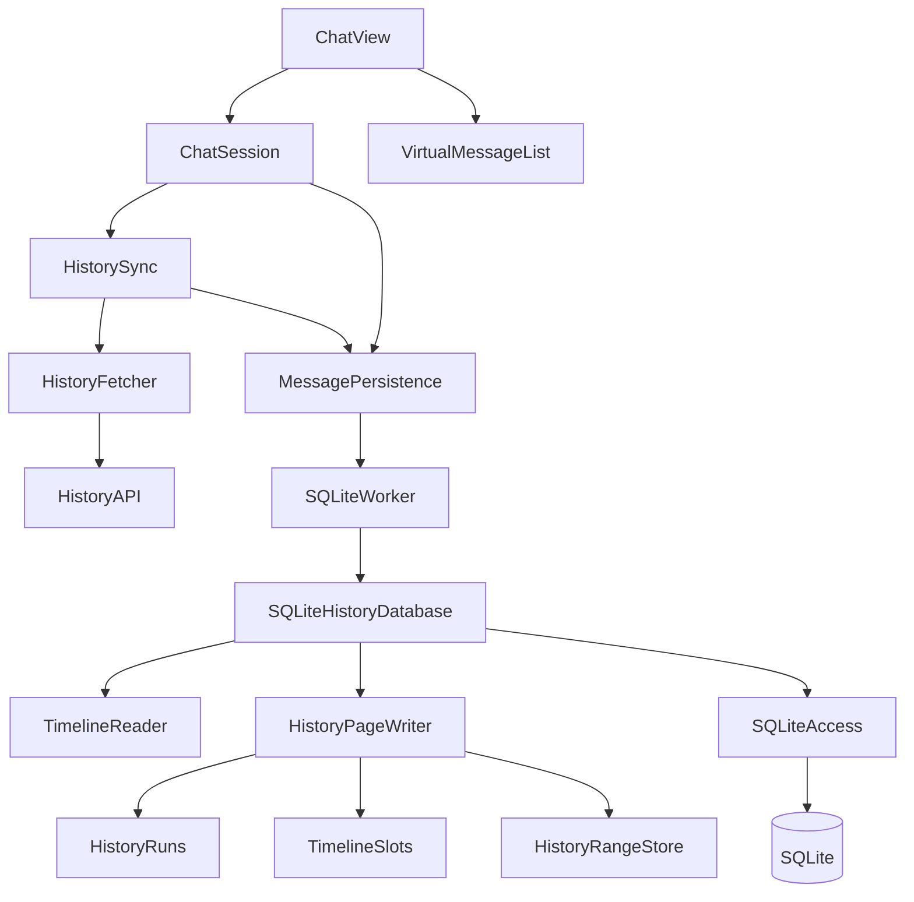

# Godot 消息增量加载与 SQLite：人工实施指南

> 本文是交给开发者逐步执行的实施文档，不是已经完成的代码变更。
>
> 配套需求：[功能 spec](./Godot消息增量加载与SQLite持久化-spec.md)。
>
> 2026-10-27 身份方案修订：本指南采用单一消息 ID，服务器消息直接复用服务器 UUID，仅本地发送记录生成消息 UUID。配套 spec 中旧的双 ID、身份映射描述尚未同步；身份与 schema 以本指南为准，其余产品范围不变。本次仅修改本指南，不修改源码。
>
> 本文中的源文件操作均为后续实施者要做的工作。编写本文不创建这些源文件，也不表示代码已经通过 Godot 编译或运行验收。

## 0. 阅读方式、基线和交付要求

所有源码路径相对 `client-godot/`。每一步依次执行：阅读指定现有函数 → 完成表中改动 → 添加该步测试 → 检查复杂度 → 检查实际行为。不要一次复制全部代码后才排错。

代码块分为三类：

- **完整文件**：可保存为指定的新文件，依赖文件须一并存在。
- **替换/新增函数**：粘到指定类中；删除同名旧函数，不保留两份。
- **集成控制代码/SQL**：须按其依赖表完成被调用接口；不是单独可运行的完整功能。不得以此类片段尚有依赖为由填入 `pass` 或伪成功返回。

现状已经核实：

1. 历史接口支持分页，但 `HistorySync._load()` 会循环取完全部历史。
2. 虚拟列表只有 `set_messages()` 整表入口，没有滚动加载入口。
3. 历史与正式助手回复已有服务器 UUID，可直接作为消息主键和媒体键；本地发送记录使用客户端 UUID，发送回执的 wire ID 单独保留。
4. 已有 SQLite 插件与未接入的 v1 草稿；草稿不是已完成的数据库实现。
5. 现有 `HistoryAPI.fetch_page()` 的圈复杂度为 12，须拆分。
6. 工作区有用户尚未提交的主题、场景、配置和 SQLite 草稿；实施者不得用恢复整个文件/目录的方式清掉它们。

实施范围沿用 spec：只改 Godot、每批 30 条、SQLite 长期保留已取得内容、默认打开最新、接受本地用户消息与服务器历史重复、不自动重发。正文时间只用于展示，`timeline_order` 才是顺序依据。

### 0.1 完成定义

必须同时满足：

- 没有未实现占位函数或返回伪成功的接口。
- 新增/修改函数 CC ≤ 10，包含 lambda 与短路逻辑。
- 真实 SQLite 的关闭重开、事务、迁移和分页测试通过。
- 真实 Godot UI 的上翻、锚点、新消息和媒体测试通过。
- 退出/切账号无丢失未告知、无跨账号污染。
- 导出程序可以加载 SQLite 扩展并持久保存。
- 记录实际通过、失败、跳过和未验证范围；不能以静态解析通过代替运行通过。

## 1. 解耦方案与总改动清单

### 1.1 依赖方向



| 模块 | 独占职责 | 禁止承担的职责 |
| --- | --- | --- |
| UI | 展示、滚动、提示、发出意图 | SQL、HTTP、跨运行消息去重 |
| ChatSession | 会话消息、实时聚合、发送状态 | 排序值分配、历史连续性判断 |
| HistorySync | 加载顺序、缺口、暂停、重试任务 | SQL、媒体播放、任意时间排序 |
| MessagePersistence | 后台任务、作用域、未保存命令 | 控件、网络重试 |
| SQLiteHistoryDatabase | 连接、命令白名单、事务入口 | SceneTree、HTTP |
| HistoryPageWriter/RangeStore | 页写入、位置与连续区间 | UI 未读数、语音 |
| Slots/Runs | 纯算法 | 数据库、文件、Node |
| 媒体模块 | 按统一消息 ID 读写文件/播放；按来源决定能否请求服务器 | 生成另一套消息身份 |

使用构造注入，不新增 Autoload 或通过全局 application 查找服务。

不再新增 `MessageIdentity`、`message_media_key.gd` 或 `resolve_server_id` 接口；不建立服务器 UUID 到本地主键的运行期映射。DTO 字段转换仍保留，但只把数据库 `message_id` 原样交给 UI 的 `id`。

### 1.2 现有函数增删改

| 文件 | 操作 | 函数/字段 | 具体目的 |
| --- | --- | --- | --- |
| network/history_api.gd | 改 | fetch_page | 30 条默认值、拆输入校验/响应解析 |
| session/history_sync.gd | 替换 | _load | 删除自动拉到底；换 _bootstrap/_fetch_one/load_older |
| 同上 | 改 | start/stop/retry/skip/get_state/_init | 注入持久化、独立状态、取消旧任务 |
| 同上 | 移出 | _valid_page_bounds/_page_messages/_deduplicate | 分别归 policy、mapper、数据库身份 |
| session/history_sync_policy.gd | 删 | next_login_count/next_login_stage | 不再按时间停止补齐 |
| storage/history_schema.gd | 改 | CREATE_V1/statements | 正式 v3，保留已知 v1/旧双 ID v2 迁移 |
| storage/sqlite_history_database.gd | 改 | open/close | 完成配置、schema 校验、迁移与释放 |
| 同上 | 增 | execute/configure_handlers/metadata | 白名单分发与元数据 |
| session/chat_session.gd | 改 | _init/start/stop | 注入持久化；不注入身份解析服务 |
| 同上 | 改 | send_text/send_image | 本地发送接纳时生成消息 UUID；服务器消息不生成 |
| 同上 | 改 | _delivery_changed/_release_history_sends | 仅保留 wire→message_id 映射与尝试持久化 |
| 同上 | 改 | _receive_reply/_present_replies | 直接用 payload.uuid，原位流式更新 |
| 同上 | 替换 | _history_page | 按数据库结果变更，禁止移动所有重复 UUID |
| 同上 | 改 | get_message_audio/replay/图片相关函数 | 同一个消息 ID 直接调用媒体；按 id_source 区分本地/远端 |
| 同上 | 删生产调用 | get_reading_state/note_read_interaction/reading_located/report_visible_messages/_update_reading | 退出跨启动阅读恢复 |
| ui/chat_view.gd | 改 | _initialize/_refresh/_visible_audio/_to_latest/_update_history_status | 增量变更、独立提示 |
| 同上 | 删 | _apply_reading/_jump_reading/_report_reading | 不再定位旧阅读文件 |
| 同上 | 增 | _messages_changed/_record_new_messages/_update_new_message_hint | 明确区分历史与实时 |
| ui/virtual_message_list.gd | 保留 | set_messages | 初始化与 reconcile 重建 |
| 同上 | 增 | prepend_messages/append_messages/patch_messages | 结构变更与正文变更分开 |
| 同上 | 改 | _ready/_input/_user_input/_layout/_process | 顶部意图、局部失效、锚点 |
| composition/application_services.gd | 改 | mount | 装配新服务；停止创建 ReadingPosition |
| application/account_lifecycle.gd | 改 | start/stop | 即时业务停止与存储收尾分开 |
| application.gd | 改 | 退出/登出连接、_exit_tree | 正常关闭等待保存，退出树不做异步交互 |

`reading_position.gd` 和旧 JSON 不删除。其现有独立测试可保留，但不得再把该组件接回聊天生产链。

## 2. 第一步：身份、排序与历史分块

### 修改思路

- 全链路只用一个不可变消息标识：SQLite 的 `message_id` 与 UI DTO 的 `id` 值相同。
- 服务器历史直接使用 `row.uuid`；正式实时助手消息直接使用 `payload.uuid`。客户端不另生成 UUID，不重编码、截断或加前缀。
- 尚无服务器历史 UUID 的本地用户发送记录才调用 `MessageUUID.create()`。发送后即使收到 ACK，也不替换这条记录的主键。
- 用 `id_source='server'|'local'` 标记 ID 来源；它不是第二个 ID。与正文来源 `content_origin`、进入方式 `origin` 分开。
- 不再保存第二列服务器 UUID；主键自身就是去重依据。发送尝试的 wire ID 不写进消息主键。
- 时间只用于显示；`timeline_order` 排序，分页和 UI 锚点使用稳定的 `message_id`。
- 数据库按服务器和账号隔离；相同服务器 UUID 在不同账号库中不会互相影响。
- 本地用户消息与后来返回的服务器用户历史仍可能是两条记录，这是已接受的协议限制。

| 消息来源 | message_id 的值 | id_source | 是否调用消息 UUID 生成器 |
| --- | --- | --- | --- |
| 服务器历史 | 原样 row.uuid | server | 否 |
| 正式助手实时消息 | 原样 payload.uuid | server | 否 |
| 本地用户发送 | 客户端生成的 UUIDv4 | local | 是，仅接纳时一次 |

UUIDv4 冲突概率极低，但不能在主键冲突时无条件覆盖另一来源记录：相同 ID 且 id_source 不同，或角色/消息类型冲突，返回 `MESSAGE_ID_CONFLICT`，保留原记录。服务器 ID 不得重写。冲突检测须与写入处于同一事务；整页历史冲突应回滚，不能发布为完整页。

### 2.1 仅为本地发送生成 UUIDv4（完整文件）

目标文件：`src/domain/message_uuid.gd`。操作：新增完整文件；已存在时先比较内容，不覆盖他人的实现。

调用位置仅为本地发送记录的创建入口。导入历史、展示助手回复、校准时间、重试写库时都不能调用它。后台命令/历史段若需要独立操作 ID，可以生成自己的 ID，但不得将该 ID 当作消息主键。

```gdscript
extends RefCounted

static func create() -> String:
	var bytes := Crypto.new().generate_random_bytes(16)
	bytes[6] = (bytes[6] & 0x0f) | 0x40
	bytes[8] = (bytes[8] & 0x3f) | 0x80
	var value := bytes.hex_encode()
	return "%s-%s-%s-%s-%s" % [
		value.substr(0, 8), value.substr(8, 4),
		value.substr(12, 4), value.substr(16, 4),
		value.substr(20, 12)
	]
```

### 2.2 顺序分配（完整文件）

目标文件：`src/domain/timeline_slots.gd`。操作：新增完整文件；已存在时先比较内容，不覆盖他人的实现。

```gdscript
extends RefCounted
const GAP: int = 1048576
const SAFE_BOUND: int = 1152921504606846976

static func allocate(left: Variant, right: Variant, count: int) -> Dictionary:
	if count < 0 or count > 1000000:
		return _error("INVALID_COUNT")
	if count == 0:
		return {"ok": true, "values": []}
	if left == null and right == null:
		return _sequence(0, GAP, count)
	if left == null:
		return _sequence(int(right) - GAP * (count + 1), GAP, count)
	if right == null:
		return _sequence(int(left), GAP, count)
	return _between(int(left), int(right), count)

static func _between(left: int, right: int, count: int) -> Dictionary:
	if left >= right:
		return _error("ORDER_CONFLICT")
	if left < -SAFE_BOUND or right > SAFE_BOUND:
		return _error("RENUMBER_REQUIRED")
	@warning_ignore("integer_division")
	var step: int = (right - left) / (count + 1)
	if step < 1:
		return _error("RENUMBER_REQUIRED")
	return _sequence(left, step, count)

static func _sequence(base: int, step: int, count: int) -> Dictionary:
	var last := base + step * count
	if base < -SAFE_BOUND or last > SAFE_BOUND:
		return _error("RENUMBER_REQUIRED")
	var values: Array[int] = []
	for index in count:
		values.append(base + step * (index + 1))
	return {"ok": true, "values": values}

static func _error(code: String) -> Dictionary:
	return {"ok": false, "code": code, "values": []}
```

### 2.3 历史页未知块切分（完整文件）

目标文件：`src/domain/history_runs.gd`。操作：新增完整文件；已存在时先比较内容，不覆盖他人的实现。

```gdscript
extends RefCounted

static func split(rows: Array, known: Dictionary) -> Dictionary:
	var runs: Array[Dictionary] = []
	var pending: Array = []
	var left := ""
	var previous_order: Variant = null
	for row in rows:
		var uuid: String = row.uuid
		if not known.has(uuid):
			pending.append(row)
			continue
		var order: int = known[uuid].timeline_order
		if previous_order != null and order <= int(previous_order):
			return {"ok": false, "code": "ORDER_CONFLICT", "runs": []}
		_push(runs, pending, left, uuid)
		pending = []
		left = uuid
		previous_order = order
	_push(runs, pending, left, "")
	return {"ok": true, "code": "OK", "runs": runs}

static func _push(runs: Array[Dictionary], rows: Array, left: String, right: String) -> void:
	if rows.is_empty():
		return
	runs.append({"rows": rows.duplicate(true), "left": left, "right": right})
```

### 2.4 接线规则和验收

`HistoryRuns.split()` 的输入必须先完成整页字段校验及重复 UUID 检测。它不是协议校验器。

| 输入 | 预期 |
| --- | --- |
| 新 A、已知 B、新 C | 分成 B 前的 A、B 后的 C |
| 已知 B、新 C、新 D、已知 E | C/D 保持数组顺序插在 B/E 之间 |
| 已知锚点逆序 | 整页拒绝排序及范围提交，返回 ORDER_CONFLICT |
| 无锚点首批 | 创建未接合段，使用刷新开始时捕获的尾部边界 |
| 无锚点连续更早页 | 前插到本轮段头部，不追加到尾部 |

位置不足返回 `RENUMBER_REQUIRED`，外层事务重编号后重新查邻居、重新分配一次。不得用浮点中点逐步逼近来替代整数方案。

验收：同一秒、反向 UUID、前插、尾插、夹入本地记录、间隔耗尽；校准 timestamp 后 timeline_order 不变。

## 3. 第二步：SQLite 表、事务、迁移与查询

### 3.1 建表与约束

操作：修改 `history_schema.gd`，本次单 ID 结构使用版本 3，以区别旧指南的双 ID v2。以下 SQL 是新库安装内容，**不得直接对已有 v1/v2 库执行覆盖**。版本号是待实施的结构约定，不代表当前客户端已经启用这些数据库。

```sql
CREATE TABLE messages (
 message_id TEXT PRIMARY KEY NOT NULL CHECK(length(message_id)>0),
 id_source TEXT NOT NULL CHECK(id_source IN ('server','local')),
 timeline_order INTEGER NOT NULL,
 origin TEXT NOT NULL,
 source TEXT NOT NULL,
 message_type TEXT NOT NULL,
 content TEXT NOT NULL DEFAULT '',
 timestamp_json TEXT NOT NULL,
 delivery_state TEXT NOT NULL,
 error_code TEXT NOT NULL DEFAULT '',
 stream_complete INTEGER NOT NULL DEFAULT 1 CHECK(stream_complete IN (0,1)),
 content_origin TEXT NOT NULL DEFAULT 'history',
 created_at_ms INTEGER NOT NULL,
 updated_at_ms INTEGER NOT NULL
);
CREATE UNIQUE INDEX messages_timeline ON messages(timeline_order);
CREATE TABLE send_attempts (
 attempt_id TEXT PRIMARY KEY NOT NULL,
 message_id TEXT NOT NULL REFERENCES messages(message_id),
 wire_id TEXT UNIQUE,
 state TEXT NOT NULL,
 ever_sent INTEGER NOT NULL DEFAULT 0 CHECK(ever_sent IN (0,1)),
 error_code TEXT NOT NULL DEFAULT ''
);
CREATE INDEX send_attempts_message ON send_attempts(message_id);
CREATE TABLE message_media (
 message_id TEXT NOT NULL REFERENCES messages(message_id),
 kind TEXT NOT NULL,
 relative_path TEXT NOT NULL DEFAULT '',
 state TEXT NOT NULL,
 PRIMARY KEY(message_id,kind)
);
CREATE TABLE sync_epochs (
 epoch INTEGER PRIMARY KEY,
 valid INTEGER NOT NULL CHECK(valid IN (0,1))
);
CREATE TABLE history_positions (
 epoch INTEGER NOT NULL REFERENCES sync_epochs(epoch),
 ordinal INTEGER NOT NULL CHECK(ordinal >= 0),
 message_id TEXT NOT NULL REFERENCES messages(message_id),
 PRIMARY KEY(epoch,ordinal),
 UNIQUE(epoch,message_id)
);
CREATE TABLE cached_ranges (
 epoch INTEGER NOT NULL REFERENCES sync_epochs(epoch),
 start_index INTEGER NOT NULL,
 end_index INTEGER NOT NULL,
 first_message_id TEXT NOT NULL REFERENCES messages(message_id),
 last_message_id TEXT NOT NULL REFERENCES messages(message_id),
 PRIMARY KEY(epoch,start_index),
 CHECK(end_index > start_index)
);
CREATE TABLE history_segments (
 segment_id TEXT PRIMARY KEY NOT NULL,
 epoch INTEGER NOT NULL REFERENCES sync_epochs(epoch),
 state TEXT NOT NULL,
 first_message_id TEXT REFERENCES messages(message_id),
 last_message_id TEXT REFERENCES messages(message_id)
);
CREATE TABLE segment_members (
 segment_id TEXT NOT NULL REFERENCES history_segments(segment_id),
 message_id TEXT NOT NULL REFERENCES messages(message_id),
 member_order INTEGER NOT NULL,
 PRIMARY KEY(segment_id,message_id),
 UNIQUE(segment_id,member_order)
);
CREATE TABLE sync_state (
 singleton INTEGER PRIMARY KEY CHECK(singleton=1),
 scope_key TEXT NOT NULL,
 active_epoch INTEGER REFERENCES sync_epochs(epoch),
 order_revision INTEGER NOT NULL DEFAULT 1,
 baseline_message_id TEXT REFERENCES messages(message_id),
 next_end INTEGER NOT NULL DEFAULT -1,
 head_message_id TEXT REFERENCES messages(message_id),
 caught_up INTEGER NOT NULL DEFAULT 0 CHECK(caught_up IN (0,1))
);
PRAGMA user_version=3;
```

初始化时额外参数绑定执行：

```sql
INSERT INTO sync_state(singleton, scope_key) VALUES(1, ?);
```

`message_id` 是唯一消息主键，服务器 UUID 不再另存一列。`send_attempts`、`message_media`、`history_positions`、`segment_members`、历史段/范围的边界及 `sync_state` 的消息指针都通过外键引用它。`first_message_id/last_message_id/baseline_message_id` 保留历史边界语义，值直接等于相应服务器消息的 `message_id`，不是额外身份映射；范围写入前须确认目标记录的 `id_source='server'`。`message_media` 不再保存与消息 ID 相同的 `media_key`。

`id_source` 创建后不可变；`origin` 可表示 local/history/live，不能拿它推断能否向服务器下载媒体。

`content_origin` 用于决定正文更新策略。历史时间可以校准；当前实时流正文优先。重启恢复的未完整流应允许完整历史修复，不能永久以旧的残缺 live 正文覆盖历史。


### 3.2 SQL 访问层（完整文件）

目标文件：`src/storage/sqlite_access.gd`。操作：新增完整文件；已存在时先比较内容，不覆盖他人的实现。

```gdscript
extends RefCounted
var _db: Object

func _init(database: Object) -> void:
	_db = database

func query(sql: String, bindings: Array = []) -> Dictionary:
	if not _db.query_with_bindings(sql, bindings):
		return failure("CACHE_SQL_FAILED")
	return {"ok": true, "code": "OK", "rows": _db.query_result.duplicate(true)}

func execute(sql: String, bindings: Array = []) -> Dictionary:
	var result := query(sql, bindings)
	return {"ok": result.ok, "code": result.code, "data": {}}

func transaction(action: Callable) -> Dictionary:
	var begun := execute("BEGIN IMMEDIATE")
	if not begun.ok:
		return begun
	var result: Dictionary = action.call()
	if not result.ok:
		return _rollback(result)
	var committed := execute("COMMIT")
	if not committed.ok:
		return _rollback(committed)
	return result

func _rollback(result: Dictionary) -> Dictionary:
	var rollback := execute("ROLLBACK")
	if not rollback.ok:
		return failure("CACHE_CONNECTION_INVALID")
	return result

static func failure(code: String) -> Dictionary:
	return {"ok": false, "code": code, "data": {}, "rows": []}
```

### 3.3 本地游标分页（完整文件）

目标文件：`src/storage/timeline_reader.gd`。操作：新增完整文件；已存在时先比较内容，不覆盖他人的实现。

```gdscript
extends RefCounted
var _sql

func _init(sql) -> void:
	_sql = sql

func latest(limit: int = 30) -> Dictionary:
	if limit < 1 or limit > 100:
		return _sql.failure("INVALID_INPUT")
	return _sql.transaction(_read_latest.bind(limit))

func before(anchor_id: String, limit: int = 30) -> Dictionary:
	if limit < 1 or limit > 100:
		return _sql.failure("INVALID_INPUT")
	return _sql.transaction(_read_before.bind(anchor_id, limit))

func _read_latest(limit: int) -> Dictionary:
	var result: Dictionary = _sql.query(
		"SELECT * FROM messages ORDER BY timeline_order DESC LIMIT ?", [limit])
	return _finish(result)

func _read_before(anchor_id: String, limit: int) -> Dictionary:
	var anchor: Dictionary = _sql.query(
		"SELECT timeline_order FROM messages WHERE message_id = ?", [anchor_id])
	if not anchor.ok:
		return anchor
	if anchor.rows.is_empty():
		return _sql.failure("ANCHOR_NOT_FOUND")
	var result: Dictionary = _sql.query(
		"SELECT * FROM messages WHERE timeline_order < ? ORDER BY timeline_order DESC LIMIT ?",
		[anchor.rows[0].timeline_order, limit])
	return _finish(result)

func _finish(result: Dictionary) -> Dictionary:
	if not result.ok:
		return result
	var state: Dictionary = _sql.query(
		"SELECT order_revision FROM sync_state WHERE singleton = 1")
	if not state.ok:
		return state
	if state.rows.is_empty():
		return _sql.failure("CACHE_METADATA_INVALID")
	var rows: Array = result.rows
	rows.reverse()
	return {"ok": true, "code": "OK", "data": {
		"rows": rows, "order_revision": state.rows[0].order_revision}}
```

### 3.4 原库封装需要补齐的函数

`sqlite_history_database.gd` 当前只有 open/close 外壳。实施者必须补齐下表，不能把草稿中的未定义调用保留下来。

| 函数 | 精确操作 | 返回/错误 |
| --- | --- | --- |
| _validate_scope | 检查 64 位十六进制作用域 | INVALID_INPUT |
| _open_connection | 在工作线程创建 SQLite，设置 path、关闭详细输出、open_db | CACHE_OPEN_FAILED |
| _configure | 外键、WAL、FULL、busy_timeout=3000；核对执行结果 | CACHE_SQL_FAILED |
| _ensure_schema | 读 user_version、区分 0/已知 v1/已知双 ID v2/v3/未知 | CACHE_VERSION_UNSUPPORTED |
| _validate_schema | 检查必须表/列、唯一索引、scope；检查窗口函数可用 | CACHE_METADATA_INVALID |
| _backup_legacy | 暂停写入，checkpoint 检查 busy，关闭连接，复制一致主文件 | CACHE_BACKUP_FAILED |
| _migrate_v1 | 保留旧服务器 uuid 作为 message_id，转换顺序；最后写 v3 | 失败回滚 |
| _migrate_v2 | 仅迁移旧双 ID 结构，原子重写主键及外键；不建立运行期映射 | 失败回滚 |
| _recover_delivery_states | 根据 ever_sent 恢复未发送/不确定，不恢复网络队列 | 事务结果 |
| metadata | 返回 active_epoch/order_revision/边界等 | 空元数据是错误 |
| close | 关闭连接，清空引用；不删文件 | 资源释放 |

连接配置按独立语句执行：

```sql
PRAGMA foreign_keys=ON;
PRAGMA journal_mode=WAL;
PRAGMA synchronous=FULL;
PRAGMA busy_timeout=3000;
```

旧库迁移顺序：

1. 停止写入，checkpoint 后检查 busy，关闭连接并做一致备份。失败即停止，不动原库。
2. 读取 user_version 和实际字段，只有已知结构才迁移；不能仅凭版本号猜测字段。
3. v1：旧 `messages.uuid` 原样写入新 `message_id`，设置 `id_source='server'`，不生成消息 UUID。优先保留有效 ordinal 确定的顺序，缺少位置的记录采用稳定迁移顺序并标记待验证。
4. 若实际存在按旧指南建成的双 ID v2 库，才执行该迁移；不能为了迁移而先创建旧库。仅在迁移事务内建立临时对应表。旧 `server_uuid` 非空时，新 `message_id=server_uuid`、`id_source='server'`；否则新 `message_id=local_id`、`id_source='local'`。保留原排序值和正文。
5. v2 在改主键前检查目标 ID 是否冲突；有冲突则中止并保留备份，不自动合并、不覆盖。以建新表并复制的方式迁移，避免逐行更新主键时触发暂时唯一冲突。
6. 同一事务内将 `send_attempts.local_id`、`message_media.local_id`、`sync_state.head_local_id` 改写到新消息 ID；历史位置和成员表的旧 `server_uuid` 直接作为新 `message_id`。旧 `first_uuid/last_uuid/baseline_uuid` 边界原值分别复制到 `first_message_id/last_message_id/baseline_message_id`；这些值本来就是服务器 UUID。发送尝试的 wire_id、attempt_id 原样保留。
7. 媒体文件不需要重命名：旧服务端缓存本来按服务器 UUID 命名；本地附件沿用旧 local_id。若旧库媒体键不符合这一约定，保留实际相对路径用于读取，不创建运行期 UUID 别名映射。
8. 验证消息数、主键唯一性、排序及外键；`PRAGMA foreign_key_check` 无错误后，才在事务末尾设置 `user_version=3`。临时迁移对应表随后删除，不进入生产查询链。
9. 旧 offset 不直接视为本次有效网络边界。未知结构、未知更高版本拒绝写入，不删除、不降级。

上文旧字段名只用于识别/迁移旧指南产生的数据库；新业务代码只使用单一 `message_id`。

### 3.5 重编号代码

在 `HistoryPageWriter._renumber()` 内逐条执行以下 SQL；它已处于外层事务，不再次 BEGIN。所有语句必须检查结果。

```sql
CREATE TEMP TABLE IF NOT EXISTS order_rebuild(
    message_id TEXT PRIMARY KEY,
    new_order INTEGER NOT NULL
);
DELETE FROM order_rebuild;
INSERT INTO order_rebuild(message_id,new_order)
SELECT message_id,ROW_NUMBER() OVER(ORDER BY timeline_order)*1048576
FROM messages;
DROP INDEX messages_timeline;
UPDATE messages SET timeline_order=(
    SELECT new_order FROM order_rebuild
    WHERE order_rebuild.message_id=messages.message_id
);
CREATE UNIQUE INDEX messages_timeline ON messages(timeline_order);
UPDATE sync_state SET order_revision=order_revision+1 WHERE singleton=1;
DROP TABLE order_rebuild;
```

只改变位置数值、不改变相对顺序。事务失败需恢复索引及原顺序，禁止用合法的负数当“临时无冲突命名空间”。

### 3.6 命令白名单

在 repository 中新增以下操作，不直接执行外部传入的方法名：

```gdscript
var _handlers: Dictionary = {}

func configure_handlers() -> void:
	_handlers = {
		"open_scope": _open_command,
		"read_latest": _read_latest_command,
		"read_before": _read_before_command,
		"save_live": _save_live_command,
		"save_history": _save_history_command,
		"update_attempt": _update_attempt_command,
		"read_sync_state": _read_sync_command,
		"flush": _flush_command,
		"close_scope": _close_command
	}

func execute(operation: String, payload: Dictionary) -> Dictionary:
	if not _handlers.has(operation):
		return failure("UNKNOWN_STORAGE_OPERATION")
	var handler: Callable = _handlers[operation]
	return handler.call(payload)
```

每个 command 只验证参数和作用域、委托下层模块。除 open 外都必须核对 scope；不匹配返回 STALE_SCOPE。不再提供 resolve_server_id 命令：服务器 UUID 已经是主键，直接按 message_id 查询和 upsert。写入前比较 id_source、角色及类型，来源冲突必须拒绝，不能无条件 ON CONFLICT 覆盖。

### 3.7 本步验收

- 新库、v1→v3、旧双 ID v2→v3、已知 v3、未知结构/版本分别测试。
- 同一服务器 UUID 的实时/历史记录只有一行，message_id 必须与输入 UUID 完全相同。
- 多条本地发送记录各有独立 message_id；不同来源出现同 ID 时拒绝覆盖原记录。
- 真实库关闭重开后身份/顺序不变。
- 重编号任一 SQL 注入失败后完整回滚。
- EXPLAIN QUERY PLAN 显示 messages_timeline 索引，不能大 OFFSET 或整库读入内存。
- 对完整性失败不自动删除用户数据库。

## 4. 第三步：后台队列与未保存状态

### 修改思路

数据库连接只存在于工作线程。主线程提交纯数据，拿到 Ticket；后台不能操作 Node 树或纹理。线程只提供运输机制，业务重试放在 MessagePersistence。


### 4.1 工作线程（完整文件）

目标文件：`src/storage/sqlite_worker.gd`。操作：新增完整文件；已存在时先比较内容，不覆盖他人的实现。

```gdscript
extends Node

class Ticket extends RefCounted:
	signal resolved
	var ready := false
	var result: Dictionary = {}

	func wait() -> Dictionary:
		if not ready:
			await resolved
		return result

	func finish(value: Dictionary) -> void:
		result = value
		ready = true
		resolved.emit()

signal stopped
var _thread := Thread.new()
var _mutex := Mutex.new()
var _wake := Semaphore.new()
var _jobs: Array[Dictionary] = []
var _results: Array[Dictionary] = []
var _tickets: Dictionary = {}
var _next_id := 0
var _closing := false
var _started := false
var _factory: Callable

func _init(factory: Callable) -> void:
	_factory = factory

func start() -> Error:
	if _started:
		return ERR_ALREADY_IN_USE
	var error := _thread.start(_run)
	_started = error == OK
	return error

func submit(operation: String, payload: Dictionary) -> Ticket:
	var ticket := Ticket.new()
	if not _started or _closing:
		ticket.finish({"ok": false, "code": "STORAGE_UNAVAILABLE", "data": {}})
		return ticket
	_next_id += 1
	_tickets[_next_id] = ticket
	_enqueue({"id": _next_id, "operation": operation, "payload": payload.duplicate(true)})
	return ticket

func begin_shutdown() -> void:
	if not _started or _closing:
		return
	_closing = true
	_enqueue({"id": 0, "operation": "__stop", "payload": {}})

func _enqueue(job: Dictionary) -> void:
	_mutex.lock()
	_jobs.append(job)
	_mutex.unlock()
	_wake.post()

func _pop_job() -> Dictionary:
	_mutex.lock()
	var job: Dictionary = _jobs.pop_front()
	_mutex.unlock()
	return job

func _run() -> void:
	var repository = _factory.call()
	while true:
		_wake.wait()
		var job := _pop_job()
		if job.operation == "__stop":
			repository.close()
			return
		var result: Dictionary = repository.execute(job.operation, job.payload)
		_mutex.lock()
		_results.append({"id": job.id, "result": result})
		_mutex.unlock()

func _process(_delta: float) -> void:
	_drain_results()
	if not _started:
		return
	if _thread.is_alive():
		return
	_thread.wait_to_finish()
	_started = false
	stopped.emit()

func _drain_results() -> void:
	_mutex.lock()
	var results: Array = _results.duplicate()
	_results.clear()
	_mutex.unlock()
	for item in results:
		var ticket: Ticket = _tickets[item.id]
		_tickets.erase(item.id)
		ticket.finish(item.result)

func _exit_tree() -> void:
	begin_shutdown()
	if _thread.is_started():
		_thread.wait_to_finish()
	_started = false
	_drain_results()
```

### 4.2 MessagePersistence 必须实现的接口

新增 `src/session/message_persistence.gd`：

| 方法 | 行为 |
| --- | --- |
| open_scope(session) | 固定 scope/generation；通过队列打开库；失败进入内存降级 |
| read_latest(limit) | 查询并把记录转成消息 DTO，返回 order_revision |
| read_before(anchor_id,limit) | 查询本地页，联合区间信息返回 gap |
| save_live(message) | 稳定命令 ID；先排队，再异步保存 |
| save_history(page,context) | 页消息与区间原子保存；失败不推进持久进度 |
| record_attempt(message_id,wire_id) | 创建稳定发送尝试 |
| update_attempt(...) | 更新状态和 ever_sent |
| retry_pending_writes | 按原顺序重试，不改变 scope |
| flush | 等待已接纳写入完成；有失败返回失败，不返回伪成功 |
| close_scope | 先排队收尾，再关闭；不销毁应用级 worker |

每个异步操作都捕获进入时的 scope/generation；结果返回后核对，不能读取“当前账号”替代原账号。

待写队列结构：

```gdscript
{
	"command_id": stable_uuid,
	"scope_key": scope_key,
	"generation": generation,
	"operation": "save_live",
	"payload": message_copy
}
```

队列规则：

1. 创建消息、发送尝试必须有稳定 ID；回调丢失后再次提交仍幂等。
2. 更新可以合并为最新正文，但不能越过它的创建命令。
3. SQL 失败保留命令；不能先 pop 再忽略失败。
4. 当前 scope 失败不能将命令改成新 scope 重试。
5. CACHE_CONNECTION_INVALID 后禁止继续用原连接，恢复时重新打开并核验。
6. worker 的 `flush` 空操作仅能表示此前已提交工作已执行；facade 还必须检查自身待写失败队列。

### 4.3 关闭语义

正常退出要在 SceneTree 仍运行时等待 flush。_exit_tree 只负责最终同步回收，不在里面 await 用户选择。

测试：后台写入时 UI 仍能响应；失败队列重试不重复插入；旧账号请求结果不能更新新账号；关闭不遗留运行线程。

## 5. 第四步：网络与历史同步


### 5.1 替换同步策略（整个文件替换）

目标文件：`src/session/history_sync_policy.gd`。操作：新增完整文件；已存在时先比较内容，不覆盖他人的实现。

```gdscript
extends RefCounted
const PAGE_SIZE: int = 30

static func valid_bounds(start: int, size: int, requested_end: int, count: int = PAGE_SIZE) -> bool:
	if start < 0 or size < 0 or size > count:
		return false
	if requested_end == -1:
		return _valid_latest(start, size, count)
	return _valid_older(start, size, requested_end, count)

static func _valid_latest(start: int, size: int, count: int) -> bool:
	if start == 0:
		return true
	return size == count

static func _valid_older(start: int, size: int, end: int, count: int) -> bool:
	if end <= 0 or size == 0:
		return false
	return start == maxi(0, end - count) and start + size == end

static func retryable(response: Dictionary) -> bool:
	if response.get("code", "") in ["NETWORK_ERROR", "TIMEOUT"]:
		return true
	var status := int(response.get("status", 0))
	if status in [408, 429]:
		return true
	return status >= 500 and status <= 599

static func continue_catchup(state: Dictionary) -> bool:
	if state.get("paused", false):
		return false
	if state.get("connected_to_baseline", false):
		return false
	if not state.get("had_baseline", false):
		return false
	return int(state.get("next_end", 0)) > 0
```

### 5.2 网络重试（完整文件）

目标文件：`src/session/history_fetcher.gd`。操作：新增完整文件；已存在时先比较内容，不覆盖他人的实现。

```gdscript
extends Node
const Policy = preload("res://src/session/history_sync_policy.gd")
var _api: Node
var _generation := 0

func _init(api: Node) -> void:
	_api = api
	add_child(api)

func cancel() -> void:
	_generation += 1
	_api.cancel()

func fetch(session: Dictionary, end_index: int) -> Dictionary:
	var generation := _generation
	var response: Dictionary = await _api.fetch_page(session, end_index, Policy.PAGE_SIZE)
	if generation != _generation:
		return _cancelled()
	if response.ok or not Policy.retryable(response):
		return response
	await get_tree().create_timer(1.0).timeout
	if generation != _generation:
		return _cancelled()
	response = await _api.fetch_page(session, end_index, Policy.PAGE_SIZE)
	if generation != _generation:
		return _cancelled()
	return response

func _cancelled() -> Dictionary:
	return {"ok": false, "code": "CANCELLED", "status": 0, "data": {}}
```

### 5.3 HistoryAPI 修改步骤

默认 count 改为 30；保留 1..100 校验、Bearer 认证、取消、超时及 body 大小上限。

新增：

```gdscript
func _valid_count(count: int) -> bool:
	return count >= 1 and count <= 100

func _valid_credentials(session: Dictionary) -> bool:
	if not session.get("username") is String:
		return false
	if not session.get("message_token") is String:
		return false
	if session.username.is_empty():
		return false
	return not session.message_token.is_empty()

func _valid_request(session: Dictionary, end_index: int, count: int) -> bool:
	if not _valid_count(count):
		return false
	if end_index < -1:
		return false
	if not _valid_credentials(session):
		return false
	var server := ServerAddress.normalize(str(session.get("server", "")))
	return not server.is_empty()
```

在 fetch_page 顶部替换原复合校验：

```gdscript
	if not _valid_request(session, end_index, count):
		return _failure("INVALID_INPUT")
	if _http != null:
		return _failure("BUSY")
```

响应处理从匿名函数拆出 `_on_request_completed`、`_transport_failure`、`_http_failure`、`_parse_history_response`。取消旧请求后旧回调必须识别 HTTPRequest 身份，不能完成新请求。

### 5.4 HistorySync 修改步骤

不再使用一条 while 自动耗尽历史。改为：

| 函数 | 详细步骤 |
| --- | --- |
| start | stop 旧网络任务；复制账号；清边界放行标志；启动 _bootstrap |
| _bootstrap | open_scope → read_latest(30) → 展示缓存 → 获取服务器首批 |
| _load_local_latest | 仅加载 30 条，不读整库；非空可放行发送 |
| _fetch_one | 获取一页 → 校验 → 原子存储 → 根据结果发布 UI 变更 |
| _continue_catchup | 只在旧连续边界存在、尚未接合、未暂停时继续 |
| load_older | 先本地页；连续则展示；有缺口则请求网络补齐 |
| retry | 重试具体失败任务，不重置为最新页 |
| skip | 只跳过首批等待，放行一次；允许稍后重新取首批 |
| stop | generation++，取消网络，不删除数据库和工作线程 |
| pause_catchup | 暂停后台补齐，不停止用户聊天或本地翻页 |

状态分开保存：

```gdscript
var _state := {
	"storage": "opening",
	"initial": "loading",
	"catchup": "idle",
	"older": "idle",
	"has_older": true,
	"has_gap": false,
	"unsaved_count": 0,
	"code": ""
}
var _boundary_released := false

func _release_boundary_once() -> void:
	if _boundary_released:
		return
	_boundary_released = true
	boundary_ready.emit()
```

首次没有历史边界只取 30 条；已有边界时从最新向前补到旧区间。不能遇到任意已知实时 UUID 就停止。后台补齐写库，但不把所有补齐消息铺进 UI。

### 5.5 HistoryPageWriter 分工

新增 `history_page_writer.gd`，构造注入 SQL、排序分配及范围存储，不注入身份映射服务。

| 函数 | 实现细节 |
| --- | --- |
| _load_known | 按 row.uuid 直接查询 messages.message_id 和位置；校验同 ID 的来源 |
| _validate_positions | 当前 epoch 内同 ordinal 不得对应另一 UUID；同 UUID 不得占多个 ordinal |
| _plan_runs | 调用 HistoryRuns；逆序锚点返回冲突 |
| _resolve_neighbors | 查实际相邻占用值；不能越过本地独有记录 |
| _allocate_run | Slots 分配；不足则事务重编号后重查 |
| _insert_run | 直接写 message_id=row.uuid、id_source=server；保持 run 内顺序，不生成消息 UUID |
| _update_known | 更新历史时间；正文按来源与完整性规则；不改已知位置 |
| _save_members | 保存段成员及页内顺序，重复提交幂等 |
| _save_ranges | 合并有重叠/相邻的位置区间，不越过缺口 |
| _finish_page | 返回变更 ID、段状态、order_revision、next_end |

集成控制代码：

```gdscript
func save_page(page: Dictionary, context: Dictionary) -> Dictionary:
	return _sql.transaction(_save_in_transaction.bind(page, context))

func _save_in_transaction(page: Dictionary, context: Dictionary) -> Dictionary:
	var positions := _validate_positions(page, context)
	if not positions.ok:
		return positions
	var known := _load_known(page.history)
	if not known.ok:
		return known
	var plan := _plan_runs(page.history, known.data)
	if not plan.ok:
		return plan
	var inserted := _apply_runs(plan.runs, context)
	if not inserted.ok:
		return inserted
	var updated := _update_known(page.history, known.data)
	if not updated.ok:
		return updated
	return _save_page_metadata(page, context)
```

这个代码块是编排入口，表中的方法必须实现后才能运行；不能只复制此入口后称历史存储完成。

段接合规则：只移动未接合的历史段成员，允许跨过本地独有记录但不改变那些记录相互间的顺序。已确认消息之间顺序不能逆转。接合与 order_revision 增加在同一事务中完成，返回 UI 恢复锚点。

### 5.6 epoch 失效

发生位置或顺序冲突，先回滚该页，再单独进行失效事务：

```sql
UPDATE sync_epochs SET valid=0
WHERE epoch=(SELECT active_epoch FROM sync_state WHERE singleton=1);

UPDATE history_segments SET state='needs_validation'
WHERE epoch=(SELECT active_epoch FROM sync_state WHERE singleton=1);

INSERT INTO sync_epochs(epoch,valid)
SELECT COALESCE(MAX(epoch),0)+1,1 FROM sync_epochs;

UPDATE sync_state
SET active_epoch=(SELECT MAX(epoch) FROM sync_epochs),
    next_end=-1,caught_up=0
WHERE singleton=1;
```

所有位置判断过滤 active_epoch 与 valid。旧内容不删；旧 offset 不继续使用。旧段中已观察到的相邻关系可供本地阅读，但不能冒充本轮服务器快照。仅 epoch 切换不改顺序、不加 order_revision。

自动重建边界最多尝试一次；再次冲突停止自动补齐，要求手动重试，避免无限循环。

## 6. 第五步：会话身份、发送和媒体

### 6.1 统一消息 DTO：服务器 UUID 直接使用

ChatSession 不再新增 local/server 映射。`_by_id`、`_replies`、媒体回调、UI 锚点及 SQLite 都使用同一个消息 ID。服务器消息采用原样 `row.uuid/payload.uuid`；数据库 DTO 转换只改变字段名称，不解析或替换身份。

数据库记录转换：

```gdscript
func _row_to_message(row: Dictionary) -> Dictionary:
	var role: String = row.source
	if role == "agent":
		role = "assistant"
	return {
		"id": row.message_id,
		"id_source": row.id_source,
		"role": role,
		"type": row.message_type,
		"text": row.content,
		"timestamp": JSON.parse_string(row.timestamp_json),
		"status": row.delivery_state,
		"code": row.error_code,
		"timeline_order": row.timeline_order
	}
```

历史页通过字段校验后的转换代码（不调用 UUID 生成器）：

```gdscript
func _history_row_to_message(row: Dictionary) -> Dictionary:
	var role: String = row.source
	if role == "agent":
		role = "assistant"
	return {
		"id": row.uuid,
		"id_source": "server",
		"role": role,
		"type": row.type,
		"text": "" if row.type == "image" else row.content,
		"timestamp": row.timestamp,
		"status": "received",
		"code": "",
		"origin": "history"
	}
```

实时回复验证 `payload.uuid` 后立即使用它作为 id，无须 await 身份查询。历史与实时先后到达均按相同主键合并。数据库失败时仍沿用该 ID 保留待写任务，恢复后原 ID 重试，无候选 ID、身份 remap 或第二条正式回复。

如果同 ID 已有本地发送记录，不能把它当成已知服务器锚点，也不能合并正文；返回 MESSAGE_ID_CONFLICT。来源、角色、类型核验与写入保持原子性。

### 6.2 用户发送拆分

send_text/send_image 分成验证、构造、接纳、保存附件、排队/发送。不要再用 transport.send_event 的返回值作为消息主键。

```gdscript
func _make_local_message(message_type: String, text: String) -> Dictionary:
	return {
		"id": MessageUUID.create(),
		"id_source": "local",
		"role": "user",
		"type": message_type,
		"text": text,
		"timestamp": Time.get_unix_time_from_system(),
		"status": "queued",
		"code": "",
		"origin": "local"
	}

func _accept_local_message(message: Dictionary) -> void:
	_messages.append(message)
	_by_id[message.id] = message
	_persistence.save_live(message.duplicate(true))
	messages_changed.emit({
		"kind": "append",
		"source": "local",
		"rows": [message.duplicate(true)]
	})
	local_message_accepted.emit(message.id)

func _send_attempt(message_id: String, event_type: String, payload: Dictionary) -> String:
	var wire_id: String = _transport.send_event(event_type, payload, true)
	if wire_id.is_empty():
		return ""
	_wire_ids[wire_id] = message_id
	_persistence.record_attempt(message_id, wire_id)
	return wire_id
```

增加信号 `messages_changed(change)`、`local_message_accepted(id)`，并注入 _persistence。

注意：outbox 在 send_event 返回前同步发 queued。因此首次 queued 由本地接纳设置，未知 wire 的同步 queued 不创建消息；后续发送状态只通过 wire_id→message_id 对应关系更新；这是投递尝试与消息的关联，不是服务器 UUID 与本地 UUID 的映射。不得回退把陌生 wire ID 当 message_id。

如果本地接纳后传输拒绝，保存失败状态并保留记录；输入区是否清空以已有发送入口最终返回值契约为准，不能一边返回拒绝一边触发成功 UI 行为。

### 6.3 重启投递状态

ever_sent 在第一次 sending 设为 1，之后不可退回 0。重新排队不表示从未发送。

```sql
UPDATE messages
SET delivery_state='uncertain',error_code='DELIVERY_UNCERTAIN'
WHERE message_id IN (
    SELECT message_id FROM send_attempts
    WHERE ever_sent=1 AND state IN ('queued','sending')
);

UPDATE messages
SET delivery_state='unsent',error_code=''
WHERE delivery_state IN ('queued','waiting_history')
AND NOT EXISTS (
    SELECT 1 FROM send_attempts
    WHERE send_attempts.message_id=messages.message_id AND ever_sent=1
);
```

恢复只影响展示，不恢复 outbox。正常停止产生的 TRANSPORT_STOPPED 不能把不确定状态覆盖成“确定失败”。

本地用户记录与历史 UUID 无对应关系，保留两条，气泡为本地记录标注“本机发送记录”。不按文字或时间匹配。

### 6.4 正式助手回复

修改 _receive_reply/_present_replies：

1. 接收分片、音频和表情保持现有聚合流程。
2. 直接以 payload.uuid 为 id，设置 id_source=server；首次可展示正文且库内没有记录时分配尾部位置、发布 append/live。若历史已存在，则复用原位置并发布 update/live，不移动到尾部。
3. 后续同 UUID 只更新原条目，发布 update/live。
4. 正文写入最多每 500ms 合并一次，终包/错误/正常退出立即提交。
5. history 页命中同 UUID 更新原记录，不重新移到整页最前。
6. ephemeral 不进入长期数据库。
7. 未完整回复重启后保留中断标识，不假装完整。


### 6.5 媒体直接使用消息 ID，不新增映射模块

不再新增 `src/domain/message_media_key.gd`，也不增加 `_media_key()`、`_server_to_local`、`_local_to_media`。服务器消息的消息 ID 已经等于媒体请求/缓存使用的 UUID；本地附件使用自身消息 ID。

ChatSession 保留或替换为以下直接调用：

```gdscript
func get_message_audio(id: String) -> Dictionary:
	return _media.get_message_audio(id)

func replay(id: String) -> Error:
	var message: Dictionary = _by_id.get(id, {})
	if message.get("role") != "assistant":
		return ERR_DOES_NOT_EXIST
	return _media.replay(id)

func _on_audio_state_changed(id: String, state: Dictionary) -> void:
	if _by_id.has(id):
		message_audio_changed.emit(id, state)

func request_message_image(id: String, retry: bool = false) -> void:
	var message: Dictionary = _by_id.get(id, {})
	if message.get("type") != "image":
		return
	if message.get("id_source") == "local":
		_images.ensure_local(id)
		return
	if message.get("id_source") != "server":
		return
	if retry:
		_images.retry(id)
	else:
		_images.ensure(id)
```

新增图片源 `ensure_local(id)`：只查本机文件，不进入 HTTP 队列；文件缺失显示 LOCAL_MEDIA_MISSING。依据 id_source 决定能否请求远端，不能因为所有消息都有 UUID 就向服务器请求本地附件。

图片 get_state/preview/changed 直接使用同一个 id；音频接收、缓存、重放继续使用 payload.uuid。历史加载不会触发实时播放。原服务端缓存文件名保持不变，不生成 UUID 别名。

`message_media` 通过 message_id 外键记录 kind、relative_path、state；文件缓存键默认就是消息 ID，无需再存 media_key。附件先写临时文件，完成后原子替换，再登记相对引用。引用存在不代表文件必然存在，缓存缺失不能删除正文。

## 7. 第六步：UI 增量接口与上翻

### 7.1 接线

删除 ChatView 对 session.changed → _refresh 的持续连接。_refresh 只用于首次创建视图，后续连接 messages_changed：

| kind | 列表调用 |
| --- | --- |
| initial/reconcile | set_messages |
| prepend | prepend_messages |
| append | append_messages |
| update | patch_messages |

initial/reconcile 必须携带当前展示窗口的完整记录；其余携带增量，不把后台所有补齐内容发送给 UI。

### 7.2 VirtualMessageList 新增函数

```gdscript
func prepend_messages(rows: Array[Dictionary]) -> void:
	if rows.is_empty():
		return
	var anchor := get_reading_anchor()
	var next: Array[Dictionary] = []
	next.append_array(rows)
	next.append_array(_messages)
	_replace_structure(next, anchor, false)

func append_messages(rows: Array[Dictionary]) -> void:
	if rows.is_empty():
		return
	var anchor := get_reading_anchor()
	var follow := is_at_latest()
	_messages.append_array(rows)
	_replace_structure(_messages, anchor, follow)

func _replace_structure(messages: Array[Dictionary], anchor: Dictionary, follow: bool) -> void:
	_messages = messages
	_indices.clear()
	for index in _messages.size():
		_indices[_messages[index].id] = index
	_update_time_markers()
	_layout(anchor, follow)

func _update_time_markers() -> void:
	var next_markers := ChatTime.markers(_messages)
	for id in _heights.keys():
		if _time_markers.get(id, "") != next_markers.get(id, ""):
			_heights.erase(id)
	_time_markers = next_markers

func patch_messages(rows: Array[Dictionary]) -> void:
	var timestamp_changed := false
	for row in rows:
		if not _indices.has(row.id):
			continue
		var index: int = _indices[row.id]
		var previous: Dictionary = _messages[index]
		if previous.get("timestamp") != row.get("timestamp"):
			timestamp_changed = true
		_messages[index] = row
		if _nodes.has(row.id):
			_nodes[row.id].update_message(row)
	if timestamp_changed:
		_update_time_markers()
	_render()
```

这些函数接收不可变快照。上层不能继续持有同一个字典原位改 timestamp，否则 previous 与 row 会同时变化，检测失效。

布局继续改进：将 _layout 中偏移计算提取到 _rebuild_offsets(from_index)，只从最早高度变化处重算后缀；结构前插可批量重建一次。普通正文 patch 不整表深拷贝、不调用 set_messages。

### 7.3 顶部请求

```gdscript
signal older_requested

var _older_enabled := false
var _older_busy := false
var _upward_intent := false

func set_older_state(enabled: bool, busy: bool) -> void:
	_older_enabled = enabled
	_older_busy = busy
	if busy:
		_upward_intent = false

func note_upward_intent() -> void:
	if _older_busy:
		return
	_upward_intent = true
	_try_request_older.call_deferred()

func _try_request_older() -> void:
	if not _upward_intent:
		return
	if not _older_enabled:
		return
	if _older_busy:
		return
	_upward_intent = false
	if float(scroll_vertical) > size.y:
		return
	_older_busy = true
	older_requested.emit()
```

修改 _input/_user_input：滚轮向上、列表焦点下的 Up/PageUp/Home、触摸实际向上、滚动条实际向上都产生意图。位置变化回调不能独立当用户意图；_layout/恢复锚点/缩放不触发请求。

不足一屏时另设 _fill_short_viewport，布局稳定后判断，直到可滚动/无更多/失败/无有效新增即停止。不积累请求期间的旧意图。

### 7.4 ChatView 增量与新消息

```gdscript
var _new_message_ids: Dictionary = {}

func _messages_changed(change: Dictionary) -> void:
	var was_latest: bool = _scroll.is_at_latest()
	var rows: Array[Dictionary] = []
	rows.assign(change.get("rows", []))
	match change.kind:
		"initial", "reconcile":
			_scroll.set_messages(rows)
		"prepend":
			_scroll.prepend_messages(rows)
		"append":
			_scroll.append_messages(rows)
		"update":
			_scroll.patch_messages(rows)
	_record_new_messages(change, was_latest)
	_update_new_message_hint()
	_visible_audio(_scroll.get_visible_ids())

func _record_new_messages(change: Dictionary, was_latest: bool) -> void:
	if was_latest:
		return
	if change.get("source") != "live":
		return
	if change.get("kind") != "append":
		return
	for message in change.rows:
		if message.role == "assistant":
			_new_message_ids[message.id] = true

func _update_new_message_hint() -> void:
	if _scroll.is_at_latest():
		_new_message_ids.clear()
	var count := _new_message_ids.size()
	_unread.visible = count > 0
	_latest.visible = not _scroll.is_at_latest()
	if count > 0:
		_unread.text = "有 %s 条新消息" % count

func _to_latest() -> void:
	_new_message_ids.clear()
	_scroll.scroll_to_latest()
	_unread.hide()
	_latest.hide()

func _on_local_message_accepted(_id: String) -> void:
	_to_latest()
```

_initialize 增加：

```gdscript
	_scroll.older_requested.connect(_session.load_older_history)
	_session.messages_changed.connect(_messages_changed)
	_session.local_message_accepted.connect(_on_local_message_accepted)
	_unread.pressed.connect(_to_latest)
```

删除旧 _jump_reading 连接及 _apply_reading/_report_reading 调用。初次定位最新只做一次；用户主动滚动后，网络补齐不得抢占位置。锚点使用 message_id+像素偏移，不用 timeline_order。

### 7.5 状态和场景

现有 HistoryRow 展示首批/更早页状态，增加 StorageRow（StorageStatus、StorageRetry）展示未保存状态；暂停补齐、重试、跳过的按钮随对应状态显示。

状态控件不插入消息数组，不分配 UUID，不计入 30 条。

同时修改 message_bubble 的状态文案，支持 unsent、uncertain、stream incomplete、本机发送记录；不把 ACK 文案写成“服务器已保存”。

## 8. 第七步：装配、关闭和日志

### 8.1 装配

修改 application_services.mount：

1. 按 layout_path 派生 history 数据根。
2. 创建应用级 SQLiteWorker，repo_factory 在 worker 内创建数据库对象。
3. 启动 worker，创建 MessagePersistence 并注入 worker 和 root。
4. 创建 HistoryFetcher(HistoryAPI)，再创建 HistorySync(fetcher,persistence,log)。
5. 创建 ChatSession 并注入 history、persistence；不创建或注入 MessageIdentity。
6. 不再创建/注入 ReadingPosition。
7. 对已有测试构造参数做兼容迁移或同步更新，避免位置参数错位将 images 当成 persistence。

SQLite 启动失败是存储降级，不把登录伪装成失败；UI 明确提示。

### 8.2 退出流程

替换 coordinator 的 exit_requested/logout_requested 直接回调，统一进入：

```text
_request_persisted_close(action)
  → 防止重复进入，禁止新发送
  → 停止发起新的历史请求
  → 收口当前流式待写
  → await persistence.flush()
  → 成功：_finish_close(action)
  → 失败：重试保存 / 放弃未保存内容 / 返回
```

| 新函数 | 所属 | 内容 |
| --- | --- | --- |
| prepare_close | ChatSession | 收口待写、保存投递结论、等待 flush |
| resume_after_cancelled_close | ChatSession | 取消关闭后恢复输入和暂停的任务 |
| _request_persisted_close | Application | 管理单一关闭状态及用户选择 |
| _finish_close | Application | 执行原退出/登出；新 scope 不抢跑旧写入 |
| begin_shutdown | Worker | 在已有任务之后放停止命令 |
| _exit_tree | Application/Worker | 最后资源回收，不 await UI |

取消退出时如果网络已经停止，必须显式恢复连接；不能只重新启用发送按钮。账号切换也须保留旧 scope 待写失败的可见结论。

### 8.3 日志

将新增错误码/状态加入现有日志白名单。日志只记录命令类型、结果、数量、耗时、匿名化标识，不记录消息正文、SQL 绑定值或凭据。

至少覆盖：CACHE_OPEN_FAILED、CACHE_SQL_FAILED、CACHE_CONNECTION_INVALID、CACHE_METADATA_INVALID、CACHE_VERSION_UNSUPPORTED、CACHE_BACKUP_FAILED、ORDER_CONFLICT、HISTORY_POSITION_CONFLICT、LOCAL_MEDIA_MISSING、STALE_SCOPE。

## 9. 测试、复杂度与人工交付清单

### 9.1 已有静态证据的准确范围

2026-10-27 本次文档修订核验：v3 建表 SQL 已在内存 SQLite 中执行，验证了单主键去重、消息外键及悬空 head 指针拒绝；修改后的 DTO、发送/媒体与分页代码块通过仓库 GDScript 解析和复杂度检查，最高 CC=5。只验证文档示例，不代表业务代码已实现、迁移已运行或 Godot UI 已验收。

下列独立代码块在此前版本已用仓库 GDScript 解析器核验；本次删除了媒体键转换模块，分页代码只把主键字段统一为 message_id。表中是历史静态证据，新增/修改的 DTO 与媒体代码仍需重新检查，不等于运行通过：

| 模块 | 最大 CC |
| --- | ---: |
| message_uuid | 1 |
| timeline_slots | 8 |
| history_runs | 5 |
| history_sync_policy | 5 |
| sqlite_access | 4 |
| timeline_reader | 4 |
| sqlite_worker | 3 |
| history_fetcher | 6 |

其他集成代码、补齐后的 writer/migration/controller/UI 必须重新检查。目标 CC≤6，上限 10；lambda、and/or、三元和 match 也计算，不通过隐藏分支规避门禁。

### 9.2 执行命令

在仓库根目录：

```powershell
& ./client-godot/artifacts/test-env/Scripts/python.exe ./client-godot/scripts/check_complexity.py --format json

$python = (Resolve-Path ./client-godot/artifacts/test-env/Scripts/python.exe).Path
$engine = '<锁定版本 Godot 可执行文件绝对路径>'

& ./client-godot/scripts/check.ps1 -Godot $engine -Python $python
& ./client-godot/scripts/check_features.ps1 -Godot $engine -Python $python
```

不提高复杂度上限、不排除新代码、不将失败场景直接删除。

### 9.3 测试矩阵

| 功能 | 必须证明 |
| --- | --- |
| UUID/顺序 | 仅本地发送调用消息 UUID 生成器；服务器 UUID 原样保留；同秒 UUID 不影响顺序 |
| 页合并 | 单/双/无锚点、相邻本地记录、逆序冲突、未接合段接合 |
| 重编号 | 原子性、相对顺序不变、过期游标按 message_id 重查 |
| SQLite | 单主键 upsert、跨来源 ID 冲突拒绝、v1/v2→v3 外键迁移、写失败回滚、关闭重开 |
| 同步 | 初次只取 30、已有缓存先显示、固定夹具新增95条补齐 |
| 缺口 | 已缓存连续页不请求，缺口不静默折叠，位置漂移可恢复 |
| 发送 | 同步 queued 不丢映射、ever_sent 恢复、不自动重发 |
| 身份 | 历史先到/实时先到/存储失败重试均以原服务器 UUID 保留一条助手消息；无额外 ID 映射；用户重复按约定保留 |
| 媒体 | server UUID 缓存保留、本地附件不发历史图片请求 |
| UI | 锚点≤2px、长文本/图片高度、上翻输入、新消息计数 |
| 生命周期 | 退出保存失败/取消/放弃、账号切换旧回调隔离 |
| 导出 | 扩展可用、建库保存、退出重启读取 |

将旧历史夹具中的 count=50、请求到 complete 的断言改成新需求对应的断言；不能仅改成“任意请求成功”。新增 30 条首批后不请求第二页、上翻后才请求的证据。

真实性能测量使用 10,000 与 100,000 条 SQLite 数据；记录查询 P50/P95、UI 帧耗时、节点数和最大卡顿帧。重编号/历史接合另测，不用平均耗时掩盖突刺。

### 9.4 分阶段实施

- [ ] A：纯算法、schema、迁移、事务、reader、worker；真实 SQLite 与 CC 通过。
- [ ] B：单 ID 实时保存、发送状态、媒体直接调用；重启恢复与去重通过。
- [ ] C：HistorySync、本地优先、补齐、缺口、epoch；网络夹具通过。
- [ ] D：增量 UI、锚点、提示、关闭；真实 Godot 两主题和导出通过。
- [ ] 非作者开发者审核 spec 和接口。
- [ ] 更新现行架构/测试说明，填写实际验证结果。

## 10. 已知限制

统一 message_id 不会解决用户发送的 client_msg_id 与服务器历史 UUID 缺少关联的问题：ACK 只关联发送尝试，本机发送记录不换主键，后来不同 UUID 的服务器用户历史仍独立保留。

只改 Godot 不能恢复服务端未提供的真实同秒全局顺序，也不能彻底解决 offset 分页在并发历史修改下的漏项。验收中的“完整补齐”限定数据不变的夹具；生产环境应检测可发现的漂移并提示，不伪称稳定快照。

本方案保留客户端已确定的顺序；历史段首次接合可能修正其位置，必须保持阅读锚点。用户发送与服务器历史重复是已确认的折衷。长期记录不代表未下载媒体也可离线使用。已浏览 UI 消息暂不做窗口淘汰，不承诺翻遍数万条后的恒定内存。

