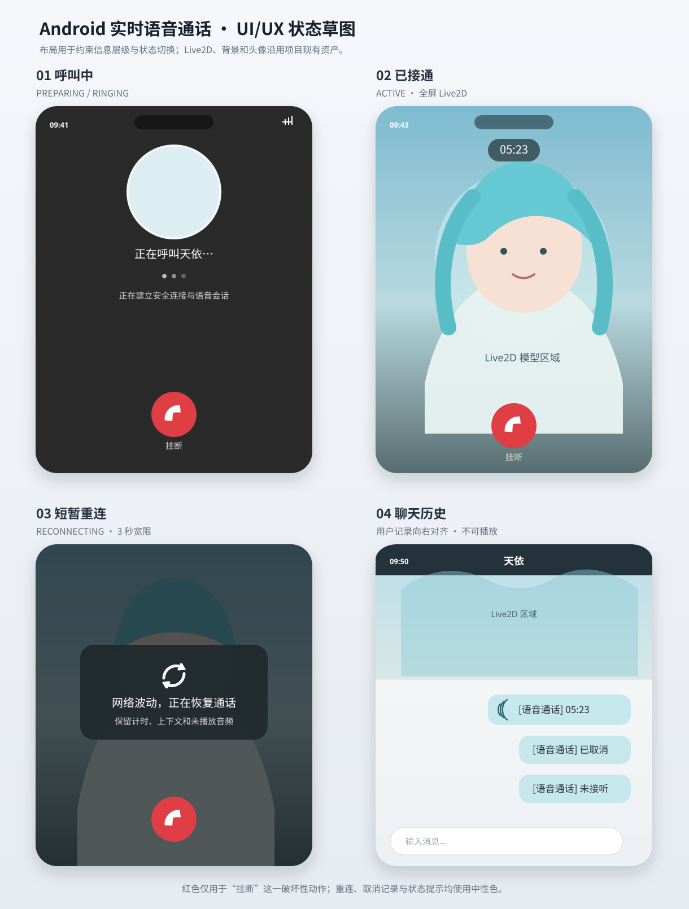
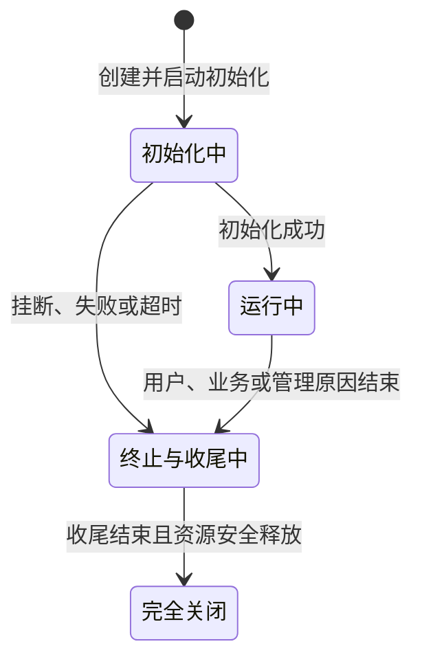

# Stage 生命周期与聊天通话切换

- 日期：2026-11-02。
- 状态：已实现并完成独立代码审查；相关回归仍有 1 项既有时序断言失败，未完成真实供应商或设备验收。
- 实现基线：`2e627f82`。
- 本轮范围：统一聊天和通话的生命周期接口，提前反馈呼叫已受理，调整聊天到通话的切换顺序，并由明确的通话终态通知驱动协议清理。
- 设计方向：StageManager 最终管理所有 Stage；本轮不接入 WorldStage，不拆分新的业务 Session。

## 一、术语与代码位置

下文代码标识符保持仓库命名，其含义以本节及接口表为准。标为“新增”的类型和接口指相对于实现基线新增的契约。

| 名称 | 位置 | 含义与作用 |
| --- | --- | --- |
| `StageManager` | [stage_manager.py](../../server/src/stage/stage_manager.py) | 管理交互接入、互斥占用、创建与终止任务、离线计时和跨 Stage 切换 |
| `ChatStage` | [chat_stage.py](../../server/src/stage/chat/chat_stage.py) | 维护一次聊天交互及其认知收尾；连接断开后可以限时保留 |
| `CallStage` | [call_stage.py](../../server/src/stage/call/call_stage.py) | 维护一次呼叫的初始化、接听、输入输出、结束及认知收尾 |
| `WorldStage` | [world_stage.py](../../server/src/stage/world_stage.py) | 维护角色与世界的长期交互；本轮保持既有管理方式 |
| `InteractionContext` | [interaction_context.py](../../server/src/agent/context/interaction_context.py) | 一次交互独占的上下文，包含对话、用户信息及临时记忆等资源 |
| `ConversationContext` | [conversation_context.py](../../server/src/agent/context/conversation_context.py) | InteractionContext 内的对话窗口；读取使用内存快照，外部写入正式历史后需显式同步 |
| `ContextFactory.create()` | [context_factory.py](../../server/src/agent/context/context_factory.py) | 加载并返回完整上下文；与本文调整的 Stage 创建方法不是同一个接口，语义不变 |
| `CallWebSocketAdapter` | [adapter.py](../../server/src/adapter/websocket/call_v1/adapter.py) | 将通话协议输入输出与业务接口连接，管理协议资源 |
| `Session` | [_session.py](../../server/src/adapter/websocket/call_v1/_session.py) | 跨重连保留的协议会话，保存输入序号、去重信息和交付状态；不是业务会话 |
| `Binding` | [_binding.py](../../server/src/adapter/websocket/call_v1/_binding.py) | 协议会话与一条物理连接的绑定 |
| `Delivery` | [_delivery.py](../../server/src/adapter/websocket/call_v1/_delivery.py) | 下行协议编码、确认及有限重放 |
| `FinalizationTasks` | [_finalization.py](../../server/src/stage/_finalization.py) | Manager 内部的终止任务登记与观察机制；本轮扩展为 Chat、Call 共用的规则 |
| `InteractionLeaseRegistry` | [interaction_lease.py](../../server/src/stage/interaction_lease.py) | 记录同用户、同角色的交互占用及切换意图 |
| `CallState`、`CallEndReason`、`CallOutcome` | [types.py](../../server/src/domain/call/types.py) | 既有的通话业务状态、详细结束原因和业务结果 |

本文使用以下概念：

- **交互结束**：不再接收新的有效业务输入，不再生成普通回复，不允许恢复这次交互；认知维护和资源清理可以继续。
- **完全关闭**：交互结束后，必要的维护、持久化及所属资源清理已经完成。维护失败可以形成失败结果，但不能跳过清理。
- **协议清理**：完成当前已接纳控制消息的确认，有限等待终态发送，然后释放连接绑定和协议缓存。不等待认知维护。
- **切换提交点**：Manager 确认原 ChatStage 不再可恢复，并启动其完整收尾的时刻。提交点之前可以回退，之后只能在全部必要清理结束后创建新聊天。
- **占用范围**：互相排斥的一组交互身份。本轮是同一用户与同一角色；不是所有 Stage 都必须具有用户或连接。
- **连接代次**：每次成功绑定时生成的身份，用来拒绝旧连接迟到的输入、断线和清理通知。
- **ACK**：协议接纳确认，只确认对应输入已经被服务端接纳，不代表初始化、网络交付、播放或认知维护完成。
- **PCM**：未压缩的音频采样数据。通话进入接通状态前不接纳其为用户通话输入。

## 二、用户故事

1. 作为用户，我希望点击通话并完成必要鉴权后，服务端受理呼叫就立即显示呼叫页面并播放铃声，以便确认操作已经生效。
2. 作为用户，我希望供应商准备失败时能够回到原聊天，以免尚未成功建立的通话破坏已有交互。
3. 作为用户，我希望准备期间随时挂断，页面及时退出，之后不再收到迟到的接通或开场。
4. 作为用户，我希望准备期间网络短暂中断后继续同一次呼叫，而不是重新拨号、重复响铃计时或重复生成开场。
5. 作为用户，我希望通话结束后及时退出通话；服务器可以继续维护记忆，但不能在旧交互尚未安全收尾时开启冲突的新交互。
6. 作为开发者，我希望 Manager 通过相同的启动、终止和完成规则管理聊天与通话，以免新增类型时重复编写生命周期分支。
7. 作为维护者，我希望协议发送失败和认知维护失败各自收敛，既不遗留协议会话，也不提前释放仍在使用的业务资源。

### 页面与反馈

复用既有页面布局及[通话界面草图](assets/用户实时语音通话-ui.svg)，本轮调整反馈时机，不新增页面元素。

`PREPARING` 表示呼叫已受理、仍在初始化；`RINGING` 表示初始化完成、正在等待接听决定。两者都显示呼叫页面、播放呼叫音，并允许挂断。初始化完成不等于接听成功，只有收到 `call.active` 后才进入接通界面。

“立即响铃”指：成功受理后，不等待供应商准备、聊天认知维护或通话上下文加载，就排入受理反馈。鉴权、网络连接和必要的占用、账本校验仍可能产生耗时，不承诺从点击到服务端响应为零延迟。

## 三、模块职责与不变量

### 3.1 职责分配

| 模块 | 负责 | 不负责 |
| --- | --- | --- |
| Manager | 接入鉴权结果的业务校验、身份复用、占用、切换提交与回退、初始化及终止任务监督、离线计时、完全关闭后的登记清理 | 协议序号、发送队列、语音和 Agent 的具体处理 |
| Stage | 初始化自身资源、处理业务、关闭输入准入、生成交互终态、认知维护、持久化及清理自身资源 | 构造协议会话、释放 Manager 的占用、等待客户端确认 |
| Adapter | 解析协议、建立和替换连接绑定、报告连接事实、维护顺序与重放、接收终态并自主清理协议资源 | 决定切换提交、业务恢复期限或认知维护是否完成 |
| Agent 与 ContextFactory | 既有角色认知和完整上下文创建 | 管理连接、协议清理或交互互斥 |

Stage 与 Manager 的协作通过显式注入的任务登记、期限更新和切换协调接口完成；Stage 不取得整个 Manager，也不访问其他 Stage。

### 3.2 必须保持的不变量

1. 同一 `client_request_id`、用户和角色只对应一次呼叫身份、一次初始化和一份有效协议会话；重复请求不重置任何期限。
2. 同一占用范围不能同时进行聊天与通话业务。过渡期间允许两个 Stage 对象存活，但 CallStage 尚无通话 Context，不能驱动通话认知或接纳 PCM。
3. 原 Chat Context 完全关闭后，才能创建 Call Context；通话初始上下文由 ContextFactory 读取，不由 Stage 拼接。
4. 通话初始化中的资源准备可以与原 ChatStage 的保留期重叠；聊天输入已暂停，切换提交时按既有规则停止其剩余业务工作。
5. 一个 Stage 只有一份初始化任务和一份完整终止任务。Manager 必须能观察主动终止、自发终止和初始化失败。
6. 交互结束后不允许恢复；协议清理完成不表示 Stage 完全关闭，也不能据此释放占用。
7. 终止不能因某个等待者取消而取消；晚到的初始化资源只允许进入清理，不能重新发布为可用资源。
8. 业务终态通知、正式历史和认知维护分别表达不同事实。终态通知不证明历史已保存或维护成功。
9. Stage 的业务状态、连接状态、生命周期状态分别表达，不能从 `CallState.ENDED` 或连接关闭推断完全关闭。

## 四、统一生命周期接口

### 4.1 公共状态与数据

新增的 `ManagedStage` 协议放在 `server/src/domain/stage/lifecycle.py`，声明 Manager 管理实例所需的公共接口；同文件定义下表中的公共状态、结束原因及终止结果。ChatStage、CallStage 直接满足协议，不新增只转发调用的业务 Session 或强制继承基类。

| 字段或类型 | 定义 |
| --- | --- |
| `interaction_id: str` | 稳定交互身份；Call 使用原 `call_id` 的值，保留 `call_id` 作为业务属性 |
| `character_id: str` | 所属角色身份 |
| `StageLifecycleState` | `PREPARING`：初始化进行中；`RUNNING`：初始化完成；`TERMINATING`：已请求终止并正在结束交互或收尾；`TERMINATED`：资源已安全释放，收尾结果已确定 |
| `lifecycle_state` | 上述公共状态；Manager 不通过 Chat 的在线状态或 Call 的业务状态判断生命周期 |
| `interaction_ended: bool` | Stage 已关闭业务输入和普通输出，不能恢复；不表示维护或清理成功 |
| `StageEndReason` | 公共原因：`USER_REQUESTED`、`AGENT_REQUESTED`、`IDLE_TIMEOUT`、`SWITCH`、`SHUTDOWN`、`INITIALIZATION_FAILED`、`TIME_LIMIT`、`SYSTEM_FAILURE` |
| `StageTerminationResult` | 统一结果，字段为 `interaction_id`、`reason`、`finalization_error`、`cleanup_error`、`resources_released`；`finalization_error` 记录认知维护、账本或历史保存错误，`cleanup_error` 记录资源释放错误。错误字段为空仅表示未报告错误，不能把未执行维护当作维护成功 |

`StageTerminationResult` 是现有同名类型的目标替代契约，不再携带聊天专用的 Agent 处理报告。通话结束快照仍留在 CallStage 内部供结算使用，不作为公共终止返回值。

公共协议不要求 `user_id`、连接或离线期限。本轮 Chat、Call 仍保留用户属性，Manager 的登记记录按现有用户与角色计算占用范围；本轮不实现新的通用作用域配置系统。

运行中不等于连接在线或通话已接听。交互结束发生在终止与收尾阶段内；其后可以继续认知维护。若清理错误导致无法证明资源已释放，保持 `TERMINATING` 并阻止冲突接入，不能虚报完全关闭。

### 4.2 Stage 方法契约

下列方法分别实现在 `stage/chat/chat_stage.py` 与 `stage/call/call_stage.py` 中；`create()` 是各类型的创建方法，其他方法属于公共实例协议。

| 方法 | 输入与返回 | 契约 |
| --- | --- | --- |
| `create(...)` | 身份、已装配依赖及管理回调；返回对应 Stage | 建立对象并启动唯一初始化任务，不等待耗时初始化；成功返回前完成 Manager 登记和任务监督，使初始化错误有明确归属 |
| `start()` | 无参数，异步返回 `None` | 仅等待已经启动的初始化；不创建任务，不重复初始化；成功表示资源、上下文及必要交接全部完成 |
| `begin_termination(reason)` | 公共结束原因，同步返回 `None` | 立即记录首次有效终止决定、拒绝新业务准入，并通过统一机制登记终止任务；不等待认知维护或资源清理 |
| `terminate(reason)` | 公共结束原因，异步返回统一终止结果 | 调用同一终止入口，再等待唯一完整终止任务；重复调用得到同一结果，不执行第二次收尾 |

`create()` 成功不表示将来一定启动成功，也不表示角色已经接听。参数、依赖或受理持久化失败可以直接失败；未成功创建的对象和任务必须由创建方回收，不能发布半成品。

`start()` 的错误规则：初始化失败抛出统一的 `StageInitializationFailed`；在成功完成前因挂断或其他终止被中止，抛出 `StageStartAborted`。这两个新增异常同样位于 `domain/stage/lifecycle.py`。重复等待观察同一启动结果；一个等待者取消只取消自己的等待。阶段已进入终止时，尚未完成的启动不得再报告成功；历史上已经成功完成的启动结果不等于当前仍可接纳输入，后续操作必须校验当前生命周期。

初始化失败必须自动进入同一终止机制，不能依赖某个调用者等待 `start()` 后再补做清理。初始化任务只能交出失败结果并请求终止，不能等待会反过来取消或等待自己的终止任务。Manager 必须观察没有外部等待者的初始化异常。

终止结果中的可预期维护、存储和资源关闭失败必须显式记录。未预期的程序异常允许从终止任务传播，但 Manager 必须观察并报告，且不能因任务异常自动释放占用。无论成功还是失败，各类型使用相同规则。

`terminate()` 等待本 Stage 的完整收尾尝试结束；维护失败但资源已经安全释放时可以返回失败结果并进入 `TERMINATED`。资源无法安全释放时返回相应失败结果，仍保持 `TERMINATING` 和占用，不把“收尾尝试已结束”报告为“完全关闭”。已提交的原 Chat 收尾属于另一份受管任务，Call 等待者取消或 Call 自身关闭不代表该任务完成。

不保留 `wait_closed()`；Manager 从已登记的完整任务观察关闭结果。不以新的 `wait_interaction_ended()` 替换 `wait_realtime_stopped()`；协议释放完全由第七节的终态通知驱动。

### 4.3 原因映射

Manager 只使用公共原因。CallStage 内部保留首次确定的 `CallEndReason` 和 `CallOutcome`，用于协议、历史和指标；后续清理异常不能覆盖先前的用户挂断或拒接决定。

| 场景 | 公共原因 | 通话详细原因或聊天处理 |
| --- | --- | --- |
| 用户挂断 | `USER_REQUESTED` | `USER_HANGUP` |
| 角色挂断或拒接 | `AGENT_REQUESTED` | 分别保留 `AGENT_HANGUP`、`DECLINED` |
| 接通后恢复超时 | `IDLE_TIMEOUT` | `RECOVERY_TIMEOUT` |
| 聊天离线到期 | `IDLE_TIMEOUT` | 转换为既有聊天用户离开语义 |
| 聊天切换通话 | `SWITCH` | 转换为既有 `SWITCH_TO_CALL` 结束刺激 |
| 建立期限到期 | `INITIALIZATION_FAILED` | `SETUP_TIMEOUT`；即使资源已准备、仍未接听，也使用此原因 |
| 建立期间供应商失败 | `INITIALIZATION_FAILED` | `PROVIDER_FAILED` 或已有系统失败分类 |
| 接通后供应商故障 | `SYSTEM_FAILURE` | `PROVIDER_FAILED` |
| 通话时长限制 | `TIME_LIMIT` | `TIME_LIMIT` |
| 服务器关闭 | `SHUTDOWN` | 聊天保持关闭语义；通话线路协议暂沿用 `SYSTEM_FAILURE`，内部保留关闭原因 |

不将通话详细原因加入所有 Stage 必须实现的公共枚举，不改变现有线路协议的原因取值集合。

## 五、Manager、连接与任务管理接口

### 5.1 接入及管理入口

| 接口 | 位置与调用方 | 目标语义 |
| --- | --- | --- |
| `try_to_get_stage(...)` | `stage_manager.py`；由对应 Adapter 调用 | 保留按用户、角色、类型、请求身份及恢复身份定位 Stage 的入口；新建时返回已登记、初始化已开始的 Stage，复用时返回同一实例；不等待 `start()` |
| `prepare_call_transition(...)` | 同上；由聊天 Adapter 调用 | 验证当前聊天绑定并登记一次性切换意图；保留既有协议与身份校验 |
| `close()` | 同上；由运行时调用 | 关闭新接入，向受管 Stage 发出关闭请求，排空初始化、终止及切换任务，并核验资源释放结果；无法证明安全释放时抛出停机失败，不允许运行时继续关闭依赖服务 |
| `begin_user_data_reset(...)` | 同上；由用户数据重置用例调用 | 存在初始化、切换、交互、收尾或未完成清理时拒绝重置 |

`close()` 只有在关联任务已结束、所有受管资源均确认安全释放后才能正常返回。若仍有 `resources_released=false`，或任务异常且无法证明资源已释放，必须保留失败及占用登记，抛出明确的 `StageShutdownFailed`，不能把任务排空视为业务安全排空。该新增异常位于 `server/src/domain/stage/lifecycle.py`，用于通知运行时停止后续依赖关闭；重复关闭不得清除未解决的失败，也不得重新启动已完成的业务收尾。

运行时的 `ServerRuntime.shutdown()` 位于 [server_runtime.py](../../server/src/server_runtime.py)，负责按依赖顺序关闭服务。收到上述异常后，必须报告停机失败并停止后续关闭步骤，保留 Agent、数据库等依赖服务。仅认知维护或历史保存失败、但资源已安全释放时，记录失败而不阻止后续依赖关闭；两种结果不能混用。本条不引入强制释放、自动重试或新的停机超时政策。

新建 Chat 的 Adapter 等待 `start()` 成功后再允许聊天业务输入；新建 Call 的 Adapter 在取得 Stage 后立即完成首反馈，不等待 `start()`。调用者需要等待何种业务就绪不改变公共方法语义。

若创建已受理而接入调用者在拿到 Stage 前取消，Manager 仍拥有该实例和初始化任务。未交付的 Chat 按普通离线回收处理；已受理的 Call 按原建立期限保留或因本地接入失败终止。任何路径都不能因没有拿到返回值而遗留无人管理的 Context。

创建依赖必须提供已可接收输出的接收器。Adapter 的接入过程负责为尚未绑定的输出建立有限暂存，保证创建任务即使立即成功或失败，也不会向不存在的路由丢失状态；Manager 不构造 Session、Binding 或 Delivery。首次握手排序由 Adapter 控制，暂存不允许绕过既有容量限制或无限增长。

### 5.2 管理回调

以下接口是注入 Stage 的内部协作契约，实现在 `stage_manager.py` 及 `_finalization.py`，不作为 Web 或客户端接口。

| 接口 | 输入与返回 | 约束 |
| --- | --- | --- |
| `own_initialization(stage, operation)` | Stage 与异步初始化操作，返回唯一任务 | 在执行前登记；观察失败；同身份重复创建不能产生第二份初始化 |
| `own_termination(stage, operation)` | Stage 与完整终止操作，返回唯一任务 | Stage 内部保存同一任务引用；Manager 直接观察此任务，不再为 Chat 单独包装另一份业务收尾 |
| `retention_changed(stage, deadline, generation)` | 单调时钟绝对期限或 `None`、连接代次 | Manager 统一替换或撤销离线计时；不混用墙上时间与单调时钟 |
| `finish_source_interaction()` | 无参数，成功时异步返回 `None`，绑定于本次切换 | Call 初始化资源准备完成后调用；Manager 校验并提交切换，终止原 Chat，检查完整终止结果；仅收尾无错误且资源安全释放时返回成功，失败时抛出交接异常；重复调用复用同一次交接结果 |

`finish_source_interaction()` 不向 CallStage 暴露 ChatStage、聊天 Context 或占用对象。无原聊天时注入直接完成的操作。它的等待可以被呼叫终止中断，但已经提交的 Chat 收尾任务不能随等待者取消。

存在原 Chat 时，成功返回要求其完整终止结果中 `finalization_error`、`cleanup_error` 均为空且 `resources_released=true`。维护失败或超时、资源未安全释放、终止任务异常，均抛出新增的 `StageHandoffFailed`；该异常位于 `server/src/domain/stage/lifecycle.py`，表示原交互未满足切换条件。Call 将其作为初始化失败处理，不创建通话 Context、不请求接听；详细原因由 Manager 保留，不能仅因旧 Context 已关闭就返回成功。尚未提交时收到挂断或其他终止，按 `StageStartAborted` 收敛，不提交切换；提交后取消等待仍不取消原 Chat 收尾。

Manager 统一负责最终移除登记和释放占用，取消原 Call 的释放占用回调及 Chat 的专用释放包装。正常终止、初始化失败、创建未交付和服务器关闭都必须汇入该规则。

### 5.3 连接附加契约

新增 `ConnectedStage` 协议位于 `domain/stage/lifecycle.py`，只由 Chat、Call 实现，WorldStage 将来不必实现。协议不接收 WebSocket 对象、序号或重放游标。

| 接口 | 语义 |
| --- | --- |
| `connection_changed(available, generation)` | Adapter 在绑定事务中报告业务连接事实；返回是否接纳。恢复时校验生命周期、期限及代次；拒绝后不能设置为在线。旧代次断线通知无副作用 |
| `expire_retention(deadline, generation)` | Manager 到期通知；Stage 校验当前状态、原期限、代次及当前时间，匹配时调用统一终止入口，不等待完整收尾 |

Stage 决定业务上适用的期限，Manager 统一计时。恢复成功撤销旧离线计时；计时任务已经唤醒也不能结束新绑定。连接可用不自动意味着通话已接听。

保持现有业务策略：聊天断线停止当前处理并保留可恢复状态；接通后通话断线暂停新回复调度，但保留已经接纳的输入事实及播放交付状态。统一方法名称不将两种业务策略改成相同算法。

## 六、初始化与聊天到通话切换

### 6.1 受理与首反馈

1. 客户端沿用权限检查及 `call.switch_prepare`、`call.switch_ready` 流程；无原聊天时省略切换准备。准备期间既有聊天输入暂停规则继续有效。
2. 首次 `call.start` 通过鉴权、角色能力、请求幂等、切换意图及占用校验。Manager 建立 PREPARING 账本和稳定呼叫身份，取得本次过渡占用。
3. Manager 创建 CallStage 并启动、登记初始化任务；此时保留原 ChatStage。成功返回前，确保聊天新业务输入已经暂停。失败时不发送成功 ACK，并完成创建补偿。
4. Adapter 关联唯一协议会话及当前绑定，依次排入 `call.state(PREPARING)`、首个 `ack(ack_seq=1)`，之后才放行初始化产生的状态或终态。
5. 客户端收到受理状态即显示呼叫页面并响铃，不等待聊天收尾。首 ACK 仅确认受理。

初始化已经从创建开始，不能在首 ACK 后重新启动一遍。输出暂存负责首反馈排序，不能反过来要求 `create()` 等待耗时初始化。

### 6.2 初始化前段与后段

| 阶段 | 工作 | 原 ChatStage | Call Context |
| --- | --- | --- | --- |
| 前段准备 | 创建并启动实时语音供应商等不依赖聊天最终上下文的资源；不请求 Agent 接听、不接纳 PCM | 保留并暂停新输入，可在失败后恢复 | 不存在 |
| 提交交接 | 调用 `finish_source_interaction()`；Manager 原子确认本次切换仍有效 | 不可恢复，进入统一终止 | 不存在 |
| 后段准备 | 等待 Chat 完整收尾且 Context 关闭，再由 ContextFactory 加载 Call Context | 已完全关闭 | 创建并完成加载 |
| 初始化完成 | 设置公共运行状态，完成初始化任务，发布 RINGING 并发起唯一接听决策 | 已关闭 | 完整可用 |

Chat 在提交前已经接纳的工作按现有暂停及断线策略处理，不为此次改造增加新的消息丢弃规则。提交时统一停止处理、执行、回复期限及未交付普通输出；已形成的持久对话事实参与结束维护。未完成且未形成正式事实的预处理按现有终止策略取消。

通话上下文继续采用既有最近三分钟、最多三十条等种子规则；本轮仅调整加载顺序，不修改内容范围。种子以原呼叫请求时间为依据，重连不重新取请求时间。

`start()` 成功不等待 Agent 作出接听决定。接听决定只能在完整上下文可用后发起一次；只有连接有效、未终止、未超过原建立期限且切换完成，才能进入 ACTIVE 并提交一次开场。接听决定在连接不可用时保留，恢复后重新检查上述条件。

### 6.3 切换提交与占用

提交点在 Manager 校验本次过渡身份、Call 未终止、建立期限未过及用户未进入重置后，原子标记旧 Chat 不可恢复并启动其终止任务。此段不等待外部输入输出；耗时维护必须在 Manager 锁外执行。

初始化期间挂断与提交点竞争时，以 Manager 的串行决定为准：挂断先被确认则禁止提交；提交先完成则不能恢复旧 Chat。不能在异步预检查成功后无条件提交。

整个切换期间由同一个过渡占用覆盖两份 Stage 登记。旧 Chat 关闭不能释放新的 Call 或过渡占用；Call 提前关闭也不能释放仍在收尾的旧 Chat。只有关联任务均已安全结束，才能回退到旧 Chat 占用或释放范围供新交互使用。

### 6.4 失败与回退矩阵

| 失败发生位置 | 呼叫结果 | 聊天处理与重新接入 |
| --- | --- | --- |
| 鉴权、意图、能力或占用校验失败 | 未受理，不创建有效呼叫，不发送成功 ACK | 不终止旧 Chat；按原准备意图的取消或到期规则解除暂停 |
| 账本或 Stage 创建失败 | 未成功受理；对部分创建资源执行补偿 | 未提交则保留旧 Chat；创建资源安全清理后恢复其原占用与可恢复状态 |
| 供应商等前段准备失败 | 初始化失败终态，不创建正式通话记录 | 原 Chat 未提交，Call 清理完成后恢复旧 Chat；不要求保留原物理连接 |
| 提交前用户挂断 | 接通前取消终态，保存一条已取消记录 | Call 清理和必要历史保存完成后，将正式历史同步到旧 Context，再恢复旧 Chat 的输入与主动调度 |
| 提交后 Chat 维护失败或超时，但 Context 已安全关闭 | 建立失败终态，不继续加载 Call Context | 旧 Chat 不复活；关联清理全部结束后新建 Chat，已持久化事实留给后续维护 |
| Chat 清理无法确认资源已释放 | 建立失败终态，并记录清理错误 | 保持范围不可重新接入，不把资源关闭失败解释成回退成功 |
| Chat 已关闭，Call Context 加载失败 | 建立失败终态 | Call 清理完成后允许新建 Chat |
| 提交后、接通前用户挂断 | 接通前取消终态，保存一条已取消记录 | 不再加载或使用 Call Context；已提交的 Chat 收尾独立继续，全部必要清理结束后新建 Chat |
| 建立总期限到期 | 建立超时终态，不创建正式通话记录 | 提交前按可恢复规则回退；提交后等待关联清理，再允许新建 Chat |
| 服务器关闭 | 关闭对应交互并尽力发布终态 | 不恢复聊天，也不接受新建请求；排空关联任务 |

恢复旧 Chat 指恢复原业务实例，不复活已经断开的网络连接。若原连接仍有效则恢复输入；若已断开，客户端重新连接后才可交互。恢复沿用原聊天离线期限，不因失败切换获得新的完整保留期；原期限已经到期时，应结束旧 Chat，之后按正常规则创建新实例。

回退恢复还必须保证保留 Context 与此次切换产生的正式历史一致。提交前取消记录保存完成后，ChatStage 通过新增的 `ConversationContext.refresh()` 同步对话窗口；该方法位于 `server/src/agent/context/conversation_context.py`，在已有上下文锁内只读加载持久化窗口并更新内存快照，与追加、压缩和关闭操作串行。同步不再次写入取消记录，不重建 Stage 或 Context，也不允许 Manager 读取并拼装对话内容。

同步完成前保持新业务输入和主动提醒调度暂停，不得依赖下一条用户消息的追加操作顺带刷新。成功后重新检查原离线期限和当前生命周期，再恢复接入；已过期或已终止则进入原有回收路径。同步失败时报告回退失败，不开放使用旧快照的聊天，转入旧 Chat 的统一终止流程；安全清理后允许新建 Chat，不因同步失败丢弃已持久化的取消记录。

切换期间暂停执行原 Chat 的离线回收动作，但保留其原期限。过渡结束时重新核对该期限。若通话前段继续成功，则通过提交流程终止旧 Chat；若回退时期限已过，则不能恢复过期实例。

## 七、终态通知驱动协议清理

### 7.1 统一通话终态输出

新增 `CallTerminated` 数据类型位于 `server/src/domain/call/types.py`，表示该呼叫的交互已不可继续，协议层可以开始清理。它替代输出通路中把完整通话快照与建立失败分别作为释放依据的方式；完整快照仍由 Stage 内部保存。

| 字段 | 类型与约束 |
| --- | --- |
| `call_id` | 稳定呼叫身份 |
| `client_request_id` | 原请求身份，用于受理、重复请求与终态关联 |
| `kind` | `ENDED` 或 `FAILED`，分别表示有业务结束结果、未形成可记录结果的建立失败 |
| `outcome` | ENDED 时为既有业务结果；FAILED 时为空 |
| `end_reason` | 既有通话详细结束原因 |
| `active_duration_ms` | 非负有效通话时长；未接通为零 |
| `ended_at` | 服务端确定交互结束的时间，沿用通话现有时间规范 |

通知不包含逐轮转录、完整上下文、概要或维护结果。通话尚未接通时，用户主动挂断属于 ENDED／接通前取消；供应商失败和建立超时属于 FAILED。已接通后异常结束属于 ENDED，并保留真实故障原因。

通知成立前，Stage 必须锁定结果、拒绝后续输入与重连、撤销普通输出资格并停止调度新的交互工作。仍在返回途中的初始化资源只能被回收，不能产生新的有效输出。发送通知不等待认知维护、历史保存或不响应取消的外部资源彻底释放；这些任务仍由 Manager 跟踪并占用原范围。

每个已经创建的 CallStage，无论正常挂断、拒接、建立失败、供应商故障还是服务器关闭，都必须确定唯一终态并尝试提交通知。账本写入或其他收尾异常不得跳过通知；若首次业务结果已经确定，保留该结果，把持久化失败作为独立收尾错误报告。终态只是本进程确定的交互事实，不承诺对应数据库写入成功。

Call 的 ENDED、FAILED 业务状态或普通状态变化事件不能单独触发协议释放。Adapter 只依据明确的 `CallTerminated` 通知进入业务终态清理，不遍历 Stage 状态、不轮询任务，也不调用任何实时停止等待方法。

### 7.2 通知接纳与线路映射

现有 `CallWebSocketAdapter.submit_output(call_id, output)` 位于 `adapter.py`，继续作为 Stage 的输出入口。收到终态后按如下顺序处理：

1. 原子登记该 `call_id` 的首次终态，立即拒绝新业务输入与恢复。
2. 为协议会话登记唯一清理任务。该动作必须先于可能失败的编码、入队或网络发送。
3. 尽力把 ENDED 映射为现有 `call.ended`，把 FAILED 映射为现有 `CALL_SETUP_FAILED` 错误；保留现有错误提示与结束原因语义。
4. 返回本地接纳结果，不等待清理任务、客户端 ACK 或业务认知维护。

同内容的重复终态幂等处理；冲突的后续终态记录内部错误，不覆盖首次结果、不建立第二个清理任务。协议会话已经释放时不重建会话，也不因迟到通知影响下一通呼叫。

编码、队列满或发送异常都不能撤销已登记的终态及清理任务。终态接收器即使报告交付失败，Stage 仍继续自己的收尾。协议资源已因 Adapter 关闭而释放时，缺少路由不表示业务收尾已完成。

本轮不增加线路协议版本或客户端新消息类型。内部显式终态与普通可重试错误严格区分，不能让任意 `error` 报文触发整通电话清理。

### 7.3 挂断确认、发送与清理顺序

协议 Session 接纳合法且顺序正确的挂断后，调用 Stage 的非阻塞终止入口，提交该输入序号并排入 ACK。此 ACK 表示终止请求已接纳，不承诺实时资源已物理释放，更不承诺认知维护完成。

终态接收器只能登记清理任务，不能同步调用需要取得当前输入锁的 `Session.close()` 或等待挂断 ACK。否则可能形成“挂断接纳等待终态接收，终态接收等待输入锁”的循环等待。

清理任务执行以下步骤：

1. 有限等待已经开始的控制接纳操作退出，并让相应 ACK 有机会入队；不再接纳新的业务消息。
2. 对当前连接有限等待终态与已入队控制消息发送；不等待客户端 ACK。
3. 无论等待成功、超时还是发送失败，最终关闭 Binding、Session 和 Delivery，移除 Adapter 内部登记。

受理控制操作排空和网络发送排空各使用最多两秒的独立预算；本轮不增加终态重传服务。终态与挂断 ACK 的相对线路顺序不作新保证，但有效连接上正常完成时两者都应得到发送机会，首握手顺序仍受第六节约束。没有当前连接时不为可能的重连保留终态协议会话。

若控制操作超时仍未退出，Adapter 应失效该绑定并完成自身清理；不得通过取消协议任务撤销已经接纳的 Stage 终止。重复输入只按原序号规则确认或拒绝，不再产生第二次业务结束。

终态未送达时不保证客户端取得最终结果。客户端依据既有网络失败规则退出或查询历史，不能据此重新创建同一请求身份的呼叫。Stage 的已确定结果不因网络失败被改写。

撤销普通输出资格只阻止后续业务输出，不允许直接丢弃已经分配协议序号的音频。客户端对 `call.ended` 按连续序号处理；存在尚未接纳的 PCM 或序号缺口时，必须沿用既有 `playback.stop` 的停止及撤回区间规则，让阻塞音频得到处理后再完成终态消费。停止控制和终态应遵守既有交付顺序；不能因为提前发送终态而跳过停止控制，也不能把音频丢弃造成的缺口留给重连解决。

### 7.4 业务收尾

终态发布后，Call 按既有业务结果执行认知维护、概要及历史保存，最后关闭 Context 和其余资源。未接通取消或拒接不执行已接通通话的认知维护，但仍按现有规则保存对应历史。

Chat 同样先结束交互，再执行结束维护并关闭 Context；聊天 Adapter 的解绑通过既有注入路径完成，不借用通话终态类型。Manager 观察同一种完整终止结果。

移除 `wait_realtime_stopped()` 及其调用，也不新增等价等待方法或轮询。移除 `wait_closed()`。终态发布、终止任务完成及占用释放必须仍是不同事实。

Call 内部的恢复超时等分支请求非阻塞终止后直接返回恢复失败；Session 的挂断接纳直接完成序号提交；Adapter 的恢复失败处理等待本地接入撤销，不再等待 Stage 的实时停止事件。各自需要的后续协议清理由同一终态路径负责。

## 八、初始化期间挂断、断线与重连

### 8.1 初始化期间挂断

| 时刻 | 必须发生的行为 |
| --- | --- |
| create 已受理、前段准备未完成 | 固定接通前取消结果，禁止切换提交，撤销初始化资格，发布终态；晚到的供应商资源关闭后才完成资源回收 |
| 切换已经提交、Chat 正在收尾 | 发布接通前取消终态；不等待 Chat 认知维护才让协议退出；Chat 收尾继续由 Manager 独立监督，禁止恢复旧 Chat |
| Chat 已关闭、Call Context 正在加载 | 取消加载等待；若加载不能立即取消，完整回收晚到 Context；不得请求 Agent 接听 |
| 初始化已完成、接听决定未到 | 固定取消结果；晚到的接听决定无效，不进入 ACTIVE、不生成开场 |
| 接通与挂断并发 | 由 Call 的串行状态变更决定结果；先接通则为已接通结束，先确认挂断则为接通前取消；不得同时发布接通和取消两种互斥事实 |

本地挂断立即停止呼叫音并退出通话页。服务端使用真实、已确定结果写历史；同一请求只保存一条记录。已经接纳挂断后，即使建立期限随后到期，也不能改写成建立超时。

### 8.2 接通前断线

物理断线不等于挂断，不撤销已创建的 Stage 或重启初始化。准备期间使用首次 `call.start` 的建立期限，默认十秒；已初始化但尚未接听也使用同一期限。

允许继续供应商准备、已提交的聊天收尾及上下文加载。即使当前连接暂时不可用，初始化也可以继续；因此断线不是对原聊天保留的承诺。没有有效连接时不得进入 ACTIVE，已取得的接听决定可以保留。

未知 `call_id` 时使用同一 `client_request_id` 重发 `call.start`；已知时使用 `call.resume`。二者都复用原 Stage、初始化任务、Session、序号和原期限，不重新消费切换意图。

### 8.3 恢复事务

1. Adapter 重新鉴权，校验用户、角色、呼叫身份及协议游标。有效旧连接不能被另一连接抢占。
2. Adapter 预留新绑定与连接代次，准备恢复反馈及旧帧重放；所有新输出必须排在这些恢复输出之后。
3. Stage 通过统一连接接口重新校验当前生命周期、业务状态和原期限。预检查通过后发生的挂断、终态或超时必须使正式恢复失败。
4. 恢复成功撤销旧离线计时；初始化继续等待原任务，接听和开场不重复执行。
5. 校验失败只撤销临时绑定；若尚未提交业务恢复，保留原会话及原期限。若业务恢复已经提交而协议事务失败，按既有系统失败路径终止并由终态驱动清理。

已经结束、终态已登记或协议会话已释放时，不允许恢复。重复 start 返回原身份对应的稳定失败或既有结果，不新建呼叫；是否保留协议对象不能作为账本幂等判断的依据。

### 8.4 接通后断线

以服务端已经进入 ACTIVE 为准，即使客户端未收到接通消息，也采用接通后的恢复规则。恢复期限保持三秒；恢复成功沿用原 Stage、Context 和协议会话，旧计时与旧连接清理不得影响新连接。

恢复失败发布对应终态，Adapter 自行清理；认知维护和历史保存继续。计时、有效时长、沉默触发及播放结算沿用既有产品约束。

## 九、期限、取消与失败观察

| 期限 | 起点与范围 | 到期行为 |
| --- | --- | --- |
| 切换意图有效期 | 既有准备成功起算，默认十秒 | 未被有效 start 消费则撤销意图，恢复普通聊天接入或离线规则 |
| 呼叫建立期限 | 首次有效 start 的受理过程起算，默认十秒 | 覆盖供应商准备、聊天交接、Context 加载和接听等待；到期确认建立失败并通知协议清理 |
| 普通聊天离线保留 | 当前有效聊天连接断开起算，默认六十秒 | 校验代次和期限后终止聊天 |
| 接通后恢复期限 | 服务端 ACTIVE 呼叫断线起算，三秒 | 终止通话，不能因恢复请求或重复断线延长 |
| Chat 结束维护期限 | Chat 终止时按现有配置，默认三十秒 | 结束维护失败，继续清理 Context；不得提前推进失败维护的进度 |
| 协议清理预算 | 收到明确终态后 | 按第七节有限排空，超时也释放协议资源 |

呼叫建立期限是用户可见结果的期限，不是允许丢弃业务收尾的期限。它到期后，即使 Chat 维护尚未结束，也应使 Call 进入失败、发送终态并禁止后续接听；Manager 继续持有尚未完成的 Chat 及其他清理任务。

不因为 Call 初始化等待被取消就取消已提交的 Chat 终止任务。默认三十秒的聊天维护上限不因十秒建立期限被隐式改写；二者分别约束业务维护和呼叫结果。这与旧通话 spec 中使用呼叫剩余时间截断聊天维护的描述不同，见第十二节。

对无法及时响应取消的供应商或存储操作，必须撤销结果发布资格，跟踪操作直至返回并清理其结果；不等待它才告知用户呼叫结束，也不在它仍持有资源时允许冲突交互或用户重置。无效的迟到任务不得更新新的 Stage 或新连接。

同一占用范围收尾期间，新接入沿用可重试的 `INTERACTION_FINALIZING`；处于运行或切换占用期间，沿用既有占用拒绝规则。不能为了页面已经返回聊天就绕过接入限制。

本轮不增加进程重启后的结算恢复、无限重试、强制释放未清理资源或新的停机超时政策。清理异常保留明确错误和占用事实，不能报告成功交付。

## 十、验收标准

只增加开发者和用户实际可感知的测试。优先扩展既有接入、协议、持久化及客户端组合测试；不为属性名、方法转发或类继承关系单独增加测试。

下表每项包含触发状态、输入及可观察结果。模型和供应商可使用受控替代实现，但消息顺序、实例复用、资源关闭和历史事实必须通过真实业务路径验证。

| 编号 | 状态 | 输入 | 可观察结果 |
| --- | --- | --- | --- |
| AC-01 | 存在可切换聊天，供应商准备被暂停 | 有效 call.start | 在解除供应商暂停之前收到 PREPARING 和首 ACK，客户端响铃且可以挂断；聊天维护尚未开始 |
| AC-02 | 创建或账本受理失败 | 有效拨号请求 | 无成功 ACK、无有效重复呼叫；旧聊天未终止，部分资源得到补偿 |
| AC-03 | 初始化刚开始且可能立即失败 | 有效拨号请求 | 成功受理时线路顺序为 PREPARING、首 ACK、失败终态；无路由缺失造成的泄漏或静默失败 |
| AC-04 | 多个请求指向同一呼叫 | 重复 start、重复等待 start | 同一呼叫身份、一次供应商准备和一次接听；重复请求不延长期限 |
| AC-05 | 一个用户初始化很慢 | 另一个用户发起聊天或通话 | 后者正常接入，不被全局 Manager 锁或前者的维护阻塞 |
| AC-06 | 前段供应商准备失败 | 客户端返回聊天 | Call 安全清理后复用原未终止 Chat；原连接已断时重新绑定，保留既有事实 |
| AC-07 | Chat 切换前已有正式对话事实 | 通话准备成功 | Chat 收尾及 Context 关闭先于 Call Context 创建；通话种子符合原时间窗口及条数规则，无两个用户 Context 并存 |
| AC-08 | 已提交切换，Chat 维护返回失败或超时，即使 Context 已安全关闭 | 等待启动 | 交接失败传播为初始化失败，不创建 Call Context、不请求接听；安全清理后新建 Chat，不复活原实例 |
| AC-09 | Chat 已关闭，Call Context 加载失败 | 客户端重回聊天 | 旧 Chat 不复活，无晚到 Call 回复；清理后新建聊天能读取已持久化事实 |
| AC-10 | 前段准备中 | 用户挂断 | 呼叫音停止，挂断得到接纳，终态为接通前取消；提交点未发生，清理后可恢复旧 Chat，历史只增加一条取消记录 |
| AC-10a | 提交前取消记录已保存，准备复用原 Chat | 不发送新用户消息，恢复后触发到期提醒 | 先完成 Context 同步，再开放输入和主动调度；真实提醒生成路径读取的历史包含且仅包含一条此次取消记录，提醒正常交付，Stage 身份不变 |
| AC-10b | 取消记录已保存，但旧 Context 同步失败 | 尝试恢复聊天及触发提醒 | 不使用旧快照生成提醒，不开放旧 Chat 输入；回退失败可见，旧 Chat 安全清理后才允许新建，正式取消记录仍保留 |
| AC-11 | 已提交切换，Chat 维护被暂停 | 用户挂断 | 在解除维护暂停之前可以收到取消终态并完成协议清理；旧 Chat 不复活，范围仍拒绝新接入与重置 |
| AC-12 | Context 或供应商创建延迟返回 | 初始化期间挂断后解除延迟 | 晚到资源被关闭，不发送接通或开场，不影响后来新建的交互 |
| AC-13 | 挂断与切换提交竞争 | 交错执行两项操作 | 按唯一提交决定回退或继续收尾，无“旧 Chat 被关闭却报告恢复成功”的结果 |
| AC-14 | PREPARING，首反馈丢失或连接断开 | 相同请求重发或 resume | 复用原呼叫与协议状态；恢复输出先于新输出；未重新准备、接听或延长期限 |
| AC-15 | 初始化完成但当前无连接 | 接听决定到达后恢复连接 | 未恢复前不进入 ACTIVE；恢复后校验期限，只接听并开场一次 |
| AC-16 | 准备期超过原建立期限，Chat 仍在维护 | 恢复、重复 start 或迟到初始化成功 | 建立超时终态已确定，不再接通；协议可清理，Manager 继续跟踪关联收尾 |
| AC-17 | 服务端已 ACTIVE，接通报文尚未到客户端 | 断线并在三秒内恢复 | 使用接通后恢复规则，身份、上下文和有效时长语义不变 |
| AC-18 | 已成功重连 | 旧连接断线通知和旧计时到达 | 新连接继续可用，不被旧事件结束 |
| AC-19 | 挂断正在提交输入序号 | 同时收到 Stage 终态 | 无输入锁死锁；正常网络下终态和挂断 ACK 均有发送机会；协议只清理一次 |
| AC-20 | 终态入队失败、网络发送阻塞或无连接 | Stage 发出终态 | Adapter 在有限预算内释放资源；Stage 继续业务收尾，不等待客户端 ACK |
| AC-20a | 客户端原生音频接纳被阻塞，已有分配序号的 PCM 尚未完成接纳，控制消息仍可到达 | 供应商故障或时长限制触发终止 | 既有播放停止机制正确处理阻塞音频及撤回区间，终态不因人为制造的序号缺口卡住；客户端停止播放并退出通话，Adapter 在原预算内清理，不等待认知维护 |
| AC-21 | 同一呼叫终态已登记 | 重复或冲突终态，随后有下一通呼叫 | 不重复写历史或清理；后续冲突不覆盖首次结果，不影响新呼叫 |
| AC-22 | 通话协议已清理，认知维护被暂停 | 新接入与用户数据重置 | 两者仍受收尾占用约束；维护及清理完成后才解除阻塞 |
| AC-23 | 首次或重复 terminate 正在等待 | 取消一个等待者 | 底层收尾继续；其他观察者得到同一结果，Context 和占用最终正确清理 |
| AC-24 | 清理报告资源未安全释放 | 新接入、重置和终止结果查询 | 错误可见，不宣称完全关闭、不提前释放占用；无静默成功 |
| AC-25 | 原聊天离线期限在切换期间经过 | 前段失败回退 | 不重置六十秒期限、不恢复过期 Chat；按普通结束流程安全回收 |
| AC-26 | 初始化、切换或收尾正在进行 | 服务器关闭 | 不接受新请求，任务被统一监督并排空；Agent 与数据库在业务排空后关闭 |
| AC-26a | 停机期间资源关闭失败，终止结果为资源未释放，或终止任务异常且无法证明安全释放 | 等待 Manager 关闭完成 | Manager 抛出明确停机失败并保留失败及占用登记；运行时不继续关闭 Agent、数据库，不把失败 Stage 当作完全关闭移除 |
| AC-26b | 停机期间认知维护或历史保存失败，但资源已安全释放 | 等待 Manager 关闭完成 | 收尾错误对维护者可见，Manager 正常结束安全排空，运行时继续关闭依赖服务；不与资源未释放的失败混淆 |
| AC-27 | 普通聊天没有拨号或切换意图 | 断线、重连及保留期到期 | 保持原聊天恢复与结束行为，不被当作通话切换 |
| AC-28 | 通话生命周期已迁移 | 正常接听、拒接、挂断、供应商故障 | 既有线路消息与原因可被现有客户端解析，历史隐私和失败提示不退化 |

建议复用的测试入口包括 `server/tests/integration/stage/test_manager_lifecycle.py`、`server/tests/integration/websocket/test_call_websocket_adapter.py`、`server/tests/integration/websocket/test_call_websocket_transport.py`，以及 `app/__tests__/call_failure_composition.test.tsx`。应按实际用户路径组织用例，不要求逐行镜像接口表。

本文未运行上述行为测试。实现验收必须区分受控供应商下的网络与持久化验证、真实供应商验证及 Android 设备验证；任何一个层面的通过都不能代替其他层面的证据。

## 十一、实现顺序与交付范围

1. 定义公共生命周期、启动和终止结果，统一任务登记及 Manager 的占用释放；保留当前行为作为回归基线。
2. 改为 Stage 创建即启动初始化、start 只等待；统一 Chat、Call 的创建失败、取消及自发终止路径。
3. 调整受理反馈与通话初始化顺序：供应商准备在前、Manager 提交聊天收尾、Context 加载在后；补齐前后两类失败回退。
4. 增加明确通话终态通知，改造 Adapter 的独立清理任务和挂断 ACK；移除实时停止及完全关闭等待接口与旧观察任务。
5. 统一连接变化及 Manager 离线计时协作，验证初始化期间恢复、代次及期限竞争。
6. 完成验收矩阵对应的用户路径验证，并在另行明确授权后同步旧 spec、代码地图及相关契约说明。

上述顺序是实现依赖顺序，不自动代表六个 Issue 或六个 PR。交付拆分应以能够独立验证的用户行为为单位，避免发布一半终态协议、一半旧清理流程的组合。

本设计已经独立审查并落实实现。后续接口收敛和目录整理保持本文行为语义；实现与测试的提交不代表真实供应商或 Android 设备验收。

## 十二、文档同步与审核边界

### 12.1 已同步的设计与旧说明差异

| 既有说明 | 本设计的替代内容 |
| --- | --- |
| [原通话 spec](用户实时语音通话-spec.md) 的 AC-01、AC-02、切换与建立顺序要求先关闭旧 ChatStage 才创建 CallStage | 提前创建 CallStage、反馈响铃；允许 Stage 对象短暂重叠，但不允许 Chat Context 与 Call Context 重叠 |
| 原通话 spec 的 AC-19 要求旧 Context 关闭后才创建 CallStage | 改为旧 Context 关闭后才创建 Call Context，并验证前段失败可以保留旧 Chat |
| 原通话 spec 将聊天维护截断在呼叫建立剩余时间内 | 呼叫到期及时发布失败；已提交的聊天收尾保持自身期限并继续受 Manager 监督 |
| 原通话 spec 描述初始化失败后总是新建聊天 | 按提交点区分：提交前可恢复旧实例，提交后只能新建 |
| [代码地图](../代码地图.md) 说明 Adapter 等待实时停止、Call 回调释放占用、公开 wait_closed | 终态通知驱动 Adapter 清理；Manager 统一观察完整任务并释放占用；删除两个等待接口 |

上述旧 spec 与代码地图已同步。本文作为本次生命周期改造范围的契约；其余音频、认知、历史、隐私及协议规则仍沿用既有说明。

### 12.2 审核重点

用户已确认：创建成功即反馈响铃、聊天收尾位于通话初始化后段、明确通话终态驱动协议清理、不拆业务 Session、不保留两个等待接口。

以下是为形成完整契约而在本文明确的工程细节，已纳入独立审查，不应在后续实现时静默改变：

1. Chat 维护失败使本次通话建立失败；已形成的事实保留，安全清理后允许新建聊天。
2. 呼叫建立十秒期限与 Chat 自身维护期限分离，协议退出可以早于关联 Chat 收尾结束。
3. 首次终止决定不被后续错误覆盖；终态接纳先于编码与清理，协议关闭不等待业务任务。
4. 原 Chat 回退不延长离线期限；不响应取消的资源必须继续受监督。
5. 清理无法证明资源已释放时维持接入阻塞，不增加自动强制释放策略。
6. 提交前取消后的回退必须先同步保留 Context，再恢复输入及主动调度；同步失败不得继续使用旧快照。
7. Manager 停机必须核验资源释放结果，不能仅凭任务结束正常返回；交接接口同样检查完整收尾结果并显式传播失败。
8. 终态清理沿用既有音频停止与撤回区间规则，并覆盖原生音频接纳阻塞的验收场景。

### 12.3 非目标与后续范围

- 不接入 WorldStage，但公共生命周期协议不强制用户或连接语义。
- 不拆分新的业务 Session，不让 Manager 接触协议 Session。
- 不改变 call.v1 的音频帧、确认、重放游标及线路消息格式，不新增协议版本。
- 不修改接听人格、回复生成、沉默策略、有效通话时长、上下文种子范围或记忆维护算法。
- 不增加进程重启结算恢复、多进程占用协调或新的供应商。
- 不把本轮 spec 视为真实供应商、生产部署或 Android 设备已验收的证据。

## 十三、绑定事务与目录收敛

`stage/chat/` 与 `stage/call/` 分别保存聊天、通话实现及专用工具；共享生命周期、配置、任务管理、占用管理与 StageManager 保留在 `stage/`。公共管理协议仍位于 `domain/stage/lifecycle.py`；WorldStage 不接入本次管理契约。

聊天 Adapter 的 `_bind()`（`adapter/websocket/chat/adapter.py`）拥有一次接入事务，按交互串行执行初始化等待、旧绑定撤销、新绑定准备、连接可用通知、`chat.ready` 排队及激活。Binding（同目录 `_binding.py`）只负责本连接的权限、就绪门控和输出清理。失败候选立即失效，随后通知 Stage 离线并移除匹配路由；正常解绑保留路由至取消输出处理完成，最终清理不误删新绑定。聊天不增加 Session。

通话 Adapter 负责鉴权、接入身份与索引；Session 的 `bind()`（`adapter/websocket/call_v1/_session.py`）拥有绑定事务。调用顺序为：准入校验 → 预留唯一绑定与新代次 → 首次握手，或验证游标并通知 Stage 恢复 → 准入复核 → 排入恢复输出 → 激活并同步发布连接句柄。首次握手保持 PREPARING、首 ACK、后续输出的顺序；原 Session、Delivery、序号和期限跨重连保留。

绑定预留或业务恢复前失败，只撤销候选绑定，不消耗恢复游标或延长原期限；Stage 明确拒绝恢复时同样只清理候选。业务恢复已经开始后发生异常，Session 请求 Stage 以系统失败终止，由既有终态路径清理协议资源，不恢复半完成的绑定。任何失败均使候选 Binding 永久失效并释放匹配的预留槽；终态后的恢复直接拒绝。断开旧连接时先撤销其权限，通知 Stage 离线后才开放恢复槽；旧连接的迟到反馈与重复清理不能影响新连接。

## 十四、本次验证记录

生命周期、接口与绑定事务已完成独立代码审查。目录迁移后的聚焦回归为 97 项通过；完整相关回归为 826 项通过、1 项失败。失败用例为 `test_stage_handoff_uses_one_context_until_real_sqlite_settlement_finishes[False-default]`：收尾观察器可能同时记录尚未完成的 `call_started`，而断言只允许 `call_ending`。迁移前的独立快照中复现相同失败，故本次目录整理未修改该断言；这不代表全部验收通过。现有文件的语法树对比确认目录迁移未改变业务逻辑，格式与静态检查通过。上述结果不覆盖真实供应商、生产部署或 Android 设备。
