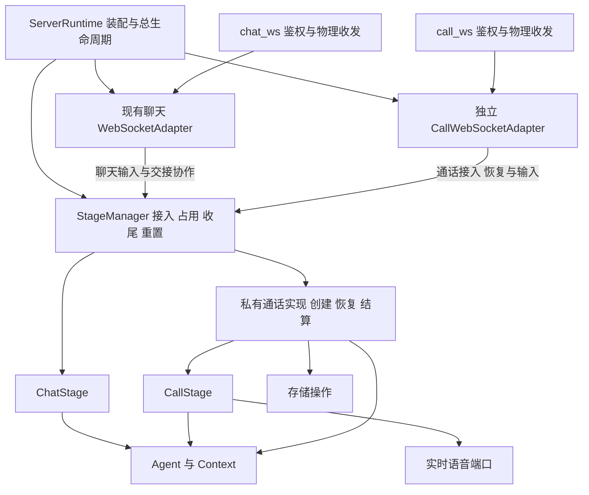

# 实时通话深模块重构交接

本文交给后续负责服务端通话重构的开发者。目标是在保留现有通话行为的基础上，减少外部模块必须了解的通话实现细节，使新增 CallStage 对整体架构的影响与新增一种 Stage 相称。

核心结论：当前主要问题是创建顺序、失败补偿、资源释放和就绪判定分散在调用方。只移动构造位置、减少参数数量或新增一个容器，不能完成深模块重构。应先收窄完整操作的接口，再整理内部实现和装配。

## 1. 交接基线与约束

### 1.1 代码基线

- 检查日期：2026-10-13。
- 工作分支：`feat/call`。
- **代码以 `feat/call` 分支已提交并推送的 HEAD 为准。**
- 本次审查对应的原始实现提交：`7c3eae65f13acb1d80804fa50c15a67b54955c8a`。CR-1 至 CR-6 后续在隔离分支实施；本文前半的“当前”调用链与审查发现保留为历史问题快照，目标契约与当前状态以代码地图及实施证据为准。
- 这是架构交接与实施建议，不是已实施的新设计，也不是 PR 审查报告或新的功能验收结论。

接手时同步 `feat/call`，直接检出该分支即可取得完整交接内容，无需额外应用工作区补丁。若 HEAD 在上述实现提交之后又包含代码修改，应重新核对本文中的符号和行为；行号仅用于审查快照导航。

### 1.2 已完成、应保留的调整

1. 通话结算与恢复已从 `application/call` 迁到 `stage/call_settlement`；用户能力查询留在 `application/user`。
2. `StageManager` 统一持有 Chat/Call 收尾任务；`ServerRuntime` 不再持有 `call_settlement_coordinator`。
3. `StageManager` 已自行创建 `CallAgentSettlement`、`CallSettlementConsumerImpl` 和 `CallSettlement`；不要恢复为由组合根创建后传入。
4. 新聊天或新通话与同一 `(user_id, character_id)` 的收尾冲突时，立即拒绝并返回可重试的 `INTERACTION_FINALIZING`。
5. 用户重置要求该用户所有角色均空闲；在线、离线保留、呼叫接入和收尾均属于忙碌。忙碌时返回 HTTP 409 `USER_INTERACTION_BUSY`，不等待、不停止交互、不删除数据。
6. 空闲检查与取得重置占用必须原子完成。重置期间不得接入新交互。

此前讨论过“收尾期间等待新聊天/通话”，但没有决定实施；本次重构不得顺带改成等待或排队。

### 1.3 阅读顺序与范围

先读[开发守则](../开发守则.md)、[代码地图](../代码地图.md)、[领域术语](../../CONTEXT.md)，再读[实时通话 Spec](用户实时语音通话-spec.md)中的接入、恢复、结算、隐私和重置约束。已更新的收尾接入规则优先于文档中的早期说明。

本次检查重点是服务端装配、Web 接入、Adapter、Stage、Agent 交互、结算、存储恢复和测试接口。客户端协议兼容与重试行为是回归范围；Android 音频实现、实际供应商效果和生产部署不在本次架构检查的验证范围。

## 2. 判断深度的标准

模块的 interface 不只是方法签名，还包括调用者必须知道的顺序、不变量、错误恢复、初始化条件和完成时点。判断重构是否有效，应回答：

- 接入一次通话，调用方还需要学习几种内部对象和几个中间状态？
- 创建中途失败，调用方是否必须判断内部执行到了哪一步才能补偿？
- 修改结算或重连实现，是否必须同时修改 ServerRuntime、Web、Adapter 和 StageManager？
- 测试能否通过正式入口观察结果，只替换模型、实时语音等外部依赖？

内部存在多个类不是问题。`CallLifecycle`、播放协调器、协议编解码、结算执行器可以继续存在；只要它们不成为外部调用者必须掌握的接口，就不必机械合并。

## 3. 当前调用链与复杂度泄露

当前聊天接入大致为：

```text
Web 鉴权 → StageManager.connect → 创建/复用 ChatStage、绑定连接、取得占用
Web 收帧 → WebSocketAdapter → ChatStage → Agent
Web 断线 → StageManager.disconnect → 离线保留/收尾
```

以下为 CR-1 之前的历史通话接入形态（冻结基线快照，非当前生产接线）：

```text
Web 鉴权、解析首帧
  → 查询 Runtime 能力、语音工厂、结算就绪状态
  → StageManager.infer_call_source_interaction
  → StageManager.start_call，取得 CallStartClaim
  → Web 查询已有 Stage，创建 Queue、Binding、Session，注册 Hub
  → Web 发送 preparing
  → StageManager.create_call_stage，传入语音工厂、Binding、指标
  → Web 完成握手、启动收发及终止释放任务
失败 → Web 根据 create_started 等状态选择 claim/传输补偿
```

重复启动和恢复分支还要求 Web 同时查询 Manager 与 Hub，确认两边对象对应。由此可见，通话的外部 interface 包含了一套跨模块事务，而聊天主要暴露完整的接入和断开操作。

## 4. 审查发现

以下是设计缺口，不等同于已经复现的运行故障。优先级表示建议重构顺序。

### D1 高优先：Web 承担通话创建事务

**历史证据**：[call_endpoint.py](../../server/src/websocket/call_endpoint.py)。该段描述 CR-1/CR-2 重构前的 Web 装配；当前正式入口通过 `CallWebSocketAdapter` 和 `StageManager.open_call`，不再由 Web 消费 claim 或创建 Binding/Session/队列。

**问题**：外部必须学习 claim 的消费、账本失败、传输注册和 Stage 创建的配对顺序。取消和握手失败使这种配对更加复杂。

**与 Chat 的对照**：[聊天入口](../../server/src/web/websocket/endpoint.py)调用 `StageManager.connect`，不负责创建 Context 或消费内部 ownership。

**建议**：Stage 模块提供完整的业务接入操作；协议适配模块提供完整的连接绑定操作。Web 只鉴权、收发、映射稳定错误。业务补偿归 Stage，传输补偿归 Adapter，双方通过明确的操作结果和连接生命周期协调，不向 Web 暴露中间 claim。

### D2 高优先：StageManager 同时管理公共协调与通话专用细节

**历史证据**：[stage_manager.py](../../server/src/stage/stage_manager.py)。该段描述重构前的公开分步接口；当前 claim、Stage 创建和 ownership 释放均由 Manager 内部流程收口，外部使用完整接入操作。

**问题**：共享 Manager 直接保存通话请求任务、创建任务、claim、ownership、deadline 和账本操作。外部接口暴露了内部阶段，部分依赖又由 Web 在每次创建时转交。指标同时从初始化和创建路径传入，调用方必须保证一致。

**建议**：在 Stage 包内设置 Manager 私有的通话实现，负责通话专用创建、恢复和结算。Manager 保留跨 Stage 占用、Chat→Call 交接、用户重置准入和统一收尾任务所有权。不要再建立独立的通话准入锁或另一份收尾任务注册表。

### D3 高优先：跨模块读取私有字段与执行私有清理

**证据**：[stage_binding.py](../../server/src/adapter/websocket/call_v1/stage_binding.py)的 `send_state` 读取 `stage._ownership.client_request_id`（111 行）和 `stage._record.connected_at`（115 行）。Manager 的 `_cleanup_failed_call_stage` 读取 `stage._started`、调用 `stage._cleanup()`（855 行起）。

**问题**：状态事件缺少完成协议转换所需的事实；Stage 创建失败的清理契约也不完整。更改 Stage 的内部存储或初始化阶段，会影响 Adapter 和 Manager。

**建议**：状态事件携带 call_id、request_id、连接时间等必要事实，避免暴露整个账本对象。Stage 的创建操作要么交付可用实例，要么负责撤销未交付资源；幂等关闭必须覆盖部分初始化对象。Manager 负责占用与账本收敛，不判断 Stage 的资源初始化细节。

### D4 高优先：结束完成语义分散，取消契约与 Chat 不同

**证据**：[ChatStage.terminate](../../server/src/stage/chat_stage.py)（262 行）复用 `_termination` task 并 shield；`_terminate`（852 行）执行维护后关闭原 Context。[CallStage.terminate](../../server/src/stage/call_stage.py)（419 行）在调用者任务内持有生命周期锁执行，`wait_closed`（443 行）等待 `_closed`；`_cleanup`（974 行）设置 `_closed`，而 `_finish` 随后才注册结算和发送终止消息。[Web 释放逻辑](../../server/src/web/websocket/call_endpoint.py)（290 行）还要等待终止事件和队列。

**问题**：`wait_closed` 不等于全部收尾完成，也不等于终止帧已送出。外层靠组合内部事件判断完成；重复结束与等待者取消的保证也不同。这里确认的是契约差异，尚未以本轮复现证明取消必然导致泄漏。

**建议**：明确“实时停止”“业务收尾完成”“传输释放”三个事实及其所有者。公共结束操作应幂等，等待者取消不能遗弃已接管的关闭/写入任务。通话可以先释放实时资源再后台结算，但全部业务收尾仍由 Manager 持有。终止帧排空归 Adapter；不要把本地排空命名为客户端已收到或已播放。

### D5 中优先：组合根了解通话内部能力和恢复步骤

**证据**：[server_runtime.py](../../server/src/server_runtime.py)持有 `call_transport_hub`、`call_metrics`、`realtime_speech_factory`、`stale_call_recovery`、`call_capability`；`_build_call_capability`（284 行）读取具体 Skill，检查 binding 类和方法。初始化显式执行恢复并解释 `failed/conflicted`。

**问题**：新增 Stage 的内部装配和准备过程扩散到组合根。结算执行器虽然已经内建，结算与恢复整体仍未形成完整的生命周期接口。

**建议**：StageManager 的异步初始化负责其通话实现的恢复和就绪；组合根只等待该初始化成功。Hub 收进协议适配模块；CallMetrics 在模块内部基于通用观测依赖创建。实时语音作为真实外部依赖，仍可由组合根选择并注入中立端口，不必为了隐藏所有 call 字样而改成全局查找。

### D6 中优先：能力条件在三层重复表达

**证据**：[CallCapabilityStatus](../../server/src/server_runtime.py)有八项就绪布尔值；[call_capability.py](../../server/src/application/user/call_capability.py)逐项投影；Web 又检查语音工厂和 `call_settlement_ready`。

**问题**：判断“可否接入”的知识分散。`isinstance` 或 `hasattr(bind_stage)`只能检查对象形状，不能替代成功初始化。

**建议**：按角色提供稳定的 `available + reason` 能力结果，由拥有这些事实的模块维护。Agent 暴露角色通话能力，不让组合根读取 Skill 树；Stage 管理恢复与业务就绪；协议适配入口合并传输是否启用的事实。用户应用层只投影结果。查询只是快照，实际接入仍须在 Manager 原子检查占用、关闭和重置状态。

### D7 中优先：交互临时维护状态由共享 Skill 和外层释放函数共同管理

**历史证据**：[CallMaintenanceSkill](../../server/src/agent/skills/cognitive/call_settlement.py)。该段描述重构前的跨调用缓存与释放端口；当前维护进度归 Context，已删除这些共享缓存和 `release_call_maintenance` 端口。

**问题**：一次交互的生命周期知识跨越共享 Skill、AgentRuntime 和 Stage。幂等释放可防止重复删除，但不能消除所有权分散。

**已定稿方向**：Skill 不保留跨调用的交互状态，每次维护对应一次 Skill 调用；维护进度随 Context 管理。逐项消除 `_pending`、`_progress`、`_locks`、`_local_batches` 在共享 Skill 中的跨调用状态，不把这些字典整体搬入一个新作用域。执行协调由 Stage 经 Agent 的执行流程负责，持久写入的幂等由持久化实现保证；删除外层按 call_id 释放 Skill 缓存的端口。具体 Context 内容与收尾顺序见第 7.5.3 节。

### D8 中优先：部分集成测试复制了生产装配细节

**证据**：[test_call_coherent_runtime.py](../../server/tests/integration/stage/test_call_coherent_runtime.py)在测试中手动消费 claim、创建 Binding/Session/Stage，并替换 `manager._call_settlement`；[test_stage_finalization.py](../../server/tests/integration/stage/test_stage_finalization.py)也使用内部 seam 控制任务。

**问题**：这些测试适合验证内部组合或并发阶段，但不足以证明正式入口封装完整；内部重构容易牵动大量装配代码。

**建议**：保留有独立价值的状态机、协议和故障注入测试；将外部接入与生命周期验收迁移到新 interface。现有真实网络/进程恢复测试仍有价值，不应描述为当前完全没有外部路径证据。新测试证明行为后再替换重复装配测试，不保留两套长期生产创建路径。

## 5. 与 ChatStage 的一致性判断

| 维度 | Chat 当前行为 | Call 当前行为 | 重构判断 |
| --- | --- | --- | --- |
| 接入 | Manager 一次 connect 完成创建/复用与绑定 | Web 拼接 claim、session、stage | 应统一为完整操作，隐藏中间状态 |
| 创建失败 | ChatStage.create 关闭未交付 Context | Stage.start、Manager、Web 分段清理 | 应统一资源交付契约，各层只清理自己拥有的资源 |
| 占用与重置 | Manager 检查占用及重置 fence | 同一 Manager，还另有通话专用状态 | 共用准入事实；通话细节留在内部，不新增平行锁 |
| 结束任务 | terminate 复用 task，调用者取消隔离 | 生命周期锁串行，实时关闭后另交结算 | 应统一幂等与取消保证，不要求相同完成时点 |
| Agent 入口 | handle_stimulus / realize_action_plan | 实时和结算均经同一门面 | 已一致，应保留；不直接调用 Skill 作为捷径 |
| Context | 工厂创建、Stage 持有，维护后关闭 | 已改为正常通话保留原 Context 完成最终维护和总结后关闭 | 进程恢复缺失 Context 时只按持久账本收敛，见第 7.5.3 节 |
| 交互状态 | Context 和 Stage 持有主要交互状态 | Skill 已无按 call_id 跨调用状态 | 维护进度归 Context，不由 Runtime 管理一次通话缓存 |
| 输出 | Adapter 消费 Stage 输出和公开能力 | Binding 读取 Stage 私有记录 | 应补全语义输出，删除跨模块私有访问 |
| 存储 | 对话过程持久化，结束维护 | 临时逐轮内容，持久账本和最终概要 | 必须保留差异，不能把 CALL 改用 CHAT Store |
| 断线 | 离线保留，期限内复用 | 三秒恢复，协议重放与播放状态继续 | 必须保留各自规则，不统一成一个超时参数 |
| 结束后前台 | 通常由离线期限或切换触发 | 用户可立即退出，结算在后台 | 必须保留用户体验差异；接入限制仍统一 |
| 重启 | 依赖已有聊天持久化行为 | 修复呼叫账本与投影，不恢复实时会话 | 通话恢复必要，但应隐藏在 Stage 启动过程 |

ChatStage 不是需要复制的完美模板：它直接依赖 WebSocketAdapter，Manager 的 connect 也接收具体连接对象。此次应借鉴其“完整操作和明确所有权”，不扩大这些耦合，也不借机重写整个聊天架构。

不引入统一 `BaseStage`、万能事件循环或所有模式共享的状态枚举。Stage 是职责族；Chat 按用户与角色复用，Call 按呼叫身份管理，有不同的输入、持久化和实时性要求。

## 6. 修改指导思想

1. **先减少调用方知识，再减少类和参数。** 优先消除中间 claim、执行步骤和补偿规则的外泄。
2. **一个事实只有一个权威所有者。** Manager 管占用与收尾；Adapter 管协议连接及重放；Stage 管交互时序；Agent 管认知；存储模块管持久一致性。
3. **创建与撤销成对封装。** 交付的对象满足公开不变量；未交付对象由创建者清理。对已持久化的呼叫可能是写入失败终态，而不是删除记录或假装没有开始过。
4. **接收真实外部依赖，内部实现自行创建。** 模型、实时语音、存储和观测有真实替换需求；结算消费者、任务管理器和内部注册表不为测试而成为顶层依赖。
5. **保留协议和并发保护。** 深化模块不删去 ACK、去重、generation、timeout、owned write 或终止幂等；先明确其归属，再迁移实现。
6. **避免以层数代替封装。** 不新增跨全部层的顶级 CallRuntime；不把五个字段包成 CallDependencies 后继续逐层读取；不注入 ServerRuntime 作为服务定位器。
7. **不把业务逻辑下沉到 infrastructure。** 可封装账本、批次、投影的存储操作；接听、恢复策略、结算时序与 Agent 调用仍属于 Stage/Agent。

## 7. 建议的目标实现

独立 `CallWebSocketAdapter` 的方案已于 2026-10-13 确认。其余草图中的名称用于说明职责，实施者可调整私有目录和类名；对外行为与所有权必须保持。

### 7.1 模块关系



图中箭头表示主要协作关系，省略经 sink 返回的输出流。Adapter 不执行认知或长期记忆；Stage 不处理 WebSocket 原始帧。

### 7.2 外部接口应表达完整行为

StageManager 保留 Chat 的 connect/disconnect、通话切换准备、用户重置准入和 close；通话接入应收敛为一个完整操作。可采用如下语义草图，不要求照抄类型和方法名：

```python
await manager.initialize()  # 内部恢复完成，或抛出初始化失败
call = await manager.open_call(request, output_sink)
await call.disconnect()
await call.resume()
await call.terminate(reason)
await manager.close()       # 不再接入，并等待全部业务收尾停止
```

`request` 只包含鉴权身份、角色和请求幂等身份等业务事实；`call` 是有限的交互控制接口，不公开账本、claim、generation、Task、provider 或结算对象。PCM 与播放回执等通话输入保留有语义的入口，不强行塞进聊天消息接口。

**已定稿：保留独立的 `CallWebSocketAdapter`，与现有聊天 `WebSocketAdapter` 并列，不作为其私有通话分支。** `CallWebSocketAdapter` 向 Web 提供接入/恢复、收帧、获取输出、断开的完整能力。Hub、Session、Binding、Queue 及其排空任务均封装在内部；ServerRuntime 可以装配和持有这个门面，但不公开其内部对象，Web 和其他模块也不得穿透访问。

独立实现有实际协议依据：`call.v1` 混合 JSON 控制帧与二进制 PCM；每个方向的有序控制帧和音频帧共享连续序号；需要 ACK/NACK、缺口重放、音频背压，以及 `playback.completed/stop/stopped` 和取消序号区间。聊天已有 ACK、消息去重和有界投递，但没有与此相同的会话协议。通话切换准备仍可通过聊天连接发起，这种跨入口协作不要求合并两个 Adapter。现有聊天类是否更名为 `ChatWebSocketAdapter` 可作为命名整理处理，不是此次封装的前提。

### 7.2.1 协议会话与 CallStage 的职责

协议会话 `CallTransportSession` 与 `CallStage` 是两个对象，属于同一次通话，正常建立后通过同一 `call_id` 一一关联。它们不等于物理 WebSocket 连接，也不要求同时创建或销毁。

| 对象 | 所有者与职责 | 不承担的职责 |
| --- | --- | --- |
| 物理 WebSocket 连接 | Web 负责鉴权和实际收发；Adapter 管理该连接与协议会话的绑定代际 | 不持有呼叫业务状态，不决定结算和恢复期限 |
| CallTransportSession | CallWebSocketAdapter 内部持有；管理 seq、ACK/NACK、去重、连续确认游标、重放、流标识和取消记录 | 不决定角色回应、沉默挂断或认知维护 |
| CallStage | StageManager 的通话实现持有；管理业务生命周期、Context、Agent 调度、打断、实际播放状态、沉默和恢复期限 | 不解释网络序号、确认游标或原始协议帧 |

Hub 在 Adapter 内部定位和管理协议会话及连接代际；Binding 在内部转换协议消息与 Stage 的语义输入/输出。Adapter 通过 Manager 的公开操作取得有限的交互控制接口，不向 Web 返回需要手动配对的 Session/Stage，也不读取 Stage 私有账本。网络 ACK 表示协议确认，`playback.completed` 表示实际播放完成；Adapter 转换回执，CallStage 根据语义事实推进交互。

### 7.2.2 断线恢复与结束的生命周期关系

```text
旧 WebSocket ─┐
             ├─ 原 CallTransportSession ─ 原 CallStage / Context
新 WebSocket ─┘
```

图中两个连接是先后替换关系；同一时刻只有当前代际的绑定有权控制该会话。旧连接晚到的断开通知、输入或清理不能影响新绑定。

| 阶段 | 协议会话与连接 | CallStage 与业务收尾 |
| --- | --- | --- |
| 建立 | 内部准备 call_id 对应的协议会话，完成绑定后接收有序输入 | 创建并启动一个 CallStage；创建中途失败按各自所有权清理，不向 Web 交付半成品 |
| 接通前断线 | 保留原协议会话及确认记录，允许同请求或 call_id 重绑 | 保留原建立操作到首次 start 的 10 秒期限；可继续准备，无连接不进入 ACTIVE |
| 接通后断线 | 旧物理连接失效，保留协议会话、确认游标和有界重放缓存 | 原 Stage 进入恢复状态，保留原 Context 和交互状态，管理三秒恢复期限 |
| 期限内恢复 | 新连接重新鉴权，校验用户、角色、call_id；沿用原 Session，交换连续确认游标并重放允许重放的缺失帧 | 接通前继续原建立操作，接通后恢复原 Stage；不重置期限，不重建已有 Context，不重复接听或开场 |
| 恢复失败或期限届满 | 解除失败绑定或按终止流程释放会话；不能仅凭缓存仍存在就恢复业务 | Stage 决定是否仍可恢复；期限届满后结束通话，进入统一收尾 |
| 实时交互结束 | 会话可短暂保留以完成有限的终止消息投递和排空，然后释放 | Stage 停止实时任务并释放实时资源，Manager 已接管业务收尾；不再接受恢复为活跃通话 |
| 后台结算 | 协议会话可以已经释放，无需等待概要和维护完成 | Manager 继续持有收尾，直到实际写入及取消清理停止，才解除接入限制 |
| 服务进程重启 | 不恢复旧内存协议会话或旧连接 | 不恢复旧实时 Stage；启动恢复只收敛允许持久化的账本与投影 |

恢复是一项封装后的协作操作：CallWebSocketAdapter 负责协议身份、代际、游标和重放；StageManager/CallStage 负责业务是否仍可恢复及状态切换。它们的内部调用顺序和失败责任遵循第 7.3 节已确认契约，但 Web 不应分别找到两个对象再执行配对。若会话或业务交互已失效，返回稳定的恢复失败，不能隐式创建新通话补齐缺失对象；PREPARING 尚未创建 Stage 但原建立操作仍有效的情况除外，它只继续原操作。

三个完成时点必须分开：实时资源停止、协议传输释放、业务收尾完成。前两个时点不代表结算完成；终止帧本地排空也不保证客户端已经收到。独立 Adapter 仅封装协议生命周期，不接管 StageManager 的收尾任务或重置准入。

### 7.2.3 协议会话的目录归属

**已定稿：协议会话放在 `server/src/adapter/websocket/call_v1/`，作为 CallWebSocketAdapter 的私有实现，不迁入 stage 或 domain。** 当前 `CallTransportSession` 位于该目录的 [transport.py](../../server/src/adapter/websocket/call_v1/transport.py)，目录归属正确；需要收口的是公开导出和外部装配方式。

建议文件组织如下；私有文件是否拆分可按维护需要调整，不以拆文件数量作为验收标准：

```text
server/src/adapter/websocket/call_v1/
├── __init__.py        # 导出 CallWebSocketAdapter、必要的结果与错误
├── adapter.py        # 完整接入、恢复、收发和断开操作
├── _session.py       # 协议序号、确认、重放和背压
├── _hub.py           # 会话注册、查找和连接代际
├── _stage_binding.py # Stage 语义与 call.v1 协议转换
├── control.py        # 控制帧编解码
└── audio_codec.py    # 音频帧编解码
```

下划线只表达内部性；真正的要求是 Web、ServerRuntime 和 Stage 不再直接创建、查找或操作 Hub/Session/Binding。协议编解码可以保留独立测试接口，但不因此重新公开协议会话的装配过程。

### 7.2.4 两种输出 sink 与协议会话的关系

**已定稿：保留 Agent→Stage 和 Stage→Adapter 两层输出职责，协议会话不是 CallStage 的输出 sink，也不直接接收 AgentOutput。** 当前代码中相关对象如下：

| 接口或对象 | 调用方与实现归属 | 职责 |
| --- | --- | --- |
| CallStage 内部 `_OutputSink` | Agent 调用；Stage 创建，满足 Agent 输出接口 | 接收 AgentOutput，校验执行与取消状态，记录正式回复，处理音频和回复完成等交互事实 |
| `CallTransportSink` | CallStage 调用；由 Adapter 内部的 CallStageBinding 实现 | 提供开始音频流、发送 PCM、停止回复、发送状态及终止通知等语义输出操作 |
| `CallTransportSession` | Adapter 内部 Binding 等实现使用 | 管理输出对应的协议序号、确认、缓存、重放和背压，不作认知或交互决策 |

`CallTransportSink` 的契约应保持在 Stage 可依赖的语义接口位置；目前定义在 [call_stage.py](../../server/src/stage/call_stage.py)，无需为了适配具体协议而移入 call.v1。它可以使用 response_id、stream_id、音频格式等流语义，但不能暴露 ACK 游标、重放表、WebSocket 或 Session 对象。需要整理文件时可以独立为 Stage 的接口文件，不改变依赖方向。

```text
Agent.realize_action_plan
  → AgentOutput
  → CallStage._OutputSink：校验、记录并维护交互状态
  → CallTransportSink：语义输出接口
  → CallStageBinding：Adapter 内部实现，转换为 call.v1 操作
  → CallTransportSession：编号、缓存、重放与背压
  → Adapter 内部输出队列
  → 当前代际的物理 WebSocket 连接
```

这是输出调用链，不表示所有状态通知都源自 Agent。CallStage 自身的生命周期状态也通过 CallTransportSink 输出。反向的播放回执由 Adapter 校验和转换后交给 Stage，业务状态仍由 Stage 推进。

以用户打断为例：CallStage 决定停止哪些回复，调用 `stop_response(response_id, stream_ids)`；Binding 根据 Session 保存的对应关系取得协议序号区间，构造 `playback.stop`；Session 处理取消记录、重放内容和缓存释放。Stage 不计算网络序号区间，Session 不决定是否应当打断。

**重连时，CallStage 持有的 CallTransportSink 保持稳定。** Adapter 内部替换当前物理连接绑定并继续使用原 Session；Stage 不重新绑定网络对象。Stage 内部 `_OutputSink` 仍可按每次 Agent 执行创建，不能把“传输输出接口稳定”误解为整个通话只有一个 Agent 输出 sink。

上述两种输出 sink 均与 `CallSettlementSink` 区分：后者仅在 Stage 内部把冻结快照交给 Manager 所有的收尾操作，不进入协议会话，也不负责网络输出。

### 7.3 已定稿的接入、首 ACK 与恢复契约

本节于 2026-10-13 确认，描述待实施的目标契约，不表示当前代码已经满足。对应产品和协议约束已同步到 Spec 的 AC-03、AC-11、呼叫建立顺序及 call.start/call.resume 定义。

#### 接管呼叫与身份准备

`StageManager.open_call(request, output_sink)` 表达完整接入：校验身份和幂等请求、取得占用、建立 PREPARING 账本，并持有最终接通或终止的建立操作。返回的交互控制接口可以处于 PREPARING，但已经支持挂断、断线、重新绑定；调用方无需继续消费 claim 或创建 Stage。后台建立任务由 Manager 持有，不随一次 Web 请求等待者退出而遗弃。

Manager 接管成功后，通过语义输出接口发出内部身份准备通知，携带 call_id、client_request_id、character_id 和当前状态。它不是新增 wire 消息，也不包含账本对象、claim 或 Task。CallWebSocketAdapter 内部建立或取得 Session，关联交互控制接口与当前连接代际，准备稳定的输出路径。

准备期间尚未创建 CallStage 是合法状态；原建立操作就是该呼叫的业务所有者。恢复该状态不能因暂时没有 CallStage 而判定业务丢失，也不能启动第二条建立流程。已完成准备的呼叫若缺失应有的 Stage，或协议会话已经失效，则不得以补建对象冒充恢复。

#### 首 ACK 的时点与承诺

首 ACK 确认“服务端已接管 call.start，并负责报告最终结果”，不确认 Context/供应商已初始化，也不确认角色接听。首次接入顺序为：

```text
鉴权、校验 call.start(seq=1)
  → Manager 幂等检查、占用与切换意图校验、建立 PREPARING 账本、持有建立操作
  → 内部身份准备通知
  → Adapter 完成逻辑绑定和输出路径
  → 按顺序排入 call.state(PREPARING，含 call_id)、ack(ack_seq=1)
  → 放行后续状态输出；Manager 终止旧 Chat 并关闭旧 Context
  → 创建通话 Context 和实时语音会话
  → 准备完成，进入 RINGING，请求 Agent 接听决定
  → 有有效连接且接听获准时进入 ACTIVE，否则等待重绑或终止
```

接入被拒绝或账本建立失败，不发送成功 ACK。ACK 后供应商初始化失败是已接纳操作的失败结果，按稳定错误及账本终态收敛。ACK 不占序号、不进入重放缓存、不再被 ACK；客户端以 call.active 判断接通并开始计时。

Adapter 必须先排好 PREPARING 与首 ACK，才放行后续状态/音频；不等待客户端实际收取，也不在 Manager 占用锁中执行物理网络发送。绑定未完成时输出不得落到无人持有的 sink；内部注册失败由 Adapter 清理，由 Manager 按系统失败收敛业务。已接管后仅物理投递失败则按断线处理，不撤销呼叫身份。

#### 初始化期间的挂断、断线与接听

Adapter 在初始化等待期间继续收帧。已接纳呼叫的用户挂断交给同一交互控制接口：Manager 停止后续建立、等待拥有的任务收敛，并按 CANCELLED_BEFORE_ANSWER 结算；不能因 Context 尚未创建而改判系统失败。

PREPARING/RINGING 断线保留原建立操作到首次 call.start 的 10 秒总期限，可以继续资源准备，但没有有效连接不得进入 ACTIVE。已取得的 Agent 接听决定可以保留，重绑不重复请求接听或触发开场。进入 ACTIVE 前再次检查当前连接事实、挂断与期限；仅首次进入 ACTIVE 触发 CallStarted。

切换意图有效期与呼叫建立期限分别计时：前者从 call.switch_ready 起 10 秒，后者从首次 call.start 起 10 秒。重复 start、resume、ACK 丢失和重绑均不重置建立期限。接通前期限届满按建立超时终止，不生成系统失败的 Conversation 通话记录；网络不可用时不能保证终态送达，客户端也不因重试延长本次等待期限。

若服务端已进入 ACTIVE，随后 call.active 或首 ACK 未送达，则仍按已接通后的三秒恢复规则处理。状态分类以服务端业务事实为准，不以客户端是否见到消息为准。

#### 重复请求、恢复顺序与失败责任

| 场景 | 约定 |
| --- | --- |
| 客户端未知 call_id，首响应丢失 | 用相同 client_request_id 重发 call.start，定位同一呼叫；不新建 Stage、账本、Session，不重新消费意图 |
| 客户端已知 call_id | 用 call.resume 重绑；接通前只继续原建立操作，接通后恢复原 Stage |
| 原请求仍在建立 | 返回原身份与当前状态，共用原操作和剩余期限；序号重传遵守相同 seq/内容幂等规则 |
| 原呼叫已结束或失败 | 返回原身份与终态/稳定失败；不重新拨号，不复活或补建已释放的 Session |
| 原连接仍有效，另一连接尝试接管 | 拒绝抢占；幂等身份不等于接管授权，旧连接清理不能影响新一代绑定 |
| 业务或协议恢复校验失败 | Adapter 撤销临时绑定；Manager/Stage 保留原期限或按既有终止条件结束，不由 Web 补偿 claim |

恢复内部顺序：Adapter 校验身份、游标并预留连接代际 → Manager/Stage 检查原呼叫及剩余期限 → Adapter 准备 call.resumed 与允许重放的旧帧 → 完成绑定并报告连接恢复 → 放行排在恢复输出之后的新输出。阶段切换须重新核对当前代际、终态和期限，不能用预检查结果绕过期间发生的挂断或超时。

call.resumed 不等待额外 ACK。绑定成功后物理发送再次失败，按一次断线处理；确认游标与幂等规则处理响应是否送达的不确定性。Adapter 保留原 Session 的序号、确认记录和取消记录，重放遵守原协议，不从零重建序列，也不发送未取消旧帧之后的新帧来跳过缺口。重复 call.start 用于身份定位，不隐式确认客户端尚未声明收到的服务端帧。

责任划分：Web 只鉴权、实际收发并报告断线；Adapter 负责身份映射、首 ACK、协议绑定、游标和重放；Manager/Stage 决定建立是否继续、是否仍可恢复、何时接听/终止，并负责账本与业务收尾。首 ACK 丢失不等于业务失败；传输清理不等于交互占用已经释放。

### 7.4 初始化与构造依赖

按职责收口通话依赖，不以减少构造参数数量为目标：

| 当前外泄依赖 | 建议处理 |
| --- | --- |
| call_sessions、conversation_service、call_maintenance_batches | 先落实 Context 与收尾流程，再评估剩余跨存储一致性操作是否需要封装；不预先要求新增持久化门面，必要时保留明确依赖 |
| call_resources | Skill 无跨调用状态，维护进度归 Context；删除按 call_id 从外层释放 Skill 缓存的端口 |
| call_metrics | 传入统一观测能力，由使用者内部建立通话指标记录器 |
| realtime_speech_factory | 保留中立实时语音端口，在初始化时注入通话实现，不再由 Web 每次转交 |
| 具体 Skill 就绪查询 | Agent 提供按角色的能力结果，内部解释 Skill 组合 |
| stale_call_recovery 与投影验证器 | 恢复由 Manager 内部启动；验证器由持久化侧或既有依赖装配提供所需存储操作 |

真实依赖仍须显式传入，参数不可能无条件降到零。不要为减少参数而把整个 DatabaseManager 或 AgentRuntime 传入后任意遍历其对象树。已有模块的公开操作可以复用；不为减少参数而把多个仓储打包成集合或原样转发的空包装。

**已定稿的持久化接口处理原则**：先落实第 7.5.3 节的 Skill 无状态、Context 内容与维护进度归属，以及最终维护→最终总结→持久化→关闭 Context 的收尾流程，再审查剩余的跨存储一致性操作，判断是否值得封装。不预先要求新增持久化门面，也不将其作为 Context 与收尾改造的前置条件。这里涉及 `call_sessions` 的呼叫账本、`conversation_service` 的最终通话记录及 `call_maintenance_batches` 的维护批次，不涉及持久化整个 Context 或逐轮转写。

只有当一个完整操作能实际隐藏多步写入、幂等校验、冲突检测或完成状态修复时，才考虑在持久化模块封装，并用真实 SQLite 的中途失败、重复执行和恢复行为验证；例如最终通话记录已写入但账本完成标记尚未更新时的一致性处理。无实际封装收益则保留明确依赖。恢复策略、收尾时序及 Agent 调用继续归 Stage/Agent，不随存储封装下沉。

初始化推荐维持现行失败语义：恢复失败或冲突导致初始化失败并回滚。不要在此次重构中擅自改成“聊天继续工作、仅禁用通话”。即使通话开关关闭，也要核对旧账本恢复要求，不得直接跳过当前启动收敛行为。

### 7.5 收尾与资源所有权

| 事实/资源 | 权威所有者 | 完成条件 |
| --- | --- | --- |
| 同用户角色交互占用、重置准入 | StageManager | 当前交互及其收尾全部退出后才允许新接入 |
| 实时语音连接、PCM、播放协调 | CallStage | 停止生产/消费，等待拥有的任务停止并释放实时资源 |
| InteractionContext（含会话内容和维护进度） | Stage 生命周期持有，Manager 保障收尾任务完成 | 实时停止时保留，业务收尾及实际写入停止后显式关闭 |
| 固定后的会话内容、最终维护、最终总结 | Manager 所有的收尾操作 | 成功、失败或超时后，实际写入与取消清理均停止 |
| WebSocket attachment、seq、重放、待发送终止帧 | Adapter | 按有限投递策略排空/放弃，释放对应代际的会话 |
| 持久账本、概要投影、维护批次 | 存储模块 | 幂等提交或明确失败，符合隐私白名单 |

向 FINALIZING 的转移必须在释放活跃占用前完成，中间不允许出现一次可接入的空窗。可继续使用现有私有收尾注册器，无需另造通用任务框架。

当前实现已由 Manager 接管正常通话的原 Context，按最终认知维护→最终总结→持久化→关闭 Context 的顺序收尾；实时资源仍提前停止。进程恢复缺失 Context 的路径继续只按持久账本收敛。完整约束见第 7.5.3 节。

15 秒结算期限触发取消，不代表 15 秒时已拥有的数据库线程必然停止。接入必须等待真实写入收敛，避免超时返回后旧任务继续影响新交互或重置。

### 7.5.1 已定稿的结束操作与完成契约

本节于 2026-10-13 确认，属于后续实现要求。公开结束操作以 `await call.terminate(reason)` 表达；首次结束请求由 Manager 接管并登记唯一的结束任务，重复调用等待同一次结束，不重复关闭资源、发起结算或改写已经确定的终态。

该操作成功返回保证：停止接纳新音频及普通 Agent 工作；实时语音、回复生成和初始化等相关任务已停止；实时资源已关闭，终态已确定；Manager 已接管后续业务收尾。它不保证概要/认知维护已完成，不等待客户端收到终止消息，也不代表允许新交互。接通前资源尚未创建时同样适用，不能由仍在运行的初始化任务在返回后补建资源。

`close()` 若保留为调用结束操作的便捷方法，必须遵守同一幂等与取消契约；不再提供完成范围不明的独立关闭路径。现有 `wait_closed()` 不作为外部判断全部业务完成的依据；实现中应明确其实时停止含义，或收为私有/更名，不能让 Web 组合内部事件猜测完成状态。

Manager 私有的业务收尾句柄可以直接使用 Task，无需新增通用任务框架。其完成保证该交互拥有的全部业务工作、持久写入和取消清理已真正停止，临时资源已经释放，不会再产生晚到业务副作用。成功完成和失败后清理完成都可以结束该句柄，但失败须保留诊断，不能把“工作已经停止”报告成“概要与维护均成功”。只要仍有子任务或已接管写入在运行，就不能以外层 Task 提前返回或异常退出冒充收尾完成。

该句柄仅供 Manager 用于解除 INTERACTION_FINALIZING、用户重置的空闲判定及服务关闭等待；不暴露给 Web，不由协议会话释放或终止帧排空代替。结束任务向收尾任务转交所有权必须无接入空窗；短暂重叠持有可以，不能两边都不持有。

| 等待或完成事实 | 保证 | 不代表 |
| --- | --- | --- |
| `call.terminate(reason)` 成功返回 | 实时停止、终态确定、收尾已被 Manager 接管 | 全部业务收尾完成、客户端已收到终止帧 |
| Manager 内部业务收尾句柄完成 | 全部业务工作与写入已停止，成功或失败清理已结束 | 所有业务步骤均成功 |
| Adapter 传输释放完成 | 对应协议资源按有限投递策略释放 | 业务收尾完成、客户端实际收到或播放完毕 |

### 7.5.2 等待者取消与生命周期取消

**已定稿：调用者可以停止等待，但不能因此取消 Manager 已接管的结束和收尾工作。** 首次结束操作在可取消的等待前完成任务登记，Manager 保持引用、观察错误并负责排空；等待层使用 shield 或等价机制隔离取消，向外部等待者正常传播取消，不吞掉请求取消。重复调用仍等待同一个已登记任务。

| 来源 | 处理 |
| --- | --- |
| Web 请求取消、连接断开、外部等待超时 | 仅退出该调用者的等待；结束/收尾任务继续由 Manager 持有，不释放占用、不清空任务登记 |
| 结算自身 15 秒期限等生命周期策略 | 由所有者取消实际工作，并等待子任务、已接管写入及 finally 清理停止，才结束收尾句柄并解除占用 |
| 服务关闭或初始化回滚 | 等待 Manager 持有的结束与收尾；其完成前不得关闭仍会被访问的 Agent 或数据库依赖 |

shield 只隔离外部等待者，不禁止所有者按生命周期策略取消任务。15 秒是触发取消的期限，不是保证数据库线程在该时刻被强制终止。失败、超时或取消均须完成实际清理，不能通过提前删除注册项使重置或新交互穿过仍在写入的旧任务。

### 7.5.3 已定稿的 Skill 状态、会话内容与最终总结

本节契约已由 CR-4 候选实现及组合测试承载；仍需维护者审查，不因此视为 Spec 非作者审批或 ADR Accepted。

**Skill 无跨调用状态。** 每一次维护工作对应一次 Skill 调用，局部输入、提取结果和执行临时变量随调用结束释放。Skill 不记录哪些维护尚未完成，不按 call_id 保留进度、待办、锁或批次缓存。维护进度由 InteractionContext 持有，表达已经完成记忆与画像提取并成功应用结果的位置；失败不得提前推进，重试从未完成范围重新发起调用。部分写入后的重试由持久化幂等保障，不能依赖 Skill 记住上次执行。持久批次仍按既有恢复及隐私规则管理，不等同于 Skill 内存状态。

**ConversationContext 保存且仅保存本次会话内容。** 它包含本次会话已生成的摘要和未被压缩的会话内容。通话开始时加载的历史聊天摘要与近期记录属于独立只读背景，可以帮助 Agent 理解，但不能合入本次会话摘要、维护范围或最终通话概括。ContextFactory 负责按此契约加载与装配，Stage 不直接查询数据库或手工拼装历史。维护指针与会话压缩位置分别表达；压缩不得丢弃尚未完成认知维护所需的原始内容。

**正常通话复用原 InteractionContext 顺序收尾。** 其中的 ConversationContext 是最终总结所需的会话上下文，不新增一套独立结算 Context 或跨 Context 状态共享机制。流程为：

1. 停止实时输入、回复及相关任务，固定本次会话内容，禁止晚到转写继续修改输入；释放实时语音与传输相关的 Stage 资源，保留 Context。
2. 经 Agent 完成最终认知维护，处理维护指针之后尚未维护的内容，成功应用后推进指针。
3. 将本次会话已有摘要与未压缩的会话内容进行一次总结，更新会话摘要；直接以此作为最终会话概括，不再额外调用一条独立概要生成链。
4. 按既有规则持久化最终结果，等待已接管写入及清理停止，显式关闭 Context，再完成业务收尾并解除占用。

上述为成功路径；维护失败、总结失败、超时或取消须沿既有失败策略记录结果并完成清理，不得报告为全部成功。Context 关闭随完整 Stage 生命周期，而非实时停止或对象垃圾回收；Manager 持有收尾任务保证其最终完成。协议资源释放仍遵循 Adapter 自身契约。

本决策针对仍持有原 Context 的正常通话；接通前尚无 Context、进程崩溃导致 Context 丢失等路径继续遵守既有账本恢复规则，不为重建会话上下文持久化转写或临时工作摘要。

### 7.6 关闭与回滚

正常关闭和初始化回滚应复用各模块自身的幂等关闭接口。顺序为：停止新接入 → 停止实时交互 → 持有并排空业务收尾；Adapter 在允许终止输出的窗口内完成传输释放；最后关闭 Agent、模型及存储依赖。

实现时协调 Adapter 的“停止接入”和“释放全部传输资源”两个动作，避免先销毁传输使 Stage 结束输出失效。ServerRuntime 可以编排模块级关闭顺序，但不需要知道某个 call 的队列、claim 或内部任务。

## 8. 实现顺序与每步交付

每一步按可观察结果组织工单和 PR，不按文件机械拆分。允许在同一步跨 Web、Adapter、Stage 修改。以下顺序不要求先写测试，但每步提交前须有对应证据。

| 步骤 | 交付结果 | 主要修改 | 完成证据 |
| --- | --- | --- | --- |
| S0 固定基线 | 在新工作区能复现当前行为 | 同步已推送的 feat/call HEAD，记录提交并确认工作区干净；核对 Spec、测试环境 | 接手者可复现接入、收尾拒绝和重置拒绝；记录既有失败 |
| S1 完整事件与关闭契约 | Adapter 不再读 Stage 私有字段，Manager 不再调用 Stage 私有清理 | 补全状态事实；封装创建失败清理；明确幂等结束与取消所有权 | 部分创建失败、重复结束、等待者取消均释放实际资源；协议输出保持一致 |
| S2 完整通话接入 | Web 不再拼接 claim、Stage 与协议会话 | 新 Manager 接入操作与独立 CallWebSocketAdapter 一同替换旧生产调用链；内部封装 Hub/Session/Binding，处理身份准备和握手失败 | 重复 start、创建中断、ACK 丢失、恢复、连接代际竞争都走正式接口 |
| S3 内部通话管理与启动 | ServerRuntime 不再解释通话恢复报告或读取 Skill 树 | Manager 私有通话实现；恢复纳入 initialize；统一能力查询；Hub 收进 Adapter | 恢复完成前不可接入，失败回滚完整，关闭等待收尾；能力查询与接入一致 |
| S4 依赖与交互状态收口 | 构造接口反映真实外部依赖，临时状态有单一所有者 | 先落实 Skill 无跨调用状态、维护进度归 Context、历史背景分离及原 Context 顺序收尾；再评估跨存储一致性封装，按收益决定是否新增接口；删除重复释放端口；指标内部创建 | 阈值维护到最终结算衔接正确；历史不混入本次概括；取消/失败后无悬留写入、临时转录或缓存 |
| S5 清理和验收 | 仅保留一条生产装配路径，文档与代码一致 | 删除过渡方法与重复测试装配，更新代码地图/Spec，按实际使用收紧导出 | 正式接入、进程恢复和隐私断言通过；架构搜索无旧路径 |

S1 与 S2 优先解决调用方必须掌握的顺序；S3 和 S4 才整理参数与顶层对象。不要先把全部字段搬进一个内部类，再发现 Web 仍需要知道同一套创建步骤。

CR-6 已删除无生产调用的 `stop_user_interactions`；claim、Stage 创建与 ownership 释放仅保留 Manager 私有实现，测试故障注入显式使用私有 seam。删除依据为正式 `open_call`/Adapter 路径已覆盖接入、失败补偿、关闭与恢复，且全仓无生产外部引用。

## 9. 验证要求

### 9.1 必须保持的行为

1. 在账本接管后、初始化未完成时，PREPARING 先于首 ACK，首 ACK 先于后续状态/音频；初始化中仍可挂断。接通前断线不延长首次 start 的 10 秒期限，无连接不接通；重复 start、接通前 resume 和 ACTIVE 已提交但响应丢失均覆盖失败注入。
2. 同一幂等请求不会建立第二个 Stage、第二个语音连接或重复正式通话记录；身份冲突被拒绝。
3. Chat→Call 切换仍遵守现有准备与交接规则；持久化前失败和持久化后失败分别正确恢复/终止。已有收尾冲突不能被解释成自动等待。
4. 创建任一阶段失败、连接丢失、旧连接晚到，均不会释放新一代连接/交互的所有权。
5. 三秒恢复沿用同一协议会话、CallStage、Context 和音频状态，仅替换物理连接绑定，不重复接听或开场；超时终止。会话或 Stage 已失效时拒绝恢复，旧绑定清理不能影响新绑定。ACK/重放不等于客户端播放完成，沉默时钟仍以真实播放回执为依据。
6. Chat 与 Call 收尾成功、失败、超时、取消清理期间，新接入均按当前规则拒绝；其他无冲突用户仍能使用。重置忙碌时不执行删除。
7. 重置与新接入竞态中至多一方取得占用；关闭或回滚后没有未持有的业务任务继续写入。
8. 重启只根据允许持久化的账本和批次收敛，不恢复实时会话；概要与维护进度独立收敛，重复恢复不重复写入。
9. Conversation 持久记录、Redis、账本和媒体库不出现不允许持久化的 PCM、逐轮转录或临时工作摘要。CALL ConversationContext 仅在内存保存本次会话内容，关闭时清空，不通过 Store 落库；维护候选/最终概要的既有持久化白名单保持不变。

结束接口还须验证：terminate 返回时实时任务/资源已停止，而被阻塞的业务收尾仍使新接入和重置被拒绝；取消首个或重复等待者只取消等待，底层结束和收尾继续且只执行一次；结算超时后故意延迟写入/清理时保持占用，直至真实完成；初始化中结束不产生晚到资源；服务关闭等待上述任务后才关闭 Agent 和数据库。协议会话可先释放，不影响 Manager 继续持有收尾。

Context 与维护契约还须验证：多个交互及重复调用之间 Skill 不残留待办或进度；维护失败不推进指针、部分写入重试不重复生效；历史背景不混入本次会话摘要及最终概括；压缩不丢失待维护内容；最终维护先于最终总结，最终概括直接使用更新后的会话摘要；实时停止保留原 Context，成功、失败或取消收尾后均关闭并清空，且无晚到转写或写入。

### 9.2 测试入口

带目录的路径相对仓库根目录；同一单元格中省略目录的文件沿用前一项的目录。下面是测试导航，不是要求每个 PR 无差别运行全部测试。

| 修改范围 | 现有入口 |
| --- | --- |
| Chat 行为、交接与统一收尾 | `server/tests/integration/stage/test_chat_stage.py`、`test_call_handoff.py`、`test_stage_finalization.py` |
| Stage 创建、状态与失败 | 同目录 `test_call_stage.py`、`test_call_stage_review.py`、`test_call_failure_policy.py`、`test_call_transport_failures.py` |
| 协议适配与真实入口 | `server/tests/integration/stage/test_call_stage_binding.py`、`server/tests/integration/websocket/test_call_websocket_transport.py`、`test_chat_ready_admission.py` |
| 编解码、序号与背压 | `server/tests/unit/adapter/websocket/test_call_v1_audio_codec.py`、`test_call_v1_control.py`、`test_call_v1_transport.py` |
| 结算、维护与恢复 | `server/tests/integration/stage/test_call_settlement_execution.py`、`test_call_settlement_consumer.py`、`test_stale_call_recovery.py`；`server/tests/integration/agent/test_call_threshold_maintenance.py` |
| 持久一致性与晚到写入 | `server/tests/integration/persistence/test_call_settlement_digest.py`、`test_call_maintenance_batches.py`、`test_call_maintenance_projection.py`；`server/tests/unit/agent/test_call_maintenance_owned_writes.py` |
| 启动、能力、重置 | `server/tests/integration/runtime/test_runtime_initialization_rollback.py`、`server/tests/unit/test_call_transport_capability.py`、`server/tests/unit/web/test_call_capability.py`、`server/tests/integration/application/test_user_data_reset.py` |
| 网络与进程重启 | `server/tests/e2e/call/test_call_network_success.py`、`test_call_network_unavailable.py`、`test_call_process_restart_recovery.py` |
| App 收尾拒绝兼容 | `app/__tests__/chat_ready_composition.test.ts`；协议不变时按实际影响选择其他 App 测试 |

在项目依赖齐全的 Python 环境中，可从以下范围开始建立基线，再按修改扩展：

```powershell
python -m pytest server/tests/integration/stage/test_stage_finalization.py server/tests/integration/stage/test_call_handoff.py server/tests/integration/websocket/test_call_websocket_transport.py server/tests/integration/runtime/test_runtime_initialization_rollback.py server/tests/e2e/call -q
python server/scripts/check_architecture_boundaries.py
git diff --check
```

Black/Ruff 对实际修改的 Python 文件显式传路径，包含测试文件；当前 Ruff 默认发现范围不代表整个 server。不要把本机临时依赖目录写成其他开发者必须使用的安装路径。重构后的测试结果由实施者重新记录，历史通过数量不作为新实现验收。

### 9.3 接口验收与测试迁移

测试外部行为时，使用真实 Manager、Adapter、Agent 门面和本地 SQLite；外部模型、TTS、实时语音和向量依赖使用确定性替身。内部并发注入可以继续在私有 seam 进行，但不因此增加生产构造参数。

替换测试时逐项映射原有断言，尤其保留失败恢复、取消、幂等和隐私断言。纯状态机与协议测试有独立价值，应保留；仅断言内部构造顺序、复制旧装配的冗余测试在新接口行为有证据后删除。

完成时还应搜索并人工确认：Web 不再构造 CallStage/CallStartClaim/结算对象；Web 不再解释 `create_started`；Hub/Session/Binding 不再由 Web 或 ServerRuntime 直接装配、访问，而是由独立 CallWebSocketAdapter 封装；Adapter 不再读取 Stage 私有账本或 ownership；ServerRuntime 不再读取 Skill 树构建通话能力，也不再显式调用恢复 `reconcile`。这些搜索是结构证据，不能代替行为测试。

## 10. 已确认的设计与实施判断

既有产品规则不需重新讨论。独立 CallWebSocketAdapter、协议会话的目录归属，第 7.2 节的职责、生命周期和两层输出 sink 关系，第 7.3 节的身份准备、首 ACK、接通前断线和恢复契约，以及第 7.5 节的实时停止、全部业务收尾完成、等待者取消、Skill 无状态与 Context 收尾契约已确认，不再作为待选方案。

第 7.4 节的持久化接口处理原则也已确认：先落实 Context 和收尾流程，再依据剩余跨存储一致性操作的实际封装收益决定是否新增接口。具体接口形状是实施时基于证据的判断，不是预先要求新增持久化门面的待定架构决策；实施者应在对应 PR 中说明封装或保留明确依赖的理由。

判断交付是否完成的标准是：外层能通过少量完整操作接入和释放通话，修改结算或实时实现不再要求 Web 和组合根了解其步骤；同时原有通话行为、隐私约束、Chat 行为以及统一收尾/重置规则均有证据保持。
