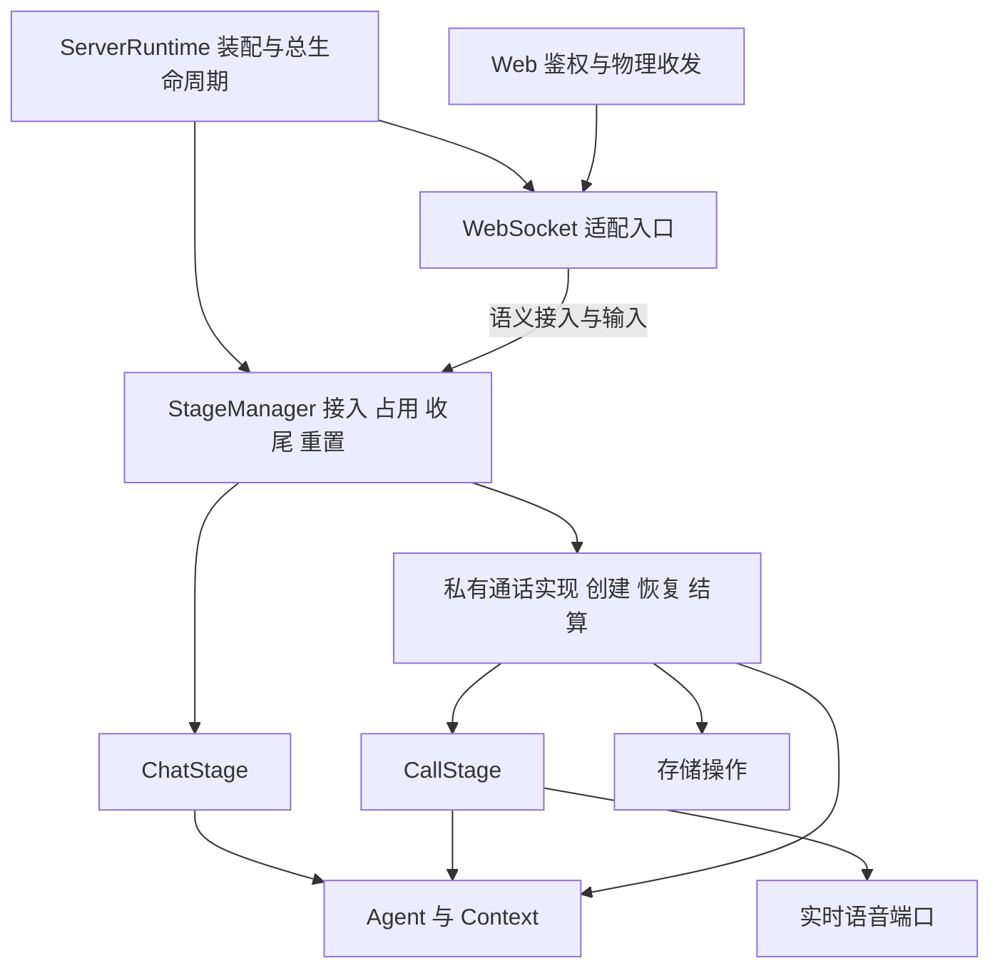

# 实时通话深模块重构交接

本文交给后续负责服务端通话重构的开发者。目标是在保留现有通话行为的基础上，减少外部模块必须了解的通话实现细节，使新增 CallStage 对整体架构的影响与新增一种 Stage 相称。

核心结论：当前主要问题是创建顺序、失败补偿、资源释放和就绪判定分散在调用方。只移动构造位置、减少参数数量或新增一个容器，不能完成深模块重构。应先收窄完整操作的接口，再整理内部实现和装配。

## 1. 交接基线与约束

### 1.1 代码基线

- 检查日期：2026-10-13。
- 工作分支：`feat/call`。
- 当前 HEAD：`e69e67b000d4db3b77ce5cd09c7b2a074c0c517f`。
- **本文以该 HEAD 加当前未提交工作区为依据，不能只检出 HEAD 后照本文操作。** 工作区还包含上一轮生命周期收口、App 接入错误处理、测试和文档修改，以及新增文件和删除文件。
- 这是架构交接与实施建议，不是已实施的新设计，也不是 PR 审查报告或新的功能验收结论。本轮只增加交接文档。

交给其他工作区前，应保存完整变更或提交为可复现基线。`git diff` 不包含未跟踪文件，尤其不要遗漏 `server/src/stage/_finalization.py`、`test_stage_finalization.py`、`test_call_settlement_execution.py`。接手时检查 `git status --short`、`git diff --stat` 和 `git ls-files --others --exclude-standard`，重新核对本文中的符号和行为；行号仅用于当前快照导航。

### 1.2 已完成、应保留的调整

1. 通话结算与恢复已从 `application/call` 迁到 `stage/call_settlement`；用户能力查询留在 `application/user`。
2. `StageManager` 统一持有 Chat/Call 收尾任务；`ServerRuntime` 不再持有 `call_settlement_coordinator`。
3. `StageManager` 已自行创建 `CallAgentSettlement`、`CallSettlementConsumerImpl` 和 `CallSettlement`；不要恢复为由组合根创建后传入。
4. 新聊天或新通话与同一 `(user_id, character_id)` 的收尾冲突时，立即拒绝并返回可重试的 `INTERACTION_FINALIZING`。
5. 用户重置要求该用户所有角色均空闲；在线、离线保留、呼叫接入和收尾均属于忙碌。忙碌时返回 HTTP 409 `USER_INTERACTION_BUSY`，不等待、不停止交互、不删除数据。
6. 空闲检查与取得重置占用必须原子完成。重置期间不得接入新交互。

此前讨论过“收尾期间等待新聊天/通话”，但没有决定实施；本次重构不得顺带改成等待或排队。

### 1.3 阅读顺序与范围

先读[开发守则](../开发守则.md)、[代码地图](../代码地图.md)、[领域术语](../../CONTEXT.md)，再读[实时通话 Spec](用户实时语音通话-spec.md)中的接入、恢复、结算、隐私和重置约束。已更新的收尾接入规则优先于文档中的早期说明。

本次检查重点是服务端装配、Web 接入、Adapter、Stage、Agent 交互、结算、存储恢复和测试接口。客户端协议兼容与重试行为是回归范围；Android 音频实现、实际供应商效果和生产部署不在本次架构检查的验证范围。

## 2. 判断深度的标准

模块的 interface 不只是方法签名，还包括调用者必须知道的顺序、不变量、错误恢复、初始化条件和完成时点。判断重构是否有效，应回答：

- 接入一次通话，调用方还需要学习几种内部对象和几个中间状态？
- 创建中途失败，调用方是否必须判断内部执行到了哪一步才能补偿？
- 修改结算或重连实现，是否必须同时修改 ServerRuntime、Web、Adapter 和 StageManager？
- 测试能否通过正式入口观察结果，只替换模型、实时语音等外部依赖？

内部存在多个类不是问题。`CallLifecycle`、播放协调器、协议编解码、结算执行器可以继续存在；只要它们不成为外部调用者必须掌握的接口，就不必机械合并。

## 3. 当前调用链与复杂度泄露

当前聊天接入大致为：

```text
Web 鉴权 → StageManager.connect → 创建/复用 ChatStage、绑定连接、取得占用
Web 收帧 → WebSocketAdapter → ChatStage → Agent
Web 断线 → StageManager.disconnect → 离线保留/收尾
```

当前通话接入大致为：

```text
Web 鉴权、解析首帧
  → 查询 Runtime 能力、语音工厂、结算就绪状态
  → StageManager.infer_call_source_interaction
  → StageManager.start_call，取得 CallStartClaim
  → Web 查询已有 Stage，创建 Queue、Binding、Session，注册 Hub
  → Web 发送 preparing
  → StageManager.create_call_stage，传入语音工厂、Binding、指标
  → Web 完成握手、启动收发及终止释放任务
失败 → Web 根据 create_started 等状态选择 claim/传输补偿
```

重复启动和恢复分支还要求 Web 同时查询 Manager 与 Hub，确认两边对象对应。由此可见，通话的外部 interface 包含了一套跨模块事务，而聊天主要暴露完整的接入和断开操作。

## 4. 审查发现

以下是设计缺口，不等同于已经复现的运行故障。优先级表示建议重构顺序。

### D1 高优先：Web 承担通话创建事务

**证据**：[call_endpoint.py](../../server/src/web/websocket/call_endpoint.py)，`_authenticate_and_attach`（95 行）、`_cleanup_failed_start`（312 行）。Web 创建 `CallStageBinding`、`CallTransportSession`、输出队列，并根据 `create_started` 决定是否调用 `fail_pending_call_claim`。

**问题**：外部必须学习 claim 的消费、账本失败、传输注册和 Stage 创建的配对顺序。取消和握手失败使这种配对更加复杂。

**与 Chat 的对照**：[聊天入口](../../server/src/web/websocket/endpoint.py)调用 `StageManager.connect`，不负责创建 Context 或消费内部 ownership。

**建议**：Stage 模块提供完整的业务接入操作；协议适配模块提供完整的连接绑定操作。Web 只鉴权、收发、映射稳定错误。业务补偿归 Stage，传输补偿归 Adapter，双方通过明确的操作结果和连接生命周期协调，不向 Web 暴露中间 claim。

### D2 高优先：StageManager 同时管理公共协调与通话专用细节

**证据**：[stage_manager.py](../../server/src/stage/stage_manager.py)，`start_call`（390 行）、`create_call_stage`（759 行）、`take_call_claim`、`release_call`。构造函数新增了 `call_sessions`、`conversation_service`、`call_maintenance_batches`、`call_resources`、`call_metrics`；创建方法又接受语音工厂和指标。

**问题**：共享 Manager 直接保存通话请求任务、创建任务、claim、ownership、deadline 和账本操作。外部接口暴露了内部阶段，部分依赖又由 Web 在每次创建时转交。指标同时从初始化和创建路径传入，调用方必须保证一致。

**建议**：在 Stage 包内设置 Manager 私有的通话实现，负责通话专用创建、恢复和结算。Manager 保留跨 Stage 占用、Chat→Call 交接、用户重置准入和统一收尾任务所有权。不要再建立独立的通话准入锁或另一份收尾任务注册表。

### D3 高优先：跨模块读取私有字段与执行私有清理

**证据**：[stage_binding.py](../../server/src/adapter/websocket/call_v1/stage_binding.py)的 `send_state` 读取 `stage._ownership.client_request_id`（111 行）和 `stage._record.connected_at`（115 行）。Manager 的 `_cleanup_failed_call_stage` 读取 `stage._started`、调用 `stage._cleanup()`（855 行起）。

**问题**：状态事件缺少完成协议转换所需的事实；Stage 创建失败的清理契约也不完整。更改 Stage 的内部存储或初始化阶段，会影响 Adapter 和 Manager。

**建议**：状态事件携带 call_id、request_id、连接时间等必要事实，避免暴露整个账本对象。Stage 的创建操作要么交付可用实例，要么负责撤销未交付资源；幂等关闭必须覆盖部分初始化对象。Manager 负责占用与账本收敛，不判断 Stage 的资源初始化细节。

### D4 高优先：结束完成语义分散，取消契约与 Chat 不同

**证据**：[ChatStage.terminate](../../server/src/stage/chat_stage.py)（262 行）复用 `_termination` task 并 shield；`_terminate`（852 行）执行维护后关闭原 Context。[CallStage.terminate](../../server/src/stage/call_stage.py)（419 行）在调用者任务内持有生命周期锁执行，`wait_closed`（443 行）等待 `_closed`；`_cleanup`（974 行）设置 `_closed`，而 `_finish` 随后才注册结算和发送终止消息。[Web 释放逻辑](../../server/src/web/websocket/call_endpoint.py)（290 行）还要等待终止事件和队列。

**问题**：`wait_closed` 不等于全部收尾完成，也不等于终止帧已送出。外层靠组合内部事件判断完成；重复结束与等待者取消的保证也不同。这里确认的是契约差异，尚未以本轮复现证明取消必然导致泄漏。

**建议**：明确“实时停止”“业务收尾完成”“传输释放”三个事实及其所有者。公共结束操作应幂等，等待者取消不能遗弃已接管的关闭/写入任务。通话可以先释放实时资源再后台结算，但全部业务收尾仍由 Manager 持有。终止帧排空归 Adapter；不要把本地排空命名为客户端已收到或已播放。

### D5 中优先：组合根了解通话内部能力和恢复步骤

**证据**：[server_runtime.py](../../server/src/server_runtime.py)持有 `call_transport_hub`、`call_metrics`、`realtime_speech_factory`、`stale_call_recovery`、`call_capability`；`_build_call_capability`（284 行）读取具体 Skill，检查 binding 类和方法。初始化显式执行恢复并解释 `failed/conflicted`。

**问题**：新增 Stage 的内部装配和准备过程扩散到组合根。结算执行器虽然已经内建，结算与恢复整体仍未形成完整的生命周期接口。

**建议**：StageManager 的异步初始化负责其通话实现的恢复和就绪；组合根只等待该初始化成功。Hub 收进协议适配模块；CallMetrics 在模块内部基于通用观测依赖创建。实时语音作为真实外部依赖，仍可由组合根选择并注入中立端口，不必为了隐藏所有 call 字样而改成全局查找。

### D6 中优先：能力条件在三层重复表达

**证据**：[CallCapabilityStatus](../../server/src/server_runtime.py)有八项就绪布尔值；[call_capability.py](../../server/src/application/user/call_capability.py)逐项投影；Web 又检查语音工厂和 `call_settlement_ready`。

**问题**：判断“可否接入”的知识分散。`isinstance` 或 `hasattr(bind_stage)`只能检查对象形状，不能替代成功初始化。

**建议**：按角色提供稳定的 `available + reason` 能力结果，由拥有这些事实的模块维护。Agent 暴露角色通话能力，不让组合根读取 Skill 树；Stage 管理恢复与业务就绪；协议适配入口合并传输是否启用的事实。用户应用层只投影结果。查询只是快照，实际接入仍须在 Manager 原子检查占用、关闭和重置状态。

### D7 中优先：交互临时维护状态由共享 Skill 和外层释放函数共同管理

**证据**：[CallMaintenanceSkill](../../server/src/agent/skills/cognitive/call_settlement.py)保存 `_pending`、`_progress`、`_locks`、`_local_batches`，`release`（305 行）按 call_id 清理；[AgentRuntime](../../server/src/agent_runtime/agent_runtime.py)暴露 `release_call_maintenance`；[消费者](../../server/src/stage/call_settlement/consumer.py)和[执行器](../../server/src/stage/call_settlement/settlement.py)都调用释放。

**问题**：一次交互的生命周期知识跨越共享 Skill、AgentRuntime 和 Stage。幂等释放可防止重复删除，但不能消除所有权分散。

**建议**：先指定唯一的最终释放所有者，再把临时状态收进显式交互作用域；共享 Skill 接收该状态完成行为。该作用域必须覆盖实时阈值维护到最终结算，不能随实时 Context 关闭而提前清空。持久维护批次、内存工作状态和通话记忆池是不同资源，不应混为一个缓存。

### D8 中优先：部分集成测试复制了生产装配细节

**证据**：[test_call_coherent_runtime.py](../../server/tests/integration/stage/test_call_coherent_runtime.py)在测试中手动消费 claim、创建 Binding/Session/Stage，并替换 `manager._call_settlement`；[test_stage_finalization.py](../../server/tests/integration/stage/test_stage_finalization.py)也使用内部 seam 控制任务。

**问题**：这些测试适合验证内部组合或并发阶段，但不足以证明正式入口封装完整；内部重构容易牵动大量装配代码。

**建议**：保留有独立价值的状态机、协议和故障注入测试；将外部接入与生命周期验收迁移到新 interface。现有真实网络/进程恢复测试仍有价值，不应描述为当前完全没有外部路径证据。新测试证明行为后再替换重复装配测试，不保留两套长期生产创建路径。

## 5. 与 ChatStage 的一致性判断

| 维度 | Chat 当前行为 | Call 当前行为 | 重构判断 |
| --- | --- | --- | --- |
| 接入 | Manager 一次 connect 完成创建/复用与绑定 | Web 拼接 claim、session、stage | 应统一为完整操作，隐藏中间状态 |
| 创建失败 | ChatStage.create 关闭未交付 Context | Stage.start、Manager、Web 分段清理 | 应统一资源交付契约，各层只清理自己拥有的资源 |
| 占用与重置 | Manager 检查占用及重置 fence | 同一 Manager，还另有通话专用状态 | 共用准入事实；通话细节留在内部，不新增平行锁 |
| 结束任务 | terminate 复用 task，调用者取消隔离 | 生命周期锁串行，实时关闭后另交结算 | 应统一幂等与取消保证，不要求相同完成时点 |
| Agent 入口 | handle_stimulus / realize_action_plan | 实时和结算均经同一门面 | 已一致，应保留；不直接调用 Skill 作为捷径 |
| Context | 工厂创建、Stage 持有，维护后关闭 | 实时 Context 关闭，结算另建 Context | 所有权要一致；是否复用同一实例不是前置要求 |
| 交互状态 | Context 和 Stage 持有主要交互状态 | 另有共享 Skill 中按 call_id 保存的状态 | 应建立明确作用域，不由 Runtime 管理一次通话缓存 |
| 输出 | Adapter 消费 Stage 输出和公开能力 | Binding 读取 Stage 私有记录 | 应补全语义输出，删除跨模块私有访问 |
| 存储 | 对话过程持久化，结束维护 | 临时逐轮内容，持久账本和最终概要 | 必须保留差异，不能把 CALL 改用 CHAT Store |
| 断线 | 离线保留，期限内复用 | 三秒恢复，协议重放与播放状态继续 | 必须保留各自规则，不统一成一个超时参数 |
| 结束后前台 | 通常由离线期限或切换触发 | 用户可立即退出，结算在后台 | 必须保留用户体验差异；接入限制仍统一 |
| 重启 | 依赖已有聊天持久化行为 | 修复呼叫账本与投影，不恢复实时会话 | 通话恢复必要，但应隐藏在 Stage 启动过程 |

ChatStage 不是需要复制的完美模板：它直接依赖 WebSocketAdapter，Manager 的 connect 也接收具体连接对象。此次应借鉴其“完整操作和明确所有权”，不扩大这些耦合，也不借机重写整个聊天架构。

不引入统一 `BaseStage`、万能事件循环或所有模式共享的状态枚举。Stage 是职责族；Chat 按用户与角色复用，Call 按呼叫身份管理，有不同的输入、持久化和实时性要求。

## 6. 修改指导思想

1. **先减少调用方知识，再减少类和参数。** 优先消除中间 claim、执行步骤和补偿规则的外泄。
2. **一个事实只有一个权威所有者。** Manager 管占用与收尾；Adapter 管协议连接及重放；Stage 管交互时序；Agent 管认知；存储模块管持久一致性。
3. **创建与撤销成对封装。** 交付的对象满足公开不变量；未交付对象由创建者清理。对已持久化的呼叫可能是写入失败终态，而不是删除记录或假装没有开始过。
4. **接收真实外部依赖，内部实现自行创建。** 模型、实时语音、存储和观测有真实替换需求；结算消费者、任务管理器和内部注册表不为测试而成为顶层依赖。
5. **保留协议和并发保护。** 深化模块不删去 ACK、去重、generation、timeout、owned write 或终止幂等；先明确其归属，再迁移实现。
6. **避免以层数代替封装。** 不新增跨全部层的顶级 CallRuntime；不把五个字段包成 CallDependencies 后继续逐层读取；不注入 ServerRuntime 作为服务定位器。
7. **不把业务逻辑下沉到 infrastructure。** 可封装账本、批次、投影的存储操作；接听、恢复策略、结算时序与 Agent 调用仍属于 Stage/Agent。

## 7. 建议的目标实现

以下名称用于说明职责，实施者可调整私有目录和类名；对外行为与所有权必须保持。

### 7.1 模块关系



图中箭头表示主要协作关系，省略经 sink 返回的输出流。Adapter 不执行认知或长期记忆；Stage 不处理 WebSocket 原始帧。

### 7.2 外部接口应表达完整行为

StageManager 保留 Chat 的 connect/disconnect、通话切换准备、用户重置准入和 close；通话接入应收敛为一个完整操作。可采用如下语义草图，不要求照抄类型和方法名：

```python
await manager.initialize()  # 内部恢复完成，或抛出初始化失败
call = await manager.open_call(request, output_sink)
await call.disconnect()
await call.resume()
await call.terminate(reason)
await manager.close()       # 不再接入，并等待全部业务收尾停止
```

`request` 只包含鉴权身份、角色和请求幂等身份等业务事实；`call` 是有限的交互控制接口，不公开账本、claim、generation、Task、provider 或结算对象。PCM 与播放回执等通话输入保留有语义的入口，不强行塞进聊天消息接口。

协议适配入口向 Web 提供接入/恢复、收帧、获取输出、断开的完整能力。Hub、Session、Binding、Queue 及其排空任务成为该模块内部实现。可作为现有 WebSocketAdapter 的私有通话分支，也可先形成独立适配门面再由现有适配入口持有；不要在 ServerRuntime 暴露内部 Hub 供其他模块继续调用。

### 7.3 处理 call_id 与传输绑定的先后关系

当前 Binding/Session 需要 call_id，而 call_id 在 Manager 建立账本时确定。实现者必须解决这个实际顺序问题，不能只把当前多步调用换个函数名。

推荐给通话输出接口增加携带公开身份的准备事件：内部通话实现确定账本身份后通知 Adapter，Adapter 在内部创建并登记协议会话；绑定就绪后才允许 Stage 启动输出及首帧 ACK 推进。准备事件只说明呼叫身份已确定，不等于呼叫已接通或创建事务已全部完成。

完整操作还必须覆盖：准备事件发送失败、持久化后 Stage 创建失败、Stage 已成功但首个 ACK 丢失、相同 request_id 再入、旧连接与新连接竞争。所有权由 Manager 内部保留/终止，Adapter 只负责自身注册和连接 generation。不要把新的 `prepared_call` 半成品返回给 Web，让它再次成为事务协调者。实现前核对现有 preparing、首 ACK 与实时状态事件顺序的协议测试。

### 7.4 初始化与构造依赖

先建立有行为的模块接口，再替换五个通话参数：

| 当前外泄依赖 | 建议处理 |
| --- | --- |
| call_sessions、conversation_service、call_maintenance_batches | 在持久化模块提供调用方真正需要的账本/结算投影操作，封装内部仓储协作；不要只返回三个仓储的集合 |
| call_resources | 临时维护状态归交互作用域；迁移完成后删除按 call_id 从外层释放 Skill 缓存的端口 |
| call_metrics | 传入统一观测能力，由使用者内部建立通话指标记录器 |
| realtime_speech_factory | 保留中立实时语音端口，在初始化时注入通话实现，不再由 Web 每次转交 |
| 具体 Skill 就绪查询 | Agent 提供按角色的能力结果，内部解释 Skill 组合 |
| stale_call_recovery 与投影验证器 | 恢复由 Manager 内部启动；验证器由持久化侧或既有依赖装配提供所需存储操作 |

真实依赖仍须显式传入，参数不可能无条件降到零。不要为减少参数而把整个 DatabaseManager 或 AgentRuntime 传入后任意遍历其对象树。已有模块的公开操作可以复用；新增持久化门面须实际隐藏多步一致性工作，并通过真实 SQLite 行为证明其价值，否则先保留明确的依赖，避免空包装。

初始化推荐维持现行失败语义：恢复失败或冲突导致初始化失败并回滚。不要在此次重构中擅自改成“聊天继续工作、仅禁用通话”。即使通话开关关闭，也要核对旧账本恢复要求，不得直接跳过当前启动收敛行为。

### 7.5 收尾与资源所有权

| 事实/资源 | 权威所有者 | 完成条件 |
| --- | --- | --- |
| 同用户角色交互占用、重置准入 | StageManager | 当前交互及其收尾全部退出后才允许新接入 |
| 实时语音连接、PCM、播放协调、实时 Context | CallStage | 停止生产/消费，等待拥有的任务停止并释放实时资源 |
| 冻结快照、概要、最终维护、临时维护作用域 | Manager 所有的收尾操作 | 成功、失败或超时后，实际写入与取消清理均停止 |
| WebSocket attachment、seq、重放、待发送终止帧 | Adapter | 按有限投递策略排空/放弃，释放对应代际的会话 |
| 持久账本、概要投影、维护批次 | 存储模块 | 幂等提交或明确失败，符合隐私白名单 |

向 FINALIZING 的转移必须在释放活跃占用前完成，中间不允许出现一次可接入的空窗。可继续使用现有私有收尾注册器，无需另造通用任务框架。

当前结算会另建一个 CALL Context。第一阶段保留该行为，把创建和关闭封装进收尾操作。以后若复用原 Context，应先证明能提前关闭实时资源、保留最终维护所需状态，并在任何失败路径销毁临时内容；不能因“与 Chat 一致”而直接延长所有资源生命周期。

15 秒结算期限触发取消，不代表 15 秒时已拥有的数据库线程必然停止。接入必须等待真实写入收敛，避免超时返回后旧任务继续影响新交互或重置。

### 7.6 关闭与回滚

正常关闭和初始化回滚应复用各模块自身的幂等关闭接口。顺序为：停止新接入 → 停止实时交互 → 持有并排空业务收尾；Adapter 在允许终止输出的窗口内完成传输释放；最后关闭 Agent、模型及存储依赖。

实现时协调 Adapter 的“停止接入”和“释放全部传输资源”两个动作，避免先销毁传输使 Stage 结束输出失效。ServerRuntime 可以编排模块级关闭顺序，但不需要知道某个 call 的队列、claim 或内部任务。

## 8. 实现顺序与每步交付

每一步按可观察结果组织工单和 PR，不按文件机械拆分。允许在同一步跨 Web、Adapter、Stage 修改。以下顺序不要求先写测试，但每步提交前须有对应证据。

| 步骤 | 交付结果 | 主要修改 | 完成证据 |
| --- | --- | --- | --- |
| S0 固定基线 | 在新工作区能复现当前行为 | 保存本轮前已有变更与新增文件；核对 Spec、分支、测试环境 | 接手者可复现接入、收尾拒绝和重置拒绝；记录既有失败 |
| S1 完整事件与关闭契约 | Adapter 不再读 Stage 私有字段，Manager 不再调用 Stage 私有清理 | 补全状态事实；封装创建失败清理；明确幂等结束与取消所有权 | 部分创建失败、重复结束、等待者取消均释放实际资源；协议输出保持一致 |
| S2 完整通话接入 | Web 不再拼接 claim、Stage 与协议会话 | 新 Manager 接入操作与 Adapter 门面一同替换旧生产调用链；处理身份准备和握手失败 | 重复 start、创建中断、ACK 丢失、恢复、连接代际竞争都走正式接口 |
| S3 内部通话管理与启动 | ServerRuntime 不再解释通话恢复报告或读取 Skill 树 | Manager 私有通话实现；恢复纳入 initialize；统一能力查询；Hub 收进 Adapter | 恢复完成前不可接入，失败回滚完整，关闭等待收尾；能力查询与接入一致 |
| S4 依赖与交互状态收口 | 构造接口反映真实外部依赖，临时状态有单一所有者 | 必要的持久化行为封装；维护状态作用域；删除重复释放端口；指标内部创建 | 阈值维护到最终结算衔接正确；取消/失败后无悬留写入、临时转录或缓存 |
| S5 清理和验收 | 仅保留一条生产装配路径，文档与代码一致 | 删除过渡方法与重复测试装配，更新代码地图/Spec，按实际使用收紧导出 | 正式接入、进程恢复和隐私断言通过；架构搜索无旧路径 |

S1 与 S2 优先解决调用方必须掌握的顺序；S3 和 S4 才整理参数与顶层对象。不要先把全部字段搬进一个内部类，再发现 Web 仍需要知道同一套创建步骤。

`stop_user_interactions` 在当前 `server/src` 搜索中只有定义，没有生产调用；`take_call_claim` 等也须分别核对内部、生产外部和测试调用。删除以替代路径及全仓库引用检查为依据，不能仅按名称判断。

## 9. 验证要求

### 9.1 必须保持的行为

1. 同一幂等请求不会建立第二个 Stage、第二个语音连接或重复正式通话记录；身份冲突被拒绝。
2. Chat→Call 切换仍遵守现有准备与交接规则；持久化前失败和持久化后失败分别正确恢复/终止。已有收尾冲突不能被解释成自动等待。
3. 创建任一阶段失败、连接丢失、旧连接晚到，均不会释放新一代连接/交互的所有权。
4. 三秒恢复沿用同一呼叫、Context 和音频状态；超时终止。ACK/重放不等于客户端播放完成，沉默时钟仍以真实播放回执为依据。
5. Chat 与 Call 收尾成功、失败、超时、取消清理期间，新接入均按当前规则拒绝；其他无冲突用户仍能使用。重置忙碌时不执行删除。
6. 重置与新接入竞态中至多一方取得占用；关闭或回滚后没有未持有的业务任务继续写入。
7. 重启只根据允许持久化的账本和批次收敛，不恢复实时会话；概要与维护进度独立收敛，重复恢复不重复写入。
8. Conversation、ConversationContext、Redis、账本和媒体库不出现不允许持久化的 PCM、逐轮转录或临时工作摘要。维护候选/概要的既有白名单保持不变。

### 9.2 测试入口

带目录的路径相对仓库根目录；同一单元格中省略目录的文件沿用前一项的目录。下面是测试导航，不是要求每个 PR 无差别运行全部测试。

| 修改范围 | 现有入口 |
| --- | --- |
| Chat 行为、交接与统一收尾 | `server/tests/integration/stage/test_chat_stage.py`、`test_call_handoff.py`、`test_stage_finalization.py` |
| Stage 创建、状态与失败 | 同目录 `test_call_stage.py`、`test_call_stage_review.py`、`test_call_failure_policy.py`、`test_call_transport_failures.py` |
| 协议适配与真实入口 | `server/tests/integration/stage/test_call_stage_binding.py`、`server/tests/integration/websocket/test_call_websocket_transport.py`、`test_chat_ready_admission.py` |
| 编解码、序号与背压 | `server/tests/unit/adapter/websocket/test_call_v1_audio_codec.py`、`test_call_v1_control.py`、`test_call_v1_transport.py` |
| 结算、维护与恢复 | `server/tests/integration/stage/test_call_settlement_execution.py`、`test_call_settlement_consumer.py`、`test_stale_call_recovery.py`；`server/tests/integration/agent/test_call_threshold_maintenance.py` |
| 持久一致性与晚到写入 | `server/tests/integration/persistence/test_call_settlement_digest.py`、`test_call_maintenance_batches.py`、`test_call_maintenance_projection.py`；`server/tests/unit/agent/test_call_maintenance_owned_writes.py` |
| 启动、能力、重置 | `server/tests/integration/runtime/test_runtime_initialization_rollback.py`、`server/tests/unit/test_call_transport_capability.py`、`server/tests/unit/web/test_call_capability.py`、`server/tests/integration/application/test_user_data_reset.py` |
| 网络与进程重启 | `server/tests/e2e/call/test_call_network_success.py`、`test_call_network_unavailable.py`、`test_call_process_restart_recovery.py` |
| App 收尾拒绝兼容 | `app/__tests__/chat_ready_composition.test.ts`；协议不变时按实际影响选择其他 App 测试 |

在项目依赖齐全的 Python 环境中，可从以下范围开始建立基线，再按修改扩展：

```powershell
python -m pytest server/tests/integration/stage/test_stage_finalization.py server/tests/integration/stage/test_call_handoff.py server/tests/integration/websocket/test_call_websocket_transport.py server/tests/integration/runtime/test_runtime_initialization_rollback.py server/tests/e2e/call -q
python server/scripts/check_architecture_boundaries.py
git diff --check
```

Black/Ruff 对实际修改的 Python 文件显式传路径，包含测试文件；当前 Ruff 默认发现范围不代表整个 server。不要把本机临时依赖目录写成其他开发者必须使用的安装路径。重构后的测试结果由实施者重新记录，历史通过数量不作为新实现验收。

### 9.3 接口验收与测试迁移

测试外部行为时，使用真实 Manager、Adapter、Agent 门面和本地 SQLite；外部模型、TTS、实时语音和向量依赖使用确定性替身。内部并发注入可以继续在私有 seam 进行，但不因此增加生产构造参数。

替换测试时逐项映射原有断言，尤其保留失败恢复、取消、幂等和隐私断言。纯状态机与协议测试有独立价值，应保留；仅断言内部构造顺序、复制旧装配的冗余测试在新接口行为有证据后删除。

完成时还应搜索并人工确认：Web 不再构造 CallStage/CallStartClaim/结算对象；Web 不再解释 `create_started`；Adapter 不再读取 Stage 私有账本或 ownership；ServerRuntime 不再读取 Skill 树构建通话能力，也不再显式调用恢复 `reconcile`。这些搜索是结构证据，不能代替行为测试。

## 10. 实施前需要定稿的少量设计点

既有产品规则不需重新讨论。实施者在相应步骤中定稿以下接口选择并写进 PR：

- 通话 Adapter 先独立成门面还是直接作为 WebSocketAdapter 私有分支；两者都必须隐藏 Hub/Session/Binding。
- 身份准备事件、传输注册和首 ACK 的精确时序，以及成功创建但握手丢失时保留/终止的责任。
- 哪个公开操作代表实时停止，哪个内部收尾句柄代表全部业务完成；等待者取消如何处理。
- 维护临时状态是否由独立的交互作用域持有；实时 Context 和结算 Context 如何共享必要状态并保证最终销毁。
- 持久化行为是否值得形成深接口；不具备实际封装收益时保留明确依赖，避免为了参数数量发明空层。

判断交付是否完成的标准是：外层能通过少量完整操作接入和释放通话，修改结算或实时实现不再要求 Web 和组合根了解其步骤；同时原有通话行为、隐私约束、Chat 行为以及统一收尾/重置规则均有证据保持。
