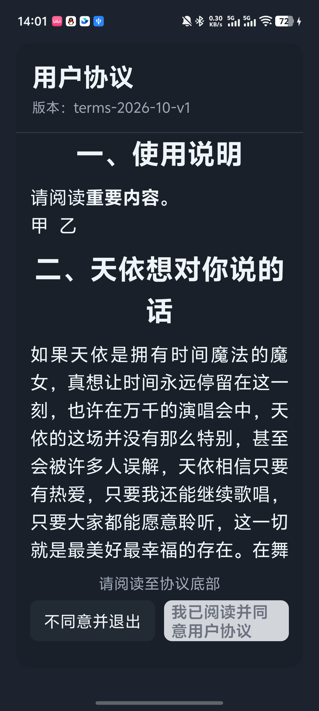
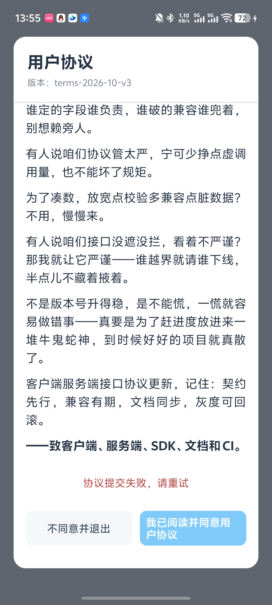
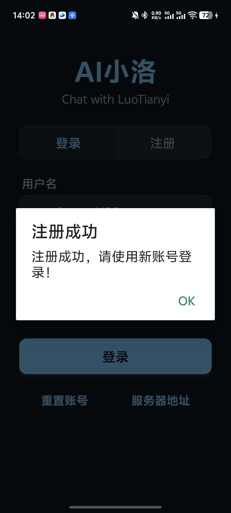
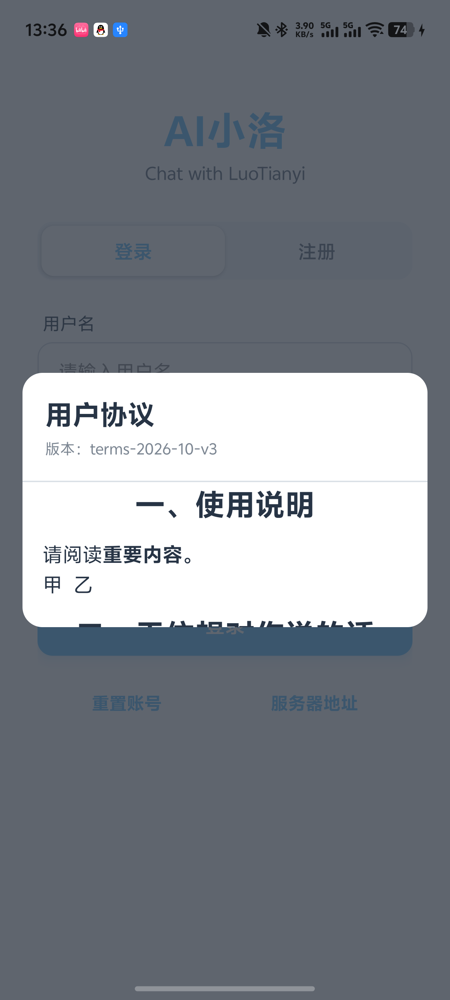
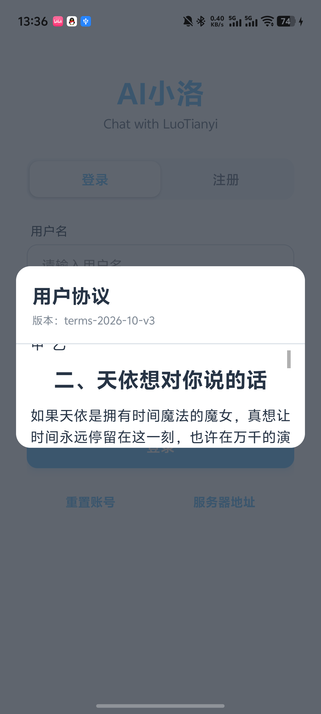

# 用户协议签署集成验收矩阵

> 对应 #297–#300，重点为 #300 集成验收。本文记录当前 worktree 的可复现证据与缺口，不表示已创建集成 PR、合入 `dev` 或完成生产发布。
>
> 历史整理：2026-10-17；本轮补证：2026-11-22。本文区分不同命令的独立结果，尤其不把修复前的历史结果、服务端 101 项范围及后续 #300 本地补证 29 项相加为虚构总数。

## 2026-11-22：桌面真机补验与修复（最新结论）

**结论：用户协议签署的本次验收范围通过。** 本节补齐 Windows 桌面客户端，不再排除桌面真机；Android、服务端与命令行客户端沿用下节已完成的证据。验收包含真实窗口、真实测试服务请求及自动化边界检查，不表示已合入 `dev` 或发布生产。

### 修复范围

- `client/src/gui/login_dialog.py` 中的 `LoginDialog._sign_existing_user` 负责老用户签署及原登录流程续接：改用窗口后台请求，界面只接收有效结果；自动登录发生在登录页显示前时，使用独立协议窗口，结束后释放窗口。
- `client/src/network/auth.py` 中的 `AccountRequest.execute` 负责纯网络请求：同一任务先签署，再按原凭据执行密码或自动登录；签署失败、版本变化或任务取消时不继续登录。`client/src/network/network_client.py` 中的 `NetworkClient.apply_account_result` 在界面线程保存成功身份并启动 WebSocket（双向长连接）。
- `client/src/gui/agreement_sign_dialog.py` 中的 `AgreementSignDialog` 负责协议阅读与提交界面：正文重新加载后持续显示换版提示，下一次提交才清除；提供最小化入口，保留原有前后台计时语义。

### 实际窗口与网络复验

本机 Windows 通过 `client/main.py` 运行实际 PySide6 客户端，连接 `https://www-www.u3493359.nyat.app:61078`。服务实例为 `/data/projects/agentluo-test`，发布提交为 `3182fd696d8f637d419e41427b15ef6ddc53177a`。使用测试账号 test5 与 ua_desktop_fix_1122；测试签署不代表真实用户对法律条款的同意。

| 场景 | 结果与证据 |
| --- | --- |
| 慢签署、双击及超时重试 | 注入 20 秒延迟，客户端 15 秒超时。双击后立即显示[正在提交](assets/agreement-desktop-20261122/slow-submit.jpg)，界面可响应；到超时后仅有一次签署请求，无排队重放。[请求记录](assets/agreement-desktop-20261122/database-evidence.json)、[超时后可重试](assets/agreement-desktop-20261122/timeout-retry.jpg)。 |
| 提交中关闭 | 点击标题栏关闭，窗口继续显示提交状态，不退出、不重复请求。[截图](assets/agreement-desktop-20261122/submit-close-blocked.jpg)。 |
| 密码登录换版 | v3 提交时服务切换 v2，拒绝旧版并加载完整 v2，更新提示持续可见，阅读位置与门禁重置；重读签署后无需再次输入密码进入主窗口。[提示](assets/agreement-desktop-20261122/password-version-notice.jpg)。 |
| 自动登录完整链路 | test5 已签 v2 后发布 v3，启动显示[独立待签窗口](assets/agreement-desktop-20261122/auto-login-gate.jpg)；标题栏关闭直接退出，重启仍可用原有效凭据进入待签。实际签署 v3 后[进入主窗口](assets/agreement-desktop-20261122/auto-login-success.jpg)，日志确认 WebSocket 鉴权成功。同版再启动直接自动登录，不重复签署。 |
| 阅读与最小化 | 顶部等满时间仍禁用，到底后启用；最小化期间完成正文下载，约 8.9 秒后还原仍显示剩余 5 秒，继续前台阅读才累计。注册模态窗口也可最小化并还原，阅读位置保留。上一轮失去前台约 15 秒后仍剩 1 秒的证据继续有效。 |
| 缩放与富文本 | 实际运行默认和 150% 应用缩放；未修改系统显示设置。签署与只读窗口均验证中英文混排、粗体、连续空格、显式换行和超长无空格英文自动折行；正文可滚动到底，底部按钮完整。[签署](assets/agreement-desktop-20261122/signing-mixed-scale150.jpg)、[只读末尾](assets/agreement-desktop-20261122/readonly-mixed-scale150.jpg)。排版样例仅供查阅，实际入库前已换版并重新阅读真实正文。 |
| 注册换版、重读与成功 | v3 旧窗口提交时服务当前为 v2；[换版提示](assets/agreement-desktop-20261122/register-version-notice.jpg)在完整正文加载后仍可见，确认重新禁用。重读 v2 后[注册成功](assets/agreement-desktop-20261122/register-success.jpg)，[返回登录页](assets/agreement-desktop-20261122/register-return-login.jpg)，用户名预填、密码空。数据库仅一条 v2 签署、邀请码已使用、成功登录时间为空。 |
| 既有场景回归 | 前轮实际窗口已覆盖下载 503 重试、提交 503 保留阅读状态、拒绝退出、短文自动到底、向上回看、设置只读、会话中查阅新版、注册表单校验与拒绝保留输入、注册响应丢失后重启恢复。对应代码路径相关回归本轮合跑通过。 |

### 自动化边界与证据

桌面相关测试最终合跑 **255 项通过**，见[测试输出](assets/agreement-desktop-20261122/tests.txt)。新增测试覆盖密码与自动登录慢签署期间的界面事件循环、禁止连点重放和关闭、失败后人工重试、换版通知持续可见、签署失败或取消后不登录，以及实际 Qt 窗口最小化后的计时暂停。共享后台请求和既有登录、注册、排版、恢复测试一并通过；修改文件的 Ruff 语法、导入与空白检查通过。

精确“第 1 秒到底、第 5 秒启用”和“阅读 2 秒、最小化 10 秒、还原后再读 3 秒”由 Qt 窗口测试配合可控单调时钟验证；宽度变化后的滚动锚点和底部判定由既有窗口重排测试验证。上述精确时间及重排断言不冒充人工秒表操作或系统缩放切换。真实设备证据验证用户可见操作、网络提交和完整流程，两类证据共同覆盖验收标准。

### 环境恢复

已关闭本轮桌面测试进程。原 `client/temp/user.json` 与备份逐字节一致；不存在未决注册文件；临时应用缩放仅作用于已退出的测试进程。测试服务器已停止故障代理，配置与协议清单逐字节恢复，正常服务重新监听原 24523 端口，公网返回门禁开启和 v3；发布资源校验通过。保留测试数据库的签署记录，不回滚数据库。生产进程 5459 的启动时间仍为 11 月 20 日 18:34:50，未重启生产。[恢复证据](assets/agreement-desktop-20261122/restore-evidence.json)。

完整操作截图与请求记录保存在本机 `.scratch/agreement-desktop-fix/`；原凭据备份、测试密码与操作脚本不提交。前轮桌面失败记录保存在 `.scratch/agreement-desktop/验收报告.md`，其中未完成项以本节补证为准。

## 2026-11-22：Android 弹窗修复与完整复验（前轮结论）

**结论：本次约定范围通过。** 已完成 Android 真机、测试服务器、真实网络与命令行客户端（CLI）的验收；桌面客户端完成自动化测试，按本次要求不执行桌面真机验收。下文初次验收的失败、缺口和旧测试数量仅为历史记录，以本节为准。本结论不表示已经合入 `dev` 或发布到生产。

### 修复范围

- `app/features/account/AgreementModal.tsx` 中的 `AgreementModal` 负责签署窗口及阅读门禁。为卡片设置确定高度、禁止头部和按钮区收缩，正文占用剩余空间，解决按钮裁切；增加滚动结束检查并提高滚动事件采样频率，避免快速到达底部后按钮仍禁用。
- `app/features/account/RichAgreement.tsx` 中的 `RichAgreement` 只渲染正文，不再持有滚动容器；签署与只读页面各自提供唯一的滚动容器，使实际滚动与底部判定一致。
- 修复短文加载重试后可视高度丢失、关闭或换版后滚动位置未重置、同一渲染帧连点重复提交，以及提交失败没有可见提示的问题。同版本重试保留阅读状态。
- `app/features/account/useAuth.ts` 中的 `useAuth` 管理认证状态。未签老用户下载正文失败时仍保留待签身份及原登录凭据；登录页提供重新下载入口，下载成功后可以签署并续接原登录。

### 最终环境与构建

Android 设备为 V2458A，Android 16，1260×2800；覆盖安装 0.5.2（版本号 11），保留应用数据。最终安装包包含本节全部修复，SHA-256 为 `02e7fcdc6575409906b882d0449d6b1b0fcb823cd143b148d8984f6db785b5ab`。验证了浅色、深色及系统字体缩放 1.0、1.3；结束后恢复浅色及 1.0，使用已签署的 test1 正常登录。

测试服务器仍使用 `3182fd696d8f637d419e41427b15ef6ddc53177a` 发布包，本次修改仅影响 App。故障注入期间以本机脚本控制测试实例代理，分别制造正文 503、提交 503、12 秒延迟及后端注册成功后断开响应。版本场景使用既有 v3、v1 相互切换，不新增或修改正式协议正文。短文排版样例仅用于阅读门禁与渲染，不执行签署。

结束后停止代理，将配置与协议清单按备份逐字节恢复：服务端口 24523、门禁开启、豁免名单为空、当前 v3（34 个正文块）。公网读取、运行时启动和 Linux 发布资源校验通过；保留测试数据与部署前备份。生产进程仍为 PID 5459，启动时间仍为 11 月 20 日 18:34:50，未部署或重启生产。

### AC 验收矩阵

验收标准（AC）来自同目录《用户协议签署-spec》。下表明确区分实际设备操作、真实服务请求和自动化边界；自动化覆盖的事务竞争、时间精度等不冒充手机人工操作。

| AC | 本轮实际证据与结果 |
| --- | --- |
| AC-01 签署与时间 | 手机 test1 下载、阅读、拒绝不写签署，明确提交后持久保存；新注册账号先签 v1，随后登录补签 v3，两条记录保留。真实接口并发签署仅保留首次秒级时间；邀请码重置后账号标识及签署不变。客户端额外时间字段、精确截断由服务端测试验证。 |
| AC-02 认证与副作用 | 手机分别完成自动登录待签、密码登录待签及原流程续接。真实接口错误凭据为 401，未签正确凭据为 403；拦截和单独签署均不改变登录时间及令牌摘要。已签 test1 再次登录无需重签，CLI 已签账号也正常登录；凭据失效、预热边界及跨客户端共享签署由自动化补齐。 |
| AC-03 门禁范围 | 测试实例换版并重启后，原消息令牌可以重新建立 WebSocket（双向连接），收到 `auth_ok`、`chat.ready`；下一次密码登录要求新版本。CLI 未签账号显示统一升级提示。 |
| AC-04 注册事务 | 手机空表单先报错；打开协议和拒绝不创建账号、不消耗邀请码，拒绝后保留输入。正式注册成功回登录页、预填用户名、密码为空且不自动登录。真实旧字段注册被拒绝；邀请码竞争、写入失败整体回滚由数据库集成测试验证。 |
| AC-05 阅读生命周期 | 手机顶部等待超过 5 秒仍不可提交；滚到底部后启用，向上回看仍启用。短文无需滚动，加载重试后也能正确满足底部条件；前台约 1.5 秒后切后台约 10 秒，回来仍显示剩余 4 秒。关闭、重启和换版重置。精确单调时钟、先到底后累计满 5 秒由组件测试补充。 |
| AC-06 拒绝与失败 | 手机老用户拒绝和 Android 返回键退出，蒙版不关闭、不穿透；提交中连点及返回不产生第二次提交。503 与超时显示可见错误，可保留阅读状态重试成功。注册在服务端提交成功后丢失响应，手机重启、手动重填相同信息并重新阅读，沿用原请求标识恢复；账户、签署时间、邀请码均未重复写入。 |
| AC-07 换版与查阅 | 手机注册阅读 v3 时切为 v1，提交提示更新、重新下载并回到顶部，不产生旧版本注册。未签老用户正文下载失败可重试并保留身份；已豁免用户在正文接口 503 时仍可登录。已登录设置页只读，无同意、拒绝和倒计时；加载失败可重试且不退出。老用户换版与读取新版不写签署由自动化补齐。 |
| AC-08 渲染 | 真机确认标题居中、字号层级、局部粗体、连续空格、显式换行、中文长段落折行及两端对齐；HTML 样式文字作为普通文本。深浅主题及实际重启后的 1.3 字体下正文和固定按钮可读。合入 dev 的 `AndroidJustifiedText` 已实现中文两端对齐，下文“延期至 #313”为历史状态；英文及混合粗体的逐行排版由现有排版测试补充。非法对齐/字号由服务端启动校验测试覆盖。 |
| AC-09 迁移与发布 | 使用部署前真实测试库备份对比：原 10 个账号标识、用户名、密码及 10 个邀请码保持不变，旧库没有签署表，未补造签署。手机关闭开关时直接注册、登录且无签署；重新开启后下一次登录被拦截。test4 加入豁免后正确凭据登录、错误凭据仍拒绝，无伪造签署；移除豁免后原消息令牌可重连、下次登录被拦截。非法配置及历史正文修改的启动失败由服务端测试覆盖，恢复后的发布资源校验通过。 |

注册响应丢失场景中，`ua_phone_1122` 的请求标识、v1 签署时间在重启重试前后完全一致，恢复时服务器已切回 v3；恢复成功后下一次登录再签 v3。该结果来自真实网络连接中断，不是仅在测试进程内丢弃返回值。

### 自动化结果

| 范围 | 独立运行结果 |
| --- | --- |
| App 全量 Jest 测试 | 70 个套件通过，754 项通过；3 个通话网络套件共 4 项因未提供对应环境条件跳过，与协议无关 |
| App 协议相关子集 | 102 项通过，已包含在上述全量结果中，不相加 |
| 服务端路径包含 agreement 的测试 | 109 项通过，2 条第三方弃用警告 |
| 桌面协议窗口、网络、注册、阅读门禁与注册恢复测试 | 103 项通过；使用隔离依赖环境及 Qt 无显示窗口模式，不作为桌面真机证据 |
| TypeScript、改动源文件 ESLint、Git 空白检查 | 通过 |
| Android release 构建、覆盖安装、真实登录 | 通过 |

桌面自动化初次收集曾缺少 PySide6/OpenGL，随后在 uv 隔离环境补齐实际依赖并重新执行通过；没有删除测试或更改业务行为以绕过环境失败。App 新增回归针对短文重试、同帧重复点击、可见失败提示和两类老用户身份保留，均对应本轮实际缺陷。

### 可审查证据

[持久证据目录](assets/agreement-completion-20261122/) 保存去除密码和原始令牌后的接口、数据库对比、恢复配置及关键截图。`migration-evidence.json` 是注册真机操作前的迁移检查快照，不是最终数据库全量记录。注册恢复前后的独立快照分别为 `registration-before-retry.json`、`registration-after-retry.json`；版本重连与豁免见 `version-ws-evidence.json`、`exemption-evidence.json`。

完整构建、测试日志、代理请求时间线和设备界面层级保存在本机 `.scratch/agreement-completion/`，未将含测试凭据的操作脚本提交至仓库。验收使用测试账号，不代表真实用户对法律条款的同意。







## 2026-11-22：初次验收历史记录（修复前）

**结论：验收不通过。** 服务端协议契约和发布启动已通过本轮验证；真机签署弹窗的操作按钮被裁切，无法完成用户签署，阻断 SPEC 的固定按钮与完整登录流程验收。下文 2026-10-17 的结果为历史记录，不作为本轮真机通过的依据。

### 版本与环境

- 实际功能分支为 `feat/user_agreement`；仓库没有 `feat/agreement`。合并提交 `73eb05d4` 引入 `dev` 的 `6e35bf5d`，保留协议功能并移除 dev 已删除的旧主动发言依赖。
- 测试服务器发布提交为 `3182fd696d8f637d419e41427b15ef6ddc53177a`；目录 `/data/projects/agentluo-test`，地址 `https://www-www.u3493359.nyat.app:61078`。仅此实例启用 `user_agreements.require_acceptance=true`，豁免列表为空，当前协议 `terms-2026-10-v3`。生产实例未修改。
- Android 真机：V2458A，Android 16，1260×2800，密度 560，系统字体缩放 1.0。安装版本 0.5.2（版本号 11），应用源码对应合并提交 `73eb05d4`；后续发布包修复不涉及 App。覆盖安装保留应用数据。
- 安装包 SHA-256：`28a34ef3228e10d48bf966a81f927f7f7e5cab15bb61bde9fda6f5d426265bc8`。
- 部署前备份保存在测试实例 `deployments/before-agreement-20261122-133429`；包含配置、数据库、环境文件与原发布目录。后续修复部署另有 `before-agreement-20261122-133547`。

### 本轮验收证据

| 范围 | 实际操作与结果 | 结论 |
| --- | --- | --- |
| 发布包启动 | 首次发布遗漏 `res/user_agreements`，运行时启动失败；补齐资源白名单和锁定清单后重新构建，测试实例运行时正常启动，Linux 发布资源校验通过 | 已修复并实测 |
| 协议公开读取 | 公网读取策略为开启，正文为 v3，共 34 个块 | 通过 |
| 老用户自动登录门禁 | 手机 test1 自动登录返回 403，随后读取协议并显示签署窗口；日志与真机画面一致 | 通过 |
| 正文显示与滚动 | 真机显示版本、标题、粗体与连续空格；滑动能够改变正文位置，但操作区超出卡片裁切范围 | 存在阻断缺陷 |
| Android 返回键拒绝 | 协议窗口按系统返回键后退出到桌面；数据库 test1 无任何签署记录 | 通过 |
| 密码认证与门禁 | 公网 test8 正确密码未签署返回 403 / `AGREEMENT_REQUIRED`；错误密码返回 401，不泄露协议状态 | 通过 |
| 时间与版本校验 | 提交客户端 `accepted_at` 返回 422；提交旧版 v1 返回 409 / `AGREEMENT_CHANGED`，要求重新阅读 v3 | 通过 |
| 签署幂等与登录 | test8 首次签署和重复签署均返回 `2026-11-22T13:37:21+08:00`，签署接口不返回登录令牌；随后原密码登录成功 | 通过 |
| 数据库持久化 | test8 只有一条 v3 签署，时间与接口一致；test1 无签署；v1、v2、v3 正文归档均存在 | 通过 |

签署弹窗实现位于 `app/features/account/AgreementModal.tsx`，负责阅读计时、正文滚动和签署操作。`card` 仅设置 `maxHeight: '92%'`，内部 `reader` 使用 `flex: 1` 和 `minHeight: 240`；本次实际布局中卡片底边为 y=1756，而按钮布局起点为 y=2330，按钮被 `overflow: 'hidden'` 裁切。此处给出代码定位与布局证据，尚未修改弹窗，仍需修复后复验。





### 自动化验证与证据位置

- 服务端：筛选 `server/tests` 中路径包含 `agreement` 的测试，共 **109 passed**。
- App：在 `app/` 执行 `npx jest --runInBand agreement`，**9 个测试套件、98 项通过**。
- 发布包回归：`test_release_build.py` **6 passed**，新增从生成包读取当前及历史协议正文的用例，验证协议资源可随发布交付。
- 修改的 Python 文件通过 Ruff 检查，合并及后续修改通过 `git diff --check`；Android release 构建成功并在真机安装成功。
- Windows 工作树直接执行资源测试曾失败：新协议文件的 CRLF 与 Git 发布内容的 LF 哈希不同，且原有测试按系统 GBK 读取 UTF-8 文件失败。未删除或放宽校验；以从 Git 提交构建的发布包和服务器 Linux 实际校验为发布资源证据，不将该 Windows 命令记为通过。
- 本机原始证据保存在 `.scratch/agreement-acceptance/`：`http-evidence.json`、`database-evidence.json`、`http_acceptance.py`、`server-tests.txt`、`app-tests.txt`、截图及发布包。Android 构建日志为 `.scratch/agreement-android-build.log`。上述临时证据不随 Git 提交，关键截图已纳入本文。

### 尚未完成的验收项

因按钮不可见，真机前台累计 5 秒与滚动到底双门禁、后台暂停计时、点击同意后的原流程续接、新用户注册签署、同版本失败重试及版本变化后重读均不能判为通过。设置只读、多设备免重复签署、深浅主题和字体缩放组合本轮未测；接口 test8 登录成功不能替代手机 test1 签署成功。实际网络响应丢失、在途注册恢复、发布新版后的存量 WebSocket 会话及实际旧数据库迁移仍只有现有自动化或历史证据，本轮未补真实环境测试。

测试服务器保留门禁开启状态和上述测试数据，以便修复弹窗后继续验收；测试签署不代表真实用户同意法律条款。

## 2026-10-17 历史验收记录

## 实现边界与入口

| 边界 | 入口 | 约束 |
| --- | --- | --- |
| 协议读取 | `GET /auth/agreement` | 公开当前正文，`Cache-Control: no-store` |
| 新用户注册 | `POST /auth/register` → `RegistrationService` | 账号、签署、邀请码、注册恢复结果同一事务 |
| 老用户签署 | `POST /auth/agreement/accept` → `UserInterface` → `AgreementService` | 重新验证密码或自动登录凭据；只写签署，不登录 |
| 登录门禁 | `/auth/login`、`/auth/auto_login` | 先认证、后查当前版本签署/豁免、最后轮换会话并触发成功副作用 |
| 发布和豁免 | `res/user_agreements/`、`ServerRuntime.initialize` | 当前版本与 UUID 豁免名单均为启动快照；变更须重启 |

门禁只作用于下一次 `/auth/login` 或 `/auth/auto_login`，不插入普通业务 HTTP、message token 校验或 WebSocket 重连。因此发布新协议不会主动中断已有会话；进程重启后的物理断线仍按既有生命周期处理。

## 可复现命令与范围

在 `server/` 目录、使用当前开发环境解释器执行：

服务端前次安全修复后的相关矩阵（独立结果：101 passed）：

```powershell
cd C:\Agent-LuoTianyi\.slim\worktrees\ua-takeover\server
python -m pytest tests/unit/application/test_agreement_loader.py tests/unit/application/test_agreement_service.py tests/unit/application/test_agreement_signature.py tests/unit/infrastructure/test_user_agreement_config_validation.py tests/integration/persistence/test_agreement_migration.py tests/integration/persistence/test_registration_with_agreement.py tests/integration/system/test_register_agreement_mapping.py tests/integration/system/test_agreement_login_gate.py tests/integration/system/test_agreement_accept_security.py tests/integration/system/test_agreement_cross_client_contract.py tests/integration/system/test_login_stage_routing.py -q --tb=short
```

#300 余项本地补证（独立结果：29 passed）：

```powershell
cd C:\Agent-LuoTianyi\.slim\worktrees\ua-takeover\server
python -m pytest tests/integration/persistence/test_agreement_migration.py tests/integration/websocket/test_agreement_existing_session.py tests/integration/system/test_agreement_login_gate.py tests/integration/system/test_agreement_accept_security.py tests/integration/system/test_agreement_cross_client_contract.py -q --tb=short

cd ..\cli-client
python -m pytest tests/test_agreement_login_gate.py -q --tb=short
```

本轮新增／受影响测试的静态与空白检查：

```powershell
cd C:\Agent-LuoTianyi\.slim\worktrees\ua-takeover\server
python -m ruff check tests/integration/persistence/test_agreement_migration.py tests/integration/websocket/test_agreement_existing_session.py
python -m black --check tests/integration/persistence/test_agreement_migration.py tests/integration/websocket/test_agreement_existing_session.py

cd ..\cli-client
python -m ruff check tests/test_agreement_login_gate.py
python -m black --check tests/test_agreement_login_gate.py

cd ..
git diff --check -- server/tests cli-client/tests/test_agreement_login_gate.py
```

这些是同进程本地集成命令；不应描述为独立服务进程、Windows/Android 真机或外部网络故障注入的验收。

App 最终合跑（当前 worktree，结果：40 suites / 312 tests passed）：

```powershell
cd C:\Agent-LuoTianyi\.slim\worktrees\ua-takeover\app
npx jest --runInBand
npx tsc --noEmit
npm run lint

cd ..
git diff --check
git status --short
git diff --stat
```

`tsc` 无输出并以零退出码结束；`expo lint` 以零退出码结束。npm 仅输出本机 `allow-scripts` 命令行设置覆盖 `.npmrc` 的提示，未报告 lint 规则错误。

## 当前结果状态

| 证据 | 已知结果 | 当前结论 |
| --- | --- | --- |
| 服务端相关安全修复矩阵 | 101 passed，2 条第三方弃用警告 | 当前已跑局部范围；不是全量 server，也不得与下行 29 相加 |
| #300 历史 DDL、既有 WS 与 CLI 本地补证 | server 29 passed，CLI 2 passed；各有 2 条第三方弃用警告 | 当前本地集成证据，命令见上；server 29 与 server 101 存在重叠，不能相加 |
| 桌面客户端测试 | 114 passed | 最新自动化证据；仍不替代 PySide6 人工窗口验收 |
| App 最终合跑 | 40 suites / 312 passed；`tsc --noEmit`、`npm run lint` 均通过 | 先前 285／309 均已过期；最后的 App 注册恢复执行顺序阻塞已由 HookHarness 回归验证，当前自动化结果有效；仍不替代 Android 真机验收，也不表示完整功能交付 |

两条警告来自 Starlette 与 `zhconv` 第三方弃用提示，不是验收断言失败。

## AC 到证据矩阵

| AC | 服务端或协议证据 | 待验证 / 人工项 |
| --- | --- | --- |
| AC-01 签署记录与时间 | `test_agreement_signature.py`、`test_agreement_login_gate.py`、`test_agreement_accept_security.py`：UTC+8、秒精度、首次时间、版本隔离、重复/竞争幂等 | 实际 UI 阅读动作不产生记录 |
| AC-02 身份校验与副作用 | `test_agreement_login_gate.py`、`test_login_stage_routing.py`、`test_agreement_accept_security.py`：密码/自动登录、401 不泄露、403 门禁、签署不登录/不轮换/不预热 | 桌面/App 实际错误状态切换 |
| AC-03 生效范围与旧端 | `test_agreement_existing_session.py`：真实 `/chat_ws` 握手、message token 鉴权和 ping/pong 后，V2 发布或豁免移除不终止已建立 WS；后续密码登录为 403 | 真实 WS 重连、旧版二进制客户端实际提示、独立进程重启后的物理断线 |
| AC-04 注册原子性 | 注册 HTTP/持久化测试：事务、回滚、同/不同请求 ID 竞争、旧字段拒绝；桌面与 App 自动化覆盖正式注册、恢复和冲突分支 | 双端实际表单／阅读／取消设备操作 |
| AC-05 阅读计时 | 无服务端阅读凭证是设计约束；桌面／App 自动化覆盖阅读门禁状态 | PySide6/Android 前台计时、底部、关闭和重开真机行为 |
| AC-06 拒绝和恢复 | 注册请求持久恢复、签署重试返回首次时间；桌面／App 自动化覆盖拒绝、超时／失败后的流程状态 | 独立进程真实网络丢响应故障注入、客户端设备交互 |
| AC-07 版本、加载、设置 | `test_agreement_login_gate.py`、`test_agreement_cross_client_contract.py`：V1 保留、V2 下次登录重签、读取 no-store；桌面／App 自动化覆盖协议状态和恢复路径 | 双端设置只读、加载失败、阅读状态重置的人工设备验收 |
| AC-08 富文本 | loader/配置校验覆盖服务端格式约束 | 双端字号、空格、换行、居中/两端对齐实际渲染；Android 中文连续段落两端对齐延期至 #313 |
| AC-09 迁移、豁免、发布 | `test_agreement_migration.py` 用冻结基线 `1d8d2fee` 的固定历史 DDL 建库，验证首／次重复初始化补三张协议表、保留用户和邀请码且不补签；CLI 测试经 `NetworkClient → AuthApi → RSA 公钥/加密 → 真实 FastAPI 路由` 验证豁免登录及普通未签升级文本 | 生产脱敏历史库、完整部署演练 |

## 跨边界协议证据的准确含义

`test_agreement_cross_client_contract.py` 使用多个独立 FastAPI `TestClient`、独立 RSA 密钥实例及同一个真实 SQLite 文件库，验证：

1. 一个 HTTP client 注册或签署后，另一个独立 HTTP client 可以读取同一持久记录并登录，无须重签。
2. V2 发布后 V1 记录仍保存，而下次登录要求签 V2。
3. 注册或签署已提交但调用方丢弃响应时，创建新服务实例后按原身份或原请求重试，恢复既有成功结果或首次签署时间。
4. 未签自动登录被拦截时 token 保持有效；签署不创建会话；随后独立登录才轮换 token。

以上是**共享 HTTP 协议与持久库集成测试**，不是 PySide6、Expo 或 Android 真机 E2E，不得作为“双端实际运行”证据。

## 恢复与安全决策

| 主题 | 当前决策 |
| --- | --- |
| 注册恢复 | 成功请求持久关联请求 ID、账号、版本和成功响应；重试必须核验用户名、密码和邀请码，不能只凭 ID 恢复 |
| 秘密 | 不持久化明文密码或邀请码；随机 RSA 密文不能用于判断密码相同 |
| 版本变化 | 成功旧版本注册的恢复优先于当前版本检查；恢复后下一次登录按当前版本门禁 |
| 冲突 | 同 ID 不同内容为 `REGISTRATION_REQUEST_CONFLICT`；只有用户在明确展示真实冲突风险后显式确认，才可放弃该恢复尝试 |
| `UNVERIFIABLE` 恢复 | 持久恢复仅在同一 server、同一 user 的成功登录已经解除不可验证状态时继续；缺失 server 旧记录时拒绝恢复，不创建替代账号，也不猜测／复制账号 |
| 签署 | 账号/版本唯一；重复提交返回首次时间；签署事务边界再次确认凭据，防止凭据变化后仍写入 |

## #300 尚不能落实项

1. #297／#298／#299 的代码与自动化范围已有当前 worktree 证据；#300 的本地集成证据可用，但本会话无提交、推送、合并或远端修改权限，不能创建集成 PR、合入 `dev` 或宣布完整特性交付。
2. App 已完成本轮最终离线合跑（40 suites / 312 tests、TypeScript 与 lint 通过）。独立复核确认冲突放弃流程已关闭原阻塞；登录确认门禁最后发现的执行顺序问题已修复，协调者核对其位于密码加密之前，并由真实 HookHarness 断言零加密、零网络请求。Android 真机验收尚未完成。
3. 桌面 PySide6 实际窗口点击、最小化／前台、阅读计时、关闭退出和设置查阅仍需人工／设备验证；Windows 与 Android 真机均未在本轮验收。
4. 已补真实同进程 `/chat_ws` 握手、鉴权及既有会话存续，以及 CLI 实际认证调用链；但**真实 WS 重连**、独立服务进程重启后的物理断线和独立进程真实网络层响应丢失故障注入仍未完成。当前恢复测试仍是调用方丢弃已提交响应的本地模拟。
5. 已以冻结基线 `1d8d2fee` 的固定历史 DDL 取代“当前 metadata 减三表”的样本；这不是生产脱敏历史数据库，仍需以真实历史结构样本复核。
6. Android 连续中文段落无法真正两端对齐按 #313 延期，不得标为已实现。

## 协调者回填清单

- [x] App 最终离线合跑：40 suites / 312 tests、TypeScript 与 lint 通过（285／309 为过期历史数字）；已完成上述定点修复与回归，Android 真机仍未验收
- [ ] 桌面实际运行和窗口人工验收结果
- [x] 安全修复后 server 局部 101 项，以及 #300 本地补证 server 29 项／CLI 2 项（不可相加）
- [ ] 真实 WebSocket 重连、真实历史库和独立进程网络故障注入结果
- [ ] AC-01 至 AC-09 最终状态、环境、未验证理由与 #313 关联
- [ ] 经授权后的 #300 集成 PR 与 `dev` 合并状态
