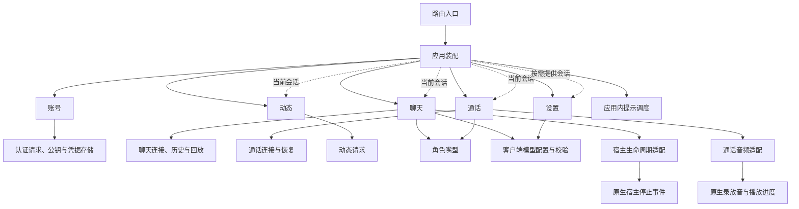
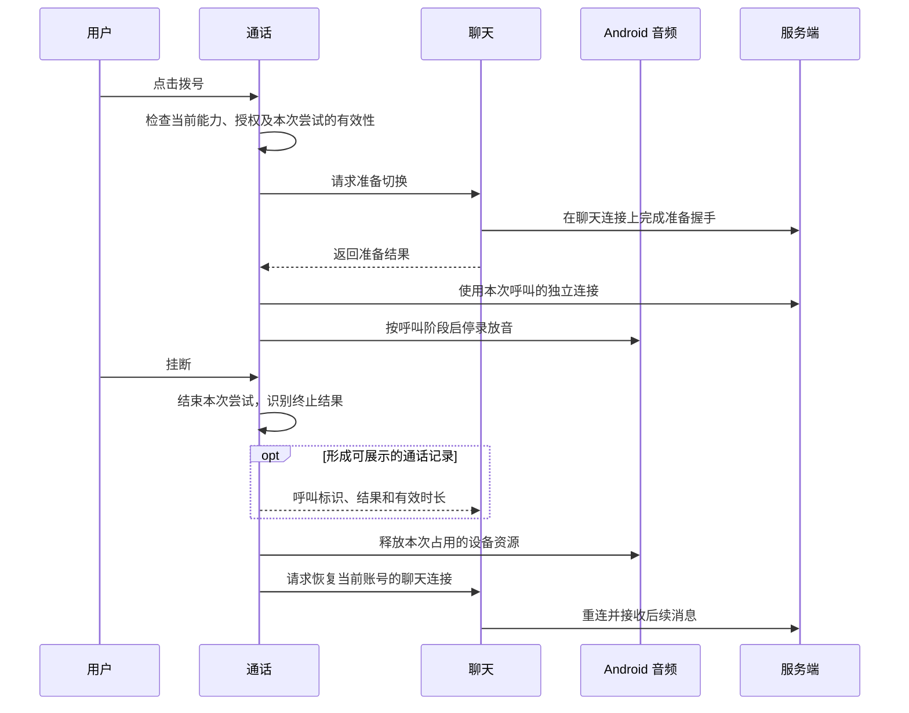
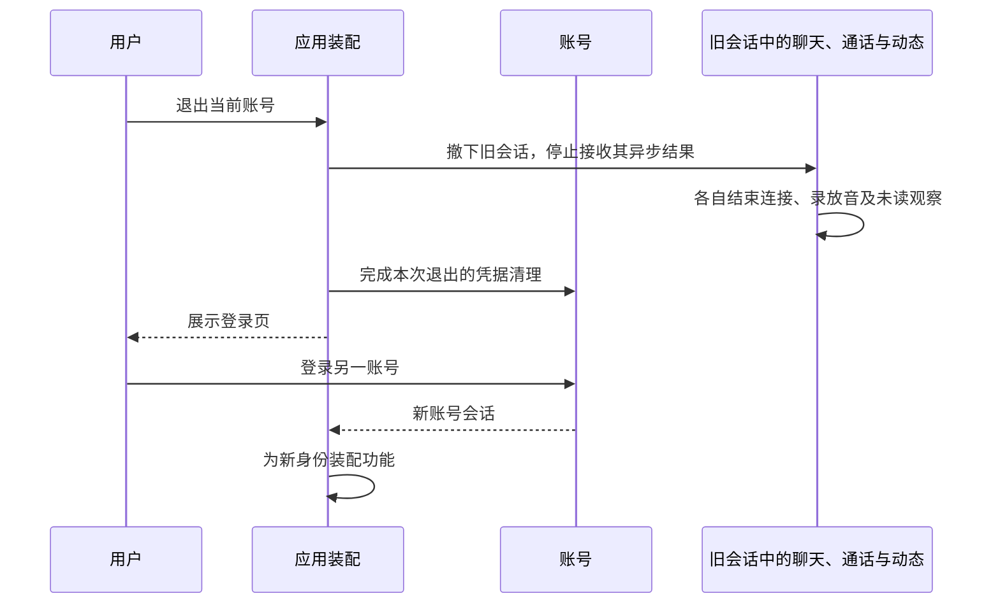

# 移动端目标架构设计

**状态：讨论稿。** 设计基线为 `dev@8134d81c`。本文面向维护 Expo / React Native 移动端的开发者。下文的目录和迁移步骤是建议；文件映射表左列给出基线中可查阅的实现。

## 1. 设计原则

以**谁负责一次用户操作直到结束**确定功能归属。聊天负责把录音提交为语音消息并更新气泡；通话负责一次呼叫从拨号到释放设备；账号负责当前身份与凭据；动态负责帖子、评论与未读状态。页面持有输入草稿、滚动位置等显示状态。功能内部自行组织界面、业务规则和外部访问。

旧五层依次为界面、事件绑定、信息处理、通信管理和 WebSocket（双向长连接）。聊天仍可按这条链理解发送、接收和回放。桌面端的事件绑定还承担 Qt 界面线程切换。移动端只在绑定确有独立职责时保留它；动态分页或账号重置可以直接调用所属功能的请求逻辑。[原客户端架构](../../client/docs/dev/客户端架构.md)

应用入口负责**装配**，即创建当前登录会话所需的功能实例，把一个功能需要的动作接到拥有该动作的功能上。账号会话指当前服务器、用户和请求凭据；呼叫会话指从拨号到终止的一次电话交互。同一账号会话可以先后经历多次呼叫。服务端继续负责正式对话历史和通话记录的持久化。[领域术语](../../CONTEXT.md)

## 2. 目标目录

以下路径以仓库的 `app/` 为根。目录表达职责，按第 6 节逐步形成。

```text
app/
├─ app/                       Expo 路由入口，选择或挂载页面
├─ shell/                     应用装配、当前业务页、账号会话的创建与撤下
│  └─ notices/                应用内提示的展示、排序和关闭
├─ features/
│  ├─ account/                登录、注册、重置、退出、服务器与凭据
│  ├─ chat/                   聊天时间线、历史、投递、录音提交与回放
│  ├─ call/                   呼叫流程、铃声、通话协议与设备适配
│  ├─ dynamics/               帖子、评论、分页、发布、未读
│  └─ settings/               用户偏好和模型设置页面
├─ shared/
│  ├─ character/              角色表现，含聊天和通话共用的嘴型规则
│  ├─ client-model/           设置页与聊天运行时共用的模型配置和校验
│  └─ ui/                     多功能使用的主题与展示元素
├─ modules/                   Expo 本地原生模块的源码和模块声明
│  ├─ call-audio/             Android 录放音、播放头、焦点、路由与铃声
│  └─ voice-host-lifecycle/   Android 宿主停止事件
├─ public/live2d/             网页内运行的角色模型、渲染脚本和资源
├─ plugins/                   Expo 构建配置，包括打包角色资源和签名
└─ __tests__/                 既有测试入口，按用户行为验证迁移
```

**原生代码按设备能力放，调用策略按功能放。** Kotlin 源码留在两个本地模块的 `android/` 子目录。通话功能中的 TypeScript 适配代码把原生进度关联到本次呼叫和播放流；聊天录音使用宿主停止事件判断是否应取消录音。Android 告知“最后一帧已经播放”或“宿主已经停止”，业务代码决定是否发播放回执、取消录音或结束呼叫。完整验证需要包含本地模块的 Android 构建。[通话音频模块说明](../../app/modules/call-audio/README.md) · [宿主停止事件适配](../../app/utils/voice_host_lifecycle.android.ts)

## 3. 依赖关系与共享能力

图中实线表示装配或调用，虚线表示应用入口把账号产生的当前会话传给功能。图中“告知业务页切换”和“请求展示提示”均由应用装配接线，功能可以请求展示、持有关闭凭据，提示调度无需读取业务内部状态。



| 能力 | 共用规则 | 各调用方保留的决定 |
| --- | --- | --- |
| 应用内提示 | 登录前后使用同一提示入口，统一处理队列、阻挡、返回键和独立关闭。应用装配告知实际业务页已切换；打开覆盖页时原聊天页可能仍挂载。 | 授权流程决定等待提示何时失效，通话区分失败和主动挂断，账号判断登录结果。动态红点由动态管理，离线推送有独立的系统送达流程。[公共展示](https://github.com/SheepLiu712/Agent-LuoTianyi/issues/403) · [业务接入](https://github.com/SheepLiu712/Agent-LuoTianyi/issues/404) |
| 角色嘴型 | 网页已共用响度映射与平滑参数。进一步统一正在驱动模型的音频流身份、分析时间窗、静音更新及结束归静。 | 网页音频与原生音频各自提供进度、拥有队列、处理打断并确认实际播完。播放器选型单独评估。[嘴型驱动工单](https://github.com/SheepLiu712/Agent-LuoTianyi/issues/360) |
| 账号身份和设备权限 | 账号提供当前服务器和请求身份。系统授权结果、宿主可见性是设备事实。敏感的自动登录令牌由账号管理。 | 聊天决定松手后能否提交录音，通话决定授权后能否继续本次拨号。各自的操作可能在等待授权时失效。 |
| 模型配置、主题与诊断 | 设置写入的模型配置和校验规则供聊天运行时读取。主题与调试记录沿用现有公共实现。 | 设置拥有表单和保存反馈，聊天拥有服务端请求触发的模型调用及结果回传。 |
| 网络与存储 | 可复用已明确相同的连接参数和存储能力。 | 聊天投递回执、通话重放、动态分页及账号令牌轮换分别由所属功能解释。错误在掌握其业务含义的位置处理。 |

## 4. 现有主要文件如何归位

表中路径均相对于 `app/`。同一文件出现在多行，表示需要按职责拆开。实施时先迁移行为和调用方，再决定是否移动文件。

| 当前主要实现 | 目标归属 | 拆分或保留的理由 |
| --- | --- | --- |
| [app/_layout.tsx](../../app/app/_layout.tsx)、[app/index.tsx](../../app/app/index.tsx) | 路由、`shell/`、各功能页面 | 根入口据登录态选择页面。首页的抽屉、当前页及跨功能接线归应用装配；聊天输入与消息列表归聊天；一次呼叫的创建、初始化和释放归通话。 |
| [hooks/useAuth.ts](../../app/hooks/useAuth.ts)、[app/login.tsx](../../app/app/login.tsx)、[components/auth.ts](../../app/components/auth.ts)、`utils/{auto_login,crypto}.ts`、`config/index.ts` 中的服务器地址 | `features/account/` | 收回分散在登录页的重置和切换服务器操作。当前身份由账号对外提供；保留旧令牌迁移和公钥更新行为。配置文件中的其他参数逐项按使用方归位。 |
| [hooks/useChatLogic.ts](../../app/hooks/useChatLogic.ts)、`hooks/useHistoryLogic.ts`、`utils/{message_processor,chat_stream,binder,getHistory}.ts`、`types/chat.ts`、`components/{ChatBubbles,CachedImage}.tsx` | `features/chat/` | 消息投递、去重、历史合并和气泡更新归同一时间线。逐条检查事件绑定中的转发是否还能删除。 |
| `utils/{network_client,ws_transport,ws_ack}.ts`、`types/ws_events.ts`、`utils/{image_selection,image_compression}.ts` | 聊天连接与媒体发送 | 聊天连接承担切换通话前的准备握手。保留这端的协议实现，由应用装配将准备动作供通话调用。 |
| [hooks/useVoiceInput.ts](../../app/hooks/useVoiceInput.ts)、`hooks/useMicrophonePermission.ts`、`utils/voice_*.ts`、`components/Voice*.tsx` | 聊天语音、宿主适配、应用提示 | 录音手势、录音提交和语音回放留在聊天。设备事件留在对应适配代码。通用横幅和排队可共享；授权申请的有效期由请求方负责。 |
| [hooks/useCallSession.ts](../../app/hooks/useCallSession.ts)、[hooks/useProductionCallComposition.ts](../../app/hooks/useProductionCallComposition.ts)、`hooks/useCallKeepAwake.ts`、`utils/call_session/`、`utils/{call_state,call_clock,call_failure}.ts`、`components/call/CallScreen.tsx` | `features/call/` | 呼叫尝试持有初始化、铃声、状态和释放动作，页面展示状态并传入拨号或挂断操作。 |
| `utils/call_protocol/`、`utils/call_transport/`、`utils/call_audio/`、`utils/call_audio_contracts.ts`、`types/call*.ts` | 通话内部的协议、传输、音频适配 | 延续既有协议、恢复与播放进度职责。两端共享的协议样例仍由仓库级契约目录维护。[通话协议决策记录](../adr/0001-call-v1-wire-protocol.md) |
| [utils/call_history.ts](../../app/utils/call_history.ts)、`components/call/CallHistoryBubble.tsx` | 通话产生终止结果；聊天合并和展示记录 | 当前一个文件同时推导本地结果、合并服务端历史。按呼叫标识交接结果，气泡和历史合并归聊天。 |
| [app/dynamics.tsx](../../app/app/dynamics.tsx)、[utils/dynamics.ts](../../app/utils/dynamics.ts)、首页未读轮询 | `features/dynamics/` | 动态拥有查询、标记已读和红点状态；首页订阅结果。 |
| `app/{preferences,llm_settings}.tsx`、`utils/getPreferences.ts`、`utils/{llm_client,llm_key_storage,llm_requirements}.ts` | 设置页面、共享模型配置与聊天运行时 | 按使用方拆分模型相关文件：配置读写与公共校验供两方使用；表单状态归设置；聊天请求的执行与回传归聊天。 |
| `components/NoticeBanner.tsx`、`components/call/CallFailureBanner.tsx`、`components/VoicePermissionNotice.tsx` | `shell/notices/` 与业务提示内容 | 复用横幅外观，收回首页决定提示优先级的条件分支。 |
| [public/live2d/live2d.html](../../app/public/live2d/live2d.html)、`utils/live2d_helper.ts`、`utils/call_audio/playback_progress.ts`、`config/live2d.ts` | 共享角色表现、网页资源、通话进度适配 | 模型更新规则归角色表现，网页仍在原资源入口运行；原生进度的流身份核对归通话适配。 |
| `modules/call-audio/`、`modules/voice-host-lifecycle/`、`plugins/` | 原生模块与构建配置 | 原生源码随本地模块维护。网页资源打包和签名由构建插件处理。 |

## 5. 聊天、通话与账号如何协作

### 在聊天中拨号，结束后回到聊天

图中展示一次成功切换的主路径，省略铃声及协议分帧。应用启动时已把“准备切换、恢复聊天、接收通话记录”三个动作接好，通话执行这些动作时无需访问聊天页面。现有接线可见[首页](../../app/app/index.tsx)和[聊天连接切换逻辑](../../app/hooks/useChatLogic.ts)。



- 通话负责区分拒接、接通前主动挂断、已接通后结束和技术失败。只有符合记录条件的结果进入聊天时间线。聊天先展示本地条目，历史加载后按同一呼叫标识合并服务端记录。[本地记录与历史合并](../../app/utils/call_history.ts)
- 所有异步结果都归属发起它的账号或呼叫。上一通的播放结束、重连或页面退出事件只能影响原呼叫；恢复聊天还要检查账号是否仍然有效。角色嘴型进度可以早于播放入队调用返回，实际播完单独由播放器确认。

### 退出、换账号或切换服务器



旧账号失效后，即使清理或网络回调稍后完成，也只能操作旧实例。应用装配协调资源所有者完成清理，语音回放缓存仍由聊天实现清除。图中步骤表达所有权交接；实现时需分别核对以下三种操作的既有语义。

| 操作 | 基线行为与迁移约束 |
| --- | --- |
| 退出账号 | 当前退出流程清公钥、自动登录信息和语音回放缓存，再撤下登录态。保留已约定的清理结果，避免账号模块直接维护语音文件。[退出流程](../../app/hooks/useAuth.ts) |
| 登录页切换服务器 | 先向候选服务器验证公钥入口，成功后保存地址、清旧公钥和自动登录凭据。验证失败仍可使用原地址；重启后不能携旧服务器令牌自动登录新服务器。[服务器地址变更](../../app/app/login.tsx) |
| 重置账号 | 登录页向服务端请求重置，在成功后清理语音回放缓存。迁移时单独核对重置结果与失败反馈，保留与退出、换服各自不同的清理范围。[账号重置](../../app/app/login.tsx) |

## 6. 建议迁移顺序与验收

每步从一个现有用户入口迁移，验收通过后再处理下一步。通话装配和提示调度可分别交付；第 2 步的公共提示入口先于三个业务提示的接入。

| 顺序 | 一次可交付的改动 | 可观察的验收结果 |
| --- | --- | --- |
| 1 | 从首页收回呼叫装配。由一次呼叫同时持有会话创建、设备初始化、铃声和清理。保留现有协议和聊天协作动作。 | 接通后挂断能恢复聊天；快速再拨时旧事件不影响新通话；本地通话气泡与随后加载的历史只显示一条。 |
| 2 | 在登录前后共用的应用入口建立提示调度，再接入登录失败、通话失败和麦克风授权。 | 登录失败后可继续编辑；重复按住只产生一个在途授权请求；切去动态会撤下原页等待提示；阻挡提示关闭后只恢复仍有效的提示。 |
| 3 | 由账号模块接管服务器切换、凭据迁移和账号操作，向功能显式提供当前会话。 | 切换服务器后重启不携旧令牌；升级前保存的凭据仍可在原服务器自动登录；换账号后旧呼叫结果或未读查询不会更新新界面。 |
| 4 | 统一角色嘴型的流身份、更新和归静，再独立评估聊天与通话的播放后端。此步可与账号整理并行。 | 用同一样音对照两路：句内静音保持平滑，打断与实际结束后归静，旧流回调不清新流。在 Android 正式构建上验证声画同步、实际完成和停止。 |
| 5 | 按收益逐项收回动态未读、聊天转发与设置职责；相关路径随交付归位。 | 动态标记已读后首页红点消失，分页仍保留原帖子；取消录音不产生消息，提交后从原气泡回放，重试不新增气泡；设置保存的模型配置能供下一次相应请求使用。 |

以上验收是后续实施的检查点。本文依据基线源码与既有行为编写，尚未执行迁移或设备验证。
