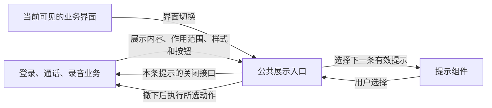

# 移动端统一 App 系统提示组件

本文规定移动客户端如何向用户展示登录、通话和麦克风授权的操作结果。App 系统提示显示在应用界面上，不进入聊天记录。Android 自己的麦克风授权框由操作系统管理。本文所称“阻挡”指用户必须先处理提示才能操作其背后的界面，“蒙版”指使背景变暗的视觉层，两者可独立配置。

## 用户故事

- 作为用户，我希望在登录页或聊天页直接看到与当前操作有关的结果，能够读完原因、关闭提示，再继续操作。
- 作为用户，我希望在必须作出选择时清楚看到“取消”和具体动作，按返回键不会误执行主要动作。
- 作为用户，我希望等待授权时仍能操作界面。授权返回或我离开当前界面后，过时的提示应自动撤下。
- 作为开发者，我希望通过同一入口展示提示，并取得只作用于本条提示的关闭接口，以便独立管理业务操作和提示的生命周期。

下图是布局示意。标题、正文可换行，示意中的尺寸不作为验收依据。

```text
单按钮窄条（默认顶部）            单按钮卡片（默认居中）
┌────────────────────────┐      ┌────────────────────────┐
│ 登录失败                │      │ 登录失败                │
│ 请检查账号和密码  知道了 │      │ 请检查账号和密码        │
└────────────────────────┘      │                 知道了 │
                                └────────────────────────┘
双按钮卡片（默认居中，有灰色蒙版，阻挡背景操作）
┌───────────────────────────────────┐
│ 未获得麦克风权限                   │
│ 可前往系统设置为本应用开启权限。   │
│      取消        │      去设置     │
└───────────────────────────────────┘
```

## 验收标准

两个合并请求（PR）按依赖顺序交付。PR 1 用独立的组件交互验证展示规则，PR 2 通过实际业务入口验证接入效果。

### PR 1 公共展示入口与提示组件

| 编号 | 初始状态与操作 | 可观察结果 |
| --- | --- | --- |
| A1 | 从登录页、聊天页分别展示单按钮提示。分别指定顶部、居中、底部和窄条、卡片布局。 | 两页均可使用同一入口。窄条正文在左、按钮在右；单按钮卡片正文在上、按钮在右下。顶部单按钮默认窄条，居中单按钮默认卡片；调用方可显式选择其他支持的组合。 |
| A2 | 分别展示有蒙版但允许背景操作、无蒙版但阻挡背景操作的提示；尝试点击及滚动背景。 | 前者背景变暗，点击和滚动仍到达页面；后者背景不变暗，点击和滚动均被阻止。位置和布局均不决定是否阻挡。 |
| A3 | 显示双按钮选择框；打开软键盘、放大系统字体或缩窄屏幕。 | 默认居中、带蒙版并阻挡。正文在上，左取消、右执行，按钮等宽。窄条优先换行，横排不足时按钮移到正文下方；双按钮并排放不下时上下排列。正文可完整阅读，操作按钮可触达，避开系统栏和键盘。 |
| A4 | 点击确认、取消或主要按钮，或快速重复点击。另分别通过关闭接口、离开页面结束提示。 | 按钮选择先撤下提示，再执行所选动作一次。外部关闭和页面离开均不执行按钮动作。业务动作出错，由业务方判断当前界面是否仍应展示新的失败提示。 |
| A5 | 对非阻挡提示、单按钮阻挡提示、双按钮阻挡提示分别按 Android 返回键；点击阻挡提示的蒙版。 | 非阻挡时返回由页面处理。单按钮阻挡时仅收起提示，不执行按钮动作；“知道了”应设计为与返回等效。双按钮阻挡时返回等同选择取消，不执行主要动作。点击蒙版默认不关闭。 |
| A6 | 普通提示 A 正在显示，普通 B 到达，阻挡提示 C、D 依次到达。在 C 和 D 上依次作选择。 | 始终仅显示一条。显示顺序为 A、C、D、恢复仍有效的 A，然后是 B。阻挡提示之间按到达顺序处理；蒙版、按钮数量和位置不改变调度顺序。 |
| A7 | 对排队、显示、被打断或已关闭的提示调用各自的关闭接口；用户先关闭后业务再关闭。 | 排队或暂时收起的提示被移出，后续不再显示；显示中的提示撤下；重复关闭无额外效果，旧接口不能关闭其他提示。操作结束后业务释放引用，展示入口释放已关闭条目及按钮回调。 |
| A8 | 页面级提示分别处于排队、显示和被打断状态时，打开其他业务页面，即使原页面仍挂载。另展示明确指定为 App 级的提示并切页。 | 原页面的所有页面级提示撤下，返回原页时不会重现。App 级提示可在页面切换后继续展示。Android 授权框暂时遮住应用不等同业务页面切换。 |
| A9 | 等待提示 A 显示时，普通提示 B 排队；关闭 A，再展示独立的普通结果 C。 | B 先于 C 显示。若 C 是阻挡型选择框，则按 A6 调度。调用方只需关闭和展示，无需修改旧提示的正文。 |

### PR 2 登录、通话和麦克风授权接入

登录失败、通话失败、授权等待及授权失败采用顶部非阻挡窄条，无蒙版，单按钮“知道了”。麦克风设置选择采用居中双按钮卡片。提示渠道及默认布局由本规格确定；业务依据见 [麦克风授权验收工单 #401](https://github.com/SheepLiu712/Agent-LuoTianyi/issues/401)。

| 编号 | 初始状态与操作 | 可观察结果 |
| --- | --- | --- |
| B1 | 登录请求失败；用户编辑密码，再次提交。 | 显示本次失败原因，保留表单内容。用户可边看提示边编辑；重新提交时撤下旧提示。成功进入聊天页，失败则显示新结果。 |
| B2 | 拨号前已知服务端或设备能力不可用；另在允许拨号的条件下进入响铃界面并触发通话失败。 | 前者通话按钮置灰且不可触发。后者回到聊天页，在聊天页显示一次失败原因。用户主动挂断不显示失败提示。 |
| B3 | 按住说话时已有权限；另在首次未授权或一次性权限被回收后按住。 | 已有权限直接录音；仍未授权且无请求在途时，即使初始查询报告不可再问，也实际向 Android 申请一次并释放输入栏。申请成功只恢复输入栏，不提示或自动录音；再次按住时以当时的权限为准。 |
| B4 | 首次实际申请未获授权；用户确认提示后再次按住。 | 首次显示“未获得麦克风权限，可重新按住再试”。再次按住时先查权限：已有权限就录音，仍未授权就实际申请。若此次仍未授权但可再问，继续提示可重试；若实际请求返回未授权且报告不可再问，才提供“取消／去设置”。按返回退出系统框也按实际结果处理。 |
| B5 | 授权请求仍在等待，用户重复按住；用户手动关闭等待提示后再按，或请求先返回。 | 保留同一系统请求，同一时刻最多一条等待提示。用户关闭后再按可重新显示。结果返回先关闭仍有效的等待提示，再处理结果。单纯经过 8 秒或累计拒绝次数均不触发设置弹窗。 |
| B6 | 申请发出后松手，仍在原语音界面；另分别切回文字、打开其他页面、开始更新的操作或卸载原界面，再让旧结果返回。 | 仅松手时仍处理当前结果。原操作失效时撤下其提示，保留系统实际授予的权限；旧结果不会启动通话、录音、发送语音或在新界面弹窗。 |
| B7 | 分别由 Android 系统授权框和用户主动切后台引起前台变化，随后返回应用。 | 前者若仍是同一次操作且回到原界面，继续处理结果。后者撤下旧提示，保留权限结果，等下一次主动操作再查权限；返回时不会补弹旧提示或启动语音操作。 |
| B8 | 权限查询或申请接口抛错；另在设置选择框点击“去设置”但打开失败。 | 若仍在原界面，前者关闭等待提示、恢复输入栏，显示“无法获取麦克风权限状态，请重新按住再试。”后者显示“无法打开系统设置，请手动前往系统设置，为本应用开启麦克风权限。”离开原界面后不补弹。两者均不写入聊天记录。 |

验收证据应覆盖调用者或用户实际能观察到的行为。PR 1 可在独立展示界面验证队列、点击、返回、页面切换和排版。PR 2 从登录表单、通话按钮和按住说话入口验证；对权限回调与提示关闭的先后顺序，可用受控回调复现。一次性权限回收、系统框暂时遮住 App 和用户主动切后台应分别记录真机、系统版本、步骤及实际结果。[一次性授权回收的设备记录 #316](https://github.com/SheepLiu712/Agent-LuoTianyi/issues/316) · [相关修复 PR #338](https://github.com/SheepLiu712/Agent-LuoTianyi/pull/338)

## 模块与架构

### 模块划分

| 模块及位置 | 职责 |
| --- | --- |
| 移动端根布局（`app/app/_layout.tsx`） | 现有入口根据登录状态显示登录页或首页。公共展示入口应覆盖两者；页面负责提供当前可见业务界面的标识，包含首页内部显示的覆盖页。 |
| 公共提示组件（归属 `app/components/`） | 展示入口统一管理当前提示、等待队列及被打断的提示；单条提示只负责内容、布局、按钮和关闭。组件不从文案判定两条消息是否重复。 |
| 登录页（`app/app/login.tsx`）及通话入口（`app/app/index.tsx`） | 登录页管理提交结果及旧提示的关闭。首页根据拨号能力显示按钮状态，并在回到聊天页后展示通话失败原因。现有通话失败横幅位于 `app/components/call/CallFailureBanner.tsx`，接入时避免同一失败重复展示。 |
| 录音授权（`app/hooks/useVoiceInput.ts`、`app/utils/voice_permission.ts`） | 录音逻辑判断请求、权限结果及操作是否仍有效；授权提示逻辑选择文案和动作。业务方保证产生消息的操作幂等，即重复触发同一次操作不会叠加相同请求或提示。 |



### 接口规范

以下是行为契约，接口名称由实现确定。

| 调用或输入 | 约束与结果 |
| --- | --- |
| 展示提示 | 输入标题或说明正文、一个或两个带文案的按钮、可选按钮动作。默认关联发起时的可见页面；调用方可显式指定 App 级范围。返回只关联本条提示的关闭接口。 |
| 显示选项 | 位置取顶部、居中或底部；布局取窄条或卡片，双按钮采用卡片；蒙版和阻挡分别取开或关。常用单按钮默认顶部、窄条、无蒙版、非阻挡；双按钮选择默认居中、卡片、有蒙版、阻挡。 |
| 关闭提示 | 外部关闭、用户确认和页面离开均能撤下提示。按钮选择才执行业务动作；Android 返回键按 A5 处理。关闭不结束业务操作。业务不必查询提示当前是否可见。 |
| 操作结束 | 业务关闭旧提示并释放引用。需要显示结果时重新展示一条独立提示；不要求提供修改已展示提示内容的公共接口。 |

## 备注

### 关键技术选型

沿用移动端 React Native 界面，在登录前后共用的层级呈现提示，以支持独立布局、非阻挡交互和外部关闭。排序只使用阻挡属性和到达顺序；提示位置、蒙版与按钮数不参与排序。

### 两个 PR 的交付边界

1. **PR 1：公共组件。** 交付共同入口、页面与 App 两种作用范围、可释放的提示和关闭接口、两种按钮布局、样式选项、队列及返回键行为。以 A1–A9 为验收条件，通过组件交互证明，不要求先迁移生产业务。
2. **PR 2：实际业务接入。** 依赖 PR 1 的公共契约。仅接入登录请求失败、通话按钮可用状态及响铃后失败、按住说话的授权提示。以 B1–B8 为验收条件，覆盖业务产生消息的幂等性和实际页面变化。实施前核对 #338 届时的合并状态，按本文和 #401 的行为验收。

### 非目标

本轮不迁移注册、账号重置、服务器地址验证或其他设置页提示，不实现版本检测、下载或提醒频率策略，不更改服务端通话协议。

### 未来目标

后续功能可按需使用 App 级提示，例如向登录页或聊天页的用户提示有新版本；版本提醒的产品规则和下载动作另行确定。
