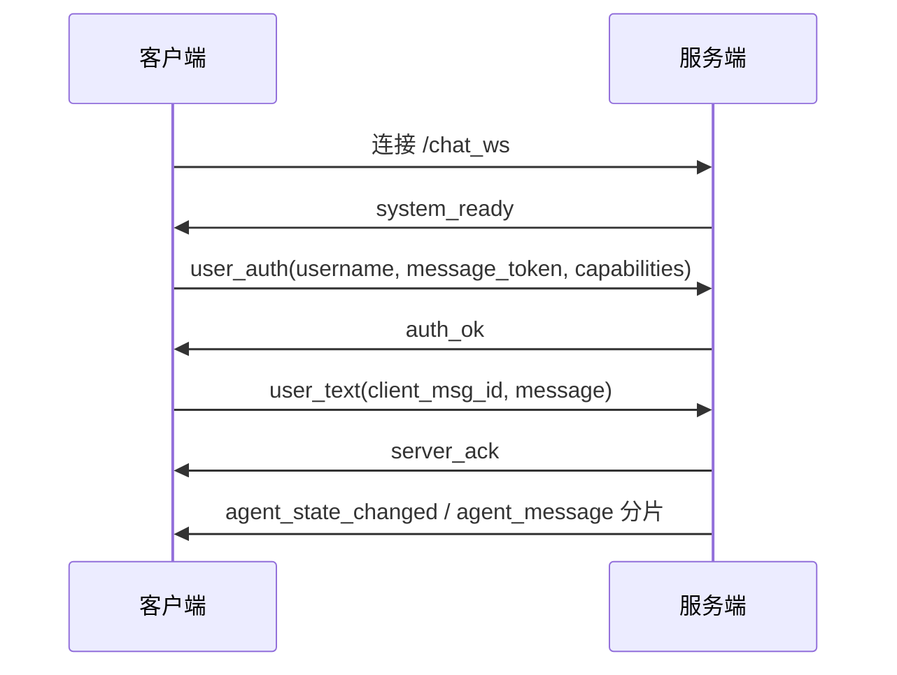

# WebSocket 互动协议

[返回总览](服务端接口文档.md) · [HTTP 接口](服务端接口-HTTP.md) · [管理接口](服务端接口-管理.md)

入口：`ws://<host>:<port>/chat_ws`（TLS 部署使用 `wss://`）。本协议是 JSON 文本消息协议，音频也包在 JSON 中，没有音频 WebSocket 二进制帧。

源码：[endpoint.py](../server/src/web/websocket/endpoint.py)、[service.py](../server/src/web/websocket/service.py)、[输入转换](../server/src/adapter/websocket/_input.py)、[回复映射](../server/src/adapter/websocket/_protocol.py)。

## 1. 消息 envelope

客户端业务事件示例：

```json
{
  "type":"user_text",
  "client_msg_id":"<客户端生成的唯一ID>",
  "ts":1793505600000,
  "payload":{"message":"你好"}
}
```

| 字段 | 契约 |
| --- | --- |
| `type` | 事件名，必填 |
| `payload` | 业务事件必须是 object；省略时解析为 `{}` |
| `client_msg_id` | 所有聊天业务输入必填：非空字符串，原始长度 ≤128；建议 UUID；认证、心跳可选，建议提供以关联回复 |
| `ts` | 可选 Unix 毫秒整数，业务输入要求非负；省略时使用服务端接收时间 |

服务端通常发送 `{"type":"...","ts":<Unix毫秒>,"payload":{...}}`，关联应答可带 `reply_to`，其值为入站 `client_msg_id`。入站 `reply_to` 当前不参与处理。运行时不可用的 `system_not_ready` 走特殊发送路径，不带 `ts`。

无法解析 JSON 返回 `error` / `BAD_JSON`；非 object 或缺 `type` 返回 `error` / `BAD_MESSAGE`。这些错误不必然关闭连接。未识别的事件名在认证后的入口被静默忽略，不保证返回拒绝事件；不要依靠发送自定义事件探测功能。

## 2. 握手与鉴权

先通过 HTTP 登录取得 **message_token**，然后：



`system_ready.payload`：

```json
{"message":"WebSocket connected. Please send auth first.","require_auth_before_chat":true}
```

客户端认证：

```json
{
  "type":"user_auth",
  "client_msg_id":"auth-1",
  "payload":{
    "username":"alice",
    "token":"<message_token>",
    "capabilities":["negative_ack_v1"]
  }
}
```

`username`、`token` 必填；不能传 `login_token`，不能用 `auth` 作为事件名。`capabilities` 可选，仅前 32 项中的 `negative_ack_v1` 会被协商。

成功：

```json
{
  "type":"auth_ok",
  "ts":1793505600000,
  "reply_to":"auth-1",
  "payload":{
    "message":"authentication successful for user alice",
    "capabilities":["negative_ack_v1"]
  }
}
```

认证阶段默认总时限 15 秒、最多 5 次接收尝试；非 `user_auth` 输入也占用尝试次数。失败发送 `auth_error`，payload 包含 `code`、`message`：

| code | 含义 |
| --- | --- |
| `MISSING_AUTH_FIELDS` | 缺用户名或令牌 |
| `INVALID_TOKEN` | 消息令牌无效、过期或不匹配 |
| `AUTH_TIMEOUT` | 超出认证总时限 |
| `AUTH_ATTEMPTS_EXCEEDED` | 超出认证尝试次数 |

耗尽尝试或超时后以关闭码 **1008** 结束。业务运行时未启动时，accept 后直接发送 `{"type":"system_not_ready","payload":<总览中的运行时错误对象>}`，再以 **1013** 关闭，不发送正常认证流程。

`auth_success`、`auth_failure`、`date_detected` 虽在枚举中定义，但当前生产链没有发现发出路径；客户端应使用实际的 `auth_ok` / `auth_error`。

## 3. 事件全集

| 方向 | type | 用途 |
| --- | --- | --- |
| C→S | `user_auth` | 连接认证 |
| C→S | `user_text` | 文本聊天，推荐名称 |
| C→S | `user_message`、`message`、`chat_message`、`chat` | 文本聊天兼容别名 |
| C→S | `user_image` | 图片消息 |
| C→S | `user_typing` | 输入状态 |
| C→S | `user_touch` | 触摸互动 |
| C→S | `user_image_selecting`、`user_image_selecting_cancel` | 打开/结束图片选择状态 |
| C→S | `user_voice` | 已占名但尚未实现，会拒绝 |
| C→S | `hb_ping` | 应用层心跳 |
| C→S | `llm_response` | 客户端执行模型后的结果 |
| S→C | `system_ready`、`system_not_ready` | 握手就绪/业务不可用 |
| S→C | `auth_ok`、`auth_error` | 认证结果 |
| S→C | `server_ack` | 业务接纳、重复确认或协商后的拒绝 |
| S→C | `error` | 协议错误或兼容模式拒绝 |
| S→C | `agent_state_changed` | 角色呈现状态 |
| S→C | `agent_message` | 文本、表情、音频分片及消息尾包 |
| S→C | `hb_pong` | 心跳应答 |
| S→C | `llm_request` | 委托客户端执行模型 |

## 4. 业务输入

本节全部事件需要认证成功及合法 `client_msg_id`。输入所属用户由认证连接决定，payload 中的 `user_id` 不能切换用户。

### 4.1 目标角色

可选 `target_character_ids:["luotianyi"]`。兼容字段依次为 `target_character_ids`、`target_characters`、`character_ids`、`target_character_id`、`character_id`，使用第一个出现的字段；字符串可作为单个目标。

目标数 1–8，每个非空字符串长度 ≤64，去首尾空白并去重。省略则取服务端默认角色（当前默认配置通常是 `luotianyi`）。这不是角色发现/订阅 API：所有目标必须已绑定到当前连接；生产 endpoint 认证后仅自动绑定默认角色，不能通过自填其他 ID 任意创建角色交互。多目标接纳前先全部检查，避免部分入队。

### 4.2 文本：`user_text` 及兼容别名

```json
{
  "type":"user_text",
  "client_msg_id":"text-1",
  "payload":{
    "message":"今天过得怎么样？",
    "target_character_ids":["luotianyi"],
    "is_proactive":false,
    "llm_mode":{"types":["chat-model"]}
  }
}
```

文本从 `message`、`text`、`content` 按顺序选择首个非空字符串，trim 后长度 1–20000。`is_proactive` 若出现必须是真实 boolean；当前转换不把它作为切换用户身份或强制角色行动的开关。

`llm_mode` 是可选的客户端模型能力声明，见第 8 节。只有精确事件名 `user_text` 和 `user_image` 会更新连接模型类型；文本别名不会更新。

### 4.3 图片：`user_image`

```json
{
  "type":"user_image",
  "client_msg_id":"image-1",
  "payload":{
    "image_base64":"<纯base64或data URI>",
    "mime_type":"image/png",
    "llm_mode":{"types":["vision-model"]}
  }
}
```

`image_base64` 必填非空字符串，`mime_type` 必填且以 `image/` 开头。允许纯 base64 或 `data:image/png;base64,...`，data URI MIME 必须与声明一致。实际验证支持 BMP、GIF、JPEG、PNG、WEBP，`image/jpg` 按 JPEG 归一；文件真实格式必须与 MIME 匹配，不是仅检查文件扩展名。

永久媒体存储默认限制：解码数据 6 MiB，编码字符串 UTF-8 字节数 8 MiB，可由 `media_store.max_bytes` / `max_encoded_bytes` 配置。还可能受 WebSocket 服务/代理消息大小限制；这里不是部署层最大帧长度承诺。

只有全部目标通过准入后才解码校验并持久化媒体；不合法图片返回业务 `BAD_MESSAGE`。一张图片形成一条用户历史记录，图片理解文本不会作为另一条用户消息。当前转换没有把 `image_client_path` 作为图片刺激字段传递；缓存下载后应使用 HTTP `/update_image_client_path` 更新历史路径。没有独立 caption 输入契约，图片和文字应分别发送。

### 4.4 输入状态：`user_typing`

payload 必填 `text_length:integer`，0–100000，bool 不算整数。例如 `{"text_length":5}`。这是输入状态提示，不是发送当前输入框文本；同样要有独立的 `client_msg_id`。

### 4.5 触摸：`user_touch`

```json
{
  "type":"user_touch",
  "client_msg_id":"touch-1",
  "payload":{
    "touch_area":["head","hand"],
    "click_frequency":{"count_10s":2,"count_30s":5}
  }
}
```

`touch_area` 必填，兼容 `touchArea`，优先前者；单个字符串可转单元素数组。区域 1–16 项，每项非空且长度 ≤64，trim 后去重。区域是字符串标识，不提供固定枚举表。

`click_frequency` 可省略，提供时必须是 object，且 `count_10s`、`count_30s` 必须都为真实非负整数，`count_10s` 不得大于 `count_30s`。服务端根据互动状态与角色决策生成结果，不保证每次触摸必有可见文字。

### 4.6 图片选择状态

`user_image_selecting` 表示开始选择；`user_image_selecting_cancel` 表示结束/取消选择。payload 可以为 `{}`，仍须独立 `client_msg_id`。两者转为临时状态刺激，不作为图片内容发送。

### 4.7 语音输入

`user_voice` 当前在转换中明确报未实现，按 `BAD_MESSAGE` 拒绝。不能依据事件枚举存在推断服务端已有语音识别能力。

## 5. ACK、拒绝与重试

成功接纳：

```json
{"type":"server_ack","ts":1793505600000,"reply_to":"text-1","payload":{"ok":true,"received_event_type":"user_text"}}
```

重复事件返回同样的正 ACK，额外 `duplicate:true`。去重键为认证用户 UUID + `client_msg_id`，缓存 TTL 600 秒、最多 4096 条，跨连接但仅在当前进程 Adapter 内有效。所有目标接纳后才记入缓存，非法/过载拒绝不占用该幂等 ID。

协商了 `negative_ack_v1` 的拒绝：

```json
{
  "type":"server_ack",
  "ts":1793505600000,
  "reply_to":"text-1",
  "payload":{
    "ok":false,
    "received_event_type":"user_text",
    "code":"OVERLOADED",
    "message":"chat ingress queue is full",
    "retryable":true
  }
}
```

未协商时外层 `type="error"`，payload 不含 `ok`，其余业务拒绝字段相同。

| code | message | retryable |
| --- | --- | --- |
| `BAD_MESSAGE` | `chat event payload is invalid` | false |
| `UNSUPPORTED_EVENT` | `chat event type is not supported` | false |
| `OVERLOADED` | `chat ingress queue is full` | true |

完全未知的事件会在入口被忽略，通常到不了 `UNSUPPORTED_EVENT` 分支。缺少 `client_msg_id` 的业务消息会被拒绝，错误可能没有 `reply_to`，客户端不应期待可关联的确认。

ACK 只证明输入已被内存 Stage 接纳，不代表模型执行完成、回复已发送、历史已持久化或音频已播放。缓存过期、容量淘汰、服务重启后都没有持久幂等保证；断线未获 ACK 属于投递不确定状态，短期重试同一 ID 可以利用当前缓存去重，但不构成端到端 exactly-once 保证。新用户动作使用新 ID；重发原动作保留原 ID 及内容。

## 6. 角色状态、回复与音频

### 6.1 `agent_state_changed`

payload 为 `{"state":"thinking"}` 或 `{"state":"waiting"}`，用于呈现状态，不是具体消息的完成通知，不带输入关联 ID。

### 6.2 `agent_message`

```json
{
  "type":"agent_message",
  "ts":1793505600000,
  "payload":{
    "uuid":"<服务端消息UUID>",
    "text":"你好呀！",
    "audio":"",
    "expression":"",
    "is_final_package":false,
    "audio_error":null,
    "error_code":null,
    "display_in_chat":true,
    "is_ephemeral":false,
    "packet_sequence":0
  }
}
```

| 字段 | 语义 |
| --- | --- |
| `uuid` | 同一回复消息的稳定标识，所有分片相同；优先业务 message_id，否则按内部执行身份生成稳定 UUID |
| `packet_sequence` | 同一消息从 0 递增；不是跨重连的恢复游标 |
| `text` | 文本内容；内容输出与音频输出可以分包；临时输出可为空 |
| `audio` | 原始音频 bytes 的 base64；无音频时为空字符串或可空值 |
| `expression` | 表情标识，由客户端映射到表现资源；无表情时可为空 |
| `is_final_package` | true 表示该消息尾包 |
| `audio_error` | 非尾包可为 null；正常尾包 false；音频失败/取消尾包 true |
| `error_code` | 正常为 null；终止错误见下表 |
| `display_in_chat` | 是否作为聊天记录展示 |
| `is_ephemeral` | 是否为临时互动反应 |

音频按最多 **48 KiB 原始 bytes** 切为多个 base64 包。每包分别解码，按 `packet_sequence` 拼接/送入同一音频流；不能直接拼接带 padding 的 base64 字符串后统一解码，不能把每包假设成完整 WAV 文件。

当前 TTS 实现产出 WAV 流，后续块可能去除重复 WAV 头；唱歌片段也导出 WAV。网络 envelope 本身没有 `sample_rate`、`channels`、codec 等字段，客户端应按实际音频头/现有音频实现解析，不能硬编码成所有来源固定采样率的 PCM。

尾包示例：

```json
{"type":"agent_message","payload":{"uuid":"<同一UUID>","text":"","audio":"","expression":"","is_final_package":true,"audio_error":false,"error_code":null,"display_in_chat":true,"is_ephemeral":false,"packet_sequence":3},"ts":1793505600100}
```

| error_code | 原因 |
| --- | --- |
| `TTS_CANCELLED` | 已开始的消息被取消 |
| `TTS_EMPTY` | 失败且无音频内容 |
| `TTS_STREAM_ERROR` | 其他生成/流失败 |

取消前尚未发送任何内容的消息可能直接清理，没有尾包；已经开始的消息取消时丢弃尚未发送内容并发取消尾包。每个连接按完整消息顺序串行投递；不同连接独立。发送失败没有协议级自动重传。

`uuid` 不是 `reply_to`：服务端没有承诺一条输入严格对应一个回复，也没有独立的“整轮 chat done”事件。一轮可能产生多条消息；`is_final_package` 仅结束它所属的那条消息。

## 7. 心跳与重连

客户端心跳：

```json
{"type":"hb_ping","client_msg_id":"ping-1","payload":{"ping_id":1}}
```

服务端应答：

```json
{"type":"hb_pong","reply_to":"ping-1","ts":1793505600000,"payload":{"ping_id":1,"server_ts":1793505600000}}
```

`ping_id` 缺失时 `error` / `MISSING_PING_ID`；服务端仅在值大于上次值时应答，重复/回退静默丢弃。客户端应使用递增整数，避免混用不可比较类型。应用层没有服务端主动心跳或漏心跳自动断线策略；Uvicorn/代理的底层 WebSocket ping 设置另行生效。

断线后 Stage 按用户 UUID + 角色 ID 默认离线保留 60 秒，期间重连并认证可复用交互和待处理输入；超时回收后创建新交互。它不等于回复历史重放：没有 resume token、音频断点续传或 replay cursor。客户端重新连接后重做认证和模型能力声明，并通过 HTTP 历史弥补持久数据。旧连接迟到的 disconnect 不会拆掉新连接绑定。

来源：[stage_manager.py](../server/src/stage/stage_manager.py)、[_delivery.py](../server/src/adapter/websocket/_delivery.py)。

## 8. 客户端执行模型

通过 `GET /llm/client-model-types` 读取需求，再在 `user_text` 或 `user_image` 的 payload 传 `llm_mode:{"types":["chat-model","vision-model"]}`；`types` 也兼容单个非空字符串。数组会替换当前连接声明，空数组可清空；省略 `llm_mode` 不会主动清空已有能力。

声明的是需求类型 ID，不是模型供应商名或 API key。重连后需重新声明。没有配置匹配类型、连接离线或未声明时，委托器返回不可委托结果，模型服务使用服务端执行路径。

### 8.1 S→C `llm_request`

```json
{
  "type":"llm_request",
  "ts":1793505600000,
  "payload":{
    "request_id":"llm-0123456789abcdef",
    "module":"main_chat",
    "type":"chat-model",
    "model_kind":"llm",
    "prompt":"<待执行提示词>",
    "params":{"temperature":0.7},
    "enable_thinking":false,
    "use_json":false
  }
}
```

`request_id` 为关联 ID；`module` 为调用模块；payload 的 `type` 是需求 ID，与外层事件名不同；`model_kind` 为 `llm` / `vlm`；`params` 为参数对象；`enable_thinking`、`use_json` 为能力要求。传入图像时还带 `image_base64`，否则省略。

### 8.2 C→S `llm_response`

```json
{
  "type":"llm_response",
  "payload":{
    "request_id":"llm-0123456789abcdef",
    "content":"<模型结果文本>",
    "usage":null
  }
}
```

失败可返回 `{"request_id":"...","error":"<错误说明>"}`。成功必须含 `content`，`usage` 可带用量数据或为空；不要求聊天 `client_msg_id`，不发聊天 ACK，只按 `request_id` 完成 pending 请求。

默认等待 120 秒（运行时可配置）；超时、发送失败、truthy `error` 或缺 `content` 都会进入委托错误路径。未知/重复请求 ID 被忽略。委托器自身不提供自动回退保证，具体模型调用方可按其策略处理错误；客户端不要把“发了响应”当作角色回复已完成。

来源：[client_model_executor.py](../server/src/adapter/websocket/client_model_executor.py)、[client_execution.py](../server/src/infrastructure/models/client_execution.py)。
