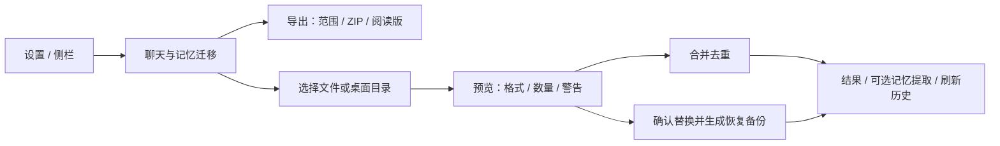

# 聊天与记忆导入导出

> 状态：2026-11-19 用户已确认产品范围；归档、双端与存储边界经非作者检查。全局检查发现的上下文范围和回执缺口已修订，并增加独立故障回归。验证边界与证据见本文末节。

## 用户故事

1. 作为已登录用户，我希望在桌面端和 Android 的“聊天与记忆迁移”中导出本人数据，以便迁服或恢复。可选择聊天、记忆、全部，下载 ZIP 或导出目录包，并可导出 Markdown、TXT 阅读版。
2. 作为已登录用户，我希望选择本项目备份后查看记录数、格式和警告，再合并去重或备份后替换。账号身份改绑到当前用户，不带密码、令牌或模型密钥。
3. 作为已登录用户，我希望导入 ChatGPT 官方 conversations.json、SillyTavern JSONL 或 role/content JSON，并可明确选择调用服务端模型提取长期记忆。

两端操作结构相同：



## 验收标准

1. **本人隔离**：有两个账号时，导出仅包含 Bearer 所属用户的对话、记忆和画像；不能用另一用户的预览或备份标识导入或下载。没有认证返回 401。
2. **可恢复包**：选择全部导出，ZIP 内有版本化 manifest、JSON 数据、媒体及校验。桌面目录包与 ZIP 的内部结构相同；Android 通过 ZIP 传递目录结构。导入另一测试账号后保留角色、原始时间、内容、通话概要、画像与偏好，媒体重新绑定所有者并可由现有接口读取。
3. **范围**：chat 包含聊天与关联媒体，memory 包含长期记忆、画像及聊天偏好，all 包含两者。目录包和 ZIP 可恢复；Markdown/TXT 为阅读副本，不作为原生还原格式。
4. **既有边界**：通话只恢复已保存的结果、时长与概要，不承诺逐字原文；角色 TTS/演唱的客户端缓存不计入备份。旧图片只从本人本机记录查询，并限定原固定 `data/images/<owner>` 普通文件，拒绝逃逸、链接/junction、非图片和超限内容；校验通过后补为受控媒体再归档。服务器路径不进入恢复包，不从上传包读取本机文件。缺失或不在受控目录的原媒体要在包与预览中报告，不伪造可回放状态。
5. **旧向量记忆**：导出前为当前用户可确认归属的无正本向量建立稳定的规范记忆，保留原文本、角色、来源与可用元数据；不可确认归属或内容异常明确失败。不会修改其他用户或角色公共记忆。
6. **合并**：同一文件重复导入两次，第二次记录与媒体不重复。ID 冲突但内容不同明确拒绝；跨账号恢复使用稳定的目标用户身份。导入记录以可携带的排序元数据保存来源的有效顺序，不修改原始时间和实体 UUID 合同；同时间的历史、窗口、通话种子及维护边界使用相同规则，多跳迁移保持顺序。合并保留现有非空画像和偏好，恢复空值。contexts 属于 chat：已有目标上下文时保留其总结、窗口计数与维护进度，新合并的原生记录只作历史；新账号无对应上下文时可恢复经 ID 映射验证的源上下文。memory 范围不改聊天上下文；chat/all 替换才恢复源上下文，清除旧冻结批次且不回放旧候选。
7. **替换**：提交必须显式选择 replace 并 confirm_replace=true；服务器先完整持久化并校验当前范围的恢复 ZIP、使其可由本人下载，再替换相同范围，响应在执行完成后返回。备份生成后的成功/失败均携带 backup_id、committed 与 failed_phase；同一 preview 重试可取回原结果和备份，导入 SQL 提交前失败保留目标原有聊天和记忆内容；导出/备份已执行的旧向量正本补建不撤销。原媒体/向量在 SQL 提交前不得不可逆删除；跨存储错误需回滚已发布投影或明确报告回滚失败。凭据、动态、好感度和模型密钥不变；恢复备份可再次导入。
8. **外部格式**：ChatGPT 采用 current_node 的祖先链；SillyTavern 跳过文件头、按 is_user 区分发言；通用 JSON 接受数组或 messages 数组。只导入文字，保留来源，无法支持的媒体/系统消息在预览报告。无时间的记录采用稳定基准，重复文件不因导入时间改变身份。
9. **可选提取**：外部记录默认仅进入历史，不加入活跃聊天/通话上下文或自动认知维护，避免重连或关闭聊天时绕过提取选择。未勾选时不发起提取模型调用；明确选择时从稳定导入批次的外部记录提取。相同文件再次合并可重试失败/不可用批次，成功候选使用稳定身份不重复写入；按批次报告成功、失败或不可用。失败保留聊天，不假称记忆已生成。
10. **交互与并发**：导入和旧数据补正本期间，对当前账号加准入栅栏；安全终止聊天并完成维护后再变更持久状态；存在通话、创建中或收尾中则返回 409。释放栅栏后客户端可重新连接并刷新历史。
11. **文件失败**：压缩包路径穿越、重复路径、符号链接、未知版本、损坏校验和、超限条目或体积在写库前拒绝；不按文件内路径访问服务器文件。设置上传和解压的明确体积/数量上限。
12. **客户端**：桌面入口使用后台任务，不阻塞 Qt 线程；Android 使用系统文件选择、保存/分享，复用主题和页面提示。操作中禁止重复提交；失败可以重试；替换前显示确认，备份可下载，导入后提供刷新/重连。

## 模块与架构

### 模块划分

- `web/http`：认证、限量二进制上传、文件响应与 HTTP 错误映射。
- `application/user/data_transfer`：预览归属、导入编排、栅栏、备份和模型提取结果。
- `infrastructure/data_transfer`：版本化归档、外部格式解析、校验和及阅读渲染；不依赖 Agent 或 Web。
- `infrastructure/persistence`：SQL 快照和事务恢复、稳定 ID 重绑定；向量和媒体投影通过明确接口准备与写入。
- `stage`：账号级迁移准入与聊天收尾；不解析数据包。
- `server_runtime`：只做依赖装配；将可选记忆提取注入用例。
- `client`、`app/features/data-transfer`：原生文件交互、预览和结果，统一调用 API。

### 接口规范

所有接口使用 `Authorization: Bearer <message_token>`，不接受客户端指定目标用户 ID。

- `GET /user/data/export?scope=all&format=zip`：scope 为 chat/memory/all，format 为 zip/markdown/txt，返回文件。包内容 `manifest.json`、`data.json`、`media/<opaque-id>/content.bin`；manifest 包含各文件 SHA-256、版本及 warnings。
- `POST /user/data/import/preview?source_format=auto&scope=all&character_id=luotianyi`：原始二进制请求体，支持 auto/native/chatgpt/sillytavern/generic；返回 `preview_id, source_format, scope, counts: {conversations, memories, media}, warnings`。外部记录归入指定的已启用角色。
- `POST /user/data/import/commit`：JSON `{preview_id, mode: merge|replace, confirm_replace: boolean, extract_memories: boolean}`；返回 `{success, committed, failed_phase, imported, skipped, backup_id, extraction, warnings}`。SQL 前提交失败也可能 HTTP 200，须检查 success/committed；备份后结果文件不可用返回含 backup_id 的错误。预览仅限同用户，上传预览有效期 1 小时；执行中禁止重复提交。SQL 权威回执与导入在同事务保存，同 preview 重试不再次替换；完成的回执可在预览文件过期后查询原提交结果。
- `GET /user/data/backups/{backup_id}`：下载本人替换前恢复 ZIP。

原生逻辑 payload：`{format: "agentluo-data", version: 1, scope, source_user_id, exported_at, conversations: [], memories: [], contexts: [], profile: {description, preferences}, media: [], warnings: []}`。conversations 保留业务元数据；memories 为 SQL 正本与文本 chunks，不导出供应商 embedding 数值；导入按当前部署准备向量投影：相同正本的合并仍补齐包内缺失的分块和向量关联，已有完整投影不增量。所有归属与内部引用由服务器重绑定，拒绝来源用户之外的私有记录。

## 备注

### 关键技术选型

1. 使用逻辑数据包，不复制整服 SQLite/Chroma，避免捎带其他账号与凭据。
2. 上传为受限二进制，避免手机整包 Base64 的额外内存开销。
3. 导入先完整验证与准备投影，再进入写入；替换先保存可下载备份。数据库事务保证规范正本不出现部分提交，并用带类型的 MemoryEventBatch 行保存权威迁移回执；文件缓存不能覆盖 SQL 状态。投影异常执行补偿，跨进程崩溃不承诺 SQL、Chroma 与文件系统的分布式原子提交；可通过回执和替换前备份检查与恢复。
4. 验证主要采用隔离 SQLite、媒体目录、可控制向量及模型端口的集成闭环，辅以实际 Chroma/现有 HTTP 媒体读链和两端行为测试。真实 Android 文件管理器、真实模型供应商调用若无设备/凭据则明确标注未验证。

### 非目标

整服灾备、管理员跨账号迁移、外部多媒体下载、通话录音/逐字稿、账号密码/令牌迁移、动态与好感度迁移、客户端 TTS 缓存归档、公开发布或部署。

### 风险与回滚

ZIP 媒体可能较大，上传和展开上限在接口中明示。旧向量补正本必须稳定且按用户隔离。导入前数据校验和替换备份用于恢复；关闭两端入口并回退该功能提交可撤销产品行为，导入结果通过生成的备份恢复。测试不触碰现用数据。

### 验证计划与责任

- 归档/格式作者：三种外部样例、当前分支、Unicode、错误 ZIP、校验和和阅读版。
- 服务端作者：双用户 round-trip、重复合并、替换备份、旧向量补正本、媒体归属、HTTP 权限与忙碌/失败。
- 桌面作者：预览到提交、取消/重复点击、目录/ZIP 保存及 API 认证。
- Android 作者：文件选择/分享、预览/确认/结果、主题/无障碍与静态检查。
- 主实现者：审阅最终差异并运行改动涉及的既有回归、Ruff/Black、桌面与 App 检查，分别报告已验证与未验证的边界。

## 使用方式

1. 桌面聊天窗口点击“设置 → 聊天与记忆迁移”；Android 打开侧栏中的同名入口。
2. 导出时选择全部、仅聊天或仅记忆。桌面支持 ZIP、目录包、Markdown、TXT；Android 下载 ZIP 或阅读副本后使用系统分享保存。ZIP 展开后即为目录包，桌面也能直接导入该目录。
3. 导入时先选择文件/目录并预览，核对格式、实际范围、数量与警告。外部格式仅含文字，实际范围固定为 chat；导入到当前账号和选定角色。
4. 默认使用“合并去重”。“备份后替换”会显示实际范围的确认，备份完成并校验后才写入；完成或可恢复失败后可下载替换前备份。
5. 外部记录默认只作历史。需要生成长期记忆时明确开启提取，提取只接纳关于用户的事实；失败时可重试本批提取，既有聊天不会再次替换。
6. 操作期间暂停本账号聊天，结束后刷新/重连。当前账号正在通话或生命周期收尾时会拒绝执行，等待结束后重试。

上传/下载文件上限 64 MiB，ZIP 展开上限 256 MiB、4096 项；单件图片/语音仍受现有媒体配置上限约束。服务器在配置的 sql_db_folder 下 transfers 目录保存本人预览和替换前备份；预览有效期 1 小时，备份供本人持久下载。归档含私人聊天和记忆，用户自行选择保存位置。Android 新增原生文件选择/分享模块，需重新构建并安装客户端后使用。

## 验证记录（2026-11-19）

- 环境：Windows；conda agent Python 3.10.21、Ruff 0.14.10、Black 26.5.1。旧 pytest 临时目录有权限错误，使用本任务独立 basetemp 与 `-p no:cacheprovider`，不修改系统权限。
- 修改前基线：21 passed、2 skipped。最终服务端组合：278 passed、2 skipped、4 warnings，69.81 秒；涵盖格式、本人 HTTP 入口、图片读链、跨账号及返回原账号身份、替换/备份/SQL 回执故障、真实 Chroma 与媒体、Stage 准入、既有认知维护和服务装配。两个跳过项为既有真实 LLM 可选用例。
- 独立回执故障专项：4 passed；结果文件写失败仍以 SQL 为权威，响应丢失重试不重复替换，备份后结果文件失败仍可取得恢复包，最终提取状态不被旧文件缓存覆盖。
- Android：新增三套 18 项；与相关聊天/提示/语音回归组合共 10 套、69 项通过；类型检查与 lint 通过。先以本机 Node 24 验证，随后使用临时 Node 22.23.5 复跑同一组合、tsc 和 lint 全通过。临时运行时按 [Node 官方 SHA256 清单](https://nodejs.org/dist/v22.23.5/SHASUMS256.txt) 校验，不改变系统安装或全局 PATH。
- 桌面：最终 92 passed、4 个既有 websockets 弃用 warning，40.04 秒；覆盖预览、文件保存、防重复/取消、账号切换、模型重试及既有窗口/TLS。真实本地 WebSocket 用例模拟 Stage 已解绑但物理连接仍打开，验证非阻塞重连、同一运行线程二次鉴权、ready 状态门控，以及重新发送 user_text 取得 ACK；设置菜单与刷新入口另有集成测试。
- 未验证：Android 实体机文件管理器/分享接收应用、TalkBack、实际横竖屏和大字体布局、真实模型供应商、部署后的远端 CI；未读取或修改现用聊天数据库。Qt offscreen 可验证控件布局和行为，不等于真实桌面人工验收。跨进程崩溃的跨存储原子性不作承诺。

## 2026-11-20 审查修复与兼容边界

N1 的消息时间线现在保存可迁移的有效排序依据，SQL 历史/窗口/维护比较、Redis、内存上下文和通话种子共用同序。`ConversationEntry` 只增加有默认值的可选排序字段，保留原四位置参数调用及消息 UUID、时间；旧归档缺字段时按源记录冻结既有顺序。不以修改时间或复合文本 ID 绕过身份契约。

N2 在主动新预览合并时只补包内已有记忆缺失的分块关联，投影身份按分块文本、类型及同文序号生成；已经完整关联的记忆不增加重复索引，不要求组件启动时自动回填包外数据。N4 的非 200 回执仍判为失败，但保留受控字段，使桌面可以下载服务器已生成的恢复备份。

N3 的旧图片兼容限于原生产者使用的 `data/images/<owner>` 目录。上一轮“任意已存服务器路径都应归档”的表述过宽，不能成为任意文件读取授权；越界或不安全路径继续告警。导出成功补为受控媒体后同步本人本机正本，失败只清理此次新媒体。所有导出快照（包括缺图告警及再次导出）均移除服务器和客户端本机路径，本机 SQL 原路径仍保留用于兼容。导出/备份已完成的旧图片正本补建与旧记忆补建一样不会因之后的导入失败撤销。

本轮整合回归 250 passed；路径剥离最后修正后，旧图 HTTP 与安全边界组合 46 passed。独立复查已验证维护冻结失败后重试、压缩尾窗、源账号往返、真实 Chroma 召回、500 备份按钮及文件下载，新增发现的循环导入和告警包路径外带均已修复并复验。上述分组有重叠，不相加为唯一总数；完整提交级门禁和远端结果在 PR 记录，不把历史测试数字当作当前全量结果。设备、真实模型供应商及跨进程分布式原子性的限制保持不变。

服务端复跑（在 server 目录，使用 conda agent 解释器）：

```text
python -m pytest tests/unit/infrastructure/test_data_transfer_formats.py tests/integration/application/test_user_data_transfer.py tests/integration/application/test_transfer_receipt_failures.py tests/integration/persistence/test_transfer_storage.py tests/unit/stage/test_data_transfer_admission.py tests/integration/application/test_user_data_reset.py tests/integration/architecture tests/integration/persistence/test_agent_memory.py tests/integration/persistence/test_cognitive_maintenance_progress.py tests/integration/persistence/test_maintenance_memory_projection.py tests/integration/agent/test_cognitive_maintenance_review_regressions.py tests/integration/stage/test_handoff_maintenance_safety.py tests/unit/agent/test_conversation_store.py tests/unit/test_server_runtime_module_ownership.py tests/integration/system/test_user_media_dependencies.py tests/integration/system/test_server_startup_ports.py tests/integration/system/test_component_startup_admin.py -q -p no:cacheprovider --basetemp=<新的独立临时目录>
```
